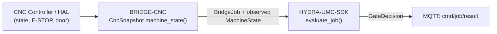

<!-- =============================================================================
HYDRA-UMC-BRIDGE-CNC - CNC cell coordination bridge
Copyright (C) JuanenRac (Electro Hobby 3D) <electrohobby3d@gmail.com>
GPL-3.0-or-later - see LICENSE
============================================================================= -->

<p align="center">
  
</p>

# 🔧 HYDRA-UMC-BRIDGE-CNC

<p align="center">🇺🇸 <b>English</b> | <a href="README_spa.md">🇪🇸 Español</a> | <a href="README_fra.md">🇫🇷 Français</a> | <a href="README_ita.md">🇮🇹 Italiano</a> | <a href="README_deu.md">🇩🇪 Deutsch</a> | <a href="README_zho.md">🇨🇳 简体中文</a> | <a href="README_jpn.md">🇯🇵 日本語</a> | <a href="README_por.md">🇵🇹 Português</a></p>

### 🛑 Fail-Safe Coordination Bridge for CNC Cells

<p align="center">
  
  
  
  
  
  
</p>

---

> **Honesty check - what actually runs today:** the fail-safe cell snapshot and safety gate (`cell.py`'s `CncSnapshot`/`CncCellBridge`, funneling every job through `HYDRA-UMC-SDK`'s own `evaluate_job()`), the read-only GRBL/MTConnect evidence normalizer (`observation.py`), the real GRBL serial transport (`serial_transport.py`'s `GrblSerialProbe`/`GrblRealtimeControl`), and the MQTT command/status transport (`mqtt_transport.py`) are real and covered by 208 passing `unittest` cases (`python tools/build_test.py`), including `tests/test_grbl_emulator.py` running this bridge against a protocol-faithful, hand-written GRBL v1.1 emulator. None of it has touched a real serial port, a real MQTT broker, or an actual CNC controller - `test_serial_transport.py`'s own `FakeSerial` stands in for a physical connection, and `test_mqtt_transport.py` uses a fake broker client the same way. The LinuxCNC and CNCjs links and the MTConnect view have only met simulations, there is no LinuxCNC HAL adapter and there is no live `run` command yet, because no real controller has been driven - see "Roadmap & Known limits" below, which already says this plainly, and `CHANGELOG.md` for exactly what has shipped so far.

> **Safety and security status:** this ecosystem is not a certified safety system. There is no hardware E-STOP path, no firmware-enforced limits or interlocks and no verified motion command yet; firmware images are checked with CRC-32 and an Ed25519 signature, and a release build refuses the published development keys (the tool heads and expansion boards behind the relay still run URTC bootloaders, which take a shared-key HMAC-SHA256 instead of a signature); TLS and mutual TLS are optional and off by default; no custom board has been populated or tested yet. Read the [security baseline](https://github.com/JuanenRac/HYDRA-UMC-DOCS/blob/main/docs/SECURITY_BASELINE.md) and the [threat model](https://github.com/JuanenRac/HYDRA-UMC-DOCS/blob/main/docs/THREAT_MODEL.md) before relying on any statement here for the safety of a person.

---

## 📋 At a glance

| | |
|---|---|
| Version | `0.2.0` |
| Maturity | Functional |
| Tests | 208 (`python tools/build_test.py`) |
| Stack | Python / LinuxCNC / G-code / GRBL status evidence / GRBL serial transport |
| Target | The Raspberry Pi CM5 of a HYDRA-UMC cell |
| On real hardware | Simulated only: tested against emulators, fakes or simulators; no run on real hardware is recorded for this version |

**Jump to:** [Overview](#-overview) · [Architecture](#-architecture) · [Features](#-features) · [Security & Safety](#-security--safety) · [Interfaces](#-interfaces) · [Configuration](#-configuration) · [Quick start](#-quick-start) · [Testing](#-testing) · [Troubleshooting](#-troubleshooting) · [Repository Structure](#-repository-structure) · [Related Projects](#-related-projects)

## 🚦 Project status

Each line is one part of this repository and the light says how far it is today. It is written from what the repository can show (tests, builds, runs), not from what is planned.

🟢 Done and verified · 🟡 Works, with known limits · 🟠 Partly done or not verified yet · 🔴 Not done or not working

| Area | State | What it means here |
|---|---|---|
| Software | 🟡 | Works for its main purpose; the honesty check above lists what is still missing |
| Tests | 🟢 | 208 automated tests, run on every change |
| Real hardware | 🟠 | Simulated only: tested against emulators, fakes or simulators; no run on real hardware is recorded for this version |
| Documentation | 🟢 | README in eight languages, checked against the manifest on every change |

## 🎯 Overview

**HYDRA-UMC-BRIDGE-CNC** is the high-level bridge between CNC cells and HYDRA-UMC robot auxiliaries: loading, unloading, part handling and supervised auxiliary tasks. It never becomes a real-time trajectory controller — the CNC controller (GRBL, LinuxCNC or the one behind CNCjs) keeps trajectory, spindle and machine-limit authority at all times.

It belongs to the **External Automation Bridges** family: a set of sibling repositories (CNC, LASER, OPENPNP, PRINTER3D, ROS2) that all speak the same shared safety contract from `HYDRA-UMC-SDK`, so no bridge can invent its own definition of "safe to work".

## 🧩 Role in HYDRA-UMC

**HYDRA-UMC-BRIDGE-CNC** sits between a CNC controller (GRBL, LinuxCNC, or the one behind CNCjs) and the robot cell that loads and unloads it. The controller always keeps trajectory, spindle and limit authority; the bridge only reports what the controller says and asks the shared gate before any auxiliary work.

Every bridge speaks the shared safety contract of `HYDRA-UMC-SDK`: a job is accepted only after the shared `evaluate_job()` gate says so, and the gate fails closed. The parent project is `HYDRA-UMC-SERVER`; this bridge does not call it, it answers over MQTT through `HYDRA-UMC-MQTT-BROKER` to whoever commands the cell.

| It talks to | How | What for |
|---|---|---|
| `HYDRA-UMC-SDK` | Python import | the job gate `evaluate_job()`, the wire shape of jobs and decisions, the serial link and the MQTT client |
| `HYDRA-UMC-MQTT-BROKER` | MQTT, `hydra/bridges/cnc/` | commands in (`cmd/`), state and results out |
| GRBL | serial port | status query `?` and the real-time bytes (feed hold, cycle resume, soft reset); never a G-code program |
| LinuxCNC | `linuxcnc` Python module | reads `linuxcnc.stat`; sends only pause, abort and resume |
| CNCjs | socket.io | listens to `controller:state`; sends only `feedhold`, `reset`, `cyclestart` |

## 🏛️ Architecture

<p align="center">
  
</p>

<details>
<summary>Text version of the diagram (Mermaid)</summary>



</details>

**Why it is built this way**

* **Why E-STOP and door state are checked before the controller's own reported state.** `CncSnapshot.machine_state()` short-circuits to `SAFE_STOP` on `estop` or a not-closed door first — a controller that still reports `IDLE` while its door is open must never be trusted at face value.
* **Why the controller-state mapping is deliberately conservative.** Only the literal string `IDLE` maps to `MachineState.IDLE`. Every unrecognized value falls back to `OFFLINE`, never to something that would permit auxiliary work — an unknown controller state is treated as "don't know", not "probably fine".
* **Why the bridge builds a new `BridgeJob` and delegates to the shared `evaluate_job()` instead of writing its own accept/reject logic.** All five External Automation Bridges (CNC, LASER, OPENPNP, PRINTER3D, ROS2) reuse the exact same `bridge_contract` from `HYDRA-UMC-SDK`, so "what counts as safe to start a job" cannot silently diverge between them.
* **Why the LinuxCNC and CNCjs links only read, pause and resume.** The controller keeps trajectory, spindle and limit authority, and the program belongs to whoever runs it (CNCjs, LinuxCNC itself): the bridge may bring the machine to rest and let a paused one go on, nothing more. Wiring real HAL pins stays a hardware integration step that has to be validated against an actual controller.
* **How this fits the rest of the ecosystem.** BRIDGE-CNC sits between the CNC controller and `HYDRA-UMC-SDK` → `HYDRA-UMC-MQTT-BROKER` → MCU/cell safety — it coordinates auxiliary robot work around the CNC, it does not replace or override the controller's own safety authority.

The observation helpers are evidence normalizers, not controller adapters: they do not open HAL, serial or network links. [Controller Evidence Boundary](docs/CONTROLLER_EVIDENCE_BOUNDARY.md) defines the validation required before a real controller integration.

## ✨ Features

* ✅ **Real fail-safe cell snapshot:** `cell.py`'s `CncSnapshot.machine_state()` checks E-STOP and door state *before* looking at anything the controller reports — an asserted E-STOP or an open door always resolves to `SAFE_STOP`, regardless of what `controller_state` says. *(implemented, tested in `tests/test_cell.py`)*
* ✅ **Real shared safety gate:** every observed job is re-evaluated through `evaluate_job()` from `HYDRA-UMC-SDK`'s `bridge_contract`, the same gate every sibling bridge uses. *(implemented)*
* ✅ **Conservative state mapping:** only `IDLE` is treated as idle; `RUN`/`RUNNING`/`JOG`/`HOME` map to `RUNNING`, `FAULT`/`ERROR`/`OFF`/`ALARM` map to `FAULT`, and anything unrecognized falls back to `OFFLINE` — never to a state that would allow productive work. (`HOLD` → `HOLDING`; `DOOR` → `SAFE_STOP`) *(implemented)*
* ✅ **Read-only controller evidence:** `observation.py` strictly normalizes local mapping evidence and supplied GRBL status lines; omitted or non-Boolean E-STOP/door signals fail closed. *(implemented, tested in `tests/test_observation.py`)*
* ✅ **Real GRBL serial transport:** `serial_transport.py`'s `GrblSerialProbe` opens a real serial connection and queries GRBL's real-time status byte (`?`); `GrblRealtimeControl` sends only GRBL's own real-time control bytes (feed hold, cycle resume, soft reset) — `cycle_start_resume()` is gated on a genuinely `HOLDING` machine, the others are always allowed like `ABORT`. It never streams a G-code program. *(implemented, tested in `tests/test_serial_transport.py`)*
* ✅ **Non-mutating build/test:** `build-test.bat`/`.sh` compile the source and run the deterministic safety-gate test suite without touching version files or CHANGELOG. *(implemented, see Build & Release below)*
* ✅ **Controller links:** the bridge talks to a controller through `ControllerLink` (`controller.py`): GRBL on a serial port the bridge holds (`GrblController`), a LinuxCNC installation (`linuxcnc_link.py`: reads `linuxcnc.stat`, sends only pause, abort and resume of a paused program through `linuxcnc.command`, never runs a program) and a CNCjs server that owns the port (`cncjs_link.py`: reads the `controller:state` it broadcasts and sends only `feedhold`, `reset` and `cyclestart`, so the bridge works beside the sender that runs the programs). A resume always needs a READY cell and a machine that is really holding; an old or missing reading is never an idle machine. Both links are tested against simulations (`SimulatedLinuxcnc`, `SimulatedCncjs`); neither has touched a real LinuxCNC or CNCjs. *(implemented, simulated only)*
* ✅ **Spindle gate:** a load or an unload is refused when the controller is idle but still reports a turning spindle or a moving feed (`FS:`). `HYDRA_UMC_CNC_SPINDLE_GATE` is `off`, `when_known` (default: refuses what is reported) or `required` (also refuses what the controller does not report). The snapshot also carries the positions, the work offset and the overrides of the report. *(implemented)*
* ✅ **MTConnect view:** `mtconnect_publish.py` turns the snapshot into MTConnect observations (`avail`, `execution`, `estop`, `door`, `spindle_speed`, `path_feedrate`, `system`), served as SHDR over TCP by `ShdrAdapter` (read only; the only line it honours is `* PING`) and, with `HYDRA_UMC_CNC_MTCONNECT=1`, published retained on `hydra/bridges/cnc/mtconnect`. A controller that does not report is `UNAVAILABLE`, never `READY`. Tested against a simulated agent. *(implemented, not yet tried against a real agent)*
* 🔜 **LinuxCNC HAL pins** — deferred; no real CNC controller, HAL pin or robot has been driven yet. *(planned)*
* ✅ **Repeated idempotency keys:** `CncMqttBridge` accepts an `IdempotencyStore`: a repeated job key gets the answer given the first time instead of being evaluated again. *(implemented, tested in `tests/test_idempotency.py`)*
* ✅ **Status replies that line up, fail-closed serial, hardened MQTT loop:** the status query throws away what is already waiting, sends `?` and reads until a real status report (`<...>`) arrives - the banner, `ok`, `[MSG:...]` and `ALARM:n` lines GRBL sends unasked no longer leave every later query one reply behind; a missing USB device (or any failure on the link) fails closed instead of ending the bridge, and the port is opened without asserting DTR; `cmd/feed_hold` reports what the controller said afterwards (`controller_state_after`, `confirmed`), and `cmd/feed_hold` and `cmd/soft_reset` run on a lane of their own, so a status query never delays them; an oversized (over 16 KiB), unreadable or deeply nested payload and any unexpected failure are answered with a refusal on the result topic and never end the loop; `cmd/job` answers say `"mode": "gate-only"` and an ABORT through it says that nothing was stopped; the state carries `observed_at` and the bridge announces itself on an `availability` topic with a Last Will. GRBL has ONE serial port: while this bridge holds it, no G-code sender can use it (see `docs/BRIDGE_GUIDE.md`). *(implemented, tested in `tests/test_hardening.py`)*

## 🔒 Security & Safety

| Threat | Defence | Where |
|---|---|---|
| A job for a cell that is not in a safe state | Every job goes through the shared `evaluate_job()` gate, which fails closed; the bridge has no accept/reject logic of its own. E-STOP and the door are read before anything the controller reports, and an open door or an E-STOP is always `SAFE_STOP` | `cell.py`, SDK `bridge_contract` |
| Oversized or unbounded job data | At most 32 parameters, keys up to 64 characters, values up to 1024, identifiers up to 128 (`MAX_PARAMETERS`, `MAX_PARAMETER_KEY_CHARS`, `MAX_PARAMETER_VALUE_CHARS`, `MAX_IDENTIFIER_CHARS`); an MQTT payload over 16 KiB is refused on the result topic | SDK `bridge_contract`, `mqtt_transport.py` |
| A repeated or replayed order | An `IdempotencyStore` remembers each key for 24 hours and at most 10 000 entries; a repeat gets the first answer instead of being evaluated again. A retained `cmd/` message is ignored on reconnect | SDK `job_intake.py`, `mqtt_transport.py` |
| A turning spindle while an arm loads or unloads | `LOAD` and `UNLOAD` are refused when the controller is idle but reports a turning spindle or a moving feed; `HYDRA_UMC_CNC_SPINDLE_GATE` is `off`, `when_known` (default, also for an unknown value) or `required` | `cell.py` |
| Stopping or moving the machine by a remote order | Only `feedhold`, `reset` and `cyclestart` reach CNCjs, only pause, abort and resume reach LinuxCNC, and only the GRBL real-time bytes reach a serial port; a resume needs a READY cell and a machine that is really holding. `cmd/feed_hold` and `cmd/soft_reset` run on a lane of their own | `cncjs_link.py`, `linuxcnc_link.py`, `serial_transport.py`, `mqtt_transport.py` |
| An old reading taken for an idle machine | A CNCjs reading older than 3 seconds is not trusted, a missing or old state is never idle and the door then counts as open; a LinuxCNC command times out after 2 seconds; a failed serial query fails closed | `cncjs_link.py`, `linuxcnc_link.py`, `serial_transport.py` |
| An MTConnect client that floods the adapter | The SHDR adapter is read only: at most 16 clients, lines up to 1024 bytes, and the only line it honours is `* PING` | `mtconnect_publish.py` |

**What it never does:** it never streams a G-code program, never runs a program in LinuxCNC, never takes the serial port of CNCjs away from it, and never infers E-STOP or door state that the evidence did not carry. See `docs/CONTROLLER_EVIDENCE_BOUNDARY.md`.

## 🔌 Interfaces

Topics under `hydra/bridges/cnc/` (prefix `TOPIC_PREFIX`); the bridge subscribes to `cmd/#`.

| Topic or route | What it carries |
|---|---|
| `cmd/status` | asks for the cell state; answered on `cmd/status/result` |
| `cmd/job` | a `BridgeJob` in the SDK's `job_to_dict()` shape; the answer is a `GateDecision` marked `"mode": "gate-only"` (it never acts, so an `ABORT` through it says nothing was stopped) |
| `cmd/feed_hold`, `cmd/soft_reset` | the stop commands, on their own lane; the answer carries `controller_state_after` and `confirmed` |
| `cmd/cycle_start_resume`, `cmd/start`, `cmd/resume` | resume a held machine; refused unless the cell is READY and the machine is really holding (never after a door event) |
| `<verb>/result` | one JSON answer per command, `{"allowed", "executed", "reason"}` for a refusal |
| `state`, `availability` | the cell state (retained, with `observed_at` in epoch milliseconds) and `online`/`offline` (the Last Will) |
| `mtconnect` | MTConnect observations, retained; only with `HYDRA_UMC_CNC_MTCONNECT=1` |

The library: `CncCellBridge`, `CncSnapshot`, `CncMqttBridge`, `spindle_gate_from_environment()` and the three links (`GrblController`, `LinuxcncController`, `CncjsController`).

## ⚙️ Configuration

| Variable | Default | What it sets |
|---|---|---|
| `HYDRA_UMC_CNC_SPINDLE_GATE` | `when_known` | `off`, `when_known` or `required`; an unset or unknown value means `when_known` |
| `HYDRA_UMC_CNC_MTCONNECT` | off | `1` publishes the MTConnect observations on `hydra/bridges/cnc/mtconnect` |
| `HYDRA_MQTT_USERNAME` | none | The MQTT user name; the broker binds it to a client-ID prefix |
| `HYDRA_MQTT_PASSWORD` | none | The password; only valid together with the user name |
| `HYDRA_MQTT_PASSWORD_FILE` | none | The password read from a file (a Docker or systemd secret); ignored when `HYDRA_MQTT_PASSWORD` is set |
| `HYDRA_MQTT_TLS_CA` | none | The CA file that signed the broker's certificate: the connection is TLS and the certificate is verified |
| `HYDRA_MQTT_TLS` | off | `1` turns TLS on, verified against the system's trusted CAs |
| `HYDRA_MQTT_TLS_CERT` / `HYDRA_MQTT_TLS_KEY` | none | The client certificate and its key for a broker that demands mutual TLS; both are needed |

The controller link is chosen in code: pass `controller=` to `CncMqttBridge` for LinuxCNC or CNCjs, otherwise the bridge holds a GRBL serial connection. While it holds that port no G-code sender can use it (see `docs/BRIDGE_GUIDE.md`, "One serial port").

## 🚀 Quick start

Requires Python 3.11 or newer. The tests and the build scripts expect `HYDRA-UMC-SDK` checked out next to this repository (`../HYDRA-UMC-SDK`) or pointed at with `HYDRA_UMC_SDK_ROOT`.

Try it without hardware (this checks the whole bridge against its emulators and fakes):

```bash
py -3 tools/build_test.py          # Windows
python3 tools/build_test.py         # Linux, macOS
build-test.bat  /  bash build-test.sh   # the same, through the scripts
```

Start the service (there is no console script: the service is the `run_forever()` of the MQTT transport, which you call from your own start-up code):

```python
from hydra_umc_bridge_cnc.mqtt_transport import CncMqttBridge, run_forever
# `connection` is an open GRBL serial connection (open_serial_port()), or pass controller=...
bridge = CncMqttBridge(connection)
run_forever(bridge, host="192.168.0.180")   # connects to the broker and serves cmd/# forever
```

The user name, the password and the TLS files come from the `HYDRA_MQTT_*` variables (see Configuration); the code above needs no credentials of its own.

## 🧪 Testing

208 automated `unittest` cases run with `python tools/build_test.py` (it also compiles every module). The tests need no hardware, no network and no optional package: the ones that would need `paho-mqtt`, `pyserial` or a vendor library use a stand-in or are skipped when the package is missing.

| Test file | Tests | What it covers |
|---|---|---|
| `test_cell.py` | 10 | safe-idle admission, open-door rejection, abort forwarding |
| `test_controllers.py` | 63 | spindle gate, LinuxCNC and CNCjs links against their simulations, MTConnect view |
| `test_serial_transport.py` | 29 | the serial transport against a fake port, including the fail-closed paths |
| `test_mqtt_transport.py`, `test_mqtt_environment.py` | 28 + 4 | command and status shapes against a fake broker client; the credentials and TLS of the environment reach the client |
| `test_grbl_emulator.py`, `grbl_emulator.py` | 17 | the bridge against a hand-written, protocol-faithful GRBL v1.1 emulator |
| `test_hardening.py`, `test_edge_cases.py`, `test_idempotency.py`, `test_observation.py` | 25 + 20 + 3 + 7 | aligned status replies, a dead cable, feed-hold confirmation, hostile payloads, repeated keys, missing evidence |

The CI runs `HYDRA_UMC_CI=1 python tools/ci_validate.py`, which checks the manifest, the documents, the eight READMEs and the pictures, and runs the tests with an SDK checkout.

## 🏗️ Build & Release

Requires Python 3.11+. `tools/build_test.py` expects `HYDRA-UMC-SDK` checked out as a sibling directory (`../HYDRA-UMC-SDK`) or pointed at via the `HYDRA_UMC_SDK_ROOT` environment variable.

```bash
# Windows
build-test.bat      # validate only — no version/CHANGELOG change
build.bat            # Validate and build (building never changes the version)

# Linux/macOS
bash build-test.sh
bash build.sh
```

`build-test` compiles every module under `src/` with `py_compile` and runs the full `unittest` suite discovered under `tests/` (`test_cell.py`, `test_observation.py`, `test_serial_transport.py`, `test_mqtt_transport.py`, `test_grbl_emulator.py`, `test_hardening.py`, `test_idempotency.py`, `test_mqtt_environment.py` - 208 tests), proving safe-idle admission, open-door rejection and abort forwarding among everything else covered — it never modifies the repository. `build` runs that same validation first and, only on success, calls `tools/bump_version.py` to synchronize the version across `pyproject.toml`, `hydra-umc.project.json` and `CHANGELOG.md`. There is no live CNC `run` command yet — that requires a validated controller integration.

## 🩺 Troubleshooting

| You see | Because | Do |
|---|---|---|
| `ModuleNotFoundError: hydra_umc_sdk` | The SDK is not installed or not next to this repository | Check out `HYDRA-UMC-SDK` next to this repository or set `HYDRA_UMC_SDK_ROOT` |
| `paho-mqtt is not installed` | The MQTT client is an optional extra | `pip install ".[mqtt]"` (it needs `paho-mqtt` 2.1 or newer, below 3) |
| `password was given without a username` | MQTT credentials need both parts | Set `HYDRA_MQTT_USERNAME` as well as the password |
| `spindle_gate must be one of ...` | `HYDRA_UMC_CNC_SPINDLE_GATE` has a value the code does not know | Use `off`, `when_known` or `required` (when passed in code it raises; from the environment an unknown value falls back to `when_known`) |
| `a serial connection or a controller link is required` | `CncMqttBridge` was built with neither | Pass an open serial connection or `controller=` |
| `"allowed": false` + `reason` | The shared gate or a guard refused the order | Read `reason`: door open, E-STOP, machine not idle, spindle turning, or an old reading; fix the cause, do not retry blindly |

## 📂 Repository Structure

<p align="center">
  
</p>

<details>
<summary>Text version of the tree</summary>

```text
HYDRA-UMC-BRIDGE-CNC/
├── src/hydra_umc_bridge_cnc/
│   ├── cell.py                    cell snapshot, safety gate, spindle gate
│   ├── observation.py             read-only evidence, GRBL status lines
│   ├── serial_transport.py        GRBL serial link: status query and real-time bytes
│   ├── controller.py              ControllerLink and the GRBL controller
│   ├── linuxcnc_link.py           LinuxCNC link (reads, pauses, resumes) and its simulation
│   ├── cncjs_link.py              CNCjs link (feedhold, reset, cyclestart) and its simulation
│   ├── mtconnect_publish.py       MTConnect observations and the read-only SHDR adapter
│   └── mqtt_transport.py          MQTT command and status transport
├── tests/                         208 tests, with a hand-written GRBL emulator
├── docs/                          bridge guide, evidence boundary
├── tools/                         build and test runner, version bump, CI validator, README and picture generators and checks
├── images/                        banner and the pictures of the README
├── .github/                       CI workflow and issue templates
├── pyproject.toml                 package metadata and dependencies
├── hydra-umc.project.json         manifest: version, maturity, family
├── CHANGELOG.md                   what changed in each version
├── build.sh build.bat             build scripts (they never change the version)
├── build-test.sh build-test.bat   build scripts (they never change the version)
├── test.sh test.bat               run the tests
└── SECURITY.md SUPPORT.md CONTRIBUTING.md CODE_OF_CONDUCT.md LICENSE LICENSE.md
```

</details>

## 🗺️ Roadmap & Known limits

**Known limits today**

**Real today:** version `0.2.0`, a locally tested fail-safe cell coordinator (`CncSnapshot` + `CncCellBridge`) backed by `HYDRA-UMC-SDK`'s shared job gate, strict read-only controller-evidence normalization covering GRBL v1.1's full real status vocabulary including real `Hold:N`/`Door:N` substates (`Idle`/`Run`/`Jog`/`Home`/`Hold`/`Alarm`/`Door`) plus MTConnect execution states, a real serial transport (`GrblSerialProbe`/`GrblRealtimeControl`) that can query status and send GRBL's own real-time control bytes over an actual connection - the live door/E-STOP read now happens right after that query's own blocking round trip, never before it, and a real short/zero-byte write is reported as not executed rather than a false success - a 208-test deterministic `unittest` suite, and non-mutating build-test scripts wired into CI with an SDK checkout.

**Integration boundary:** the CNC controller (GRBL, LinuxCNC or the one behind CNCjs) retains trajectory, spindle and machine-limit authority at all times; this bridge only ever gates *auxiliary* robot work, never controller motion.

**Still ahead:** no real CNC controller, LinuxCNC HAL pin or robot has been driven — choosing and validating a concrete HAL adapter is a hardware/software integration step that comes after the machine and its documented interface are available.

## 🌍 Languages

This README and the documents of the repository exist in eight languages: English, Spanish, German, French, Italian, Japanese, Chinese and Portuguese (Portugal). They are written together and checked in the CI so that the eight files have the same sections and the same links. This repository has no screen or message catalogue of its own, so there are no interface strings to translate.

## 🔗 Related Projects

This project is part of the HYDRA-UMC robotics ecosystem by the same author (JuanenRac / Electro Hobby 3D). Worth knowing about, since a request might actually be about one of these rather than this repository.

**Parent Project**
- **[HYDRA-UMC-SERVER](https://github.com/JuanenRac/HYDRA-UMC-SERVER)** — the real headless backend (REST/WebSocket) every control client actually talks to; this bridge does not call it - it answers over MQTT, through HYDRA-UMC-MQTT-BROKER, to whoever commands the cell.

**Sibling Projects** — also talk to HYDRA-UMC-SERVER's own API, each their own client
- **[HYDRA-UMC-STUDIO](https://github.com/JuanenRac/HYDRA-UMC-STUDIO)** — web control dashboard with real-time multi-robot 3D visualization.
- **[HYDRA-UMC-SUITE](https://github.com/JuanenRac/HYDRA-UMC-SUITE)** — desktop (PySide6) swarm command center for multiple servers at once, packaged as a standalone executable.
- **[HYDRA-UMC-ANDROID-CONTROL](https://github.com/JuanenRac/HYDRA-UMC-ANDROID-CONTROL)** — native Android control app with biometric login and a paired Wear OS companion.
- **[HYDRA-UMC-IOS-CONTROL](https://github.com/JuanenRac/HYDRA-UMC-IOS-CONTROL)** — iOS/iPadOS control app (Flutter) with real-time WebSocket sync.
- **[HYDRA-UMC-DSI](https://github.com/JuanenRac/HYDRA-UMC-DSI)** — native touch UI for the onboard 7" DSI touchscreen, embedded on the CM5 itself.
- **[HYDRA-UMC-BRIDGE-AMR](https://github.com/JuanenRac/HYDRA-UMC-BRIDGE-AMR)** — coordination boundary for AGV/AMR fleets via a VDA 5050 MQTT publisher (tested against an emulated fleet only).
- **[HYDRA-UMC-BRIDGE-DROIDS](https://github.com/JuanenRac/HYDRA-UMC-BRIDGE-DROIDS)** — coordination boundary for legged/humanoid droids, with a Boston Dynamics Spot command sender (tested against an emulator only).
- **[HYDRA-UMC-BRIDGE-LASER](https://github.com/JuanenRac/HYDRA-UMC-BRIDGE-LASER)** — laser-cell coordinator reading 3 key/enclosure/interlock GPIO signals (tested against a fake chip only; it cannot arm or fire a laser).
- **[HYDRA-UMC-BRIDGE-OPENPNP](https://github.com/JuanenRac/HYDRA-UMC-BRIDGE-OPENPNP)** — safe high-level board-flow coordinator for OpenPnP pick-and-place.
- **[HYDRA-UMC-BRIDGE-PRINTER3D](https://github.com/JuanenRac/HYDRA-UMC-BRIDGE-PRINTER3D)** — safe coordination boundary for Moonraker/Klipper 3D printers, with real gated job commands.
- **[HYDRA-UMC-BRIDGE-ROS2](https://github.com/JuanenRac/HYDRA-UMC-BRIDGE-ROS2)** — coordinator with a lazily imported rclpy ROS 2 transport (not yet run against a ROS 2 installation).
- **[HYDRA-UMC-BRIDGE-UAV](https://github.com/JuanenRac/HYDRA-UMC-BRIDGE-UAV)** — coordination boundary for camera-equipped UAVs, with a MAVLink command sender (tested against an emulator only).

**Directly Related**
- **[HYDRA-UMC-SDK](https://github.com/JuanenRac/HYDRA-UMC-SDK)** — the shared JSON-Schema contract and software job-gate boundary every bridge validates its commands against (not a certified safety function).
- **[HYDRA-UMC-CONNECTOR-HUB](https://github.com/JuanenRac/HYDRA-UMC-CONNECTOR-HUB)** — declarative adapter-manifest registry and validator for external-machine connectors; extends the SDK's own contract idea to external machines without replacing the industrial-gateway projects.
- **[HYDRA-UMC-MQTT-BROKER](https://github.com/JuanenRac/HYDRA-UMC-MQTT-BROKER)** — `mqtt_transport.py`'s real transport for this bridge's own `hydra/bridges/cnc/...` topics — status plus jog/reset/resume control bytes, alongside the shared job gate; see that repo's own `docs/BRIDGE_TOPICS.md`.
- **[HYDRA-UMC-HIL-BRIDGE](https://github.com/JuanenRac/HYDRA-UMC-HIL-BRIDGE)** — future hardware-in-the-loop evidence path for real controller integration.

**Also Part of the Ecosystem**

*Core Hardware & Platform*
- **[HYDRA-UMC](https://github.com/JuanenRac/HYDRA-UMC)** — the robot-arm motherboard design: CM5 host + dual-core STM32H745, meant to orchestrate up to 8 tool arms over CAN-OTA/SPI-OTA (firmware at an early stage; no populated board yet).
- **[HYDRA-UMC-OS](https://github.com/JuanenRac/HYDRA-UMC-OS)** — reproducible Raspberry Pi OS product layer for the CM5: read-only agent, validated config/profiles, WiFi first-contact provisioning.

*Core Backend & Clients*
- **[HYDRA-UMC-EDITOR-URDF](https://github.com/JuanenRac/HYDRA-UMC-EDITOR-URDF)** — desktop graphical URDF creator/editor that pushes finished models into STUDIO's own catalog.
- **[HYDRA-UMC-EDITOR-STL](https://github.com/JuanenRac/HYDRA-UMC-EDITOR-STL)** — desktop STL model editor, transforming/replacing/removing/adding real parts in the same model catalog HYDRA-UMC-EDITOR-URDF also edits.

*URTC Tool Platform*
- **[URTC](https://github.com/JuanenRac/URTC)** — firmware for the physical Universal Robot Tool Controller PCB, 25+ tool profiles over CAN bus.
- **[URTC-FLASHER](https://github.com/JuanenRac/URTC-FLASHER)** — desktop GUI flashing tool for URTC boards, CAN-OTA plus full-chip SWD/JTAG.
- **[URTC-TESTER](https://github.com/JuanenRac/URTC-TESTER)** — desktop live CAN-bus diagnostic tool for URTC boards, one panel per tool profile.
- **[URTC-WEB-STUDIO](https://github.com/JuanenRac/URTC-WEB-STUDIO)** — browser-based alternative to URTC-TESTER via the Web Serial API, no local install needed.
- **[URTC-GATEWAY](https://github.com/JuanenRac/URTC-GATEWAY)** — gateway in front of the URTC CAN bus: an allowed list of identifiers, a rate limit and a session key; software tested on a computer, not yet on a real bus.

*Vision AI Node (Hailo-8)*
- **[HYDRA-UMC-VISION-NODE](https://github.com/JuanenRac/HYDRA-UMC-VISION-NODE)** — integration hub for the Hailo-8 vision pipeline, with a real per-stage hardware-readiness check.
- **[HYDRA-UMC-DETECTION-HEF](https://github.com/JuanenRac/HYDRA-UMC-DETECTION-HEF)** — real compiled-model registry with Hailo-architecture/checksum safe-load verification.
- **[HYDRA-UMC-VISION-STREAMER](https://github.com/JuanenRac/HYDRA-UMC-VISION-STREAMER)** — real GStreamer pipeline + MediaMTX config generator with a real HailoRT integration boundary.
- **[HYDRA-UMC-VISUAL-SERVOING-API](https://github.com/JuanenRac/HYDRA-UMC-VISUAL-SERVOING-API)** — Position-Based Visual Servoing correction law with authorisation gated on the zone state; no camera pose estimation yet.
- **[HYDRA-UMC-SAFETY-ZONES](https://github.com/JuanenRac/HYDRA-UMC-SAFETY-ZONES)** — v0 zone-breach, calibration-freshness and E-STOP-request logic that takes object positions from a file; no detector feeds it and no physical E-STOP is wired to it yet.

*Cognitive AI Node (Hailo-10)*
- **[HYDRA-UMC-COGNITIVE-NODE](https://github.com/JuanenRac/HYDRA-UMC-COGNITIVE-NODE)** — integration hub for the Hailo-10 cognitive pipeline (LLM/VLA/voice orchestration).
- **[HYDRA-UMC-VLA-ENGINE](https://github.com/JuanenRac/HYDRA-UMC-VLA-ENGINE)** — real action-token encoding/decoding and trajectory generation for a Vision-Language-Action model.
- **[HYDRA-UMC-VOICE-UI](https://github.com/JuanenRac/HYDRA-UMC-VOICE-UI)** — real voice front-end (VAD + intent parser) with a bounded, confirmation-gated Watch relay.
- **[HYDRA-UMC-SEMANTIC-PLANNER](https://github.com/JuanenRac/HYDRA-UMC-SEMANTIC-PLANNER)** — real rule-based task decomposition and semantic error recovery over MCU error codes.
- **[HYDRA-UMC-DOCS-QA](https://github.com/JuanenRac/HYDRA-UMC-DOCS-QA)** — real stdlib-only TF-IDF document search over this ecosystem's own Markdown docs.
- **[HYDRA-UMC-LOCAL-TECHNICIAN](https://github.com/JuanenRac/HYDRA-UMC-LOCAL-TECHNICIAN)** — local, policy-gated AI maintenance technician for the ecosystem itself - observes, diagnoses and proposes fixes; the two highest risk levels are deliberately not implemented yet.

*Orchestration & Swarm*
- **[HYDRA-UMC-ORCHESTRATOR](https://github.com/JuanenRac/HYDRA-UMC-ORCHESTRATOR)** — integration hub with a real gRPC/Protobuf health-report contract and mission state machine.
- **[HYDRA-UMC-JOB-DISPATCHER](https://github.com/JuanenRac/HYDRA-UMC-JOB-DISPATCHER)** — real priority-based job queue with deduplication, over a real HTTP API.
- **[HYDRA-UMC-NODE-HEALING](https://github.com/JuanenRac/HYDRA-UMC-NODE-HEALING)** — real gRPC-based fleet health watchdog with retry/backoff and identity-mismatch detection.
- **[HYDRA-UMC-PATH-PLANNER-3D](https://github.com/JuanenRac/HYDRA-UMC-PATH-PLANNER-3D)** — real RRT-based 3D path planner with real obstacle/workspace collision validation.
- **[HYDRA-UMC-SWARM-SYNC](https://github.com/JuanenRac/HYDRA-UMC-SWARM-SYNC)** — real CRDT LWW-Element-Map state sync, property-tested for multi-cell convergence.

*Digital Twin & Simulation*
- **[HYDRA-UMC-TWIN](https://github.com/JuanenRac/HYDRA-UMC-TWIN)** — integration hub for the digital-twin engine, with a real version-compatibility sync contract.
- **[HYDRA-UMC-PHYSICS-REPLICA](https://github.com/JuanenRac/HYDRA-UMC-PHYSICS-REPLICA)** — real forward kinematics and joint-limit validation over a real URDF subset.
- **[HYDRA-UMC-SYNTHETIC-DATA-GEN](https://github.com/JuanenRac/HYDRA-UMC-SYNTHETIC-DATA-GEN)** — real procedural 2D scene generator with YOLO/COCO annotation export.

*Data & Analytics*
- **[HYDRA-UMC-DATALAKE](https://github.com/JuanenRac/HYDRA-UMC-DATALAKE)** — real sqlite3-backed time-series store with a real ingest/query HTTP API.
- **[HYDRA-UMC-ANOMALY-DETECTOR](https://github.com/JuanenRac/HYDRA-UMC-ANOMALY-DETECTOR)** — real FFT + statistical baseline anomaly detector with drift monitoring.
- **[HYDRA-UMC-PRODUCTION-REPORTS](https://github.com/JuanenRac/HYDRA-UMC-PRODUCTION-REPORTS)** — real OEE/availability calculation over DATALAKE history, with reproducible CSV export.
- **[HYDRA-UMC-TELEMETRY-COLLECTOR](https://github.com/JuanenRac/HYDRA-UMC-TELEMETRY-COLLECTOR)** — real CAN/WebSocket ingestion pipeline into DATALAKE, with sequence deduplication.

*Industrial Gateway*
- **[HYDRA-UMC-GATEWAY-INDUSTRIAL](https://github.com/JuanenRac/HYDRA-UMC-GATEWAY-INDUSTRIAL)** — integration hub relaying to industrial protocols, with a real command allowlist/backpressure layer.
- **[HYDRA-UMC-OPCUA-SERVER](https://github.com/JuanenRac/HYDRA-UMC-OPCUA-SERVER)** — real OPC-UA address space, verified with a real binary-protocol client session.
- **[HYDRA-UMC-MTCONNECT-ADAPTER](https://github.com/JuanenRac/HYDRA-UMC-MTCONNECT-ADAPTER)** — real MTConnect `/probe` and `/current` XML endpoints with degraded-mode output.

*Complementary Tools & Ecosystem Operations*
- **[HYDRA-UMC-DASHBOARD-AI](https://github.com/JuanenRac/HYDRA-UMC-DASHBOARD-AI)** — Smart Summaries and Anomaly Highlighting panels over DATALAKE/ANOMALY-DETECTOR, with an honest statistical fallback.
- **[HYDRA-UMC-TOOL-CLI](https://github.com/JuanenRac/HYDRA-UMC-TOOL-CLI)** — fleet CLI with a real, stable exit-code contract, a genuine live client of HYDRA-UMC-SERVER's own API.
- **[HYDRA-UMC-WATCH](https://github.com/JuanenRac/HYDRA-UMC-WATCH)** — WearOS companion app with haptic alert patterns and a paired-phone voice relay (not yet run on a physical watch).
- **[URTC-SMART-RACK](https://github.com/JuanenRac/URTC-SMART-RACK)** — firmware for a board-mounting rack with real tool-ID decoding and Smart Idle pre-heating logic.
- **[URTC-VISION-TOOL](https://github.com/JuanenRac/URTC-VISION-TOOL)** — firmware plus a real Python vision companion for a thermal/RGB inspection tool head.
- **[HYDRA-UMC-UPDATER](https://github.com/JuanenRac/HYDRA-UMC-UPDATER)** — administrative desktop tool that discovers, clones and updates every repo in this ecosystem.
- **[HYDRA-UMC-OS-REBUILDER](https://github.com/JuanenRac/HYDRA-UMC-OS-REBUILDER)** — Windows/Linux desktop tool that builds a ready-to-flash CM5 image pre-loaded with the ecosystem's most current versions, with Raspberry-Pi-Imager-style first-boot Wi-Fi/user/SSH configuration.
- **[HYDRA-UMC-OPS-AGENT](https://github.com/JuanenRac/HYDRA-UMC-OPS-AGENT)** — maintenance-incident coordinator: a low-privilege edge role collects a sanitized inventory/health snapshot, a control-plane role renders it read-only and asks an AI provider to suggest a diagnosis - never applies a patch or deploys anything.
- **[HYDRA-UMC-DEV-SERVER](https://github.com/JuanenRac/HYDRA-UMC-DEV-SERVER)** — reproducible development host (Raspberry Pi 5 / CM5) that stores the ecosystem's source and runs bounded build/test tasks under a durable queue; a dedicated dev role, explicitly not an operational CM5.

## 📚 Documentation

Where to read more:

* [docs/BRIDGE_GUIDE.md](docs/BRIDGE_GUIDE.md) - scope, controller links, spindle gate, MTConnect view, the single serial port, scripts
* [docs/CONTROLLER_EVIDENCE_BOUNDARY.md](docs/CONTROLLER_EVIDENCE_BOUNDARY.md) - what counts as real safety evidence and what the bridge refuses to infer
* [Security baseline of the ecosystem](https://github.com/JuanenRac/HYDRA-UMC-DOCS/blob/main/docs/SECURITY_BASELINE.md)
* [Threat model of the ecosystem](https://github.com/JuanenRac/HYDRA-UMC-DOCS/blob/main/docs/THREAT_MODEL.md)
* [Changelog of this repository](CHANGELOG.md)
* [License of this repository](LICENSE.md)

## 🤝 Contributing & Community

* Before a pull request run `HYDRA_UMC_CI=1 py -3 tools/ci_validate.py` (or `HYDRA_UMC_CI=1 python3 tools/ci_validate.py`): it must print `CI_VALIDATION=PASS`. Do not run `build.sh` or `build.bat` for this check; building is not a check.
* The eight READMEs are written from one source in HYDRA-UMC-DOCS; do not edit them by hand. Change the source and write them again with `tools/make_readmes.py`.
* Do not state in a README what has not run: say "simulated" or "not tried on hardware" where that is the truth.
* See [CONTRIBUTING.md](CONTRIBUTING.md), the [code of conduct](CODE_OF_CONDUCT.md), [SECURITY.md](SECURITY.md) and [SUPPORT.md](SUPPORT.md).

## 👤 AUTHOR

**JuanenRac (Electro Hobby 3D)** · electrohobby3d@gmail.com

## 📜 LICENSE

GPL-3.0-or-later - [LICENSE](LICENSE).
