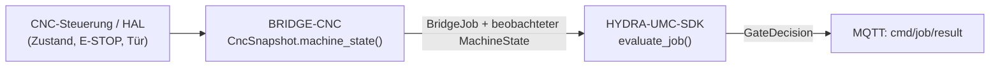

<!-- =============================================================================
HYDRA-UMC-BRIDGE-CNC - CNC cell coordination bridge
Copyright (C) JuanenRac (Electro Hobby 3D) <electrohobby3d@gmail.com>
GPL-3.0-or-later - see LICENSE
============================================================================= -->

<p align="center">
  
</p>

# 🔧 HYDRA-UMC-BRIDGE-CNC

<p align="center"><a href="README.md">🇺🇸 English</a> | <a href="README_spa.md">🇪🇸 Español</a> | <a href="README_fra.md">🇫🇷 Français</a> | <a href="README_ita.md">🇮🇹 Italiano</a> | 🇩🇪 <b>Deutsch</b> | <a href="README_zho.md">🇨🇳 简体中文</a> | <a href="README_jpn.md">🇯🇵 日本語</a> | <a href="README_por.md">🇵🇹 Português</a></p>

### 🛑 Ausfallsichere Koordinationsbrücke für CNC-Zellen

<p align="center">
  
  
  
  
  
  
</p>

---

> **Ehrlichkeitscheck - was heute wirklich läuft:** der ausfallsichere Zellen-Snapshot und das Sicherheitsgate (`cell.py` mit `CncSnapshot`/`CncCellBridge`, das jeden Job durch das echte `evaluate_job()` von `HYDRA-UMC-SDK` leitet), der schreibgeschützte GRBL/MTConnect-Evidenz-Normalisierer (`observation.py`), der echte GRBL-Seriell-Transport (`serial_transport.py` mit `GrblSerialProbe`/`GrblRealtimeControl`) und der MQTT-Befehls-/Statustransport (`mqtt_transport.py`) sind real und durch 283 bestehende `unittest`-Fälle abgedeckt (`python tools/build_test.py`), einschließlich `tests/test_grbl_emulator.py`, das diese Bridge gegen einen protokolltreuen, von Hand geschriebenen GRBL-v1.1-Emulator laufen lässt. Nichts davon hat je einen echten seriellen Port, einen echten MQTT-Broker oder einen echten CNC-Controller berührt - `test_serial_transport.py`s eigener `FakeSerial` ersetzt eine physische Verbindung, und `test_mqtt_transport.py` verwendet ebenso einen simulierten Broker-Client. Die Anbindungen an LinuxCNC und CNCjs und die MTConnect-Sicht kennen nur Simulationen, es gibt keinen LinuxCNC-HAL-Adapter und keinen echten `run`-Befehl, weil noch kein realer Controller angesteuert wurde - siehe „Aktueller Status und nächste Schritte" weiter unten, das dies bereits klar sagt, sowie `CHANGELOG.md` für das, was bisher genau ausgeliefert wurde. Der MQTT-Transport wurde außerdem auf einem Entwicklungsrechner gegen einen echten HYDRA-UMC-MQTT-BROKER ausgeführt (`tests/test_broker_integration.py`, übersprungen, wenn kein Broker installiert ist): Publish und Subscribe mit QoS 0, 1 und 2, die zurückbehaltene Verfügbarkeit samt Last Will und die Rückkehr, nachdem der Broker ausgefallen und wieder gestartet wurde.

> **Stand von Sicherheit (Safety) und Security:** Dieses Ökosystem ist kein zertifiziertes Sicherheitssystem. Es gibt noch keinen Hardware-E-STOP-Pfad, keine von der Firmware durchgesetzten Grenzen oder Verriegelungen und keinen verifizierten Bewegungsbefehl; Firmware-Images werden mit CRC-32 und einer Ed25519-Signatur geprüft, und ein Release-Build verweigert die veröffentlichten Entwicklungsschlüssel (die Werkzeugköpfe und Erweiterungsplatinen hinter dem Relais laufen noch mit URTC-Bootloadern, die statt einer Signatur ein HMAC-SHA256 mit gemeinsamem Schlüssel verwenden); TLS und gegenseitiges TLS sind optional und standardmäßig aus; noch keine eigene Platine wurde bestückt oder getestet. Lesen Sie die [Sicherheitsbasis](https://github.com/JuanenRac/HYDRA-UMC-DOCS/blob/main/docs/SECURITY_BASELINE.md) und das [Bedrohungsmodell](https://github.com/JuanenRac/HYDRA-UMC-DOCS/blob/main/docs/THREAT_MODEL.md), bevor Sie sich für die Sicherheit einer Person auf eine Aussage hier verlassen.

---

## 📋 Auf einen Blick

| | |
|---|---|
| Version | `0.2.2` |
| Reifegrad | Funktionsfähig |
| Tests | 283 (`python tools/build_test.py`) |
| Technik | Python / LinuxCNC / G-code / GRBL status evidence / GRBL serial transport |
| Ziel | Der Raspberry Pi CM5 einer HYDRA-UMC-Zelle |
| Auf echter Hardware | Nur simuliert: gegen Emulatoren, Attrappen oder Simulatoren getestet; für diese Version ist kein Lauf auf echter Hardware vermerkt |

**Springe zu:** [Überblick](#-überblick) · [Architektur](#-architektur) · [Funktionen](#-funktionen) · [Sicherheit und Schutz](#-sicherheit-und-schutz) · [Schnittstellen](#-schnittstellen) · [Konfiguration](#-konfiguration) · [Schnellstart](#-schnellstart) · [Tests](#-tests) · [Fehlerbehebung](#-fehlerbehebung) · [Struktur des Repositorys](#-struktur-des-repositorys) · [Verwandte Projekte](#-verwandte-projekte)

## 🚦 Projektstatus

Jede Zeile ist ein Teil dieses Repositorys, und die Ampel sagt, wie weit er heute ist. Sie beruht auf dem, was das Repository zeigen kann (Tests, Builds, Läufe), nicht auf dem, was geplant ist.

🟢 Fertig und überprüft · 🟡 Funktioniert, mit bekannten Grenzen · 🟠 Teilweise fertig oder noch nicht überprüft · 🔴 Nicht gemacht oder funktioniert nicht

| Bereich | Stand | Was das hier bedeutet |
|---|---|---|
| Software | 🟡 | Funktioniert für seinen Hauptzweck; die Ehrlichkeitsprüfung oben nennt, was noch fehlt |
| Tests | 🟢 | 283 automatische Tests, bei jeder Änderung ausgeführt |
| Echte Hardware | 🟠 | Nur simuliert: gegen Emulatoren, Attrappen oder Simulatoren getestet; für diese Version ist kein Lauf auf echter Hardware vermerkt |
| Dokumentation | 🟢 | README in acht Sprachen, bei jeder Änderung gegen das Manifest geprüft |

## 🎯 Überblick

**HYDRA-UMC-BRIDGE-CNC** ist die High-Level-Brücke zwischen CNC-Zellen und HYDRA-UMC-Roboterhilfsfunktionen: Beladen, Entladen, Werkstückhandhabung und überwneune Hilfsaufgaben. Sie wird niemals zu einem Echtzeit-Bahnsteuerungscontroller — die CNC-Steuerung (GRBL, LinuxCNC oder die hinter CNCjs) behält jederzeit die Autorität über Bahn, Spindel und Maschinengrenzen.

Sie gehört zur Familie **External Automation Bridges**: einer Gruppe von Schwester-Repositories (CNC, LASER, OPENPNP, PRINTER3D, ROS2), die alle denselben gemeinsamen Sicherheitsvertrag von `HYDRA-UMC-SDK` sprechen, sodass keine Brücke ihre eigene Definition von "sicher zum Arbeiten" erfinden kann.

## 🧩 Rolle in HYDRA-UMC

**HYDRA-UMC-BRIDGE-CNC** sitzt zwischen einer CNC-Steuerung (GRBL, LinuxCNC oder der hinter CNCjs) und der Roboterzelle, die sie be- und entlädt. Die Steuerung behält stets die Hoheit über Bahn, Spindel und Grenzen; der Bridge meldet nur, was die Steuerung sagt, und fragt vor jeder Hilfsarbeit das gemeinsame Tor.

Jeder Bridge spricht den gemeinsamen Sicherheitsvertrag von `HYDRA-UMC-SDK`: Ein Auftrag wird nur angenommen, wenn das gemeinsame Tor `evaluate_job()` zustimmt, und das Tor schließt im Zweifel. Das Elternprojekt ist `HYDRA-UMC-SERVER`; dieser Bridge ruft es nicht auf, er antwortet über MQTT und `HYDRA-UMC-MQTT-BROKER` dem, der die Zelle steuert.

| Er spricht mit | Wie | Wozu |
|---|---|---|
| `HYDRA-UMC-SDK` | Python-Import | das Auftragstor `evaluate_job()`, die Form von Aufträgen und Entscheidungen, die serielle Anbindung und der MQTT-Client |
| `HYDRA-UMC-MQTT-BROKER` | MQTT, `hydra/bridges/cnc/` | Befehle hinein (`cmd/`), Status und Ergebnisse heraus |
| GRBL | serieller Port | Statusabfrage `?` und die Echtzeit-Bytes (Vorschubhalt, Zyklus fortsetzen, Soft-Reset); nie ein G-Code-Programm |
| LinuxCNC | Python-Modul `linuxcnc` | liest `linuxcnc.stat`; sendet nur Pause, Abbruch und Fortsetzen |
| CNCjs | socket.io | hört `controller:state`; sendet nur `feedhold`, `reset`, `cyclestart` |

## 🏛️ Architektur

<p align="center">
  
</p>

<details>
<summary>Textversion des Diagramms (Mermaid)</summary>



</details>

**Warum es so gebaut ist**

* **Warum E-STOP und Türzustand vor dem vom Controller selbst gemeldeten Zustand geprüft werden.** `CncSnapshot.machine_state()` springt zuerst auf `SAFE_STOP`, wenn `estop` gesetzt ist oder die Tür nicht geschlossen ist — ein Controller, der weiterhin `IDLE` meldet, während die Tür offen ist, darf niemals wörtlich genommen werden.
* **Warum die Zustandsabbildung des Controllers bewusst konservativ ist.** Nur die wörtliche Zeichenkette `IDLE` wird auf `MachineState.IDLE` abgebildet. Jeder nicht erkannte Wert fällt auf `OFFLINE` zurück, niemals auf etwas, das Hilfsarbeit erlauben würde — ein unbekannter Controller-Zustand wird als "weiß ich nicht" behandelt, nicht als "wahrscheinlich in Ordnung".
* **Warum die Brücke einen neuen `BridgeJob` erstellt und an das gemeinsame `evaluate_job()` delegiert, statt eigene Annahme-/Ablehnungslogik zu schreiben.** Alle fünf External Automation Bridges (CNC, LASER, OPENPNP, PRINTER3D, ROS2) verwenden exakt denselben `bridge_contract` von `HYDRA-UMC-SDK` wieder, sodass "was als sicher für den Start eines Auftrags zählt" zwischen ihnen nicht stillschweigend auseinanderdriften kann.
* **Warum die Anbindungen an LinuxCNC und CNCjs nur lesen, pausieren und fortsetzen.** Die Steuerung behält die Autorität über Bahn, Spindel und Grenzen, und das Programm gehört dem, der es ausführt (CNCjs, LinuxCNC selbst): die Bridge darf die Maschine zur Ruhe bringen und eine pausierte weiterlaufen lassen, mehr nicht. Das Verdrahten echter HAL-Pins bleibt ein Hardware-Integrationsschritt, der gegen eine reale Steuerung validiert werden muss.
* **Wie das in den Rest des Ökosystems passt.** BRIDGE-CNC sitzt zwischen der CNC-Steuerung und `HYDRA-UMC-SDK` → `HYDRA-UMC-MQTT-BROKER` → MCU-/Zellsicherheit: es koordiniert Roboter-Hilfsarbeit rund um die CNC, es ersetzt oder überschreibt nicht die eigene Sicherheitsautorität der Steuerung.

Die Beobachtungs-Hilfsfunktionen sind Evidenz-Normalisierer, keine Controller-Adapter: sie öffnen keine HAL-, seriellen oder Netzwerkverbindungen. [Controller Evidence Boundary](docs/CONTROLLER_EVIDENCE_BOUNDARY.md) definiert die Validierung, die vor einer echten Controller-Integration erforderlich ist.

**Betrieb als Dienst.** `python -m hydra_umc_bridge_cnc --config /etc/hydra-umc/bridge-cnc.toml` startet den Bridge aus einer einzigen TOML-Datei: die Steuerung (eine GRBL-Platine an einer seriellen Schnittstelle, CNCjs oder LinuxCNC), die Quellen von NOT-HALT und Tür (eine GPIO-Leitung mit ihrem deklarierten unsicheren Pegel oder eine kleine Datei), die gemeinsame Nutzung der seriellen Schnittstelle mit einem G-Code-Sender, das Spindeltor, MTConnect, der MQTT-Broker und die Quelle des Zellenzustands. Ein unbekannter Schlüssel wird abgelehnt, eine Signalquelle muss ihre Verdrahtung deklarieren und alles fällt geschlossen aus: ein Signal ohne Quelle bedeutet NOT-HALT gedrückt oder Tür offen, und ein Signal oder eine Zellenzustandsdatei, die fehlt, unbekannt oder veraltet ist, liefert die unsichere Antwort. `--check` prüft die Datei; `deploy/` enthält die systemd-Unit (`Restart=on-failure`) und eine Beispieldatei. Er lief gegen den GRBL-Emulator und simulierte Signale, nicht an einer echten Maschine.

## ✨ Funktionen

* ✅ **Echter ausfallsicherer Zellen-Snapshot:** `cell.py` — `CncSnapshot.machine_state()` prüft E-STOP und Türzustand, *bevor* überhaupt betrachtet wird, was der Controller meldet; ein ausgelöster E-STOP oder eine offene Tür führen immer zu `SAFE_STOP`, unabhängig davon, was `controller_state` sagt. *(implementiert, getestet in `tests/test_cell.py`)*
* ✅ **Echtes gemeinsames Sicherheitsgatter:** jeder beobachtete Auftrag wird über `evaluate_job()` aus dem `bridge_contract` von `HYDRA-UMC-SDK` neu bewertet — demselben Gatter, das jede Schwesterbrücke verwendet. *(implementiert)*
* ✅ **Gemeinsamer serieller Port:** Eine GRBL-Platine hat nur einen seriellen Port. `multiplexer.py` kann ihn besitzen und eine TCP-Seite anbieten (standardmäßig nur Loopback), an der sich jeweils ein G-Code-Sender verbindet, während die Bridge ihre Statusabfragen und ihre drei Echtzeit-Bytes behält; die Bridge kann nie etwas anderes schreiben, ein zweiter Sender wird abgewiesen. Standardmäßig ist es aus (`HYDRA_UMC_CNC_PORT_SHARING=multiplexer` schaltet es ein; `HYDRA_UMC_CNC_PORT_SHARING_LISTEN` und `HYDRA_UMC_CNC_PORT_SHARING_ALLOW_REMOTE` legen die Adresse fest). Gegen den GRBL-Emulator getestet; auf einer echten GRBL-Platine lief es nicht. *(implementiert, nur simuliert)*
* ✅ **Konservative Zustandsabbildung:** nur `IDLE` wird als Leerlauf behandelt; `RUN`/`RUNNING`/`JOG`/`HOME` werden auf `RUNNING` abgebildet, `FAULT`/`ERROR`/`OFF`/`ALARM` auf `FAULT`, und jeder nicht erkannte Wert fällt auf `OFFLINE` zurück — niemals auf einen Zustand, der produktive Arbeit erlauben würde. (`HOLD` → `HOLDING`; `DOOR` → `SAFE_STOP`) *(implementiert)*
* ✅ **Schreibgeschützte Controller-Evidenz:** `observation.py` normalisiert streng die lokale Mapping-Evidenz und die gelieferten GRBL-Statuszeilen; ausgelassene oder nicht-boolesche E-STOP-/Tür-Signale schlagen sicher fehl. *(implementiert, getestet in `tests/test_observation.py`)*
* ✅ **Echter GRBL-Serientransport:** `GrblSerialProbe` aus `serial_transport.py` öffnet eine echte serielle Verbindung und fragt das Echtzeit-Statusbyte von GRBL ab (`?`); `GrblRealtimeControl` sendet ausschließlich GRBLs eigene Echtzeit-Steuerbytes (Vorschub-Halt, Zyklus-Fortsetzung, Soft-Reset) — `cycle_start_resume()` ist an eine tatsächlich in `HOLDING` befindliche Maschine gebunden, die übrigen sind immer erlaubt wie `ABORT`. Es streamt niemals ein G-Code-Programm. *(implementiert, getestet in `tests/test_serial_transport.py`)*
* ✅ **Nicht-mutierender Build/Test:** `build-test.bat`/`.sh` kompilieren den Quellcode und führen die Sicherheitsgatter-Testsuite aus, ohne Versionsdateien oder das CHANGELOG anzufassen. *(implementiert, siehe Build und Veröffentlichung unten)*
* ✅ **Steuerungsanbindungen:** die Bridge spricht über `ControllerLink` (`controller.py`) mit einer Steuerung: GRBL an einem seriellen Port, den die Bridge offen hält (`GrblController`), eine LinuxCNC-Installation (`linuxcnc_link.py`: liest `linuxcnc.stat`, sendet über `linuxcnc.command` nur Pause, Abbruch und Fortsetzen eines pausierten Programms, führt nie ein Programm aus) und ein CNCjs-Server, der den Port besitzt (`cncjs_link.py`: liest das von ihm gesendete `controller:state` und sendet nur `feedhold`, `reset` und `cyclestart`, sodass die Bridge neben dem Sender arbeitet, der die Programme ausführt). Ein Fortsetzen verlangt immer eine READY-Zelle und eine Maschine, die wirklich angehalten ist; eine alte oder fehlende Messung ist nie eine ruhende Maschine. Beide Anbindungen sind gegen Simulationen getestet (`SimulatedLinuxcnc`, `SimulatedCncjs`); keine hat ein echtes LinuxCNC oder CNCjs berührt. *(implementiert, nur simuliert)*
* ✅ **Spindel-Gate:** ein Beladen oder Entladen wird abgelehnt, wenn die Steuerung im Leerlauf ist, aber noch eine drehende Spindel oder einen laufenden Vorschub meldet (`FS:`). `HYDRA_UMC_CNC_SPINDLE_GATE` ist `off`, `when_known` (Standard: lehnt ab, was gemeldet wird) oder `required` (lehnt auch ab, was die Steuerung nicht meldet). Der Snapshot trägt außerdem die Positionen, den Werkstücknullpunkt-Versatz und die Overrides des Berichts. *(implementiert)*
* ✅ **MTConnect-Sicht:** `mtconnect_publish.py` macht aus dem Snapshot MTConnect-Beobachtungen (`avail`, `execution`, `estop`, `door`, `spindle_speed`, `path_feedrate`, `system`), die `ShdrAdapter` als SHDR über TCP ausliefert (nur lesend; die einzige akzeptierte Zeile ist `* PING`) und die mit `HYDRA_UMC_CNC_MTCONNECT=1` als Retained-Nachricht auf `hydra/bridges/cnc/mtconnect` veröffentlicht werden. Eine Steuerung, die nicht meldet, ist `UNAVAILABLE`, nie `READY`. Gegen einen simulierten Agenten getestet. *(implementiert, noch nicht mit einem echten Agenten erprobt)*
* 🔜 **LinuxCNC-HAL-Pins** — zurückgestellt; es wurde noch keine reale CNC-Steuerung, kein HAL-Pin und kein Roboter angesteuert. *(geplant)*
* ✅ **Wiederholte Idempotenzschlüssel:** `CncMqttBridge` nimmt einen `IdempotencyStore` an: ein wiederholter Auftragsschlüssel erhält die Antwort vom ersten Mal, statt erneut bewertet zu werden. *(implementiert, getestet in `tests/test_idempotency.py`)*
* ✅ **Passende Statusantworten, fail-closed Seriell, gehärtete MQTT-Schleife:** die Statusabfrage verwirft, was schon wartet, sendet `?` und liest, bis ein echter Statusbericht (`<...>`) eintrifft: das Banner sowie `ok`, `[MSG:...]` und `ALARM:n`, die GRBL ungefragt sendet, lassen nicht mehr jede spätere Abfrage um eine Antwort hinterherhinken; ein fehlendes USB-Gerät (oder jeder Fehler auf der Leitung) schlägt fail-closed fehl, statt die Bridge zu beenden, und der Port wird geöffnet, ohne DTR zu setzen; `cmd/feed_hold` meldet, was die Steuerung danach gesagt hat (`controller_state_after`, `confirmed`), und `cmd/feed_hold` und `cmd/soft_reset` laufen auf einer eigenen Spur, sodass eine Statusabfrage sie nie verzögert; eine zu große (über 16 KiB), unlesbare oder tief verschachtelte Nutzlast und jeder unerwartete Fehler werden mit einer Ablehnung auf dem Ergebnis-Topic beantwortet und beenden die Schleife nie; die Antworten von `cmd/job` tragen `"mode": "gate-only"`, und ein ABORT darüber sagt, dass nichts gestoppt wurde; der Zustand enthält `observed_at`, und die Bridge meldet sich auf einem `availability`-Topic mit Last Will. GRBL hat EINEN seriellen Port: solange diese Bridge ihn hält, kann ihn kein G-Code-Sender benutzen (siehe `docs/BRIDGE_GUIDE.md`). *(implementiert, getestet in `tests/test_hardening.py`)*
* ✅ **Aufträge über die gemeinsame Annahme:** Die Prüfung eines fehlerhaften Auftrags und eines wiederholten `idempotency_key` ist das `JobIntake` des SDK statt Code dieser Bridge (die Schlüssel tragen das Präfix `job:` nicht mehr).
* ✅ **Antworten, die zur Anfrage passen:** Eine Befehlsnutzlast, die ein JSON-Objekt ist, kann eine `request_id` tragen (ein schlichtes Token mit bis zu 64 Zeichen: Buchstaben, Ziffern, `.`, `_`, `:`, `-`), und jedes Ergebnis, das die Bridge für diese Nachricht veröffentlicht, trägt sie zurück, auch das für einen wiederholten Idempotenzschlüssel gespeicherte. Die Zustandsthemen bleiben unverändert.
* ✅ **Folgt dem globalen Stopp (standardmäßig aus):** mit `HYDRA_UMC_CNC_GLOBAL_STOP=1` liest der Bridge die retained Meldung des Servers auf `hydra/swarm/safety/estop`; solange sie `SAFE_STOP` lautet oder nicht lesbar ist, lehnt er mit Begründung ab: ein Fortsetzen und ein Auftrag (ein Abbruch geht durch). Stopps und reine Leseanfragen funktionieren weiter, und nur `READY` beendet die Ablehnung. *(implementiert, gegen einen echten Broker getestet; nie mit einem echten Server gelaufen)*

## 🔒 Sicherheit und Schutz

| Bedrohung | Abwehr | Wo |
|---|---|---|
| Ein Auftrag für eine Zelle, die nicht sicher ist | Jeder Auftrag läuft durch das gemeinsame Tor `evaluate_job()`, das im Zweifel schließt; der Bridge hat keine eigene Annahmelogik. NOT-HALT und Tür werden vor allem gelesen, was die Steuerung meldet, und offene Tür oder NOT-HALT ist immer `SAFE_STOP` | `cell.py`, SDK `bridge_contract` |
| Überlange oder unbegrenzte Auftragsdaten | Höchstens 32 Parameter, Schlüssel bis 64 Zeichen, Werte bis 1024, Bezeichner bis 128; eine MQTT-Nutzlast über 16 KiB wird auf dem Ergebnis-Topic abgelehnt | SDK `bridge_contract`, `mqtt_transport.py` |
| Ein wiederholter oder erneut gesendeter Befehl | Ein `IdempotencyStore` merkt sich jeden Schlüssel 24 Stunden und höchstens 10 000 Einträge; eine Wiederholung bekommt die erste Antwort, statt neu bewertet zu werden. Eine gehaltene `cmd/`-Nachricht wird beim Wiederverbinden ignoriert | SDK `job_intake.py`, `mqtt_transport.py` |
| Eine drehende Spindel, während ein Arm be- oder entlädt | `LOAD` und `UNLOAD` werden abgelehnt, wenn die Steuerung im Leerlauf ist, aber eine drehende Spindel oder einen laufenden Vorschub meldet; `HYDRA_UMC_CNC_SPINDLE_GATE` ist `off`, `when_known` (Standard, auch für unbekannte Werte) oder `required` | `cell.py` |
| Die Maschine per Fernbefehl stoppen oder bewegen | Zu CNCjs gelangen nur `feedhold`, `reset` und `cyclestart`, zu LinuxCNC nur Pause, Abbruch und Fortsetzen, zu einem seriellen Port nur die GRBL-Echtzeit-Bytes; ein Fortsetzen braucht eine READY-Zelle und eine wirklich haltende Maschine. `cmd/feed_hold` und `cmd/soft_reset` laufen auf einer eigenen Spur | `cncjs_link.py`, `linuxcnc_link.py`, `serial_transport.py`, `mqtt_transport.py` |
| Ein alter Messwert, der für eine ruhende Maschine gehalten wird | Ein CNCjs-Messwert älter als 3 Sekunden gilt nicht, ein fehlender oder alter Zustand ist nie Leerlauf und die Tür gilt dann als offen; ein LinuxCNC-Befehl läuft nach 2 Sekunden ab; eine fehlgeschlagene serielle Abfrage schließt im Zweifel | `cncjs_link.py`, `linuxcnc_link.py`, `serial_transport.py` |
| Ein MTConnect-Client, der den Adapter überflutet | Der SHDR-Adapter ist schreibgeschützt: höchstens 16 Clients, Zeilen bis 1024 Byte, und die einzige beachtete Zeile ist `* PING` | `mtconnect_publish.py` |

**Was er nie tut:** Er streamt nie ein G-Code-Programm, startet nie ein Programm in LinuxCNC, nimmt CNCjs nie den seriellen Port weg und schließt nie auf einen NOT-HALT- oder Türzustand, den der Nachweis nicht enthielt. Siehe `docs/CONTROLLER_EVIDENCE_BOUNDARY.md`.

## 🔌 Schnittstellen

Topics unter `hydra/bridges/cnc/` (Präfix `TOPIC_PREFIX`); der Bridge abonniert `cmd/#`.

| Topic oder Route | Was es trägt |
|---|---|
| `cmd/status` | fragt den Zellenzustand ab; Antwort auf `cmd/status/result` |
| `cmd/job` | ein `BridgeJob` in der `job_to_dict()`-Form des SDK; die Antwort ist eine `GateDecision` mit `"mode": "gate-only"` (sie handelt nie, ein `ABORT` darüber sagt, dass nichts gestoppt wurde) |
| `cmd/feed_hold`, `cmd/soft_reset` | die Stoppbefehle auf eigener Spur; die Antwort enthält `controller_state_after` und `confirmed` |
| `cmd/cycle_start_resume`, `cmd/start`, `cmd/resume` | setzen eine haltende Maschine fort; abgelehnt, wenn die Zelle nicht READY ist und die Maschine nicht wirklich hält (nie nach einem Türereignis) |
| `<verb>/result` | eine JSON-Antwort je Befehl, `{"allowed", "executed", "reason"}` bei einer Ablehnung |
| `state`, `availability` | der Zellenzustand (gehalten, mit `observed_at` in Epochen-Millisekunden) und `online`/`offline` (das Last Will) |
| `mtconnect` | MTConnect-Beobachtungen, gehalten; nur mit `HYDRA_UMC_CNC_MTCONNECT=1` |

Die Bibliothek: `CncCellBridge`, `CncSnapshot`, `CncMqttBridge`, `spindle_gate_from_environment()` und die drei Anbindungen (`GrblController`, `LinuxcncController`, `CncjsController`).

## ⚙️ Konfiguration

| Variable | Standard | Was sie festlegt |
|---|---|---|
| `HYDRA_UMC_CNC_SPINDLE_GATE` | `when_known` | `off`, `when_known` oder `required`; nicht gesetzt oder unbekannt bedeutet `when_known` |
| `HYDRA_UMC_CNC_MTCONNECT` | aus | `1` veröffentlicht die MTConnect-Beobachtungen auf `hydra/bridges/cnc/mtconnect` |
| `HYDRA_UMC_CNC_GLOBAL_STOP` | aus | `1` folgt dem globalen Stopp des Servers: Solange die letzte Meldung auf dem retained Topic `hydra/swarm/safety/estop` `SAFE_STOP` lautet (oder nicht lesbar ist), lehnt der Bridge mit Begründung ab: ein Fortsetzen und ein Auftrag (ein Abbruch geht durch); nur `READY` beendet das. `HYDRA_UMC_CNC_GLOBAL_STOP_TOPIC` ändert das Topic, `HYDRA_UMC_CNC_GLOBAL_STOP_STRICT=1` lehnt zusätzlich ab, bis die erste Meldung eintrifft |
| `HYDRA_MQTT_USERNAME` | keiner | Der MQTT-Benutzername; der Broker bindet ihn an ein Client-ID-Präfix |
| `HYDRA_MQTT_PASSWORD` | keiner | Das Passwort; nur zusammen mit dem Benutzernamen gültig |
| `HYDRA_MQTT_PASSWORD_FILE` | keiner | Das Passwort aus einer Datei (Docker- oder systemd-Secret); wird ignoriert, wenn `HYDRA_MQTT_PASSWORD` gesetzt ist |
| `HYDRA_MQTT_TLS_CA` | keiner | Die CA-Datei, die das Zertifikat des Brokers signiert hat: Die Verbindung ist TLS und das Zertifikat wird geprüft |
| `HYDRA_MQTT_TLS` | aus | `1` schaltet TLS ein, geprüft gegen die vertrauenswürdigen CAs des Systems |
| `HYDRA_MQTT_TLS_CERT` / `HYDRA_MQTT_TLS_KEY` | keiner | Das Clientzertifikat und sein Schlüssel für einen Broker mit gegenseitigem TLS; beide sind nötig |

Die Controller-Anbindung wird im Code gewählt: Übergib `controller=` an `CncMqttBridge` für LinuxCNC oder CNCjs, sonst hält der Bridge eine serielle GRBL-Verbindung. Solange er den Port hält, kann ihn kein G-Code-Sender nutzen (siehe `docs/BRIDGE_GUIDE.md`, „One serial port“).

## 🚀 Schnellstart

Benötigt Python 3.11 oder neuer. Die Tests und die Build-Skripte erwarten `HYDRA-UMC-SDK` neben diesem Repository (`../HYDRA-UMC-SDK`) oder über `HYDRA_UMC_SDK_ROOT` angegeben.

Ohne Hardware ausprobieren (das prüft den ganzen Bridge gegen seine Emulatoren und Attrappen):

```bash
py -3 tools/build_test.py          # Windows
python3 tools/build_test.py         # Linux, macOS
build-test.bat  /  bash build-test.sh   # the same, through the scripts
```

Den Dienst starten (es gibt kein Konsolenskript: Der Dienst ist das `run_forever()` des MQTT-Transports, das du aus deinem eigenen Startcode aufrufst):

```python
from hydra_umc_bridge_cnc.mqtt_transport import CncMqttBridge, run_forever
# `connection` is an open GRBL serial connection (open_serial_port()), or pass controller=...
bridge = CncMqttBridge(connection)
run_forever(bridge, host="192.168.0.180")   # connects to the broker and serves cmd/# forever
```

Benutzername, Passwort und TLS-Dateien kommen aus den Variablen `HYDRA_MQTT_*` (siehe Konfiguration); der Code oben braucht keine eigenen Zugangsdaten.

## 🧪 Tests

283 automatische `unittest`-Fälle laufen mit `python tools/build_test.py` (das kompiliert auch jedes Modul). Die Tests brauchen weder Hardware noch Netz noch optionale Pakete: Die, die `paho-mqtt`, `pyserial` oder eine Herstellerbibliothek bräuchten, nutzen einen Ersatz oder werden übersprungen, wenn das Paket fehlt.

| Testdatei | Tests | Was sie abdeckt |
|---|---|---|
| `test_cell.py` | 10 | Annahme im sicheren Leerlauf, Ablehnung bei offener Tür, Weiterleitung des Abbruchs |
| `test_controllers.py` | 63 | Spindeltor, LinuxCNC- und CNCjs-Anbindung gegen ihre Simulationen, MTConnect-Sicht |
| `test_serial_transport.py` | 29 | der serielle Transport gegen einen Scheinport, einschließlich der geschlossenen Fehlerpfade |
| `test_mqtt_transport.py`, `test_mqtt_environment.py` | 28 + 4 | Befehls- und Statusformen gegen einen Schein-Broker-Client; Zugangsdaten und TLS der Umgebung erreichen den Client |
| `test_grbl_emulator.py`, `grbl_emulator.py` | 17 | der Bridge gegen einen handgeschriebenen, protokolltreuen GRBL-v1.1-Emulator |
| `test_hardening.py`, `test_edge_cases.py`, `test_idempotency.py`, `test_observation.py` | 25 + 20 + 3 + 7 | ausgerichtete Statusantworten, ein totes Kabel, Bestätigung des Vorschubhalts, feindliche Nutzlasten, wiederholte Schlüssel, fehlende Nachweise |

Die CI führt `HYDRA_UMC_CI=1 python tools/ci_validate.py` aus; das prüft das Manifest, die Dokumente, die acht READMEs und die Bilder und führt die Tests mit einem SDK-Checkout aus.

## 🏗️ Build und Veröffentlichung

Erfordert Python 3.11+. `tools/build_test.py` erwartet, dass `HYDRA-UMC-SDK` als Schwesterverzeichnis (`../HYDRA-UMC-SDK`) ausgecheckt oder über die Umgebungsvariable `HYDRA_UMC_SDK_ROOT` angegeben ist.

```bash
# Windows
build-test.bat      # nur Validierung — keine Versions-/CHANGELOG-Änderung
build.bat            # Validiert und baut (Bauen ändert nie die Version)

# Linux/macOS
bash build-test.sh
bash build.sh
```

`build-test` kompiliert jedes Modul unter `src/` mit `py_compile` und führt die vollständige, unter `tests/` entdeckte `unittest`-Suite aus (`test_cell.py`, `test_observation.py`, `test_serial_transport.py`, `test_mqtt_transport.py`, `test_grbl_emulator.py`, `test_hardening.py`, `test_idempotency.py`, `test_mqtt_environment.py` - 283 Tests), was unter anderem die Zulassung im sicheren Leerlauf, die Ablehnung bei offener Tür und die Abbruchweiterleitung belegt — es ändert das Repository nie. `build` führt zuerst dieselbe Validierung aus und ruft nur bei Erfolg `tools/bump_version.py` auf, um die Version in `pyproject.toml`, `hydra-umc.project.json` und `CHANGELOG.md` zu synchronisieren. Es gibt noch keinen echten CNC-`run`-Befehl — dafür ist eine validierte Controller-Integration erforderlich.

## 🩺 Fehlerbehebung

| Du siehst | Weil | Tu |
|---|---|---|
| `ModuleNotFoundError: hydra_umc_sdk` | Das SDK ist nicht installiert oder liegt nicht neben diesem Repository | `HYDRA-UMC-SDK` neben dieses Repository klonen oder `HYDRA_UMC_SDK_ROOT` setzen |
| `paho-mqtt is not installed` | Der MQTT-Client ist ein optionales Extra | `pip install ".[mqtt]"` (braucht `paho-mqtt` ab 2.1, unter 3) |
| `password was given without a username` | MQTT-Zugangsdaten brauchen beide Teile | Setze auch `HYDRA_MQTT_USERNAME`, nicht nur das Passwort |
| `spindle_gate must be one of ...` | `HYDRA_UMC_CNC_SPINDLE_GATE` hat einen dem Code unbekannten Wert | Nimm `off`, `when_known` oder `required` (im Code löst es eine Ausnahme aus; aus der Umgebung fällt ein unbekannter Wert auf `when_known` zurück) |
| `a serial connection or a controller link is required` | `CncMqttBridge` wurde ohne beides gebaut | Übergib eine offene serielle Verbindung oder `controller=` |
| `"allowed": false` + `reason` | Das gemeinsame Tor oder eine Sperre hat den Befehl abgelehnt | Lies `reason`: Tür offen, NOT-HALT, Maschine nicht im Leerlauf, Spindel dreht oder alter Messwert; behebe die Ursache, nicht blind wiederholen |

## 📂 Struktur des Repositorys

<p align="center">
  
</p>

<details>
<summary>Textversion des Baums</summary>

```text
HYDRA-UMC-BRIDGE-CNC/
├── src/hydra_umc_bridge_cnc/
│   ├── cell.py                    Zellen-Schnappschuss, Sicherheitstor, Spindeltor
│   ├── observation.py             Nur-Lese-Nachweise, GRBL-Statuszeilen
│   ├── serial_transport.py        GRBL-Seriell: Statusabfrage und Echtzeit-Bytes
│   ├── controller.py              ControllerLink und der GRBL-Controller
│   ├── linuxcnc_link.py           LinuxCNC-Anbindung (liest, pausiert, setzt fort) und ihre Simulation
│   ├── cncjs_link.py              CNCjs-Anbindung (feedhold, reset, cyclestart) und ihre Simulation
│   ├── multiplexer.py             Multiplexer des seriellen Ports: Bridge und G-Code-Sender teilen sich einen GRBL-Port
│   ├── mtconnect_publish.py       MTConnect-Beobachtungen und der schreibgeschützte SHDR-Adapter
│   └── mqtt_transport.py          MQTT-Transport für Befehle und Status
├── tests/                         238 Tests, mit einem handgeschriebenen GRBL-Emulator
├── deploy/                        systemd-Unit und Beispielkonfiguration
├── docs/                          Bridge-Leitfaden, Grenze der Nachweise
├── tools/                         Build- und Testläufer, Versionserhöhung, CI-Prüfer, README- und Bildgeneratoren samt Prüfungen
├── images/                        Banner und die Bilder der README
├── .github/                       CI-Workflow und Issue-Vorlagen
├── pyproject.toml                 Paketmetadaten und Abhängigkeiten
├── hydra-umc.project.json         Manifest: Version, Reifegrad, Familie
├── CHANGELOG.md                   was sich in jeder Version geändert hat
├── build.sh build.bat             Build-Skripte (ändern die Version nie)
├── build-test.sh build-test.bat   Build-Skripte (ändern die Version nie)
├── test.sh test.bat               führen die Tests aus
└── SECURITY.md SUPPORT.md CONTRIBUTING.md CODE_OF_CONDUCT.md LICENSE LICENSE.md
```

</details>

## 🗺️ Roadmap und bekannte Grenzen

**Bekannte Grenzen heute**

**Heute real:** Version `0.2.2`, ein lokal getesteter ausfallsicherer Zellkoordinator (`CncSnapshot` + `CncCellBridge`), gestützt auf das gemeinsame Auftragsgatter von `HYDRA-UMC-SDK`, strenge schreibgeschützte Normalisierung von Controller-Evidenz, die das vollständige echte Statusvokabular von GRBL v1.1 einschließlich echter `Hold:N`/`Door:N`-Unterzustände (`Idle`/`Run`/`Jog`/`Home`/`Hold`/`Alarm`/`Door`) sowie MTConnect-Ausführungszustände abdeckt, ein echter Serientransport (`GrblSerialProbe`/`GrblRealtimeControl`), der den Status abfragen und GRBLs eigene Echtzeit-Steuerbytes über eine echte Verbindung senden kann - das Live-Auslesen von Tür/E-STOP erfolgt jetzt direkt nach dem eigenen blockierenden Hin-und-Rückweg dieser Abfrage, niemals davor, und ein echter kurzer oder Null-Byte-Schreibvorgang wird als nicht ausgeführt gemeldet statt als falscher Erfolg -, eine deterministische `unittest`-Suite mit 283 Tests sowie nicht-mutierende Build-Test-Skripte, die in CI mit SDK-Checkout eingebunden sind.

**Integrationsgrenze:** die CNC-Steuerung (GRBL, LinuxCNC oder die hinter CNCjs) behält jederzeit die Autorität über Bahn, Spindel und Maschinengrenzen; diese Brücke steuert ausschließlich *Hilfs*-Roboterarbeit, niemals die Bewegung der Steuerung.

**Noch offen:** es wurde noch keine reale CNC-Steuerung, kein LinuxCNC-HAL-Pin und kein Roboter angesteuert — die Auswahl und Validierung eines konkreten HAL-Adapters ist ein Hardware-/Software-Integrationsschritt, der erst nach Verfügbarkeit der Maschine und ihrer dokumentierten Schnittstelle folgt.

## 🌍 Sprachen

Diese README und die Dokumente des Repositorys gibt es in acht Sprachen: Englisch, Spanisch, Deutsch, Französisch, Italienisch, Japanisch, Chinesisch und Portugiesisch (Portugal). Sie entstehen gemeinsam, und die CI prüft, dass die acht Dateien dieselben Abschnitte und dieselben Links haben. Dieses Repository hat weder eine eigene Oberfläche noch einen eigenen Meldungskatalog, es gibt also keine Oberflächentexte zu übersetzen.

## 🔗 Verwandte Projekte

Dieses Projekt ist Teil des HYDRA-UMC-Robotik-Ökosystems desselben Autors (JuanenRac / Electro Hobby 3D). Gut zu wissen, da eine Anfrage eigentlich eines dieser Projekte betreffen könnte statt dieses Repositorys.

**Übergeordnetes Projekt**
- **[HYDRA-UMC-SERVER](https://github.com/JuanenRac/HYDRA-UMC-SERVER)** — das reale Headless-Backend (REST/WebSocket), mit dem jeder Steuerungsclient tatsächlich spricht; diese Bridge ruft es nicht auf: sie antwortet über MQTT, via HYDRA-UMC-MQTT-BROKER, demjenigen, der die Zelle steuert.

**Geschwisterprojekte** — sprechen ebenfalls mit der eigenen API von HYDRA-UMC-SERVER, jeweils als eigener Client
- **[HYDRA-UMC-STUDIO](https://github.com/JuanenRac/HYDRA-UMC-STUDIO)** — Web-Steuerungs-Dashboard mit Echtzeit-3D-Visualisierung mehrerer Roboter.
- **[HYDRA-UMC-SUITE](https://github.com/JuanenRac/HYDRA-UMC-SUITE)** — Desktop-Schwarmleitstand (PySide6) für mehrere Server gleichzeitig, verpackt als eigenständige ausführbare Datei.
- **[HYDRA-UMC-ANDROID-CONTROL](https://github.com/JuanenRac/HYDRA-UMC-ANDROID-CONTROL)** — native Android-Steuerungs-App mit biometrischem Login und einer gekoppelten Wear-OS-Begleit-App.
- **[HYDRA-UMC-IOS-CONTROL](https://github.com/JuanenRac/HYDRA-UMC-IOS-CONTROL)** — iOS/iPadOS-Steuerungs-App (Flutter) mit Echtzeit-WebSocket-Synchronisierung.
- **[HYDRA-UMC-DSI](https://github.com/JuanenRac/HYDRA-UMC-DSI)** — native Touch-UI für das eingebaute 7"-DSI-Touchscreen, direkt auf dem CM5 eingebettet.
- **[HYDRA-UMC-BRIDGE-AMR](https://github.com/JuanenRac/HYDRA-UMC-BRIDGE-AMR)** — Koordinationsschranke für AGV-/AMR-Flotten über einen VDA-5050-MQTT-Publisher (nur gegen eine emulierte Flotte getestet).
- **[HYDRA-UMC-BRIDGE-DROIDS](https://github.com/JuanenRac/HYDRA-UMC-BRIDGE-DROIDS)** — Koordinationsschranke für laufende/humanoide Droiden, mit einem Boston-Dynamics-Spot-Befehlssender (nur gegen einen Emulator getestet).
- **[HYDRA-UMC-BRIDGE-LASER](https://github.com/JuanenRac/HYDRA-UMC-BRIDGE-LASER)** — Koordinator für Laserzellen, liest 3 Schlüssel-/Gehäuse-/Verriegelungs-GPIO-Signale (nur gegen einen simulierten Chip getestet; kann keinen Laser scharfschalten oder auslösen).
- **[HYDRA-UMC-BRIDGE-OPENPNP](https://github.com/JuanenRac/HYDRA-UMC-BRIDGE-OPENPNP)** — sicherer High-Level-Koordinator für den Leiterplattenfluss von OpenPnP Pick-and-Place.
- **[HYDRA-UMC-BRIDGE-PRINTER3D](https://github.com/JuanenRac/HYDRA-UMC-BRIDGE-PRINTER3D)** — sichere Koordinationsschranke für Moonraker/Klipper-3D-Drucker, mit echten gesicherten Job-Befehlen.
- **[HYDRA-UMC-BRIDGE-ROS2](https://github.com/JuanenRac/HYDRA-UMC-BRIDGE-ROS2)** — Koordinator mit einem träge importierten rclpy-ROS-2-Transport (noch nicht gegen eine ROS-2-Installation ausgeführt).
- **[HYDRA-UMC-BRIDGE-UAV](https://github.com/JuanenRac/HYDRA-UMC-BRIDGE-UAV)** — Koordinationsschranke für kameraausgestattete UAVs, mit einem MAVLink-Befehlssender (nur gegen einen Emulator getestet).

**Direkt verwandt**
- **[HYDRA-UMC-SDK](https://github.com/JuanenRac/HYDRA-UMC-SDK)** — der gemeinsame JSON-Schema-Vertrag und die Software-Auftragsschranke, gegen die jede Bridge ihre Befehle validiert (keine zertifizierte Sicherheitsfunktion).
- **[HYDRA-UMC-CONNECTOR-HUB](https://github.com/JuanenRac/HYDRA-UMC-CONNECTOR-HUB)** — deklaratives Adapter-Manifest-Register und Validator für Konnektoren externer Maschinen; erweitert die eigene Vertragsidee des SDK auf externe Maschinen, ohne die Industrie-Gateway-Projekte zu ersetzen.
- **[HYDRA-UMC-MQTT-BROKER](https://github.com/JuanenRac/HYDRA-UMC-MQTT-BROKER)** — der echte Transport von `mqtt_transport.py` für die eigenen `hydra/bridges/cnc/...`-Topics dieser Bridge — Status plus Jog-/Reset-/Resume-Steuerbytes, neben der gemeinsamen Job-Schranke; siehe die eigene `docs/BRIDGE_TOPICS.md` dieses Repositorys.
- **[HYDRA-UMC-HIL-BRIDGE](https://github.com/JuanenRac/HYDRA-UMC-HIL-BRIDGE)** — zukünftiger Hardware-in-the-Loop-Nachweispfad für die echte Controller-Integration.

**Ebenfalls Teil des Ökosystems**

*Kern-Hardware & Plattform*
- **[HYDRA-UMC](https://github.com/JuanenRac/HYDRA-UMC)** — der Entwurf des Motherboards des Roboterarms: CM5-Host + Dual-Core-STM32H745, gedacht zur Koordination von bis zu 8 Werkzeugarmen über CAN-OTA/SPI-OTA (Firmware in einer frühen Phase; noch keine bestückte Platine).
- **[HYDRA-UMC-OS](https://github.com/JuanenRac/HYDRA-UMC-OS)** — reproduzierbare Raspberry-Pi-OS-Produktschicht für den CM5: schreibgeschützter Agent, validierte Konfiguration/Profile, WiFi-Ersteinrichtung.

*Kern-Backend & Clients*
- **[HYDRA-UMC-EDITOR-URDF](https://github.com/JuanenRac/HYDRA-UMC-EDITOR-URDF)** — grafischer Desktop-URDF-Ersteller/-Editor, der fertige Modelle in STUDIOs eigenen Katalog überträgt.
- **[HYDRA-UMC-EDITOR-STL](https://github.com/JuanenRac/HYDRA-UMC-EDITOR-STL)** — Desktop-STL-Modelleditor, der echte Teile im selben Modellkatalog transformiert/ersetzt/entfernt/hinzufügt, den auch HYDRA-UMC-EDITOR-URDF bearbeitet.

*URTC-Werkzeugplattform*
- **[URTC](https://github.com/JuanenRac/URTC)** — Firmware für die physische Universal-Robot-Tool-Controller-Platine, 25+ Werkzeugprofile über CAN-Bus.
- **[URTC-FLASHER](https://github.com/JuanenRac/URTC-FLASHER)** — Desktop-GUI-Flash-Tool für URTC-Platinen, CAN-OTA plus Full-Chip-SWD/JTAG.
- **[URTC-TESTER](https://github.com/JuanenRac/URTC-TESTER)** — Desktop-Live-CAN-Bus-Diagnosetool für URTC-Platinen, ein Panel pro Werkzeugprofil.
- **[URTC-WEB-STUDIO](https://github.com/JuanenRac/URTC-WEB-STUDIO)** — browserbasierte Alternative zu URTC-TESTER über die Web-Serial-API, ohne lokale Installation.
- **[URTC-GATEWAY](https://github.com/JuanenRac/URTC-GATEWAY)** — Gateway vor dem CAN-Bus von URTC: Liste erlaubter Kennungen, Ratenbegrenzung und Sitzungsschlüssel; Software auf dem Computer getestet, noch nicht an einem echten Bus.

*Vision-KI-Knoten (Hailo-8)*
- **[HYDRA-UMC-VISION-NODE](https://github.com/JuanenRac/HYDRA-UMC-VISION-NODE)** — Integrationsknoten für die Hailo-8-Vision-Pipeline, mit einer echten stufenweisen Hardware-Bereitschaftsprüfung.
- **[HYDRA-UMC-DETECTION-HEF](https://github.com/JuanenRac/HYDRA-UMC-DETECTION-HEF)** — echte Registry für kompilierte Modelle mit Hailo-Architektur-/Prüfsummen-Safe-Load-Verifizierung.
- **[HYDRA-UMC-VISION-STREAMER](https://github.com/JuanenRac/HYDRA-UMC-VISION-STREAMER)** — echter GStreamer-Pipeline- + MediaMTX-Konfigurationsgenerator mit einer echten HailoRT-Integrationsschranke.
- **[HYDRA-UMC-VISUAL-SERVOING-API](https://github.com/JuanenRac/HYDRA-UMC-VISUAL-SERVOING-API)** — Position-Based-Visual-Servoing-Korrekturgesetz mit Freigabe abhängig vom Zonenstatus; noch keine Posenschätzung per Kamera.
- **[HYDRA-UMC-SAFETY-ZONES](https://github.com/JuanenRac/HYDRA-UMC-SAFETY-ZONES)** — v0-Logik für Zonenverletzung, Kalibrierungsaktualität und E-STOP-Anforderung, die Objektpositionen aus einer Datei nimmt; kein Detektor speist sie, und noch kein physischer E-STOP ist angeschlossen.

*Kognitiver KI-Knoten (Hailo-10)*
- **[HYDRA-UMC-COGNITIVE-NODE](https://github.com/JuanenRac/HYDRA-UMC-COGNITIVE-NODE)** — Integrationsknoten für die Hailo-10-Cognitive-Pipeline (LLM-/VLA-/Sprach-Orchestrierung).
- **[HYDRA-UMC-VLA-ENGINE](https://github.com/JuanenRac/HYDRA-UMC-VLA-ENGINE)** — echte Aktions-Token-Kodierung/-Dekodierung und Trajektoriengenerierung für ein Vision-Language-Action-Modell.
- **[HYDRA-UMC-VOICE-UI](https://github.com/JuanenRac/HYDRA-UMC-VOICE-UI)** — echtes Sprach-Frontend (VAD + Intent-Parser) mit einem begrenzten, bestätigungsgesicherten Watch-Relay.
- **[HYDRA-UMC-SEMANTIC-PLANNER](https://github.com/JuanenRac/HYDRA-UMC-SEMANTIC-PLANNER)** — echte regelbasierte Aufgabenzerlegung und semantische Fehlerbehebung über MCU-Fehlercodes.
- **[HYDRA-UMC-DOCS-QA](https://github.com/JuanenRac/HYDRA-UMC-DOCS-QA)** — echte, nur auf der Standardbibliothek basierende TF-IDF-Dokumentensuche über die eigenen Markdown-Dokumente dieses Ökosystems.
- **[HYDRA-UMC-LOCAL-TECHNICIAN](https://github.com/JuanenRac/HYDRA-UMC-LOCAL-TECHNICIAN)** — lokaler, richtlinien-gesteuerter KI-Wartungstechniker für das Ökosystem selbst - beobachtet, diagnostiziert und schlägt Korrekturen vor; die zwei höchsten Risikostufen sind absichtlich noch nicht implementiert.

*Orchestrierung & Schwarm*
- **[HYDRA-UMC-ORCHESTRATOR](https://github.com/JuanenRac/HYDRA-UMC-ORCHESTRATOR)** — Integrationsknoten mit einem echten gRPC/Protobuf-Health-Report-Vertrag und einer Missions-Zustandsmaschine.
- **[HYDRA-UMC-JOB-DISPATCHER](https://github.com/JuanenRac/HYDRA-UMC-JOB-DISPATCHER)** — echte prioritätsbasierte Job-Queue mit Deduplizierung, über eine echte HTTP-API.
- **[HYDRA-UMC-NODE-HEALING](https://github.com/JuanenRac/HYDRA-UMC-NODE-HEALING)** — echter gRPC-basierter Flotten-Health-Watchdog mit Retry/Backoff und Identitäts-Mismatch-Erkennung.
- **[HYDRA-UMC-PATH-PLANNER-3D](https://github.com/JuanenRac/HYDRA-UMC-PATH-PLANNER-3D)** — echter RRT-basierter 3D-Pfadplaner mit echter Hindernis-/Arbeitsraum-Kollisionsvalidierung.
- **[HYDRA-UMC-SWARM-SYNC](https://github.com/JuanenRac/HYDRA-UMC-SWARM-SYNC)** — echte CRDT-LWW-Element-Map-Zustandssynchronisation, eigenschaftsgetestet auf Multi-Zellen-Konvergenz.

*Digitaler Zwilling & Simulation*
- **[HYDRA-UMC-TWIN](https://github.com/JuanenRac/HYDRA-UMC-TWIN)** — Integrationsknoten für die Digital-Twin-Engine, mit einem echten Versionskompatibilitäts-Sync-Vertrag.
- **[HYDRA-UMC-PHYSICS-REPLICA](https://github.com/JuanenRac/HYDRA-UMC-PHYSICS-REPLICA)** — echte Vorwärtskinematik und Gelenkgrenzenvalidierung über eine echte URDF-Teilmenge.
- **[HYDRA-UMC-SYNTHETIC-DATA-GEN](https://github.com/JuanenRac/HYDRA-UMC-SYNTHETIC-DATA-GEN)** — echter prozeduraler 2D-Szenengenerator mit YOLO/COCO-Annotationsexport.

*Daten & Analytik*
- **[HYDRA-UMC-DATALAKE](https://github.com/JuanenRac/HYDRA-UMC-DATALAKE)** — echter sqlite3-gestützter Zeitreihenspeicher mit einer echten Ingest-/Abfrage-HTTP-API.
- **[HYDRA-UMC-ANOMALY-DETECTOR](https://github.com/JuanenRac/HYDRA-UMC-ANOMALY-DETECTOR)** — echter FFT- + statistischer Basislinien-Anomaliedetektor mit Drift-Überwachung.
- **[HYDRA-UMC-PRODUCTION-REPORTS](https://github.com/JuanenRac/HYDRA-UMC-PRODUCTION-REPORTS)** — echte OEE-/Verfügbarkeitsberechnung über den DATALAKE-Verlauf, mit reproduzierbarem CSV-Export.
- **[HYDRA-UMC-TELEMETRY-COLLECTOR](https://github.com/JuanenRac/HYDRA-UMC-TELEMETRY-COLLECTOR)** — echte CAN/WebSocket-Ingestion-Pipeline in DATALAKE, mit Sequenz-Deduplizierung.

*Industrie-Gateway*
- **[HYDRA-UMC-GATEWAY-INDUSTRIAL](https://github.com/JuanenRac/HYDRA-UMC-GATEWAY-INDUSTRIAL)** — Integrationsknoten, der zu Industrieprotokollen weiterleitet, mit einer echten Befehls-Allowlist-/Backpressure-Schicht.
- **[HYDRA-UMC-OPCUA-SERVER](https://github.com/JuanenRac/HYDRA-UMC-OPCUA-SERVER)** — echter OPC-UA-Adressraum, verifiziert mit einer echten Binärprotokoll-Client-Session.
- **[HYDRA-UMC-MTCONNECT-ADAPTER](https://github.com/JuanenRac/HYDRA-UMC-MTCONNECT-ADAPTER)** — echte MTConnect-`/probe`- und `/current`-XML-Endpunkte mit Degraded-Mode-Ausgabe.

*Ergänzende Tools & Ökosystembetrieb*
- **[HYDRA-UMC-DASHBOARD-AI](https://github.com/JuanenRac/HYDRA-UMC-DASHBOARD-AI)** — Smart-Summaries- und Anomaly-Highlighting-Panels über DATALAKE/ANOMALY-DETECTOR, mit einem ehrlichen statistischen Fallback.
- **[HYDRA-UMC-TOOL-CLI](https://github.com/JuanenRac/HYDRA-UMC-TOOL-CLI)** — Flotten-CLI mit einem echten, stabilen Exit-Code-Vertrag, ein echter Live-Client der eigenen API von HYDRA-UMC-SERVER.
- **[HYDRA-UMC-WATCH](https://github.com/JuanenRac/HYDRA-UMC-WATCH)** — WearOS-Begleit-App mit haptischen Alarmmustern und einem Sprach-Relay zum gekoppelten Telefon (noch nicht auf einer physischen Uhr ausgeführt).
- **[URTC-SMART-RACK](https://github.com/JuanenRac/URTC-SMART-RACK)** — Firmware für ein Platinenmontagegestell mit echter Werkzeug-ID-Dekodierung und Smart-Idle-Vorheizlogik.
- **[URTC-VISION-TOOL](https://github.com/JuanenRac/URTC-VISION-TOOL)** — Firmware plus ein echter Python-Vision-Begleiter für einen Thermal-/RGB-Inspektionswerkzeugkopf.
- **[HYDRA-UMC-UPDATER](https://github.com/JuanenRac/HYDRA-UMC-UPDATER)** — administratives Desktop-Tool, das jedes Repository in diesem Ökosystem entdeckt, klont und aktualisiert.
- **[HYDRA-UMC-OS-REBUILDER](https://github.com/JuanenRac/HYDRA-UMC-OS-REBUILDER)** — Windows/Linux-Desktop-Tool, das ein flashbereites CM5-Image baut, vorgeladen mit den aktuellsten Versionen des Ökosystems, mit Ersteinrichtungs-Konfiguration für WLAN/Benutzer/SSH im Stil von Raspberry Pi Imager.
- **[HYDRA-UMC-OPS-AGENT](https://github.com/JuanenRac/HYDRA-UMC-OPS-AGENT)** — Wartungsvorfall-Koordinator: eine Edge-Rolle mit niedrigem Privileg sammelt einen bereinigten Inventar-/Gesundheits-Snapshot, eine Control-Plane-Rolle rendert ihn schreibgeschützt und bittet einen KI-Anbieter um einen Diagnosevorschlag - wendet nie einen Patch an und stellt nie etwas bereit.
- **[HYDRA-UMC-DEV-SERVER](https://github.com/JuanenRac/HYDRA-UMC-DEV-SERVER)** — reproduzierbarer Entwicklungshost (Raspberry Pi 5 / CM5), der den Quellcode des Ökosystems vorhält und begrenzte Build-/Test-Aufgaben über eine dauerhafte Warteschlange ausführt; eine dedizierte Entwicklerrolle, ausdrücklich kein operativer CM5.

## 📚 Dokumentation

Hier steht mehr:

* [docs/BRIDGE_GUIDE.md](docs/BRIDGE_GUIDE.md) - Umfang, Controller-Anbindungen, Spindeltor, MTConnect-Sicht, der einzige serielle Port, Skripte
* [docs/CONTROLLER_EVIDENCE_BOUNDARY.md](docs/CONTROLLER_EVIDENCE_BOUNDARY.md) - was als echter Sicherheitsnachweis gilt und was der Bridge nicht ableitet
* [Sicherheitsgrundlage des Ökosystems](https://github.com/JuanenRac/HYDRA-UMC-DOCS/blob/main/docs/SECURITY_BASELINE.md)
* [Bedrohungsmodell des Ökosystems](https://github.com/JuanenRac/HYDRA-UMC-DOCS/blob/main/docs/THREAT_MODEL.md)
* [Änderungsprotokoll dieses Repositorys](CHANGELOG.md)
* [Lizenz dieses Repositorys](LICENSE.md)

## 🤝 Mitwirken und Community

* Führe vor einem Pull Request `HYDRA_UMC_CI=1 py -3 tools/ci_validate.py` (oder `HYDRA_UMC_CI=1 python3 tools/ci_validate.py`) aus: Es muss `CI_VALIDATION=PASS` ausgeben. Führe dafür nicht `build.sh` oder `build.bat` aus; Bauen ist keine Prüfung.
* Die acht READMEs entstehen aus einer einzigen Quelle in HYDRA-UMC-DOCS; bearbeite sie nicht von Hand. Ändere die Quelle und schreibe sie mit `tools/make_readmes.py` neu.
* Behaupte in einer README nichts, was nicht gelaufen ist: Schreibe „simuliert“ oder „nicht auf Hardware erprobt“, wo das stimmt.
* Siehe [CONTRIBUTING.md](CONTRIBUTING.md), den [Verhaltenskodex](CODE_OF_CONDUCT.md), [SECURITY.md](SECURITY.md) und [SUPPORT.md](SUPPORT.md).

## 👤 AUTOR

**JuanenRac (Electro Hobby 3D)** · electrohobby3d@gmail.com

## 📜 LIZENZ

GPL-3.0-or-later - [LICENSE](LICENSE).
