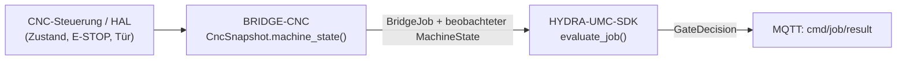

<!-- =============================================================================
HYDRA-UMC-BRIDGE-CNC - CNC-Zellkoordinationsbrücke
Copyright (C) JuanenRac (Electro Hobby 3D) <electrohobby3d@gmail.com>
GPL-3.0-or-later - see LICENSE
============================================================================= -->

<p align="center">
  
</p>

# 🔧 HYDRA-UMC-BRIDGE-CNC

<p align="center"><a href="README.md">🇺🇸 English</a> | <a href="README_spa.md">🇪🇸 Español</a> | <a href="README_fra.md">🇫🇷 Français</a> | <a href="README_ita.md">🇮🇹 Italiano</a> | 🇩🇪 <b>Deutsch</b> | <a href="README_zho.md">🇨🇳 简体中文</a> | <a href="README_jpn.md">🇯🇵 日本語</a> | <a href="README_por.md">🇵🇹 Português</a></p>

### 🛑 Ausfallsichere Koordinationsbrücke für CNC-Zellen

<p align="center">
  
  
  
</p>

---

> **Ehrlichkeitscheck - was heute wirklich läuft:** der ausfallsichere Zellen-Snapshot und das Sicherheitsgate (`cell.py` mit `CncSnapshot`/`CncCellBridge`, das jeden Job durch das echte `evaluate_job()` von `HYDRA-UMC-SDK` leitet), der schreibgeschützte GRBL/MTConnect-Evidenz-Normalisierer (`observation.py`), der echte GRBL-Seriell-Transport (`serial_transport.py` mit `GrblSerialProbe`/`GrblRealtimeControl`) und der MQTT-Befehls-/Statustransport (`mqtt_transport.py`) sind real und durch 206 bestehende `unittest`-Fälle abgedeckt (`python tools/build_test.py`), einschließlich `tests/test_grbl_emulator.py`, das diese Bridge gegen einen protokolltreuen, von Hand geschriebenen GRBL-v1.1-Emulator laufen lässt. Nichts davon hat je einen echten seriellen Port, einen echten MQTT-Broker oder einen echten CNC-Controller berührt - `test_serial_transport.py`s eigener `FakeSerial` ersetzt eine physische Verbindung, und `test_mqtt_transport.py` verwendet ebenso einen simulierten Broker-Client. Die Anbindungen an LinuxCNC und CNCjs und die MTConnect-Sicht kennen nur Simulationen, es gibt keinen LinuxCNC-HAL-Adapter und keinen echten `run`-Befehl, weil noch kein realer Controller angesteuert wurde - siehe „Aktueller Status und nächste Schritte" weiter unten, das dies bereits klar sagt, sowie `CHANGELOG.md` für das, was bisher genau ausgeliefert wurde.

---

> **Stand von Sicherheit (Safety) und Security:** Dieses Ökosystem ist kein zertifiziertes Sicherheitssystem. Es gibt noch keinen Hardware-E-STOP-Pfad, keine von der Firmware durchgesetzten Grenzen oder Verriegelungen und keinen verifizierten Bewegungsbefehl; Firmware-Images werden mit CRC32 und einem HMAC-SHA256 mit gemeinsamem Schlüssel geprüft, nicht mit einer asymmetrischen Signatur; TLS und gegenseitiges TLS sind optional und standardmäßig aus; noch keine eigene Platine wurde bestückt oder getestet. Lesen Sie die [Sicherheitsbasis](https://github.com/JuanenRac/HYDRA-UMC-DOCS/blob/main/docs/SECURITY_BASELINE.md) und das [Bedrohungsmodell](https://github.com/JuanenRac/HYDRA-UMC-DOCS/blob/main/docs/THREAT_MODEL.md), bevor Sie sich für die Sicherheit einer Person auf eine Aussage hier verlassen.

## 📋 Auf einen Blick

| | |
|---|---|
| Version | `0.1.9` |
| Reifegrad | Funktionsfähig |
| Tests | 206 (`python tools/build_test.py`) |
| Technik | Python / LinuxCNC / G-code / GRBL status evidence / GRBL serial transport |
| Ziel | Der Raspberry Pi CM5 einer HYDRA-UMC-Zelle |
| Auf echter Hardware | Nur simuliert: gegen Emulatoren, Attrappen oder Simulatoren getestet; für diese Version ist kein Lauf auf echter Hardware vermerkt |

## 1. 🛠️ TECHNISCHER ÜBERBLICK

**HYDRA-UMC-BRIDGE-CNC** ist die High-Level-Brücke zwischen CNC-Zellen und HYDRA-UMC-Roboterhilfsfunktionen: Beladen, Entladen, Werkstückhandhabung und überwneune Hilfsaufgaben. Sie wird niemals zu einem Echtzeit-Bahnsteuerungscontroller — die CNC-Steuerung (GRBL, LinuxCNC oder die hinter CNCjs) behält jederzeit die Autorität über Bahn, Spindel und Maschinengrenzen.

Sie gehört zur Familie **External Automation Bridges**: einer Gruppe von Schwester-Repositories (CNC, LASER, OPENPNP, PRINTER3D, ROS2), die alle denselben gemeinsamen Sicherheitsvertrag von `HYDRA-UMC-SDK` sprechen, sodass keine Brücke ihre eigene Definition von "sicher zum Arbeiten" erfinden kann.

### Kernfunktionen:
* ✅ **Echter ausfallsicherer Zellen-Snapshot:** `cell.py` — `CncSnapshot.machine_state()` prüft E-STOP und Türzustand, *bevor* überhaupt betrachtet wird, was der Controller meldet; ein ausgelöster E-STOP oder eine offene Tür führen immer zu `SAFE_STOP`, unabhängig davon, was `controller_state` sagt. *(implementiert, getestet in `tests/test_cell.py`)*
* ✅ **Echtes gemeinsames Sicherheitsgatter:** jeder beobachtete Auftrag wird über `evaluate_job()` aus dem `bridge_contract` von `HYDRA-UMC-SDK` neu bewertet — demselben Gatter, das jede Schwesterbrücke verwendet. *(implementiert)*
* ✅ **Konservative Zustandsabbildung:** nur `IDLE` wird als Leerlauf behandelt; `RUN`/`RUNNING`/`JOG`/`HOME` werden auf `RUNNING` abgebildet, `FAULT`/`ERROR`/`OFF`/`ALARM` auf `FAULT`, und jeder nicht erkannte Wert fällt auf `OFFLINE` zurück — niemals auf einen Zustand, der produktive Arbeit erlauben würde. (`HOLD` → `HOLDING`; `DOOR` → `SAFE_STOP`) *(implementiert)*
* ✅ **Schreibgeschützte Controller-Evidenz:** `observation.py` normalisiert streng die lokale Mapping-Evidenz und die gelieferten GRBL-Statuszeilen; ausgelassene oder nicht-boolesche E-STOP-/Tür-Signale schlagen sicher fehl. *(implementiert, getestet in `tests/test_observation.py`)*
* ✅ **Echter GRBL-Serientransport:** `GrblSerialProbe` aus `serial_transport.py` öffnet eine echte serielle Verbindung und fragt das Echtzeit-Statusbyte von GRBL ab (`?`); `GrblRealtimeControl` sendet ausschließlich GRBLs eigene Echtzeit-Steuerbytes (Vorschub-Halt, Zyklus-Fortsetzung, Soft-Reset) — `cycle_start_resume()` ist an eine tatsächlich in `HOLDING` befindliche Maschine gebunden, die übrigen sind immer erlaubt wie `ABORT`. Es streamt niemals ein G-Code-Programm. *(implementiert, getestet in `tests/test_serial_transport.py`)*
* ✅ **Nicht-mutierender Build/Test:** `build-test.bat`/`.sh` kompilieren den Quellcode und führen die Sicherheitsgatter-Testsuite aus, ohne Versionsdateien oder das CHANGELOG anzufassen. *(implementiert, siehe BUILD & AUSFÜHRUNG unten)*
* ✅ **Steuerungsanbindungen:** die Bridge spricht über `ControllerLink` (`controller.py`) mit einer Steuerung: GRBL an einem seriellen Port, den die Bridge offen hält (`GrblController`), eine LinuxCNC-Installation (`linuxcnc_link.py`: liest `linuxcnc.stat`, sendet über `linuxcnc.command` nur Pause, Abbruch und Fortsetzen eines pausierten Programms, führt nie ein Programm aus) und ein CNCjs-Server, der den Port besitzt (`cncjs_link.py`: liest das von ihm gesendete `controller:state` und sendet nur `feedhold`, `reset` und `cyclestart`, sodass die Bridge neben dem Sender arbeitet, der die Programme ausführt). Ein Fortsetzen verlangt immer eine READY-Zelle und eine Maschine, die wirklich angehalten ist; eine alte oder fehlende Messung ist nie eine ruhende Maschine. Beide Anbindungen sind gegen Simulationen getestet (`SimulatedLinuxcnc`, `SimulatedCncjs`); keine hat ein echtes LinuxCNC oder CNCjs berührt. *(implementiert, nur simuliert)*
* ✅ **Spindel-Gate:** ein Beladen oder Entladen wird abgelehnt, wenn die Steuerung im Leerlauf ist, aber noch eine drehende Spindel oder einen laufenden Vorschub meldet (`FS:`). `HYDRA_UMC_CNC_SPINDLE_GATE` ist `off`, `when_known` (Standard: lehnt ab, was gemeldet wird) oder `required` (lehnt auch ab, was die Steuerung nicht meldet). Der Snapshot trägt außerdem die Positionen, den Werkstücknullpunkt-Versatz und die Overrides des Berichts. *(implementiert)*
* ✅ **MTConnect-Sicht:** `mtconnect_publish.py` macht aus dem Snapshot MTConnect-Beobachtungen (`avail`, `execution`, `estop`, `door`, `spindle_speed`, `path_feedrate`, `system`), die `ShdrAdapter` als SHDR über TCP ausliefert (nur lesend; die einzige akzeptierte Zeile ist `* PING`) und die mit `HYDRA_UMC_CNC_MTCONNECT=1` als Retained-Nachricht auf `hydra/bridges/cnc/mtconnect` veröffentlicht werden. Eine Steuerung, die nicht meldet, ist `UNAVAILABLE`, nie `READY`. Gegen einen simulierten Agenten getestet. *(implementiert, noch nicht mit einem echten Agenten erprobt)*
* 🔜 **LinuxCNC-HAL-Pins** — zurückgestellt; es wurde noch keine reale CNC-Steuerung, kein HAL-Pin und kein Roboter angesteuert. *(geplant)*
* ✅ **Wiederholte Idempotenzschlüssel:** `CncMqttBridge` nimmt einen `IdempotencyStore` an: ein wiederholter Auftragsschlüssel erhält die Antwort vom ersten Mal, statt erneut bewertet zu werden. *(implementiert, getestet in `tests/test_idempotency.py`)*
* ✅ **Passende Statusantworten, fail-closed Seriell, gehärtete MQTT-Schleife:** die Statusabfrage verwirft, was schon wartet, sendet `?` und liest, bis ein echter Statusbericht (`<...>`) eintrifft: das Banner sowie `ok`, `[MSG:...]` und `ALARM:n`, die GRBL ungefragt sendet, lassen nicht mehr jede spätere Abfrage um eine Antwort hinterherhinken; ein fehlendes USB-Gerät (oder jeder Fehler auf der Leitung) schlägt fail-closed fehl, statt die Bridge zu beenden, und der Port wird geöffnet, ohne DTR zu setzen; `cmd/feed_hold` meldet, was die Steuerung danach gesagt hat (`controller_state_after`, `confirmed`), und `cmd/feed_hold` und `cmd/soft_reset` laufen auf einer eigenen Spur, sodass eine Statusabfrage sie nie verzögert; eine zu große (über 16 KiB), unlesbare oder tief verschachtelte Nutzlast und jeder unerwartete Fehler werden mit einer Ablehnung auf dem Ergebnis-Topic beantwortet und beenden die Schleife nie; die Antworten von `cmd/job` tragen `"mode": "gate-only"`, und ein ABORT darüber sagt, dass nichts gestoppt wurde; der Zustand enthält `observed_at`, und die Bridge meldet sich auf einem `availability`-Topic mit Last Will. GRBL hat EINEN seriellen Port: solange diese Bridge ihn hält, kann ihn kein G-Code-Sender benutzen (siehe `docs/BRIDGE_GUIDE.md`). *(implementiert, getestet in `tests/test_hardening.py`)*

---

## 2. 🔄 ZELLKOORDINATIONSABLAUF



---

## 3. 🧱 ARCHITEKTUR UND DESIGN-ENTSCHEIDUNGEN

* **Warum E-STOP und Türzustand vor dem vom Controller selbst gemeldeten Zustand geprüft werden.** `CncSnapshot.machine_state()` springt zuerst auf `SAFE_STOP`, wenn `estop` gesetzt ist oder die Tür nicht geschlossen ist — ein Controller, der weiterhin `IDLE` meldet, während die Tür offen ist, darf niemals wörtlich genommen werden.
* **Warum die Zustandsabbildung des Controllers bewusst konservativ ist.** Nur die wörtliche Zeichenkette `IDLE` wird auf `MachineState.IDLE` abgebildet. Jeder nicht erkannte Wert fällt auf `OFFLINE` zurück, niemals auf etwas, das Hilfsarbeit erlauben würde — ein unbekannter Controller-Zustand wird als "weiß ich nicht" behandelt, nicht als "wahrscheinlich in Ordnung".
* **Warum die Brücke einen neuen `BridgeJob` erstellt und an das gemeinsame `evaluate_job()` delegiert, statt eigene Annahme-/Ablehnungslogik zu schreiben.** Alle fünf External Automation Bridges (CNC, LASER, OPENPNP, PRINTER3D, ROS2) verwenden exakt denselben `bridge_contract` von `HYDRA-UMC-SDK` wieder, sodass "was als sicher für den Start eines Auftrags zählt" zwischen ihnen nicht stillschweigend auseinanderdriften kann.
* **Warum die Anbindungen an LinuxCNC und CNCjs nur lesen, pausieren und fortsetzen.** Die Steuerung behält die Autorität über Bahn, Spindel und Grenzen, und das Programm gehört dem, der es ausführt (CNCjs, LinuxCNC selbst): die Bridge darf die Maschine zur Ruhe bringen und eine pausierte weiterlaufen lassen, mehr nicht. Das Verdrahten echter HAL-Pins bleibt ein Hardware-Integrationsschritt, der gegen eine reale Steuerung validiert werden muss.
* **Wie das in den Rest des Ökosystems passt.** BRIDGE-CNC sitzt zwischen der CNC-Steuerung und `HYDRA-UMC-SDK` → `HYDRA-UMC-MQTT-BROKER` → MCU-/Zellsicherheit: es koordiniert Roboter-Hilfsarbeit rund um die CNC, es ersetzt oder überschreibt nicht die eigene Sicherheitsautorität der Steuerung.

Die Beobachtungs-Hilfsfunktionen sind Evidenz-Normalisierer, keine Controller-Adapter: sie öffnen keine HAL-, seriellen oder Netzwerkverbindungen. [Controller Evidence Boundary](docs/CONTROLLER_EVIDENCE_BOUNDARY.md) definiert die Validierung, die vor einer echten Controller-Integration erforderlich ist.

---

## 📂 VERZEICHNISSTRUKTUR

```text
HYDRA-UMC-BRIDGE-CNC/
├── src/
│   └── hydra_umc_bridge_cnc/
│       ├── __init__.py
│       ├── cell.py              # Sicherheitsgatter CncSnapshot + CncCellBridge
│       ├── observation.py       # Nur-Lese-Mapping und GRBL-Statusnormalisierung
│       ├── serial_transport.py  # Echter, ausfallsicherer GRBL-Seriell-Transport - nur Statusabfragen und Echtzeit-Steuerbytes (Port und Statusabfrage sind die gemeinsame serielle Anbindung des SDK)
│       ├── controller.py        # ControllerLink: was die Bridge von jeder Steuerung braucht (+ GrblController)
│       ├── linuxcnc_link.py     # LinuxCNC: liest linuxcnc.stat, pausiert, bricht ab, setzt fort (+ SimulatedLinuxcnc)
│       ├── cncjs_link.py        # CNCjs: liest dessen Broadcast, feedhold/reset/cyclestart (+ SimulatedCncjs)
│       ├── mtconnect_publish.py # MTConnect-Beobachtungen, SHDR-Zeilen und der schreibgeschützte SHDR-Adapter
│       └── mqtt_transport.py    # Echter MQTT-Broker-Transport für die bereits reale Logik dieser Bridge
├── tests/
│   ├── test_cell.py             # Zulassung im sicheren Leerlauf, Ablehnung bei offener Tür, Abbruchweiterleitung
│   ├── test_observation.py      # Fehlende Sicherheitsnachweise schlagen fail-closed fehl
│   ├── test_serial_transport.py # Echter Serial-Transport gegen einen simulierten Port, inkl. Fail-Closed-Pfade
│   ├── test_mqtt_transport.py   # MQTT-Befehls-/Statusform-Tests gegen einen simulierten Broker-Client
│   ├── test_mqtt_environment.py # Die MQTT-Zugangsdaten und TLS der Dienstumgebung erreichen den Client
│   ├── test_idempotency.py      # Ein wiederholter Idempotenzschlüssel wird nur einmal beantwortet
│   ├── test_controllers.py      # Spindel-Gate, LinuxCNC- und CNCjs-Anbindung gegen ihre Simulationen, MTConnect-Sicht
│   ├── grbl_emulator.py         # Protokolltreuer GRBL v1.1-Emulator (realistischer Test-Double)
│   ├── test_grbl_emulator.py    # Bridge-Verhalten gegenüber dem GRBL v1.1-Emulator
│   └── test_hardening.py        # Passende Statusantworten, totes Kabel, Bestätigung des Haltens, feindliche Nutzlasten
├── tools/
│   ├── build_test.py            # Nicht-mutierender Compiler + Testläufer (build-test.bat/.sh)
│   ├── bump_version.py          # Synchronisiert pyproject.toml, Manifest und CHANGELOG.md
│   ├── ci_validate.py           # Abhängigkeitsfreie, nicht-destruktive CI-Basislinie (verwendet von .github/workflows/ci.yml)
│   └── inspect_controller_evidence.py # Normalisiert eine gespeicherte lokale Evidenz-JSON-Datei (keine Verbindung geöffnet)
├── docs/
│   ├── BRIDGE_GUIDE.md                    # Umfang, kompatible Plattformen, Skripte, Hardware-Abnahmegatter
│   └── CONTROLLER_EVIDENCE_BOUNDARY.md    # Was als echter Sicherheitsnachweis zählt und was diese Bridge nicht ableitet
├── images/
│   └── HYDRA_UMC_BANNER.svg     # README-Banner
├── build-test.bat / build-test.sh  # Validiert nur, ändert das Repository nie
├── build.bat / build.sh            # Validiert und baut (Bauen ändert nie die Version)
├── pyproject.toml               # Paket-Metadaten; hängt von HYDRA-UMC-SDK ab (git)
├── hydra-umc.project.json       # Ökosystem-Manifest (Version, Reifegrad, Familie)
├── CHANGELOG.md
├── CODE_OF_CONDUCT.md / CONTRIBUTING.md / SECURITY.md / SUPPORT.md
├── LICENSE / LICENSE.md
└── README.md / README_*.md      # Diese Datei und ihre 6 Übersetzungen
```

---

## 4. ⚙️ BUILD & AUSFÜHRUNG

Erfordert Python 3.11+. `tools/build_test.py` erwartet, dass `HYDRA-UMC-SDK` als Schwesterverzeichnis (`../HYDRA-UMC-SDK`) ausgecheckt oder über die Umgebungsvariable `HYDRA_UMC_SDK_ROOT` angegeben ist.

```bash
# Windows
build-test.bat      # nur Validierung — keine Versions-/CHANGELOG-Änderung
build.bat            # Validiert und baut (Bauen ändert nie die Version)

# Linux/macOS
bash build-test.sh
bash build.sh
```

`build-test` kompiliert jedes Modul unter `src/` mit `py_compile` und führt die vollständige, unter `tests/` entdeckte `unittest`-Suite aus (`test_cell.py`, `test_observation.py`, `test_serial_transport.py`, `test_mqtt_transport.py`, `test_grbl_emulator.py`, `test_hardening.py`, `test_idempotency.py`, `test_mqtt_environment.py` - 206 Tests), was unter anderem die Zulassung im sicheren Leerlauf, die Ablehnung bei offener Tür und die Abbruchweiterleitung belegt — es ändert das Repository nie. `build` führt zuerst dieselbe Validierung aus und ruft nur bei Erfolg `tools/bump_version.py` auf, um die Version in `pyproject.toml`, `hydra-umc.project.json` und `CHANGELOG.md` zu synchronisieren. Es gibt noch keinen echten CNC-`run`-Befehl — dafür ist eine validierte Controller-Integration erforderlich.

---

## ✅ AKTUELLER STATUS UND NÄCHSTE SCHRITTE

**Heute real:** Version `0.1.9`, ein lokal getesteter ausfallsicherer Zellkoordinator (`CncSnapshot` + `CncCellBridge`), gestützt auf das gemeinsame Auftragsgatter von `HYDRA-UMC-SDK`, strenge schreibgeschützte Normalisierung von Controller-Evidenz, die das vollständige echte Statusvokabular von GRBL v1.1 einschließlich echter `Hold:N`/`Door:N`-Unterzustände (`Idle`/`Run`/`Jog`/`Home`/`Hold`/`Alarm`/`Door`) sowie MTConnect-Ausführungszustände abdeckt, ein echter Serientransport (`GrblSerialProbe`/`GrblRealtimeControl`), der den Status abfragen und GRBLs eigene Echtzeit-Steuerbytes über eine echte Verbindung senden kann - das Live-Auslesen von Tür/E-STOP erfolgt jetzt direkt nach dem eigenen blockierenden Hin-und-Rückweg dieser Abfrage, niemals davor, und ein echter kurzer oder Null-Byte-Schreibvorgang wird als nicht ausgeführt gemeldet statt als falscher Erfolg -, eine deterministische `unittest`-Suite mit 206 Tests sowie nicht-mutierende Build-Test-Skripte, die in CI mit SDK-Checkout eingebunden sind.

**Integrationsgrenze:** die CNC-Steuerung (GRBL, LinuxCNC oder die hinter CNCjs) behält jederzeit die Autorität über Bahn, Spindel und Maschinengrenzen; diese Brücke steuert ausschließlich *Hilfs*-Roboterarbeit, niemals die Bewegung der Steuerung.

**Noch offen:** es wurde noch keine reale CNC-Steuerung, kein LinuxCNC-HAL-Pin und kein Roboter angesteuert — die Auswahl und Validierung eines konkreten HAL-Adapters ist ein Hardware-/Software-Integrationsschritt, der erst nach Verfügbarkeit der Maschine und ihrer dokumentierten Schnittstelle folgt.

---

## 🔗 Verwandte Projekte

Dieses Projekt ist Teil des HYDRA-UMC-Robotik-Ökosystems desselben Autors (JuanenRac / Electro Hobby 3D). Gut zu wissen, da eine Anfrage eigentlich eines dieser Projekte betreffen könnte statt dieses Repositorys.

**Übergeordnetes Projekt**
- **[HYDRA-UMC-SERVER](https://github.com/JuanenRac/HYDRA-UMC-SERVER)** — das reale Headless-Backend (REST/WebSocket), mit dem jeder Steuerungsclient tatsächlich spricht; diese Bridge ruft es nicht auf: sie antwortet über MQTT, via HYDRA-UMC-MQTT-BROKER, demjenigen, der die Zelle steuert.

**Geschwisterprojekte** — sprechen ebenfalls mit der eigenen API von HYDRA-UMC-SERVER, jeweils als eigener Client
- **[HYDRA-UMC-STUDIO](https://github.com/JuanenRac/HYDRA-UMC-STUDIO)** — Web-Steuerungs-Dashboard mit Echtzeit-3D-Visualisierung mehrerer Roboter.
- **[HYDRA-UMC-SUITE](https://github.com/JuanenRac/HYDRA-UMC-SUITE)** — Desktop-Schwarmleitstand (PySide6) für mehrere Server gleichzeitig, verpackt als eigenständige ausführbare Datei.
- **[HYDRA-UMC-ANDROID-CONTROL](https://github.com/JuanenRac/HYDRA-UMC-ANDROID-CONTROL)** — native Android-Steuerungs-App mit biometrischem Login und einer gekoppelten Wear-OS-Begleit-App.
- **[HYDRA-UMC-IOS-CONTROL](https://github.com/JuanenRac/HYDRA-UMC-IOS-CONTROL)** — iOS/iPadOS-Steuerungs-App (Flutter) mit Echtzeit-WebSocket-Synchronisierung.
- **[HYDRA-UMC-DSI](https://github.com/JuanenRac/HYDRA-UMC-DSI)** — native Touch-UI für das eingebaute 7"-DSI-Touchscreen, direkt auf dem CM5 eingebettet.
- **[HYDRA-UMC-BRIDGE-AMR](https://github.com/JuanenRac/HYDRA-UMC-BRIDGE-AMR)** — Koordinationsschranke für AGV-/AMR-Flotten über einen VDA-5050-MQTT-Publisher (nur gegen eine emulierte Flotte getestet).
- **[HYDRA-UMC-BRIDGE-DROIDS](https://github.com/JuanenRac/HYDRA-UMC-BRIDGE-DROIDS)** — Koordinationsschranke für laufende/humanoide Droiden, mit einem Boston-Dynamics-Spot-Befehlssender (nur gegen einen Emulator getestet).
- **[HYDRA-UMC-BRIDGE-LASER](https://github.com/JuanenRac/HYDRA-UMC-BRIDGE-LASER)** — Koordinator für Laserzellen, liest 3 Schlüssel-/Gehäuse-/Verriegelungs-GPIO-Signale (nur gegen einen simulierten Chip getestet; kann keinen Laser scharfschalten oder auslösen).
- **[HYDRA-UMC-BRIDGE-OPENPNP](https://github.com/JuanenRac/HYDRA-UMC-BRIDGE-OPENPNP)** — sicherer High-Level-Koordinator für den Leiterplattenfluss von OpenPnP Pick-and-Place.
- **[HYDRA-UMC-BRIDGE-PRINTER3D](https://github.com/JuanenRac/HYDRA-UMC-BRIDGE-PRINTER3D)** — sichere Koordinationsschranke für Moonraker/Klipper-3D-Drucker, mit echten gesicherten Job-Befehlen.
- **[HYDRA-UMC-BRIDGE-ROS2](https://github.com/JuanenRac/HYDRA-UMC-BRIDGE-ROS2)** — Koordinator mit einem träge importierten rclpy-ROS-2-Transport (noch nicht gegen eine ROS-2-Installation ausgeführt).
- **[HYDRA-UMC-BRIDGE-UAV](https://github.com/JuanenRac/HYDRA-UMC-BRIDGE-UAV)** — Koordinationsschranke für kameraausgestattete UAVs, mit einem MAVLink-Befehlssender (nur gegen einen Emulator getestet).

**Direkt verwandt**
- **[HYDRA-UMC-SDK](https://github.com/JuanenRac/HYDRA-UMC-SDK)** — der gemeinsame JSON-Schema-Vertrag und die Software-Auftragsschranke, gegen die jede Bridge ihre Befehle validiert (keine zertifizierte Sicherheitsfunktion).
- **[HYDRA-UMC-CONNECTOR-HUB](https://github.com/JuanenRac/HYDRA-UMC-CONNECTOR-HUB)** — deklaratives Adapter-Manifest-Register und Validator für Konnektoren externer Maschinen; erweitert die eigene Vertragsidee des SDK auf externe Maschinen, ohne die Industrie-Gateway-Projekte zu ersetzen.
- **[HYDRA-UMC-MQTT-BROKER](https://github.com/JuanenRac/HYDRA-UMC-MQTT-BROKER)** — der echte Transport von `mqtt_transport.py` für die eigenen `hydra/bridges/cnc/...`-Topics dieser Bridge — Status plus Jog-/Reset-/Resume-Steuerbytes, neben der gemeinsamen Job-Schranke; siehe die eigene `docs/BRIDGE_TOPICS.md` dieses Repositorys.
- **[HYDRA-UMC-HIL-BRIDGE](https://github.com/JuanenRac/HYDRA-UMC-HIL-BRIDGE)** — zukünftiger Hardware-in-the-Loop-Nachweispfad für die echte Controller-Integration.

**Ebenfalls Teil des Ökosystems**

*Kern-Hardware & Plattform*
- **[HYDRA-UMC](https://github.com/JuanenRac/HYDRA-UMC)** — der Entwurf des Motherboards des Roboterarms: CM5-Host + Dual-Core-STM32H745, gedacht zur Koordination von bis zu 8 Werkzeugarmen über CAN-OTA/SPI-OTA (Firmware in einer frühen Phase; noch keine bestückte Platine).
- **[HYDRA-UMC-OS](https://github.com/JuanenRac/HYDRA-UMC-OS)** — reproduzierbare Raspberry-Pi-OS-Produktschicht für den CM5: schreibgeschützter Agent, validierte Konfiguration/Profile, WiFi-Ersteinrichtung.

*Kern-Backend & Clients*
- **[HYDRA-UMC-EDITOR-URDF](https://github.com/JuanenRac/HYDRA-UMC-EDITOR-URDF)** — grafischer Desktop-URDF-Ersteller/-Editor, der fertige Modelle in STUDIOs eigenen Katalog überträgt.
- **[HYDRA-UMC-EDITOR-STL](https://github.com/JuanenRac/HYDRA-UMC-EDITOR-STL)** — Desktop-STL-Modelleditor, der echte Teile im selben Modellkatalog transformiert/ersetzt/entfernt/hinzufügt, den auch HYDRA-UMC-EDITOR-URDF bearbeitet.

*URTC-Werkzeugplattform*
- **[URTC](https://github.com/JuanenRac/URTC)** — Firmware für die physische Universal-Robot-Tool-Controller-Platine, 25+ Werkzeugprofile über CAN-Bus.
- **[URTC-FLASHER](https://github.com/JuanenRac/URTC-FLASHER)** — Desktop-GUI-Flash-Tool für URTC-Platinen, CAN-OTA plus Full-Chip-SWD/JTAG.
- **[URTC-TESTER](https://github.com/JuanenRac/URTC-TESTER)** — Desktop-Live-CAN-Bus-Diagnosetool für URTC-Platinen, ein Panel pro Werkzeugprofil.
- **[URTC-WEB-STUDIO](https://github.com/JuanenRac/URTC-WEB-STUDIO)** — browserbasierte Alternative zu URTC-TESTER über die Web-Serial-API, ohne lokale Installation.
- **[URTC-GATEWAY](https://github.com/JuanenRac/URTC-GATEWAY)** — Gateway vor dem CAN-Bus von URTC: Liste erlaubter Kennungen, Ratenbegrenzung und Sitzungsschlüssel; Software auf dem Computer getestet, noch nicht an einem echten Bus.

*Vision-KI-Knoten (Hailo-8)*
- **[HYDRA-UMC-VISION-NODE](https://github.com/JuanenRac/HYDRA-UMC-VISION-NODE)** — Integrationsknoten für die Hailo-8-Vision-Pipeline, mit einer echten stufenweisen Hardware-Bereitschaftsprüfung.
- **[HYDRA-UMC-DETECTION-HEF](https://github.com/JuanenRac/HYDRA-UMC-DETECTION-HEF)** — echte Registry für kompilierte Modelle mit Hailo-Architektur-/Prüfsummen-Safe-Load-Verifizierung.
- **[HYDRA-UMC-VISION-STREAMER](https://github.com/JuanenRac/HYDRA-UMC-VISION-STREAMER)** — echter GStreamer-Pipeline- + MediaMTX-Konfigurationsgenerator mit einer echten HailoRT-Integrationsschranke.
- **[HYDRA-UMC-VISUAL-SERVOING-API](https://github.com/JuanenRac/HYDRA-UMC-VISUAL-SERVOING-API)** — Position-Based-Visual-Servoing-Korrekturgesetz mit Freigabe abhängig vom Zonenstatus; noch keine Posenschätzung per Kamera.
- **[HYDRA-UMC-SAFETY-ZONES](https://github.com/JuanenRac/HYDRA-UMC-SAFETY-ZONES)** — v0-Logik für Zonenverletzung, Kalibrierungsaktualität und E-STOP-Anforderung, die Objektpositionen aus einer Datei nimmt; kein Detektor speist sie, und noch kein physischer E-STOP ist angeschlossen.

*Kognitiver KI-Knoten (Hailo-10)*
- **[HYDRA-UMC-COGNITIVE-NODE](https://github.com/JuanenRac/HYDRA-UMC-COGNITIVE-NODE)** — Integrationsknoten für die Hailo-10-Cognitive-Pipeline (LLM-/VLA-/Sprach-Orchestrierung).
- **[HYDRA-UMC-VLA-ENGINE](https://github.com/JuanenRac/HYDRA-UMC-VLA-ENGINE)** — echte Aktions-Token-Kodierung/-Dekodierung und Trajektoriengenerierung für ein Vision-Language-Action-Modell.
- **[HYDRA-UMC-VOICE-UI](https://github.com/JuanenRac/HYDRA-UMC-VOICE-UI)** — echtes Sprach-Frontend (VAD + Intent-Parser) mit einem begrenzten, bestätigungsgesicherten Watch-Relay.
- **[HYDRA-UMC-SEMANTIC-PLANNER](https://github.com/JuanenRac/HYDRA-UMC-SEMANTIC-PLANNER)** — echte regelbasierte Aufgabenzerlegung und semantische Fehlerbehebung über MCU-Fehlercodes.
- **[HYDRA-UMC-DOCS-QA](https://github.com/JuanenRac/HYDRA-UMC-DOCS-QA)** — echte, nur auf der Standardbibliothek basierende TF-IDF-Dokumentensuche über die eigenen Markdown-Dokumente dieses Ökosystems.
- **[HYDRA-UMC-LOCAL-TECHNICIAN](https://github.com/JuanenRac/HYDRA-UMC-LOCAL-TECHNICIAN)** — lokaler, richtlinien-gesteuerter KI-Wartungstechniker für das Ökosystem selbst - beobachtet, diagnostiziert und schlägt Korrekturen vor; die zwei höchsten Risikostufen sind absichtlich noch nicht implementiert.

*Orchestrierung & Schwarm*
- **[HYDRA-UMC-ORCHESTRATOR](https://github.com/JuanenRac/HYDRA-UMC-ORCHESTRATOR)** — Integrationsknoten mit einem echten gRPC/Protobuf-Health-Report-Vertrag und einer Missions-Zustandsmaschine.
- **[HYDRA-UMC-JOB-DISPATCHER](https://github.com/JuanenRac/HYDRA-UMC-JOB-DISPATCHER)** — echte prioritätsbasierte Job-Queue mit Deduplizierung, über eine echte HTTP-API.
- **[HYDRA-UMC-NODE-HEALING](https://github.com/JuanenRac/HYDRA-UMC-NODE-HEALING)** — echter gRPC-basierter Flotten-Health-Watchdog mit Retry/Backoff und Identitäts-Mismatch-Erkennung.
- **[HYDRA-UMC-PATH-PLANNER-3D](https://github.com/JuanenRac/HYDRA-UMC-PATH-PLANNER-3D)** — echter RRT-basierter 3D-Pfadplaner mit echter Hindernis-/Arbeitsraum-Kollisionsvalidierung.
- **[HYDRA-UMC-SWARM-SYNC](https://github.com/JuanenRac/HYDRA-UMC-SWARM-SYNC)** — echte CRDT-LWW-Element-Map-Zustandssynchronisation, eigenschaftsgetestet auf Multi-Zellen-Konvergenz.

*Digitaler Zwilling & Simulation*
- **[HYDRA-UMC-TWIN](https://github.com/JuanenRac/HYDRA-UMC-TWIN)** — Integrationsknoten für die Digital-Twin-Engine, mit einem echten Versionskompatibilitäts-Sync-Vertrag.
- **[HYDRA-UMC-PHYSICS-REPLICA](https://github.com/JuanenRac/HYDRA-UMC-PHYSICS-REPLICA)** — echte Vorwärtskinematik und Gelenkgrenzenvalidierung über eine echte URDF-Teilmenge.
- **[HYDRA-UMC-SYNTHETIC-DATA-GEN](https://github.com/JuanenRac/HYDRA-UMC-SYNTHETIC-DATA-GEN)** — echter prozeduraler 2D-Szenengenerator mit YOLO/COCO-Annotationsexport.

*Daten & Analytik*
- **[HYDRA-UMC-DATALAKE](https://github.com/JuanenRac/HYDRA-UMC-DATALAKE)** — echter sqlite3-gestützter Zeitreihenspeicher mit einer echten Ingest-/Abfrage-HTTP-API.
- **[HYDRA-UMC-ANOMALY-DETECTOR](https://github.com/JuanenRac/HYDRA-UMC-ANOMALY-DETECTOR)** — echter FFT- + statistischer Basislinien-Anomaliedetektor mit Drift-Überwachung.
- **[HYDRA-UMC-PRODUCTION-REPORTS](https://github.com/JuanenRac/HYDRA-UMC-PRODUCTION-REPORTS)** — echte OEE-/Verfügbarkeitsberechnung über den DATALAKE-Verlauf, mit reproduzierbarem CSV-Export.
- **[HYDRA-UMC-TELEMETRY-COLLECTOR](https://github.com/JuanenRac/HYDRA-UMC-TELEMETRY-COLLECTOR)** — echte CAN/WebSocket-Ingestion-Pipeline in DATALAKE, mit Sequenz-Deduplizierung.

*Industrie-Gateway*
- **[HYDRA-UMC-GATEWAY-INDUSTRIAL](https://github.com/JuanenRac/HYDRA-UMC-GATEWAY-INDUSTRIAL)** — Integrationsknoten, der zu Industrieprotokollen weiterleitet, mit einer echten Befehls-Allowlist-/Backpressure-Schicht.
- **[HYDRA-UMC-OPCUA-SERVER](https://github.com/JuanenRac/HYDRA-UMC-OPCUA-SERVER)** — echter OPC-UA-Adressraum, verifiziert mit einer echten Binärprotokoll-Client-Session.
- **[HYDRA-UMC-MTCONNECT-ADAPTER](https://github.com/JuanenRac/HYDRA-UMC-MTCONNECT-ADAPTER)** — echte MTConnect-`/probe`- und `/current`-XML-Endpunkte mit Degraded-Mode-Ausgabe.

*Ergänzende Tools & Ökosystembetrieb*
- **[HYDRA-UMC-DASHBOARD-AI](https://github.com/JuanenRac/HYDRA-UMC-DASHBOARD-AI)** — Smart-Summaries- und Anomaly-Highlighting-Panels über DATALAKE/ANOMALY-DETECTOR, mit einem ehrlichen statistischen Fallback.
- **[HYDRA-UMC-TOOL-CLI](https://github.com/JuanenRac/HYDRA-UMC-TOOL-CLI)** — Flotten-CLI mit einem echten, stabilen Exit-Code-Vertrag, ein echter Live-Client der eigenen API von HYDRA-UMC-SERVER.
- **[HYDRA-UMC-WATCH](https://github.com/JuanenRac/HYDRA-UMC-WATCH)** — WearOS-Begleit-App mit haptischen Alarmmustern und einem Sprach-Relay zum gekoppelten Telefon (noch nicht auf einer physischen Uhr ausgeführt).
- **[URTC-SMART-RACK](https://github.com/JuanenRac/URTC-SMART-RACK)** — Firmware für ein Platinenmontagegestell mit echter Werkzeug-ID-Dekodierung und Smart-Idle-Vorheizlogik.
- **[URTC-VISION-TOOL](https://github.com/JuanenRac/URTC-VISION-TOOL)** — Firmware plus ein echter Python-Vision-Begleiter für einen Thermal-/RGB-Inspektionswerkzeugkopf.
- **[HYDRA-UMC-UPDATER](https://github.com/JuanenRac/HYDRA-UMC-UPDATER)** — administratives Desktop-Tool, das jedes Repository in diesem Ökosystem entdeckt, klont und aktualisiert.
- **[HYDRA-UMC-OS-REBUILDER](https://github.com/JuanenRac/HYDRA-UMC-OS-REBUILDER)** — Windows/Linux-Desktop-Tool, das ein flashbereites CM5-Image baut, vorgeladen mit den aktuellsten Versionen des Ökosystems, mit Ersteinrichtungs-Konfiguration für WLAN/Benutzer/SSH im Stil von Raspberry Pi Imager.
- **[HYDRA-UMC-OPS-AGENT](https://github.com/JuanenRac/HYDRA-UMC-OPS-AGENT)** — Wartungsvorfall-Koordinator: eine Edge-Rolle mit niedrigem Privileg sammelt einen bereinigten Inventar-/Gesundheits-Snapshot, eine Control-Plane-Rolle rendert ihn schreibgeschützt und bittet einen KI-Anbieter um einen Diagnosevorschlag - wendet nie einen Patch an und stellt nie etwas bereit.
- **[HYDRA-UMC-DEV-SERVER](https://github.com/JuanenRac/HYDRA-UMC-DEV-SERVER)** — reproduzierbarer Entwicklungshost (Raspberry Pi 5 / CM5), der den Quellcode des Ökosystems vorhält und begrenzte Build-/Test-Aufgaben über eine dauerhafte Warteschlange ausführt; eine dedizierte Entwicklerrolle, ausdrücklich kein operativer CM5.

---

## 📚 Dokumentation & Community

- **[CONTRIBUTING.md](CONTRIBUTING.md)** — Technologie-Stack und Coding-Richtlinien für einen Pull Request.
- **[CODE_OF_CONDUCT.md](CODE_OF_CONDUCT.md)** — die in dieser Community erwarteten Verhaltensstandards.
- **[SECURITY.md](SECURITY.md)** — wie man eine Schwachstelle meldet, und die echten Sicherheitsschwerpunkte dieses Projekts.
- **[SUPPORT.md](SUPPORT.md)** — wo man Fragen stellt und Fehler meldet.
- **[LICENSE.md](LICENSE.md)** — die eigene Lizenz dieses Projekts.

## 👤 AUTOR
**JuanenRac** (Electro Hobby 3D)
📧 electrohobby3d@gmail.com
📺 [youtube.com/@electrohobby3d](https://youtube.com/@electrohobby3d)

## 📜 LIZENZ
GPL-3.0-or-later - Siehe LICENSE für Details.
