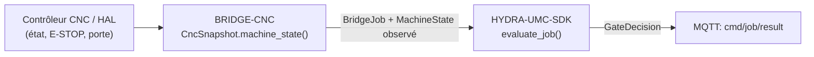

<!-- =============================================================================
HYDRA-UMC-BRIDGE-CNC - Pont de coordination de cellule CNC
Copyright (C) JuanenRac (Electro Hobby 3D) <electrohobby3d@gmail.com>
GPL-3.0-or-later - see LICENSE
============================================================================= -->

<p align="center">
  
</p>

# 🔧 HYDRA-UMC-BRIDGE-CNC

<p align="center"><a href="README.md">🇺🇸 English</a> | <a href="README_spa.md">🇪🇸 Español</a> | 🇫🇷 <b>Français</b> | <a href="README_ita.md">🇮🇹 Italiano</a> | <a href="README_deu.md">🇩🇪 Deutsch</a> | <a href="README_zho.md">🇨🇳 简体中文</a> | <a href="README_jpn.md">🇯🇵 日本語</a> | <a href="README_por.md">🇵🇹 Português</a></p>

### 🛑 Pont de coordination à sécurité intrinsèque pour cellules CNC

<p align="center">
  
  
  
</p>

---

> **Vérification d'honnêteté - ce qui fonctionne réellement aujourd'hui :** l'instantané de cellule à sécurité intégrée et la porte de sécurité (`cell.py` avec `CncSnapshot`/`CncCellBridge`, faisant passer chaque tâche par le propre `evaluate_job()` de `HYDRA-UMC-SDK`), le normaliseur de preuves GRBL/MTConnect en lecture seule (`observation.py`), le vrai transport série GRBL (`serial_transport.py` avec `GrblSerialProbe`/`GrblRealtimeControl`), et le transport de commandes/état MQTT (`mqtt_transport.py`) sont réels et couverts par 206 cas `unittest` qui passent (`python tools/build_test.py`), y compris `tests/test_grbl_emulator.py`, qui fait tourner ce bridge contre un émulateur GRBL v1.1 fidèle au protocole mais écrit à la main. Rien de tout cela n'a touché un vrai port série, un vrai broker MQTT, ou un vrai contrôleur CNC - le `FakeSerial` propre à `test_serial_transport.py` remplace une connexion physique, et `test_mqtt_transport.py` utilise de la même façon un client de broker factice. Les liens LinuxCNC et CNCjs et la vue MTConnect n'ont rencontré que des simulations, il n'existe ni adaptateur HAL LinuxCNC ni commande `run` en direct, car aucun contrôleur réel n'a été piloté - voir « État actuel et prochaines étapes » ci-dessous, qui le dit déjà clairement, et `CHANGELOG.md` pour ce qui a été exactement livré jusqu'à présent.

---

> **État de la sûreté et de la cybersécurité :** cet écosystème n'est pas un système de sécurité certifié. Il n'existe pas encore de chaîne d'E-STOP matérielle, ni de limites ou de verrouillages imposés par le firmware, ni de commande de mouvement vérifiée ; les images de firmware sont contrôlées par CRC32 et un HMAC-SHA256 à clé partagée, pas par une signature asymétrique ; TLS et TLS mutuel sont optionnels et désactivés par défaut ; aucune carte propre n'a encore été assemblée ni testée. Lisez la [base de sécurité](https://github.com/JuanenRac/HYDRA-UMC-DOCS/blob/main/docs/SECURITY_BASELINE.md) et le [modèle de menaces](https://github.com/JuanenRac/HYDRA-UMC-DOCS/blob/main/docs/THREAT_MODEL.md) avant de vous fier à une affirmation d'ici pour la sécurité d'une personne.

## 📋 En un coup d'œil

| | |
|---|---|
| Version | `0.2.0` |
| Maturité | Fonctionnel |
| Tests | 123 (`python tools/build_test.py`) |
| Technologie | Python / LinuxCNC / G-code / GRBL status evidence / GRBL serial transport |
| Cible | Le Raspberry Pi CM5 d'une cellule HYDRA-UMC |
| Sur matériel réel | Simulé seulement : testé avec des émulateurs, des doubles de test ou des simulateurs ; aucune exécution sur du matériel réel n'est consignée pour cette version |

## 🚦 État du projet

Chaque ligne est une partie de ce dépôt et le feu dit où elle en est aujourd'hui. Elle est écrite d'après ce que le dépôt peut montrer (tests, compilations, exécutions), pas d'après ce qui est prévu.

🟢 Fait et vérifié · 🟡 Fonctionne, avec des limites connues · 🟠 À moitié fait ou pas encore vérifié · 🔴 Pas fait ou ne fonctionne pas

| Domaine | État | Ce que cela veut dire ici |
|---|---|---|
| Logiciel | 🟡 | Fonctionne pour son usage principal ; la vérification d'honnêteté ci-dessus liste ce qui manque encore |
| Tests | 🟢 | 123 tests automatiques, exécutés à chaque modification |
| Matériel réel | 🟠 | Simulé seulement : testé avec des émulateurs, des doubles de test ou des simulateurs ; aucune exécution sur du matériel réel n'est consignée pour cette version |
| Documentation | 🟢 | README en huit langues, vérifié par rapport au manifeste à chaque modification |

## 1. 🛠️ APERÇU TECHNIQUE

**HYDRA-UMC-BRIDGE-CNC** est le pont haut niveau entre les cellules CNC et les auxiliaires robotiques HYDRA-UMC : chargement, déchargement, manipulation de pièces et tâches auxiliaires supervisées. Il ne devient jamais un contrôleur de trajectoire temps réel — le contrôleur CNC (GRBL, LinuxCNC ou celui qui se trouve derrière CNCjs) conserve à tout moment l'autorité sur la trajectoire, la broche et les limites machine.

Il appartient à la famille **External Automation Bridges** : un ensemble de dépôts frères (CNC, LASER, OPENPNP, PRINTER3D, ROS2) qui partagent le même contrat de sécurité de `HYDRA-UMC-SDK`, afin qu'aucun pont ne puisse inventer sa propre définition du « sûr pour travailler ».

### Fonctionnalités clés :
* ✅ **Instantané de cellule à sécurité intrinsèque, réel :** `cell.py` — `CncSnapshot.machine_state()` vérifie l'E-STOP et l'état de la porte *avant* de regarder ce que rapporte le contrôleur ; un E-STOP activé ou une porte ouverte résout toujours en `SAFE_STOP`, quel que soit `controller_state`. *(implémenté, testé dans `tests/test_cell.py`)*
* ✅ **Portail de sécurité partagé, réel :** chaque tâche observée est réévaluée via `evaluate_job()` du `bridge_contract` de `HYDRA-UMC-SDK`, le même portail utilisé par tous les ponts frères. *(implémenté)*
* ✅ **Mappage d'état conservateur :** seul `IDLE` est traité comme repos ; `RUN`/`RUNNING`/`JOG`/`HOME` sont mappés vers `RUNNING`, `FAULT`/`ERROR`/`OFF`/`ALARM` vers `FAULT`, et toute valeur non reconnue retombe sur `OFFLINE` — jamais sur un état qui autoriserait un travail productif. (`HOLD` → `HOLDING`; `DOOR` → `SAFE_STOP`) *(implémenté)*
* ✅ **Preuve du contrôleur en lecture seule :** `observation.py` normalise strictement la preuve de mappage locale et les lignes d'état GRBL fournies ; les signaux E-STOP/porte omis ou non booléens échouent en mode sécurisé. *(implémenté, testé dans `tests/test_observation.py`)*
* ✅ **Transport série GRBL réel :** `GrblSerialProbe` de `serial_transport.py` ouvre une véritable connexion série et interroge l'octet d'état temps réel de GRBL (`?`) ; `GrblRealtimeControl` n'envoie que les octets de contrôle temps réel propres à GRBL (maintien d'avance, reprise de cycle, réinitialisation douce) — `cycle_start_resume()` est conditionné à une machine véritablement en `HOLDING`, les autres sont toujours autorisés comme `ABORT`. Il ne diffuse jamais un programme G-code. *(implémenté, testé dans `tests/test_serial_transport.py`)*
* ✅ **Build/test non mutant :** `build-test.bat`/`.sh` compilent le code source et exécutent la suite de tests du portail de sécurité sans toucher aux fichiers de version ni au CHANGELOG. *(implémenté, voir COMPILATION & EXÉCUTION ci-dessous)*
* ✅ **Liens de contrôleur :** le bridge parle à un contrôleur par `ControllerLink` (`controller.py`) : GRBL sur un port série que le bridge garde ouvert (`GrblController`), une installation LinuxCNC (`linuxcnc_link.py` : lit `linuxcnc.stat`, n'envoie que pause, abandon et reprise d'un programme en pause par `linuxcnc.command`, ne lance jamais de programme) et un serveur CNCjs qui possède le port (`cncjs_link.py` : lit le `controller:state` qu'il diffuse et n'envoie que `feedhold`, `reset` et `cyclestart`, de sorte que le bridge travaille à côté de l'émetteur qui exécute les programmes). Une reprise exige toujours une cellule READY et une machine réellement en maintien ; une lecture ancienne ou absente n'est jamais une machine au repos. Les deux liens sont testés contre des simulations (`SimulatedLinuxcnc`, `SimulatedCncjs`) ; aucun n'a touché un vrai LinuxCNC ou CNCjs. *(implémenté, simulé seulement)*
* ✅ **Porte de la broche :** un chargement ou un déchargement est refusé lorsque le contrôleur est au repos mais signale encore une broche qui tourne ou une avance en mouvement (`FS:`). `HYDRA_UMC_CNC_SPINDLE_GATE` vaut `off`, `when_known` (par défaut : refuse ce qui est signalé) ou `required` (refuse aussi ce que le contrôleur ne signale pas). L'instantané porte aussi les positions, le décalage de travail et les overrides du rapport. *(implémenté)*
* ✅ **Vue MTConnect :** `mtconnect_publish.py` transforme l'instantané en observations MTConnect (`avail`, `execution`, `estop`, `door`, `spindle_speed`, `path_feedrate`, `system`), servies en SHDR sur TCP par `ShdrAdapter` (lecture seule ; la seule ligne acceptée est `* PING`) et, avec `HYDRA_UMC_CNC_MTCONNECT=1`, publiées en retenu sur `hydra/bridges/cnc/mtconnect`. Un contrôleur qui ne répond pas est `UNAVAILABLE`, jamais `READY`. Testé contre un agent simulé. *(implémenté, pas encore essayé avec un vrai agent)*
* 🔜 **Broches HAL de LinuxCNC** — reporté ; aucun contrôleur CNC réel, broche HAL ou robot n'a encore été piloté. *(prévu)*
* ✅ **Clés d'idempotence répétées :** `CncMqttBridge` accepte un `IdempotencyStore` : une clé de travail répétée reçoit la réponse donnée la première fois au lieu d'être évaluée de nouveau. *(implémenté, testé dans `tests/test_idempotency.py`)*
* ✅ **Réponses d'état alignées, série en sécurité intrinsèque, boucle MQTT durcie :** la requête d'état jette ce qui attend déjà, envoie `?` et lit jusqu'à l'arrivée d'un vrai rapport d'état (`<...>`) : la bannière, `ok`, `[MSG:...]` et `ALARM:n` que GRBL envoie sans qu'on les demande ne laissent plus chaque requête suivante en retard d'une réponse ; un périphérique USB absent (ou toute défaillance de la liaison) échoue de façon sûre au lieu de terminer le bridge, et le port est ouvert sans activer DTR ; `cmd/feed_hold` rapporte ce que le contrôleur a dit ensuite (`controller_state_after`, `confirmed`), et `cmd/feed_hold` et `cmd/soft_reset` tournent sur une voie à part, de sorte qu'une requête d'état ne les retarde jamais ; une charge trop grande (plus de 16 Kio), illisible ou très imbriquée, et toute défaillance inattendue, reçoivent un refus sur le topic de résultat et ne terminent jamais la boucle ; les réponses de `cmd/job` portent `"mode": "gate-only"` et un ABORT par ce biais indique que rien n'a été arrêté ; l'état porte `observed_at` et le bridge s'annonce sur un topic `availability` avec un Last Will. GRBL n'a QU'UN port série : tant que ce bridge le tient, aucun émetteur de G-code ne peut l'utiliser (voir `docs/BRIDGE_GUIDE.md`). *(implémenté, testé dans `tests/test_hardening.py`)*

---

## 2. 🔄 FLUX DE COORDINATION DE CELLULE



---

## 3. 🧱 ARCHITECTURE ET CHOIX DE CONCEPTION

* **Pourquoi l'E-STOP et l'état de la porte sont vérifiés avant l'état rapporté par le contrôleur lui-même.** `CncSnapshot.machine_state()` court-circuite d'abord vers `SAFE_STOP` sur `estop` ou une porte non fermée — un contrôleur qui rapporte toujours `IDLE` alors que sa porte est ouverte ne doit jamais être pris au pied de la lettre.
* **Pourquoi le mappage de l'état du contrôleur est délibérément conservateur.** Seule la chaîne littérale `IDLE` est mappée vers `MachineState.IDLE`. Toute valeur non reconnue retombe sur `OFFLINE`, jamais sur quelque chose qui permettrait un travail auxiliaire — un état de contrôleur inconnu est traité comme « je ne sais pas », pas comme « probablement correct ».
* **Pourquoi le pont construit un nouveau `BridgeJob` et délègue au `evaluate_job()` partagé plutôt que d'écrire sa propre logique d'acceptation/rejet.** Les cinq External Automation Bridges (CNC, LASER, OPENPNP, PRINTER3D, ROS2) réutilisent exactement le même `bridge_contract` de `HYDRA-UMC-SDK`, afin que « ce qui compte comme sûr pour démarrer une tâche » ne puisse pas diverger silencieusement entre eux.
* **Pourquoi les liens LinuxCNC et CNCjs ne font que lire, mettre en pause et reprendre.** Le contrôleur garde l'autorité sur la trajectoire, la broche et les limites, et le programme appartient à celui qui l'exécute (CNCjs, LinuxCNC lui-même) : le bridge peut amener la machine au repos et laisser repartir une machine en pause, rien de plus. Câbler de véritables broches HAL reste une étape d'intégration matérielle à valider contre un contrôleur réel.
* **Comment cela s'intègre dans le reste de l'écosystème.** BRIDGE-CNC se situe entre le contrôleur CNC et `HYDRA-UMC-SDK` → `HYDRA-UMC-MQTT-BROKER` → sécurité MCU/cellule : il coordonne le travail robotique auxiliaire autour du CNC, il ne remplace ni n'annule l'autorité de sécurité propre du contrôleur.

Les assistants d'observation sont des normalisateurs de preuves, pas des adaptateurs de contrôleur : ils n'ouvrent aucune liaison HAL, série ou réseau. [Controller Evidence Boundary](docs/CONTROLLER_EVIDENCE_BOUNDARY.md) définit la validation requise avant une véritable intégration de contrôleur.

---

## 📂 STRUCTURE DES RÉPERTOIRES

```text
HYDRA-UMC-BRIDGE-CNC/
├── src/
│   └── hydra_umc_bridge_cnc/
│       ├── __init__.py
│       ├── cell.py              # Portail de sécurité CncSnapshot + CncCellBridge
│       ├── observation.py       # Mappage en lecture seule et normalisation de l'état GRBL
│       ├── serial_transport.py  # Vrai transport série GRBL, fail-closed - requêtes d'état et octets de contrôle temps réel seulement (le port et la requête d'état sont le lien série partagé du SDK)
│       ├── controller.py        # ControllerLink : ce dont le bridge a besoin de tout contrôleur (+ GrblController)
│       ├── linuxcnc_link.py     # LinuxCNC : lit linuxcnc.stat, pause, abandon, reprise (+ SimulatedLinuxcnc)
│       ├── cncjs_link.py        # CNCjs : lit sa diffusion, feedhold/reset/cyclestart (+ SimulatedCncjs)
│       ├── mtconnect_publish.py # Observations MTConnect, lignes SHDR et l'adaptateur SHDR en lecture seule
│       └── mqtt_transport.py    # Transport MQTT réel du broker pour la logique déjà réelle de ce bridge
├── tests/
│   ├── test_cell.py             # Admission en repos sûr, rejet porte ouverte, transmission d'abandon
│   ├── test_observation.py      # Une preuve de sécurité manquante échoue en fail-closed
│   ├── test_serial_transport.py # Transport série réel contre un port simulé, incl. chemins fail-closed
│   ├── test_mqtt_transport.py   # Tests de forme commande/état MQTT contre un client broker simulé
│   ├── test_mqtt_environment.py # Les identifiants MQTT et le TLS de l'environnement du service atteignent le client
│   ├── test_idempotency.py      # Une clé d'idempotence répétée n'est traitée qu'une fois
│   ├── test_controllers.py      # Porte de la broche, liens LinuxCNC et CNCjs contre leurs simulations, vue MTConnect
│   ├── grbl_emulator.py         # Émulateur GRBL v1.1 fidèle au protocole (double de test réaliste)
│   ├── test_grbl_emulator.py    # Comportement du bridge face à l'émulateur GRBL v1.1
│   ├── test_hardening.py        # Réponses d'état alignées, câble débranché, confirmation de la retenue, charges hostiles
│   └── test_edge_cases.py       # Cas limites de la charge utile, routage de la voie d'arrêt et liaison série qui se reconnecte
├── tools/
│   ├── build_test.py            # Compilateur + lanceur de tests non mutant (build-test.bat/.sh)
│   ├── bump_version.py          # Synchronise pyproject.toml, manifeste et CHANGELOG.md
│   ├── ci_validate.py           # Base CI sans dépendances et non destructive (utilisée par .github/workflows/ci.yml)
│   ├── inspect_controller_evidence.py # Normalise un fichier JSON de preuve local enregistré (sans ouvrir de liaison)
│   ├── _doc_policy.py                 # Règles de documentation partagées par la famille (copie de celle de HYDRA-UMC-SDK, tenue synchronisée)
│   ├── _readme_parity.py              # Contrôle que les huit README partagent la même structure (copie de celui de HYDRA-UMC-SDK, tenue synchronisée)
│   ├── hydra_project_tool.py          # Les mêmes commandes dans chaque dépôt : validate, test, ci, version, status, bump
│   └── extra_build_steps.py           # Les étapes de compilation propres à ce dépôt en plus du test de compilation partagé (ses tests unitaires)
├── docs/
│   ├── BRIDGE_GUIDE.md                    # Portée, plateformes compatibles, scripts, portail d'acceptation matérielle
│   └── CONTROLLER_EVIDENCE_BOUNDARY.md    # Ce qui compte comme preuve de sécurité réelle et ce que ce bridge refuse de déduire
├── images/
│   └── HYDRA_UMC_BANNER.svg     # Bannière du README
├── build-test.bat / build-test.sh  # Valide uniquement, ne modifie jamais le dépôt
├── build.bat / build.sh            # Valide et compile (compiler ne change jamais la version)
├── pyproject.toml               # Métadonnées du paquet ; dépend de HYDRA-UMC-SDK (git)
├── hydra-umc.project.json       # Manifeste de l'écosystème (version, maturité, famille)
├── CHANGELOG.md
├── CODE_OF_CONDUCT.md / CONTRIBUTING.md / SECURITY.md / SUPPORT.md
├── LICENSE / LICENSE.md
└── README.md / README_*.md      # Ce fichier et ses 6 traductions
```

---

## 4. ⚙️ COMPILATION ET EXÉCUTION

Nécessite Python 3.11+. `tools/build_test.py` attend que `HYDRA-UMC-SDK` soit cloné en tant que répertoire frère (`../HYDRA-UMC-SDK`) ou indiqué via la variable d'environnement `HYDRA_UMC_SDK_ROOT`.

```bash
# Windows
build-test.bat      # validation uniquement — pas de changement de version/CHANGELOG
build.bat            # Valide et compile (compiler ne change jamais la version)

# Linux/macOS
bash build-test.sh
bash build.sh
```

`build-test` compile chaque module sous `src/` avec `py_compile` et exécute la suite complète `unittest` découverte sous `tests/` (`test_cell.py`, `test_observation.py`, `test_serial_transport.py`, `test_mqtt_transport.py`, `test_grbl_emulator.py`, `test_hardening.py`, `test_idempotency.py`, `test_mqtt_environment.py` - 206 tests), démontrant l'admission en repos sûr, le rejet porte ouverte et la transmission d'abandon parmi tout le reste couvert — il ne modifie jamais le dépôt. `build` exécute d'abord cette même validation et, seulement en cas de succès, appelle `tools/bump_version.py` pour synchroniser la version dans `pyproject.toml`, `hydra-umc.project.json` et `CHANGELOG.md`. Il n'existe pas encore de commande `run` CNC réelle — cela nécessite une intégration de contrôleur validée.

---

## ✅ ÉTAT ACTUEL ET PROCHAINES ÉTAPES

**Réel aujourd'hui :** version `0.2.0`, un coordinateur de cellule à sécurité intrinsèque testé localement (`CncSnapshot` + `CncCellBridge`) adossé au portail de tâches partagé de `HYDRA-UMC-SDK`, une normalisation stricte et en lecture seule de l'évidence contrôleur couvrant tout le vocabulaire d'état réel de GRBL v1.1, y compris les vrais sous-états `Hold:N`/`Door:N` (`Idle`/`Run`/`Jog`/`Home`/`Hold`/`Alarm`/`Door`) ainsi que les états d'exécution MTConnect, un transport série réel (`GrblSerialProbe`/`GrblRealtimeControl`) capable d'interroger l'état et d'envoyer les octets de contrôle temps réel propres à GRBL sur une véritable connexion - la lecture en direct porte/E-STOP a désormais lieu juste après l'aller-retour bloquant de cette même requête, jamais avant, et une écriture réelle courte ou de zéro octet est signalée comme non exécutée plutôt que comme un faux succès -, une suite `unittest` déterministe de 206 tests, et des scripts build-test non mutants intégrés en CI avec clonage du SDK.

**Frontière d'intégration :** le contrôleur CNC (GRBL, LinuxCNC ou celui qui se trouve derrière CNCjs) conserve à tout moment l'autorité sur la trajectoire, la broche et les limites machine ; ce pont ne fait que réguler le travail robotique *auxiliaire*, jamais le mouvement du contrôleur.

**Encore à venir :** aucun contrôleur CNC réel, broche HAL LinuxCNC ou robot n'a été piloté — choisir et valider un adaptateur HAL concret est une étape d'intégration matérielle/logicielle qui viendra après disposer de la machine et de son interface documentée.

---

## 🔗 Projets Liés

Ce projet fait partie de l'écosystème robotique HYDRA-UMC du même auteur (JuanenRac / Electro Hobby 3D). Bon à savoir, car une demande pourrait en réalité concerner l'un de ceux-ci plutôt que ce dépôt.

**Projet Parent**
- **[HYDRA-UMC-SERVER](https://github.com/JuanenRac/HYDRA-UMC-SERVER)** — le vrai backend headless (REST/WebSocket) auquel parle réellement chaque client de contrôle ; ce bridge ne l'appelle pas : il répond en MQTT, via HYDRA-UMC-MQTT-BROKER, à qui pilote la cellule.

**Projets Frères** — parlent également à la propre API de HYDRA-UMC-SERVER, chacun en tant que son propre client
- **[HYDRA-UMC-STUDIO](https://github.com/JuanenRac/HYDRA-UMC-STUDIO)** — tableau de bord de contrôle web avec visualisation 3D multi-robot en temps réel.
- **[HYDRA-UMC-SUITE](https://github.com/JuanenRac/HYDRA-UMC-SUITE)** — centre de commande d'essaim de bureau (PySide6) pour plusieurs serveurs à la fois, empaqueté en exécutable autonome.
- **[HYDRA-UMC-ANDROID-CONTROL](https://github.com/JuanenRac/HYDRA-UMC-ANDROID-CONTROL)** — application de contrôle Android native avec connexion biométrique et un compagnon Wear OS jumelé.
- **[HYDRA-UMC-IOS-CONTROL](https://github.com/JuanenRac/HYDRA-UMC-IOS-CONTROL)** — application de contrôle iOS/iPadOS (Flutter) avec synchronisation WebSocket en temps réel.
- **[HYDRA-UMC-DSI](https://github.com/JuanenRac/HYDRA-UMC-DSI)** — interface tactile native pour l'écran tactile DSI 7" embarqué, intégrée directement sur le CM5.
- **[HYDRA-UMC-BRIDGE-AMR](https://github.com/JuanenRac/HYDRA-UMC-BRIDGE-AMR)** — frontière de coordination pour les flottes AGV/AMR via un éditeur MQTT VDA 5050 (testé uniquement contre une flotte émulée).
- **[HYDRA-UMC-BRIDGE-DROIDS](https://github.com/JuanenRac/HYDRA-UMC-BRIDGE-DROIDS)** — frontière de coordination pour droïdes à pattes/humanoïdes, avec un émetteur de commandes Boston Dynamics Spot (testé uniquement contre un émulateur).
- **[HYDRA-UMC-BRIDGE-LASER](https://github.com/JuanenRac/HYDRA-UMC-BRIDGE-LASER)** — coordinateur de cellules laser lisant 3 signaux GPIO de clé/enceinte/verrouillage (testé uniquement contre une puce simulée ; il ne peut ni armer ni tirer un laser).
- **[HYDRA-UMC-BRIDGE-OPENPNP](https://github.com/JuanenRac/HYDRA-UMC-BRIDGE-OPENPNP)** — coordinateur haut niveau sûr pour le flux de cartes du pick-and-place OpenPnP.
- **[HYDRA-UMC-BRIDGE-PRINTER3D](https://github.com/JuanenRac/HYDRA-UMC-BRIDGE-PRINTER3D)** — frontière de coordination sûre pour imprimantes 3D Moonraker/Klipper, avec de vraies commandes de tâche contrôlées.
- **[HYDRA-UMC-BRIDGE-ROS2](https://github.com/JuanenRac/HYDRA-UMC-BRIDGE-ROS2)** — coordinateur avec un transport ROS 2 rclpy à importation paresseuse (pas encore exécuté contre une installation ROS 2).
- **[HYDRA-UMC-BRIDGE-UAV](https://github.com/JuanenRac/HYDRA-UMC-BRIDGE-UAV)** — frontière de coordination pour UAV équipés de caméra, avec un émetteur de commandes MAVLink (testé uniquement contre un émulateur).

**Directement Liés**
- **[HYDRA-UMC-SDK](https://github.com/JuanenRac/HYDRA-UMC-SDK)** — le contrat JSON-Schema partagé et la barrière logicielle de contrôle des jobs contre laquelle chaque bridge valide ses commandes (pas une fonction de sécurité certifiée).
- **[HYDRA-UMC-CONNECTOR-HUB](https://github.com/JuanenRac/HYDRA-UMC-CONNECTOR-HUB)** — registre déclaratif et validateur de manifestes d'adaptateur pour les connecteurs de machines externes ; étend la propre idée de contrat du SDK aux machines externes sans remplacer les projets de passerelle industrielle.
- **[HYDRA-UMC-MQTT-BROKER](https://github.com/JuanenRac/HYDRA-UMC-MQTT-BROKER)** — le vrai transport de `mqtt_transport.py` pour les propres topics `hydra/bridges/cnc/...` de ce bridge — statut plus les octets de contrôle jog/reset/resume, avec la barrière de tâches partagée ; voir le propre `docs/BRIDGE_TOPICS.md` de ce dépôt.
- **[HYDRA-UMC-HIL-BRIDGE](https://github.com/JuanenRac/HYDRA-UMC-HIL-BRIDGE)** — futur chemin de preuve hardware-in-the-loop pour l'intégration réelle du contrôleur.

**Fait Également Partie de l'Écosystème**

*Matériel & Plateforme de Base*
- **[HYDRA-UMC](https://github.com/JuanenRac/HYDRA-UMC)** — la conception de la carte mère du bras robotique : hôte CM5 + coprocesseur STM32H745 double cœur, destinée à coordonner jusqu'à 8 bras-outils via CAN-OTA/SPI-OTA (firmware à un stade précoce ; aucune carte assemblée pour l'instant).
- **[HYDRA-UMC-OS](https://github.com/JuanenRac/HYDRA-UMC-OS)** — couche produit reproductible sur Raspberry Pi OS pour le CM5 : agent en lecture seule, config/profils validés, provisionnement WiFi de premier contact.

*Backend Central & Clients*
- **[HYDRA-UMC-EDITOR-URDF](https://github.com/JuanenRac/HYDRA-UMC-EDITOR-URDF)** — créateur/éditeur graphique de bureau pour URDF qui envoie les modèles terminés vers le propre catalogue de STUDIO.
- **[HYDRA-UMC-EDITOR-STL](https://github.com/JuanenRac/HYDRA-UMC-EDITOR-STL)** — éditeur de bureau de modèles STL, transformant/remplaçant/retirant/ajoutant de vraies pièces dans le même catalogue de modèles qu'édite aussi HYDRA-UMC-EDITOR-URDF.

*Plateforme d'Outils URTC*
- **[URTC](https://github.com/JuanenRac/URTC)** — firmware pour la carte physique Universal Robot Tool Controller, plus de 25 profils d'outil sur bus CAN.
- **[URTC-FLASHER](https://github.com/JuanenRac/URTC-FLASHER)** — outil de bureau à interface graphique pour flasher les cartes URTC, CAN-OTA plus SWD/JTAG puce complète.
- **[URTC-TESTER](https://github.com/JuanenRac/URTC-TESTER)** — outil de bureau de diagnostic CAN-bus en direct pour cartes URTC, un panneau par profil d'outil.
- **[URTC-WEB-STUDIO](https://github.com/JuanenRac/URTC-WEB-STUDIO)** — alternative basée navigateur à URTC-TESTER via la Web Serial API, sans installation locale.
- **[URTC-GATEWAY](https://github.com/JuanenRac/URTC-GATEWAY)** — passerelle devant le bus CAN d'URTC : liste d'identifiants autorisés, limite de débit et clé de session ; logiciel testé sur ordinateur, pas encore sur un bus réel.

*Nœud IA de Vision (Hailo-8)*
- **[HYDRA-UMC-VISION-NODE](https://github.com/JuanenRac/HYDRA-UMC-VISION-NODE)** — hub d'intégration pour le pipeline de vision Hailo-8, avec une vraie vérification de disponibilité matérielle par étape.
- **[HYDRA-UMC-DETECTION-HEF](https://github.com/JuanenRac/HYDRA-UMC-DETECTION-HEF)** — registre réel de modèles compilés avec vérification de chargement sécurisé par architecture Hailo/checksum.
- **[HYDRA-UMC-VISION-STREAMER](https://github.com/JuanenRac/HYDRA-UMC-VISION-STREAMER)** — générateur réel de pipeline GStreamer + config MediaMTX, avec une vraie frontière d'intégration HailoRT.
- **[HYDRA-UMC-VISUAL-SERVOING-API](https://github.com/JuanenRac/HYDRA-UMC-VISUAL-SERVOING-API)** — loi de correction Position-Based Visual Servoing avec autorisation conditionnée à l'état de zone ; pas encore d'estimation de pose par caméra.
- **[HYDRA-UMC-SAFETY-ZONES](https://github.com/JuanenRac/HYDRA-UMC-SAFETY-ZONES)** — logique v0 de violation de zone, de fraîcheur de calibration et de demande d'E-STOP qui lit les positions d'objets dans un fichier ; aucun détecteur ne l'alimente et aucun E-STOP physique n'y est encore relié.

*Nœud IA Cognitif (Hailo-10)*
- **[HYDRA-UMC-COGNITIVE-NODE](https://github.com/JuanenRac/HYDRA-UMC-COGNITIVE-NODE)** — hub d'intégration pour le pipeline cognitif Hailo-10 (orchestration LLM/VLA/voix).
- **[HYDRA-UMC-VLA-ENGINE](https://github.com/JuanenRac/HYDRA-UMC-VLA-ENGINE)** — vrai encodage/décodage de jetons d'action et génération de trajectoire pour un modèle Vision-Language-Action.
- **[HYDRA-UMC-VOICE-UI](https://github.com/JuanenRac/HYDRA-UMC-VOICE-UI)** — vrai front-end vocal (VAD + analyseur d'intention) avec un relais Watch borné et soumis à confirmation.
- **[HYDRA-UMC-SEMANTIC-PLANNER](https://github.com/JuanenRac/HYDRA-UMC-SEMANTIC-PLANNER)** — vraie décomposition de tâches basée sur des règles et récupération sémantique d'erreurs sur les codes d'erreur MCU.
- **[HYDRA-UMC-DOCS-QA](https://github.com/JuanenRac/HYDRA-UMC-DOCS-QA)** — vraie recherche documentaire TF-IDF (bibliothèque standard uniquement) sur les propres documents Markdown de cet écosystème.
- **[HYDRA-UMC-LOCAL-TECHNICIAN](https://github.com/JuanenRac/HYDRA-UMC-LOCAL-TECHNICIAN)** — technicien de maintenance IA local et à portes de politique pour l'écosystème lui-même - observe, diagnostique et propose des corrections ; les deux niveaux de risque les plus élevés ne sont délibérément pas encore implémentés.

*Orchestration & Essaim*
- **[HYDRA-UMC-ORCHESTRATOR](https://github.com/JuanenRac/HYDRA-UMC-ORCHESTRATOR)** — hub d'intégration avec un vrai contrat de rapport de santé gRPC/Protobuf et une machine à états de mission.
- **[HYDRA-UMC-JOB-DISPATCHER](https://github.com/JuanenRac/HYDRA-UMC-JOB-DISPATCHER)** — vraie file de tâches basée sur la priorité avec déduplication, via une vraie API HTTP.
- **[HYDRA-UMC-NODE-HEALING](https://github.com/JuanenRac/HYDRA-UMC-NODE-HEALING)** — vrai chien de garde de santé de flotte basé sur gRPC, avec retry/backoff et détection d'incohérence d'identité.
- **[HYDRA-UMC-PATH-PLANNER-3D](https://github.com/JuanenRac/HYDRA-UMC-PATH-PLANNER-3D)** — vrai planificateur de trajectoire 3D basé sur RRT, avec vraie validation des collisions obstacle/espace de travail.
- **[HYDRA-UMC-SWARM-SYNC](https://github.com/JuanenRac/HYDRA-UMC-SWARM-SYNC)** — vraie synchronisation d'état CRDT LWW-Element-Map, testée par propriétés pour la convergence multi-cellule.

*Jumeau Numérique & Simulation*
- **[HYDRA-UMC-TWIN](https://github.com/JuanenRac/HYDRA-UMC-TWIN)** — hub d'intégration pour le moteur de jumeau numérique, avec un vrai contrat de synchronisation par compatibilité de version.
- **[HYDRA-UMC-PHYSICS-REPLICA](https://github.com/JuanenRac/HYDRA-UMC-PHYSICS-REPLICA)** — vraie cinématique directe et validation des limites articulaires sur un vrai sous-ensemble URDF.
- **[HYDRA-UMC-SYNTHETIC-DATA-GEN](https://github.com/JuanenRac/HYDRA-UMC-SYNTHETIC-DATA-GEN)** — vrai générateur procédural de scènes 2D avec export d'annotations YOLO/COCO.

*Données & Analytique*
- **[HYDRA-UMC-DATALAKE](https://github.com/JuanenRac/HYDRA-UMC-DATALAKE)** — vrai magasin de séries temporelles basé sur sqlite3, avec une vraie API HTTP d'ingestion/requête.
- **[HYDRA-UMC-ANOMALY-DETECTOR](https://github.com/JuanenRac/HYDRA-UMC-ANOMALY-DETECTOR)** — vrai détecteur d'anomalies FFT + ligne de base statistique, avec surveillance de dérive.
- **[HYDRA-UMC-PRODUCTION-REPORTS](https://github.com/JuanenRac/HYDRA-UMC-PRODUCTION-REPORTS)** — vrai calcul OEE/disponibilité sur l'historique de DATALAKE, avec export CSV reproductible.
- **[HYDRA-UMC-TELEMETRY-COLLECTOR](https://github.com/JuanenRac/HYDRA-UMC-TELEMETRY-COLLECTOR)** — vrai pipeline d'ingestion CAN/WebSocket vers DATALAKE, avec déduplication par séquence.

*Passerelle Industrielle*
- **[HYDRA-UMC-GATEWAY-INDUSTRIAL](https://github.com/JuanenRac/HYDRA-UMC-GATEWAY-INDUSTRIAL)** — hub d'intégration relayant vers les protocoles industriels, avec une vraie couche de liste blanche de commandes/contre-pression.
- **[HYDRA-UMC-OPCUA-SERVER](https://github.com/JuanenRac/HYDRA-UMC-OPCUA-SERVER)** — vrai espace d'adressage OPC-UA, vérifié avec une vraie session client du protocole binaire.
- **[HYDRA-UMC-MTCONNECT-ADAPTER](https://github.com/JuanenRac/HYDRA-UMC-MTCONNECT-ADAPTER)** — vrais points de terminaison XML MTConnect `/probe` et `/current`, avec sortie en mode dégradé.

*Outils Complémentaires & Opérations de l'Écosystème*
- **[HYDRA-UMC-DASHBOARD-AI](https://github.com/JuanenRac/HYDRA-UMC-DASHBOARD-AI)** — panneaux Smart Summaries et Anomaly Highlighting sur DATALAKE/ANOMALY-DETECTOR, avec un repli statistique honnête.
- **[HYDRA-UMC-TOOL-CLI](https://github.com/JuanenRac/HYDRA-UMC-TOOL-CLI)** — CLI de flotte avec un vrai contrat de codes de sortie stable, un vrai client en direct de la propre API de HYDRA-UMC-SERVER.
- **[HYDRA-UMC-WATCH](https://github.com/JuanenRac/HYDRA-UMC-WATCH)** — application compagnon WearOS avec des motifs d'alerte haptique et un relais vocal vers le téléphone jumelé (pas encore exécutée sur une montre physique).
- **[URTC-SMART-RACK](https://github.com/JuanenRac/URTC-SMART-RACK)** — firmware pour un rack de montage de cartes avec décodage réel d'ID d'outil et logique de préchauffage Smart Idle.
- **[URTC-VISION-TOOL](https://github.com/JuanenRac/URTC-VISION-TOOL)** — firmware plus un vrai compagnon de vision Python pour une tête d'outil d'inspection thermique/RGB.
- **[HYDRA-UMC-UPDATER](https://github.com/JuanenRac/HYDRA-UMC-UPDATER)** — outil administratif de bureau qui découvre, clone et met à jour chaque dépôt de cet écosystème.
- **[HYDRA-UMC-OS-REBUILDER](https://github.com/JuanenRac/HYDRA-UMC-OS-REBUILDER)** — outil de bureau Windows/Linux qui construit une image de la CM5 prête à graver, préchargée avec les versions les plus actuelles de l'écosystème, avec une configuration de premier démarrage Wi-Fi/utilisateur/SSH façon Raspberry Pi Imager.
- **[HYDRA-UMC-OPS-AGENT](https://github.com/JuanenRac/HYDRA-UMC-OPS-AGENT)** — coordinateur d'incidents de maintenance : un rôle edge à faible privilège collecte un instantané d'inventaire/santé assaini, un rôle control-plane le rend en lecture seule et demande à un fournisseur d'IA de suggérer un diagnostic - n'applique jamais de correctif ni ne déploie rien.
- **[HYDRA-UMC-DEV-SERVER](https://github.com/JuanenRac/HYDRA-UMC-DEV-SERVER)** — hôte de développement reproductible (Raspberry Pi 5 / CM5) qui héberge le code source de l'écosystème et exécute des tâches de compilation/test délimitées via une file d'attente durable ; un rôle de développement dédié, explicitement distinct d'un CM5 opérationnel.

---

## 📚 Documentation & Communauté

- **[CONTRIBUTING.md](CONTRIBUTING.md)** — pile technologique et lignes directrices de codage pour une pull request.
- **[CODE_OF_CONDUCT.md](CODE_OF_CONDUCT.md)** — les normes de comportement attendues dans cette communauté.
- **[SECURITY.md](SECURITY.md)** — comment signaler une vulnérabilité, et les véritables axes de sécurité de ce projet.
- **[SUPPORT.md](SUPPORT.md)** — où poser des questions et signaler des bugs.
- **[LICENSE.md](LICENSE.md)** — la licence propre de ce projet.

## 👤 AUTEUR
**JuanenRac** (Electro Hobby 3D)
📧 electrohobby3d@gmail.com
📺 [youtube.com/@electrohobby3d](https://youtube.com/@electrohobby3d)

## 📜 LICENCE
GPL-3.0-or-later - Voir LICENSE pour les détails.
