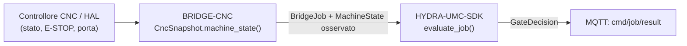

<!-- =============================================================================
HYDRA-UMC-BRIDGE-CNC - CNC cell coordination bridge
Copyright (C) JuanenRac (Electro Hobby 3D) <electrohobby3d@gmail.com>
GPL-3.0-or-later - see LICENSE
============================================================================= -->

<p align="center">
  
</p>

# 🔧 HYDRA-UMC-BRIDGE-CNC

<p align="center"><a href="README.md">🇺🇸 English</a> | <a href="README_spa.md">🇪🇸 Español</a> | <a href="README_fra.md">🇫🇷 Français</a> | 🇮🇹 <b>Italiano</b> | <a href="README_deu.md">🇩🇪 Deutsch</a> | <a href="README_zho.md">🇨🇳 简体中文</a> | <a href="README_jpn.md">🇯🇵 日本語</a> | <a href="README_por.md">🇵🇹 Português</a></p>

### 🛑 Ponte di coordinamento fail-safe per celle CNC

<p align="center">
  
  
  
  
  
  
</p>

---

> **Verifica di onestà - cosa funziona davvero oggi:** lo snapshot di cella fail-safe e il gate di sicurezza (`cell.py` con `CncSnapshot`/`CncCellBridge`, che fa passare ogni lavoro attraverso il vero `evaluate_job()` di `HYDRA-UMC-SDK`), il normalizzatore di evidenze GRBL/MTConnect di sola lettura (`observation.py`), il vero trasporto seriale GRBL (`serial_transport.py` con `GrblSerialProbe`/`GrblRealtimeControl`), e il trasporto comandi/stato MQTT (`mqtt_transport.py`) sono reali e coperti da 283 casi `unittest` superati (`python tools/build_test.py`), incluso `tests/test_grbl_emulator.py`, che esegue questo bridge contro un emulatore GRBL v1.1 fedele al protocollo ma scritto a mano. Nulla di tutto ciò ha toccato una porta seriale reale, un vero broker MQTT, o un vero controller CNC - il `FakeSerial` proprio di `test_serial_transport.py` sostituisce una connessione fisica, e `test_mqtt_transport.py` usa allo stesso modo un client broker fittizio. I collegamenti LinuxCNC e CNCjs e la vista MTConnect hanno incontrato solo simulazioni, non esiste un adattatore HAL LinuxCNC né un comando `run` dal vivo, perché nessun controller reale è stato pilotato - vedi "Roadmap e limiti noti" qui sotto, che lo dice già chiaramente, e `CHANGELOG.md` per cosa è stato esattamente consegnato finora. Il trasporto MQTT è stato eseguito anche contro un vero HYDRA-UMC-MQTT-BROKER su una macchina di sviluppo (`tests/test_broker_integration.py`, saltato se nessun broker è installato): pubblicazione e sottoscrizione con QoS 0, 1 e 2, la disponibilità trattenuta e il suo last will, e il ritorno dopo che il broker si è fermato ed è ripartito.

> **Stato di sicurezza (safety e security):** questo ecosistema non è un sistema di sicurezza certificato. Non esiste ancora un percorso E-STOP hardware, né limiti o interblocchi imposti dal firmware, né un comando di movimento verificato; le immagini firmware sono controllate con CRC-32 e una firma Ed25519, e una compilazione di rilascio rifiuta le chiavi di sviluppo pubblicate (le teste utensile e le schede di espansione dietro il relè usano ancora i bootloader di URTC, che accettano un HMAC-SHA256 a chiave condivisa invece di una firma); TLS e TLS reciproco sono opzionali e disattivati per impostazione predefinita; nessuna scheda propria è stata ancora assemblata o provata. Leggi la [base di sicurezza](https://github.com/JuanenRac/HYDRA-UMC-DOCS/blob/main/docs/SECURITY_BASELINE.md) e il [modello delle minacce](https://github.com/JuanenRac/HYDRA-UMC-DOCS/blob/main/docs/THREAT_MODEL.md) prima di fidarti di qualsiasi affermazione qui per la sicurezza di una persona.

---

## 📋 In breve

| | |
|---|---|
| Versione | `0.2.2` |
| Maturità | Funzionale |
| Test | 283 (`python tools/build_test.py`) |
| Tecnologia | Python / LinuxCNC / G-code / GRBL status evidence / GRBL serial transport |
| Destinazione | Il Raspberry Pi CM5 di una cella HYDRA-UMC |
| Su hardware reale | Solo simulato: provato con emulatori, test double o simulatori; per questa versione non risulta alcuna esecuzione su hardware reale |

**Vai a:** [Panoramica](#-panoramica) · [Architettura](#-architettura) · [Funzionalità](#-funzionalità) · [Sicurezza e protezione](#-sicurezza-e-protezione) · [Interfacce](#-interfacce) · [Configurazione](#-configurazione) · [Avvio rapido](#-avvio-rapido) · [Test](#-test) · [Risoluzione dei problemi](#-risoluzione-dei-problemi) · [Struttura del repository](#-struttura-del-repository) · [Progetti correlati](#-progetti-correlati)

## 🚦 Stato del progetto

Ogni riga è una parte di questo repository e il semaforo dice a che punto è oggi. È scritta in base a ciò che il repository può mostrare (test, compilazioni, esecuzioni), non a ciò che è previsto.

🟢 Fatto e verificato · 🟡 Funziona, con limiti noti · 🟠 Fatto a metà o non ancora verificato · 🔴 Non fatto o non funzionante

| Area | Stato | Cosa significa qui |
|---|---|---|
| Software | 🟡 | Funziona per il suo scopo principale; la verifica di onestà qui sopra elenca ciò che manca ancora |
| Test | 🟢 | 283 test automatici, eseguiti a ogni modifica |
| Hardware reale | 🟠 | Solo simulato: provato con emulatori, test double o simulatori; per questa versione non risulta alcuna esecuzione su hardware reale |
| Documentazione | 🟢 | README in otto lingue, verificato rispetto al manifesto a ogni modifica |

## 🎯 Panoramica

**HYDRA-UMC-BRIDGE-CNC** è il ponte di alto livello tra celle CNC e ausiliari robotici HYDRA-UMC: carico, scarico, movimentazione pezzi e attività ausiliarie supervisionate. Non diventa mai un controllore di traiettoria in tempo reale — il controllore CNC (GRBL, LinuxCNC o quello dietro CNCjs) mantiene sempre l'autorità su traiettoria, mandrino e limiti macchina.

Appartiene alla famiglia **External Automation Bridges**: un insieme di repository fratelli (CNC, LASER, OPENPNP, PRINTER3D, ROS2) che condividono lo stesso contratto di sicurezza di `HYDRA-UMC-SDK`, così nessun ponte può inventare una propria definizione di "sicuro per lavorare".

## 🧩 Ruolo in HYDRA-UMC

**HYDRA-UMC-BRIDGE-CNC** sta tra un controller CNC (GRBL, LinuxCNC o quello dietro CNCjs) e la cella di robot che lo carica e scarica. Il controller mantiene sempre l'autorità su traiettoria, mandrino e limiti; il bridge riferisce solo ciò che dice il controller e interroga la porta condivisa prima di qualsiasi lavoro ausiliario.

Ogni bridge parla il contratto di sicurezza condiviso di `HYDRA-UMC-SDK`: un lavoro viene accettato solo se la porta condivisa `evaluate_job()` lo permette, e quella porta fallisce chiusa. Il progetto padre è `HYDRA-UMC-SERVER`; questo bridge non lo chiama, risponde via MQTT, attraverso `HYDRA-UMC-MQTT-BROKER`, a chi comanda la cella.

| Parla con | Come | A che scopo |
|---|---|---|
| `HYDRA-UMC-SDK` | import Python | la porta dei lavori `evaluate_job()`, la forma di lavori e decisioni, il collegamento seriale e il client MQTT |
| `HYDRA-UMC-MQTT-BROKER` | MQTT, `hydra/bridges/cnc/` | comandi in ingresso (`cmd/`), stato e risultati in uscita |
| GRBL | porta seriale | richiesta di stato `?` e byte in tempo reale (sospensione avanzamento, ripresa ciclo, reset software); mai un programma G-code |
| LinuxCNC | modulo Python `linuxcnc` | legge `linuxcnc.stat`; invia solo pausa, interruzione e ripresa |
| CNCjs | socket.io | ascolta `controller:state`; invia solo `feedhold`, `reset`, `cyclestart` |

## 🏛️ Architettura

<p align="center">
  
</p>

<details>
<summary>Versione testuale del diagramma (Mermaid)</summary>



</details>

**Perché è fatto così**

* **Perché l'E-STOP e lo stato della porta vengono controllati prima dello stato riportato dal controllore stesso.** `CncSnapshot.machine_state()` va direttamente in cortocircuito su `SAFE_STOP` in caso di `estop` o porta non chiusa, prima di ogni altra cosa — un controllore che continua a riportare `IDLE` con la porta aperta non deve mai essere preso alla lettera.
* **Perché la mappatura dello stato del controllore è deliberatamente conservativa.** Solo la stringa letterale `IDLE` viene mappata su `MachineState.IDLE`. Qualsiasi valore non riconosciuto ricade su `OFFLINE`, mai su qualcosa che permetterebbe lavoro ausiliario — uno stato del controllore sconosciuto viene trattato come "non lo so", non come "probabilmente va bene".
* **Perché il ponte costruisce un nuovo `BridgeJob` e delega al `evaluate_job()` condiviso invece di scrivere una propria logica di accettazione/rifiuto.** Tutti e cinque gli External Automation Bridges (CNC, LASER, OPENPNP, PRINTER3D, ROS2) riutilizzano esattamente lo stesso `bridge_contract` di `HYDRA-UMC-SDK`, così "cosa conta come sicuro per avviare un lavoro" non può divergere silenziosamente tra loro.
* **Perché i collegamenti LinuxCNC e CNCjs si limitano a leggere, mettere in pausa e riprendere.** Il controllore mantiene l'autorità su traiettoria, mandrino e limiti, e il programma appartiene a chi lo esegue (CNCjs, LinuxCNC stesso): il bridge può portare la macchina a riposo e lasciar proseguire una macchina in pausa, niente di più. Cablare pin HAL reali resta un passo di integrazione hardware da validare contro un controllore reale.
* **Come si inserisce nel resto dell'ecosistema.** BRIDGE-CNC si trova tra il controllore CNC e `HYDRA-UMC-SDK` → `HYDRA-UMC-MQTT-BROKER` → sicurezza MCU/cella: coordina il lavoro robotico ausiliario attorno al CNC, non sostituisce né annulla l'autorità di sicurezza propria del controllore.

Gli helper di osservazione sono normalizzatori di evidenza, non adattatori del controllore: non aprono collegamenti HAL, seriali o di rete. [Controller Evidence Boundary](docs/CONTROLLER_EVIDENCE_BOUNDARY.md) definisce la validazione richiesta prima di una reale integrazione del controllore.

**Esecuzione come servizio.** `python -m hydra_umc_bridge_cnc --config /etc/hydra-umc/bridge-cnc.toml` avvia il bridge da un unico file TOML: il controller (una scheda GRBL su una porta seriale, CNCjs o LinuxCNC), le origini dell'arresto di emergenza e della porta (una linea GPIO con il suo livello non sicuro dichiarato, o un piccolo file), la condivisione della porta seriale con un sender G-code, il cancello del mandrino, MTConnect, il broker MQTT e l'origine dello stato della cella. Una chiave sconosciuta viene rifiutata, un'origine di segnale deve dichiarare il proprio cablaggio e tutto fallisce in modo chiuso: un segnale senza origine vale arresto di emergenza premuto o porta aperta, e un segnale o un file di stato della cella assente, sconosciuto o scaduto dà la risposta non sicura. `--check` convalida il file; `deploy/` contiene l'unità systemd (`Restart=on-failure`) e un file di esempio. Ha girato contro l'emulatore GRBL e segnali simulati, non su una macchina reale.

## ✨ Funzionalità

* ✅ **Snapshot di cella fail-safe, reale:** `cell.py` — `CncSnapshot.machine_state()` controlla l'E-STOP e lo stato della porta *prima* di guardare ciò che riporta il controllore; un E-STOP attivo o una porta aperta risolvono sempre in `SAFE_STOP`, indipendentemente da ciò che dice `controller_state`. *(implementato, testato in `tests/test_cell.py`)*
* ✅ **Porta di sicurezza condivisa, reale:** ogni lavoro osservato viene rivalutato tramite `evaluate_job()` del `bridge_contract` di `HYDRA-UMC-SDK`, la stessa porta usata da tutti i ponti fratelli. *(implementato)*
* ✅ **Porta seriale condivisa:** una scheda GRBL ha una sola porta seriale. `multiplexer.py` può possederla e offrire un fronte TCP (solo loopback per impostazione predefinita) a cui si collega un invio di G-code alla volta, mentre il bridge mantiene le sue richieste di stato e i suoi tre byte in tempo reale; il bridge non può mai scrivere altro e un secondo invio viene rifiutato. È disattivato per impostazione predefinita (`HYDRA_UMC_CNC_PORT_SHARING=multiplexer` lo attiva; `HYDRA_UMC_CNC_PORT_SHARING_LISTEN` e `HYDRA_UMC_CNC_PORT_SHARING_ALLOW_REMOTE` impostano l'indirizzo). Provato con l'emulatore GRBL; mai eseguito su una vera scheda GRBL. *(implementato, solo simulato)*
* ✅ **Mappatura di stato conservativa:** solo `IDLE` è trattato come riposo; `RUN`/`RUNNING`/`JOG`/`HOME` vengono mappati su `RUNNING`, `FAULT`/`ERROR`/`OFF`/`ALARM` su `FAULT`, e qualsiasi valore non riconosciuto ricade su `OFFLINE` — mai su uno stato che permetterebbe lavoro produttivo. (`HOLD` → `HOLDING`; `DOOR` → `SAFE_STOP`) *(implementato)*
* ✅ **Evidenza del controller in sola lettura:** `observation.py` normalizza rigorosamente l'evidenza di mappatura locale e le righe di stato GRBL fornite; i segnali E-STOP/porta omessi o non booleani falliscono in modo sicuro. *(implementato, testato in `tests/test_observation.py`)*
* ✅ **Trasporto seriale GRBL reale:** `GrblSerialProbe` di `serial_transport.py` apre una vera connessione seriale e interroga il byte di stato in tempo reale di GRBL (`?`); `GrblRealtimeControl` invia solo i byte di controllo in tempo reale propri di GRBL (mantenimento avanzamento, ripresa ciclo, reset morbido) — `cycle_start_resume()` è subordinato a una macchina realmente in `HOLDING`, gli altri sono sempre consentiti come `ABORT`. Non trasmette mai un programma G-code. *(implementato, testato in `tests/test_serial_transport.py`)*
* ✅ **Build/test non mutante:** `build-test.bat`/`.sh` compilano il codice sorgente ed eseguono la suite di test della porta di sicurezza senza toccare i file di versione o il CHANGELOG. *(implementato, vedi Compilazione e rilascio più sotto)*
* ✅ **Collegamenti al controllore:** il bridge parla con un controllore tramite `ControllerLink` (`controller.py`): GRBL su una porta seriale che il bridge tiene aperta (`GrblController`), un'installazione LinuxCNC (`linuxcnc_link.py`: legge `linuxcnc.stat`, invia solo pausa, interruzione e ripresa di un programma in pausa tramite `linuxcnc.command`, non esegue mai un programma) e un server CNCjs che possiede la porta (`cncjs_link.py`: legge il `controller:state` che trasmette e invia solo `feedhold`, `reset` e `cyclestart`, così il bridge lavora accanto al mittente che esegue i programmi). Una ripresa richiede sempre una cella READY e una macchina davvero in attesa; una lettura vecchia o assente non è mai una macchina a riposo. Entrambi i collegamenti sono testati contro simulazioni (`SimulatedLinuxcnc`, `SimulatedCncjs`); nessuno ha toccato un vero LinuxCNC o CNCjs. *(implementato, solo simulato)*
* ✅ **Gate del mandrino:** un carico o uno scarico viene rifiutato quando il controllore è a riposo ma segnala ancora un mandrino in rotazione o un avanzamento in movimento (`FS:`). `HYDRA_UMC_CNC_SPINDLE_GATE` vale `off`, `when_known` (predefinito: rifiuta ciò che viene segnalato) o `required` (rifiuta anche ciò che il controllore non segnala). Lo snapshot porta anche le posizioni, l'offset di lavoro e gli override del rapporto. *(implementato)*
* ✅ **Vista MTConnect:** `mtconnect_publish.py` trasforma lo snapshot in osservazioni MTConnect (`avail`, `execution`, `estop`, `door`, `spindle_speed`, `path_feedrate`, `system`), servite come SHDR su TCP da `ShdrAdapter` (sola lettura; l'unica riga accettata è `* PING`) e, con `HYDRA_UMC_CNC_MTCONNECT=1`, pubblicate come retained su `hydra/bridges/cnc/mtconnect`. Un controllore che non risponde è `UNAVAILABLE`, mai `READY`. Testato contro un agente simulato. *(implementato, non ancora provato con un agente reale)*
* 🔜 **Pin HAL di LinuxCNC** — rimandato; nessun controllore CNC reale, pin HAL o robot è stato ancora azionato. *(pianificato)*
* ✅ **Chiavi di idempotenza ripetute:** `CncMqttBridge` accetta un `IdempotencyStore`: una chiave di lavoro ripetuta riceve la risposta data la prima volta invece di essere valutata di nuovo. *(implementato, testato in `tests/test_idempotency.py`)*
* ✅ **Risposte di stato allineate, seriale fail-safe, ciclo MQTT blindato:** la richiesta di stato scarta ciò che già attende, invia `?` e legge finché non arriva un vero rapporto di stato (`<...>`): il banner, `ok`, `[MSG:...]` e `ALARM:n` che GRBL invia senza che li si chieda non lasciano più ogni richiesta successiva indietro di una risposta; un dispositivo USB assente (o qualsiasi guasto del collegamento) fallisce in modo sicuro invece di terminare il bridge, e la porta viene aperta senza attivare DTR; `cmd/feed_hold` riporta ciò che il controller ha detto dopo (`controller_state_after`, `confirmed`), e `cmd/feed_hold` e `cmd/soft_reset` girano su una corsia propria, così una richiesta di stato non li ritarda mai; un payload troppo grande (oltre 16 KiB), illeggibile o con JSON profondamente annidato, e qualsiasi guasto inatteso, ricevono un rifiuto sul topic di risultato e non terminano mai il ciclo; le risposte di `cmd/job` riportano `"mode": "gate-only"` e un ABORT passato di lì dice che nulla è stato fermato; lo stato porta `observed_at` e il bridge si annuncia su un topic `availability` con Last Will. GRBL ha UNA sola porta seriale: finché questo bridge la tiene aperta, nessun emettitore di G-code può usarla (vedi `docs/BRIDGE_GUIDE.md`). *(implementato, testato in `tests/test_hardening.py`)*
* ✅ **Lavori tramite l'accettazione condivisa:** il controllo di un lavoro malformato e di una `idempotency_key` ripetuta è il `JobIntake` dell'SDK invece di codice di questo bridge (le chiavi non hanno più il prefisso `job:`).
* ✅ **Risposte che corrispondono alla richiesta:** un payload di comando che è un oggetto JSON può portare un `request_id` (un semplice token di al massimo 64 caratteri: lettere, cifre, `.`, `_`, `:`, `-`), e ogni risultato che il bridge pubblica per quel messaggio lo riporta, anche quello conservato per una chiave di idempotenza ripetuta. I topic di stato non cambiano.
* ✅ **Segue l'arresto globale (disattivato per impostazione predefinita):** con `HYDRA_UMC_CNC_GLOBAL_STOP=1` il bridge legge l'annuncio retained del server su `hydra/swarm/safety/estop`; finché dice `SAFE_STOP`, o non è leggibile, rifiuta con un motivo: una ripresa e un lavoro (un abort passa). Gli arresti e le richieste di sola lettura continuano a funzionare e solo `READY` termina il rifiuto. *(implementato, testato contro un broker reale; mai eseguito con un server reale)*

## 🔒 Sicurezza e protezione

| Minaccia | Difesa | Dove |
|---|---|---|
| Un lavoro per una cella che non è in stato sicuro | Ogni lavoro passa dalla porta condivisa `evaluate_job()`, che fallisce chiusa; il bridge non ha una logica propria di accettazione. L'arresto di emergenza e la porta si leggono prima di ciò che riferisce il controller, e porta aperta o arresto di emergenza è sempre `SAFE_STOP` | `cell.py`, SDK `bridge_contract` |
| Dati di lavoro smisurati | Al massimo 32 parametri, chiavi fino a 64 caratteri, valori fino a 1024, identificatori fino a 128; un payload MQTT oltre 16 KiB viene rifiutato sul topic di risultato | SDK `bridge_contract`, `mqtt_transport.py` |
| Un ordine ripetuto o rinviato | Un `IdempotencyStore` ricorda ogni chiave per 24 ore e al massimo 10 000 voci; una ripetizione riceve la prima risposta invece di essere valutata di nuovo. Un messaggio `cmd/` trattenuto viene ignorato alla riconnessione | SDK `job_intake.py`, `mqtt_transport.py` |
| Un mandrino in rotazione mentre un braccio carica o scarica | `LOAD` e `UNLOAD` vengono rifiutati se il controller è a riposo ma riferisce un mandrino in rotazione o un avanzamento in movimento; `HYDRA_UMC_CNC_SPINDLE_GATE` è `off`, `when_known` (predefinito, anche per un valore sconosciuto) o `required` | `cell.py` |
| Fermare o muovere la macchina con un ordine remoto | A CNCjs arrivano solo `feedhold`, `reset` e `cyclestart`, a LinuxCNC solo pausa, interruzione e ripresa, a una porta seriale solo i byte in tempo reale GRBL; una ripresa richiede una cella READY e una macchina davvero ferma. `cmd/feed_hold` e `cmd/soft_reset` girano su una corsia propria | `cncjs_link.py`, `linuxcnc_link.py`, `serial_transport.py`, `mqtt_transport.py` |
| Una lettura vecchia scambiata per una macchina a riposo | Una lettura CNCjs più vecchia di 3 secondi non è considerata, uno stato mancante o vecchio non è mai a riposo e la porta conta come aperta; un comando LinuxCNC scade dopo 2 secondi; una richiesta seriale fallita fallisce chiusa | `cncjs_link.py`, `linuxcnc_link.py`, `serial_transport.py` |
| Un client MTConnect che inonda l'adattatore | L'adattatore SHDR è di sola lettura: al massimo 16 client, righe fino a 1024 byte, e l'unica riga accettata è `* PING` | `mtconnect_publish.py` |

**Cosa non fa mai:** non invia mai in streaming un programma G-code, non esegue mai un programma in LinuxCNC, non toglie mai a CNCjs la sua porta seriale e non deduce mai uno stato di arresto di emergenza o di porta che la prova non portava. Vedi `docs/CONTROLLER_EVIDENCE_BOUNDARY.md`.

## 🔌 Interfacce

Topic sotto `hydra/bridges/cnc/` (prefisso `TOPIC_PREFIX`); il bridge si iscrive a `cmd/#`.

| Topic o rotta | Cosa porta |
|---|---|
| `cmd/status` | chiede lo stato della cella; risposta su `cmd/status/result` |
| `cmd/job` | un `BridgeJob` nella forma `job_to_dict()` dell'SDK; la risposta è una `GateDecision` marcata `"mode": "gate-only"` (non agisce mai, un `ABORT` da qui dice che nulla è stato fermato) |
| `cmd/feed_hold`, `cmd/soft_reset` | i comandi di arresto, su una corsia propria; la risposta contiene `controller_state_after` e `confirmed` |
| `cmd/cycle_start_resume`, `cmd/start`, `cmd/resume` | riprendono una macchina ferma; rifiutato se la cella non è READY e la macchina non è davvero ferma (mai dopo un evento di porta) |
| `<verb>/result` | una risposta JSON per comando, `{"allowed", "executed", "reason"}` per un rifiuto |
| `state`, `availability` | lo stato della cella (trattenuto, con `observed_at` in millisecondi epoch) e `online`/`offline` (il Last Will) |
| `mtconnect` | osservazioni MTConnect, trattenute; solo con `HYDRA_UMC_CNC_MTCONNECT=1` |

La libreria: `CncCellBridge`, `CncSnapshot`, `CncMqttBridge`, `spindle_gate_from_environment()` e i tre collegamenti (`GrblController`, `LinuxcncController`, `CncjsController`).

## ⚙️ Configurazione

| Variabile | Predefinito | Cosa imposta |
|---|---|---|
| `HYDRA_UMC_CNC_SPINDLE_GATE` | `when_known` | `off`, `when_known` o `required`; non impostato o sconosciuto equivale a `when_known` |
| `HYDRA_UMC_CNC_MTCONNECT` | disattivato | `1` pubblica le osservazioni MTConnect su `hydra/bridges/cnc/mtconnect` |
| `HYDRA_UMC_CNC_GLOBAL_STOP` | disattivato | `1` segue l'arresto globale del server: finché l'ultimo annuncio sul topic retained `hydra/swarm/safety/estop` dice `SAFE_STOP` (o non è leggibile), il bridge rifiuta con un motivo: una ripresa e un lavoro (un abort passa); solo `READY` lo termina. `HYDRA_UMC_CNC_GLOBAL_STOP_TOPIC` cambia il topic e `HYDRA_UMC_CNC_GLOBAL_STOP_STRICT=1` rifiuta anche finché non arriva il primo annuncio |
| `HYDRA_MQTT_USERNAME` | nessuno | Il nome utente MQTT; il broker lo lega a un prefisso di ID client |
| `HYDRA_MQTT_PASSWORD` | nessuno | La password; valida solo insieme al nome utente |
| `HYDRA_MQTT_PASSWORD_FILE` | nessuno | La password letta da un file (segreto Docker o systemd); ignorata se `HYDRA_MQTT_PASSWORD` è impostata |
| `HYDRA_MQTT_TLS_CA` | nessuno | Il file della CA che ha firmato il certificato del broker: la connessione è TLS e il certificato viene verificato |
| `HYDRA_MQTT_TLS` | disattivato | `1` attiva TLS, verificato con le CA fidate del sistema |
| `HYDRA_MQTT_TLS_CERT` / `HYDRA_MQTT_TLS_KEY` | nessuno | Il certificato client e la sua chiave per un broker che richiede TLS reciproco; servono entrambi |

Il collegamento al controller si sceglie nel codice: passa `controller=` a `CncMqttBridge` per LinuxCNC o CNCjs, altrimenti il bridge tiene una connessione seriale GRBL. Finché la tiene, nessun sender G-code può usare quella porta (vedi `docs/BRIDGE_GUIDE.md`, «One serial port»).

## 🚀 Avvio rapido

Richiede Python 3.11 o successivo. I test e gli script di build si aspettano `HYDRA-UMC-SDK` clonato accanto a questo repository (`../HYDRA-UMC-SDK`) o indicato con `HYDRA_UMC_SDK_ROOT`.

Provalo senza hardware (questo verifica tutto il bridge con i suoi emulatori e test double):

```bash
py -3 tools/build_test.py          # Windows
python3 tools/build_test.py         # Linux, macOS
build-test.bat  /  bash build-test.sh   # the same, through the scripts
```

Avviare il servizio (non c'è uno script da console: il servizio è il `run_forever()` del trasporto MQTT, che chiami dal tuo codice di avvio):

```python
from hydra_umc_bridge_cnc.mqtt_transport import CncMqttBridge, run_forever
# `connection` is an open GRBL serial connection (open_serial_port()), or pass controller=...
bridge = CncMqttBridge(connection)
run_forever(bridge, host="192.168.0.180")   # connects to the broker and serves cmd/# forever
```

Nome utente, password e file TLS vengono dalle variabili `HYDRA_MQTT_*` (vedi Configurazione); il codice sopra non ha bisogno di credenziali proprie.

## 🧪 Test

283 casi `unittest` automatici si eseguono con `python tools/build_test.py` (che compila anche ogni modulo). I test non richiedono hardware, rete né pacchetti opzionali: quelli che richiederebbero `paho-mqtt`, `pyserial` o una libreria del produttore usano un sostituto o vengono saltati se il pacchetto manca.

| File di test | Test | Cosa copre |
|---|---|---|
| `test_cell.py` | 10 | ammissione a riposo sicuro, rifiuto con porta aperta, inoltro dell'interruzione |
| `test_controllers.py` | 63 | porta del mandrino, collegamenti LinuxCNC e CNCjs contro le loro simulazioni, vista MTConnect |
| `test_serial_transport.py` | 29 | il trasporto seriale contro una porta finta, compresi i percorsi che falliscono chiusi |
| `test_mqtt_transport.py`, `test_mqtt_environment.py` | 28 + 4 | forme di comandi e stato contro un client di broker finto; credenziali e TLS dell'ambiente arrivano al client |
| `test_grbl_emulator.py`, `grbl_emulator.py` | 17 | il bridge contro un emulatore GRBL v1.1 scritto a mano e fedele al protocollo |
| `test_hardening.py`, `test_edge_cases.py`, `test_idempotency.py`, `test_observation.py` | 25 + 20 + 3 + 7 | risposte di stato allineate, un cavo morto, conferma della sospensione, payload ostili, chiavi ripetute, prove mancanti |

La CI esegue `HYDRA_UMC_CI=1 python tools/ci_validate.py`, che controlla il manifesto, i documenti, gli otto README e le immagini, ed esegue i test con una copia dell'SDK.

## 🏗️ Compilazione e rilascio

Richiede Python 3.11+. `tools/build_test.py` si aspetta che `HYDRA-UMC-SDK` sia clonato come directory fratella (`../HYDRA-UMC-SDK`) o indicato tramite la variabile d'ambiente `HYDRA_UMC_SDK_ROOT`.

```bash
# Windows
build-test.bat      # solo validazione — nessun cambio di versione/CHANGELOG
build.bat            # valida e, se ha successo, aggiorna versione + CHANGELOG

# Linux/macOS
bash build-test.sh
bash build.sh
```

`build-test` compila ogni modulo sotto `src/` con `py_compile` ed esegue l'intera suite `unittest` individuata sotto `tests/` (`test_cell.py`, `test_observation.py`, `test_serial_transport.py`, `test_mqtt_transport.py`, `test_grbl_emulator.py`, `test_hardening.py`, `test_idempotency.py`, `test_mqtt_environment.py` - 283 test), dimostrando l'ammissione in riposo sicuro, il rifiuto porta aperta e l'inoltro dell'abort tra tutto il resto coperto — non modifica mai il repository. `build` esegue prima quella stessa validazione e, solo in caso di successo, chiama `tools/bump_version.py` per sincronizzare la versione in `pyproject.toml`, `hydra-umc.project.json` e `CHANGELOG.md`. Non esiste ancora un comando `run` CNC reale — serve un'integrazione del controllore validata.

## 🩺 Risoluzione dei problemi

| Vedi | Perché | Fai |
|---|---|---|
| `ModuleNotFoundError: hydra_umc_sdk` | L'SDK non è installato né accanto a questo repository | Clona `HYDRA-UMC-SDK` accanto a questo repository o imposta `HYDRA_UMC_SDK_ROOT` |
| `paho-mqtt is not installed` | Il client MQTT è un extra opzionale | `pip install ".[mqtt]"` (serve `paho-mqtt` 2.1 o successivo, inferiore a 3) |
| `password was given without a username` | Le credenziali MQTT richiedono entrambe le parti | Imposta anche `HYDRA_MQTT_USERNAME`, non solo la password |
| `spindle_gate must be one of ...` | `HYDRA_UMC_CNC_SPINDLE_GATE` ha un valore che il codice non conosce | Usa `off`, `when_known` o `required` (passato nel codice solleva un'eccezione; dall'ambiente un valore sconosciuto torna a `when_known`) |
| `a serial connection or a controller link is required` | `CncMqttBridge` è stato creato senza nessuna delle due | Passa una connessione seriale aperta o `controller=` |
| `"allowed": false` + `reason` | La porta condivisa o una guardia ha rifiutato l'ordine | Leggi `reason`: porta aperta, arresto di emergenza, macchina non a riposo, mandrino in rotazione o lettura vecchia; correggi la causa, non riprovare alla cieca |

## 📂 Struttura del repository

<p align="center">
  
</p>

<details>
<summary>Versione testuale dell'albero</summary>

```text
HYDRA-UMC-BRIDGE-CNC/
├── src/hydra_umc_bridge_cnc/
│   ├── cell.py                    istantanea della cella, porta di sicurezza, porta del mandrino
│   ├── observation.py             prove di sola lettura, righe di stato GRBL
│   ├── serial_transport.py        collegamento seriale GRBL: richiesta di stato e byte in tempo reale
│   ├── controller.py              ControllerLink e il controller GRBL
│   ├── linuxcnc_link.py           collegamento LinuxCNC (legge, mette in pausa, riprende) e la sua simulazione
│   ├── cncjs_link.py              collegamento CNCjs (feedhold, reset, cyclestart) e la sua simulazione
│   ├── multiplexer.py             multiplexer della porta seriale: il bridge e un invio di G-code condividono una porta GRBL
│   ├── mtconnect_publish.py       osservazioni MTConnect e l'adattatore SHDR di sola lettura
│   └── mqtt_transport.py          trasporto MQTT di comandi e stato
├── tests/                         238 test, con un emulatore GRBL scritto a mano
├── deploy/                        unità systemd e configurazione di esempio
├── docs/                          guida del bridge, limite delle prove
├── tools/                         esecutore di build e test, aumento di versione, validatore CI, generatori e controlli di README e immagini
├── images/                        banner e immagini del README
├── .github/                       workflow CI e modelli di segnalazione
├── pyproject.toml                 metadati del pacchetto e dipendenze
├── hydra-umc.project.json         manifesto: versione, maturità, famiglia
├── CHANGELOG.md                   cosa è cambiato in ogni versione
├── build.sh build.bat             script di build (non cambiano mai la versione)
├── build-test.sh build-test.bat   script di build (non cambiano mai la versione)
├── test.sh test.bat               eseguono i test
└── SECURITY.md SUPPORT.md CONTRIBUTING.md CODE_OF_CONDUCT.md LICENSE LICENSE.md
```

</details>

## 🗺️ Roadmap e limiti noti

**Limiti noti oggi**

**Reale oggi:** versione `0.2.2`, un coordinatore di cella fail-safe testato in locale (`CncSnapshot` + `CncCellBridge`) appoggiato sulla porta di lavoro condivisa di `HYDRA-UMC-SDK`, normalizzazione rigorosa e in sola lettura dell'evidenza del controllore che copre l'intero vocabolario di stato reale di GRBL v1.1 inclusi i veri sottostati `Hold:N`/`Door:N` (`Idle`/`Run`/`Jog`/`Home`/`Hold`/`Alarm`/`Door`) oltre agli stati di esecuzione MTConnect, un trasporto seriale reale (`GrblSerialProbe`/`GrblRealtimeControl`) capace di interrogare lo stato e inviare i byte di controllo in tempo reale propri di GRBL su una connessione reale - la lettura live di porta/E-STOP avviene ora subito dopo il round trip bloccante di quella stessa interrogazione, mai prima, e una scrittura reale corta o di zero byte viene segnalata come non eseguita anziché come un falso successo -, una suite `unittest` deterministica di 283 test, e script build-test non mutanti collegati alla CI con checkout dell'SDK.

**Confine di integrazione:** il controllore CNC (GRBL, LinuxCNC o quello dietro CNCjs) mantiene sempre l'autorità su traiettoria, mandrino e limiti macchina; questo ponte regola solo il lavoro robotico *ausiliario*, mai il movimento del controllore.

**Ancora da fare:** nessun controllore CNC reale, pin HAL LinuxCNC o robot è stato azionato — scegliere e validare un adattatore HAL concreto è un passo di integrazione hardware/software successivo alla disponibilità della macchina e della sua interfaccia documentata.

## 🌍 Lingue

Questo README e i documenti del repository esistono in otto lingue: inglese, spagnolo, tedesco, francese, italiano, giapponese, cinese e portoghese (Portogallo). Sono scritti insieme e la CI verifica che gli otto file abbiano le stesse sezioni e gli stessi link. Questo repository non ha uno schermo né un catalogo di messaggi propri, quindi non ci sono stringhe di interfaccia da tradurre.

## 🔗 Progetti correlati

Questo progetto fa parte dell'ecosistema robotico HYDRA-UMC dello stesso autore (JuanenRac / Electro Hobby 3D). Vale la pena conoscerlo, poiché una richiesta potrebbe in realtà riguardare uno di questi invece di questo repository.

**Progetto Padre**
- **[HYDRA-UMC-SERVER](https://github.com/JuanenRac/HYDRA-UMC-SERVER)** — il vero backend headless (REST/WebSocket) con cui parla davvero ogni client di controllo; questo bridge non lo chiama: risponde via MQTT, attraverso HYDRA-UMC-MQTT-BROKER, a chi comanda la cella.

**Progetti Fratelli** — parlano anch'essi con la stessa API di HYDRA-UMC-SERVER, ciascuno come proprio client
- **[HYDRA-UMC-STUDIO](https://github.com/JuanenRac/HYDRA-UMC-STUDIO)** — dashboard di controllo web con visualizzazione 3D multi-robot in tempo reale.
- **[HYDRA-UMC-SUITE](https://github.com/JuanenRac/HYDRA-UMC-SUITE)** — centro di comando sciame desktop (PySide6) per più server contemporaneamente, pacchettizzato come eseguibile standalone.
- **[HYDRA-UMC-ANDROID-CONTROL](https://github.com/JuanenRac/HYDRA-UMC-ANDROID-CONTROL)** — app di controllo nativa per Android con login biometrico e un companion Wear OS abbinato.
- **[HYDRA-UMC-IOS-CONTROL](https://github.com/JuanenRac/HYDRA-UMC-IOS-CONTROL)** — app di controllo per iOS/iPadOS (Flutter) con sincronizzazione WebSocket in tempo reale.
- **[HYDRA-UMC-DSI](https://github.com/JuanenRac/HYDRA-UMC-DSI)** — interfaccia touch nativa per il touchscreen DSI da 7" a bordo, incorporata direttamente nel CM5.
- **[HYDRA-UMC-BRIDGE-AMR](https://github.com/JuanenRac/HYDRA-UMC-BRIDGE-AMR)** — barriera di coordinamento per flotte AGV/AMR tramite un publisher MQTT VDA 5050 (testato solo contro una flotta emulata).
- **[HYDRA-UMC-BRIDGE-DROIDS](https://github.com/JuanenRac/HYDRA-UMC-BRIDGE-DROIDS)** — barriera di coordinamento per droidi con zampe/umanoidi, con un mittente di comandi per Boston Dynamics Spot (testato solo contro un emulatore).
- **[HYDRA-UMC-BRIDGE-LASER](https://github.com/JuanenRac/HYDRA-UMC-BRIDGE-LASER)** — coordinatore per celle laser che legge 3 segnali GPIO di chiave/involucro/interblocco (testato solo contro un chip simulato; non può armare né far partire un laser).
- **[HYDRA-UMC-BRIDGE-OPENPNP](https://github.com/JuanenRac/HYDRA-UMC-BRIDGE-OPENPNP)** — coordinatore ad alto livello sicuro per il flusso schede del pick-and-place OpenPnP.
- **[HYDRA-UMC-BRIDGE-PRINTER3D](https://github.com/JuanenRac/HYDRA-UMC-BRIDGE-PRINTER3D)** — barriera di coordinamento sicura per stampanti 3D Moonraker/Klipper, con comandi di lavoro reali e controllati.
- **[HYDRA-UMC-BRIDGE-ROS2](https://github.com/JuanenRac/HYDRA-UMC-BRIDGE-ROS2)** — coordinatore con un trasporto ROS 2 rclpy importato in modo lazy (non ancora eseguito contro un'installazione ROS 2).
- **[HYDRA-UMC-BRIDGE-UAV](https://github.com/JuanenRac/HYDRA-UMC-BRIDGE-UAV)** — barriera di coordinamento per UAV dotati di fotocamera, con un mittente di comandi MAVLink (testato solo contro un emulatore).

**Direttamente Correlati**
- **[HYDRA-UMC-SDK](https://github.com/JuanenRac/HYDRA-UMC-SDK)** — il contratto JSON-Schema condiviso e la barriera software di controllo dei job contro cui ogni bridge valida i propri comandi (non è una funzione di sicurezza certificata).
- **[HYDRA-UMC-CONNECTOR-HUB](https://github.com/JuanenRac/HYDRA-UMC-CONNECTOR-HUB)** — registro dichiarativo e validatore di manifesti adattatore per connettori di macchine esterne; estende la propria idea di contratto dell'SDK alle macchine esterne senza sostituire i progetti di gateway industriale.
- **[HYDRA-UMC-MQTT-BROKER](https://github.com/JuanenRac/HYDRA-UMC-MQTT-BROKER)** — il vero trasporto di `mqtt_transport.py` per i propri topic `hydra/bridges/cnc/...` di questo bridge — stato più i byte di controllo jog/reset/resume, insieme alla barriera di lavoro condivisa; vedi il proprio `docs/BRIDGE_TOPICS.md` di quel repository.
- **[HYDRA-UMC-HIL-BRIDGE](https://github.com/JuanenRac/HYDRA-UMC-HIL-BRIDGE)** — futuro percorso di evidenza hardware-in-the-loop per l'integrazione reale del controller.

**Fa Anche Parte dell'Ecosistema**

*Hardware e Piattaforma di Base*
- **[HYDRA-UMC](https://github.com/JuanenRac/HYDRA-UMC)** — il progetto della scheda madre del braccio robotico: host CM5 + coprocessore STM32H745 dual-core, pensato per coordinare fino a 8 bracci utensile via CAN-OTA/SPI-OTA (firmware in fase iniziale; nessuna scheda assemblata per ora).
- **[HYDRA-UMC-OS](https://github.com/JuanenRac/HYDRA-UMC-OS)** — livello prodotto riproducibile su Raspberry Pi OS per il CM5: agente in sola lettura, config/profili validati, provisioning WiFi al primo contatto.

*Backend Centrale e Client*
- **[HYDRA-UMC-EDITOR-URDF](https://github.com/JuanenRac/HYDRA-UMC-EDITOR-URDF)** — creatore/editor grafico desktop di URDF che invia i modelli finiti al catalogo di STUDIO.
- **[HYDRA-UMC-EDITOR-STL](https://github.com/JuanenRac/HYDRA-UMC-EDITOR-STL)** — editor desktop di modelli STL, che trasforma/sostituisce/rimuove/aggiunge veri pezzi nello stesso catalogo di modelli modificato anche da HYDRA-UMC-EDITOR-URDF.

*Piattaforma Strumenti URTC*
- **[URTC](https://github.com/JuanenRac/URTC)** — firmware per la scheda fisica dell'Universal Robot Tool Controller, oltre 25 profili utensile su bus CAN.
- **[URTC-FLASHER](https://github.com/JuanenRac/URTC-FLASHER)** — strumento desktop con GUI per il flashing delle schede URTC, CAN-OTA più SWD/JTAG a chip intero.
- **[URTC-TESTER](https://github.com/JuanenRac/URTC-TESTER)** — strumento desktop di diagnostica CAN-bus dal vivo per schede URTC, un pannello per profilo utensile.
- **[URTC-WEB-STUDIO](https://github.com/JuanenRac/URTC-WEB-STUDIO)** — alternativa basata su browser a URTC-TESTER tramite la Web Serial API, senza installazione locale.
- **[URTC-GATEWAY](https://github.com/JuanenRac/URTC-GATEWAY)** — gateway davanti al bus CAN di URTC: elenco di identificatori consentiti, limite di frequenza e chiave di sessione; software provato su computer, non ancora su un bus reale.

*Nodo IA Visione (Hailo-8)*
- **[HYDRA-UMC-VISION-NODE](https://github.com/JuanenRac/HYDRA-UMC-VISION-NODE)** — hub di integrazione per la pipeline di visione Hailo-8, con un vero controllo di prontezza hardware per fase.
- **[HYDRA-UMC-DETECTION-HEF](https://github.com/JuanenRac/HYDRA-UMC-DETECTION-HEF)** — registro reale di modelli compilati con verifica di caricamento sicuro per architettura Hailo/checksum.
- **[HYDRA-UMC-VISION-STREAMER](https://github.com/JuanenRac/HYDRA-UMC-VISION-STREAMER)** — generatore reale di pipeline GStreamer + config MediaMTX, con una vera barriera di integrazione HailoRT.
- **[HYDRA-UMC-VISUAL-SERVOING-API](https://github.com/JuanenRac/HYDRA-UMC-VISUAL-SERVOING-API)** — legge di correzione Position-Based Visual Servoing con autorizzazione condizionata allo stato di zona; ancora nessuna stima di posa da telecamera.
- **[HYDRA-UMC-SAFETY-ZONES](https://github.com/JuanenRac/HYDRA-UMC-SAFETY-ZONES)** — logica v0 di violazione zona, freschezza di calibrazione e richiesta E-STOP che legge le posizioni degli oggetti da un file; nessun rilevatore la alimenta e nessun E-STOP fisico è ancora collegato.

*Nodo IA Cognitivo (Hailo-10)*
- **[HYDRA-UMC-COGNITIVE-NODE](https://github.com/JuanenRac/HYDRA-UMC-COGNITIVE-NODE)** — hub di integrazione per la pipeline cognitiva Hailo-10 (orchestrazione LLM/VLA/voce).
- **[HYDRA-UMC-VLA-ENGINE](https://github.com/JuanenRac/HYDRA-UMC-VLA-ENGINE)** — vera codifica/decodifica di token d'azione e generazione di traiettoria per un modello Vision-Language-Action.
- **[HYDRA-UMC-VOICE-UI](https://github.com/JuanenRac/HYDRA-UMC-VOICE-UI)** — vero front-end vocale (VAD + parser di intenti) con un relay verso Watch limitato e soggetto a conferma.
- **[HYDRA-UMC-SEMANTIC-PLANNER](https://github.com/JuanenRac/HYDRA-UMC-SEMANTIC-PLANNER)** — vera scomposizione dei task basata su regole e recupero semantico degli errori sui codici errore MCU.
- **[HYDRA-UMC-DOCS-QA](https://github.com/JuanenRac/HYDRA-UMC-DOCS-QA)** — vera ricerca documentale TF-IDF (solo libreria standard) sui documenti Markdown di questo ecosistema.
- **[HYDRA-UMC-LOCAL-TECHNICIAN](https://github.com/JuanenRac/HYDRA-UMC-LOCAL-TECHNICIAN)** — tecnico di manutenzione IA locale e con cancelli di policy per l'ecosistema stesso - osserva, diagnostica e propone correzioni; i due livelli di rischio più alti non sono deliberatamente ancora implementati.

*Orchestrazione e Sciame*
- **[HYDRA-UMC-ORCHESTRATOR](https://github.com/JuanenRac/HYDRA-UMC-ORCHESTRATOR)** — hub di integrazione con un vero contratto di health-report gRPC/Protobuf e una macchina a stati di missione.
- **[HYDRA-UMC-JOB-DISPATCHER](https://github.com/JuanenRac/HYDRA-UMC-JOB-DISPATCHER)** — vera coda di lavori basata su priorità con deduplicazione, su una vera API HTTP.
- **[HYDRA-UMC-NODE-HEALING](https://github.com/JuanenRac/HYDRA-UMC-NODE-HEALING)** — vero watchdog di salute della flotta basato su gRPC, con retry/backoff e rilevamento di discrepanza d'identità.
- **[HYDRA-UMC-PATH-PLANNER-3D](https://github.com/JuanenRac/HYDRA-UMC-PATH-PLANNER-3D)** — vero pianificatore di percorsi 3D basato su RRT, con vera validazione delle collisioni ostacolo/spazio di lavoro.
- **[HYDRA-UMC-SWARM-SYNC](https://github.com/JuanenRac/HYDRA-UMC-SWARM-SYNC)** — vera sincronizzazione di stato CRDT LWW-Element-Map, con property test per la convergenza multi-cella.

*Gemello Digitale e Simulazione*
- **[HYDRA-UMC-TWIN](https://github.com/JuanenRac/HYDRA-UMC-TWIN)** — hub di integrazione per il motore di gemello digitale, con un vero contratto di sincronizzazione per compatibilità di versione.
- **[HYDRA-UMC-PHYSICS-REPLICA](https://github.com/JuanenRac/HYDRA-UMC-PHYSICS-REPLICA)** — vera cinematica diretta e validazione dei limiti articolari su un vero sottoinsieme URDF.
- **[HYDRA-UMC-SYNTHETIC-DATA-GEN](https://github.com/JuanenRac/HYDRA-UMC-SYNTHETIC-DATA-GEN)** — vero generatore procedurale di scene 2D con esportazione di annotazioni YOLO/COCO.

*Dati e Analisi*
- **[HYDRA-UMC-DATALAKE](https://github.com/JuanenRac/HYDRA-UMC-DATALAKE)** — vero archivio di serie temporali basato su sqlite3, con una vera API HTTP di ingestione/query.
- **[HYDRA-UMC-ANOMALY-DETECTOR](https://github.com/JuanenRac/HYDRA-UMC-ANOMALY-DETECTOR)** — vero rilevatore di anomalie FFT + baseline statistica, con monitoraggio della deriva.
- **[HYDRA-UMC-PRODUCTION-REPORTS](https://github.com/JuanenRac/HYDRA-UMC-PRODUCTION-REPORTS)** — vero calcolo OEE/disponibilità sullo storico di DATALAKE, con esportazione CSV riproducibile.
- **[HYDRA-UMC-TELEMETRY-COLLECTOR](https://github.com/JuanenRac/HYDRA-UMC-TELEMETRY-COLLECTOR)** — vera pipeline di ingestione CAN/WebSocket verso DATALAKE, con deduplicazione per sequenza.

*Gateway Industriale*
- **[HYDRA-UMC-GATEWAY-INDUSTRIAL](https://github.com/JuanenRac/HYDRA-UMC-GATEWAY-INDUSTRIAL)** — hub di integrazione che inoltra ai protocolli industriali, con un vero livello di allowlist dei comandi/backpressure.
- **[HYDRA-UMC-OPCUA-SERVER](https://github.com/JuanenRac/HYDRA-UMC-OPCUA-SERVER)** — vero spazio di indirizzi OPC-UA, verificato con una vera sessione client del protocollo binario.
- **[HYDRA-UMC-MTCONNECT-ADAPTER](https://github.com/JuanenRac/HYDRA-UMC-MTCONNECT-ADAPTER)** — veri endpoint XML `/probe` e `/current` di MTConnect, con output in modalità degradata.

*Strumenti Complementari e Operazioni dell'Ecosistema*
- **[HYDRA-UMC-DASHBOARD-AI](https://github.com/JuanenRac/HYDRA-UMC-DASHBOARD-AI)** — pannelli Smart Summaries e Anomaly Highlighting su DATALAKE/ANOMALY-DETECTOR, con un fallback statistico onesto.
- **[HYDRA-UMC-TOOL-CLI](https://github.com/JuanenRac/HYDRA-UMC-TOOL-CLI)** — CLI di flotta con un vero e stabile contratto di exit-code, un client live reale della stessa API di HYDRA-UMC-SERVER.
- **[HYDRA-UMC-WATCH](https://github.com/JuanenRac/HYDRA-UMC-WATCH)** — app companion WearOS con schemi di avviso aptico e un relay vocale verso il telefono abbinato (non ancora eseguita su un orologio fisico).
- **[URTC-SMART-RACK](https://github.com/JuanenRac/URTC-SMART-RACK)** — firmware per un rack di montaggio schede con decodifica reale dell'ID utensile e logica di preriscaldamento Smart Idle.
- **[URTC-VISION-TOOL](https://github.com/JuanenRac/URTC-VISION-TOOL)** — firmware più un vero companion di visione Python per una testa utensile di ispezione termica/RGB.
- **[HYDRA-UMC-UPDATER](https://github.com/JuanenRac/HYDRA-UMC-UPDATER)** — strumento amministrativo desktop che scopre, clona e aggiorna ogni repository di questo ecosistema.
- **[HYDRA-UMC-OS-REBUILDER](https://github.com/JuanenRac/HYDRA-UMC-OS-REBUILDER)** — strumento desktop Windows/Linux che costruisce un'immagine della CM5 pronta da scrivere, precaricata con le versioni più aggiornate dell'ecosistema, con configurazione di primo avvio Wi-Fi/utente/SSH in stile Raspberry Pi Imager.
- **[HYDRA-UMC-OPS-AGENT](https://github.com/JuanenRac/HYDRA-UMC-OPS-AGENT)** — coordinatore di incidenti di manutenzione: un ruolo edge a basso privilegio raccoglie uno snapshot di inventario/salute sanificato, un ruolo control-plane lo rende in sola lettura e chiede a un provider di IA di suggerire una diagnosi - non applica mai una patch né distribuisce nulla.
- **[HYDRA-UMC-DEV-SERVER](https://github.com/JuanenRac/HYDRA-UMC-DEV-SERVER)** — host di sviluppo riproducibile (Raspberry Pi 5 / CM5) che conserva il codice sorgente dell'ecosistema ed esegue attività delimitate di build/test tramite una coda durevole; un ruolo di sviluppo dedicato, esplicitamente distinto da un CM5 operativo.

## 📚 Documentazione

Dove leggere di più:

* [docs/BRIDGE_GUIDE.md](docs/BRIDGE_GUIDE.md) - ambito, collegamenti ai controller, porta del mandrino, vista MTConnect, l'unica porta seriale, script
* [docs/CONTROLLER_EVIDENCE_BOUNDARY.md](docs/CONTROLLER_EVIDENCE_BOUNDARY.md) - cosa conta come prova di sicurezza reale e cosa il bridge rifiuta di dedurre
* [Base di sicurezza dell'ecosistema](https://github.com/JuanenRac/HYDRA-UMC-DOCS/blob/main/docs/SECURITY_BASELINE.md)
* [Modello delle minacce dell'ecosistema](https://github.com/JuanenRac/HYDRA-UMC-DOCS/blob/main/docs/THREAT_MODEL.md)
* [Registro delle modifiche di questo repository](CHANGELOG.md)
* [Licenza di questo repository](LICENSE.md)

## 🤝 Contribuire e comunità

* Prima di una pull request esegui `HYDRA_UMC_CI=1 py -3 tools/ci_validate.py` (oppure `HYDRA_UMC_CI=1 python3 tools/ci_validate.py`): deve stampare `CI_VALIDATION=PASS`. Non eseguire `build.sh` né `build.bat` per questa verifica; compilare non è verificare.
* I otto README sono scritti da un'unica fonte in HYDRA-UMC-DOCS; non modificarli a mano. Cambia la fonte e riscrivili con `tools/make_readmes.py`.
* Non affermare in un README ciò che non è stato eseguito: scrivi «simulato» o «non provato su hardware» quando è la verità.
* Vedi [CONTRIBUTING.md](CONTRIBUTING.md), il [codice di condotta](CODE_OF_CONDUCT.md), [SECURITY.md](SECURITY.md) e [SUPPORT.md](SUPPORT.md).

## 👤 AUTORE

**JuanenRac (Electro Hobby 3D)** · electrohobby3d@gmail.com

## 📜 LICENZA

GPL-3.0-or-later - [LICENSE](LICENSE).
