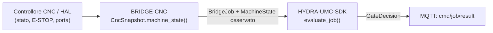

<!-- =============================================================================
HYDRA-UMC-BRIDGE-CNC - Ponte di coordinamento cella CNC
Copyright (C) JuanenRac (Electro Hobby 3D) <electrohobby3d@gmail.com>
GPL-3.0-or-later - see LICENSE
============================================================================= -->

<p align="center">
  
</p>

# 🔧 HYDRA-UMC-BRIDGE-CNC

<p align="center"><a href="README.md">🇺🇸 English</a> | <a href="README_spa.md">🇪🇸 Español</a> | <a href="README_fra.md">🇫🇷 Français</a> | 🇮🇹 <b>Italiano</b> | <a href="README_deu.md">🇩🇪 Deutsch</a> | <a href="README_zho.md">🇨🇳 简体中文</a> | <a href="README_jpn.md">🇯🇵 日本語</a> | <a href="README_por.md">🇵🇹 Português</a></p>

### 🛑 Ponte di coordinamento fail-safe per celle CNC

<p align="center">
  
  
  
</p>

---

> **Verifica di onestà - cosa funziona davvero oggi:** lo snapshot di cella fail-safe e il gate di sicurezza (`cell.py` con `CncSnapshot`/`CncCellBridge`, che fa passare ogni lavoro attraverso il vero `evaluate_job()` di `HYDRA-UMC-SDK`), il normalizzatore di evidenze GRBL/MTConnect di sola lettura (`observation.py`), il vero trasporto seriale GRBL (`serial_transport.py` con `GrblSerialProbe`/`GrblRealtimeControl`), e il trasporto comandi/stato MQTT (`mqtt_transport.py`) sono reali e coperti da 206 casi `unittest` superati (`python tools/build_test.py`), incluso `tests/test_grbl_emulator.py`, che esegue questo bridge contro un emulatore GRBL v1.1 fedele al protocollo ma scritto a mano. Nulla di tutto ciò ha toccato una porta seriale reale, un vero broker MQTT, o un vero controller CNC - il `FakeSerial` proprio di `test_serial_transport.py` sostituisce una connessione fisica, e `test_mqtt_transport.py` usa allo stesso modo un client broker fittizio. I collegamenti LinuxCNC e CNCjs e la vista MTConnect hanno incontrato solo simulazioni, non esiste un adattatore HAL LinuxCNC né un comando `run` dal vivo, perché nessun controller reale è stato pilotato - vedi "Stato attuale e prossimi passi" qui sotto, che lo dice già chiaramente, e `CHANGELOG.md` per cosa è stato esattamente consegnato finora.

---

> **Stato di sicurezza (safety e security):** questo ecosistema non è un sistema di sicurezza certificato. Non esiste ancora un percorso E-STOP hardware, né limiti o interblocchi imposti dal firmware, né un comando di movimento verificato; le immagini firmware sono controllate con CRC32 e un HMAC-SHA256 a chiave condivisa, non con una firma asimmetrica; TLS e TLS reciproco sono opzionali e disattivati per impostazione predefinita; nessuna scheda propria è stata ancora assemblata o provata. Leggi la [base di sicurezza](https://github.com/JuanenRac/HYDRA-UMC-DOCS/blob/main/docs/SECURITY_BASELINE.md) e il [modello delle minacce](https://github.com/JuanenRac/HYDRA-UMC-DOCS/blob/main/docs/THREAT_MODEL.md) prima di fidarti di qualsiasi affermazione qui per la sicurezza di una persona.

## 📋 In breve

| | |
|---|---|
| Versione | `0.2.0` |
| Maturità | Funzionale |
| Test | 123 (`python tools/build_test.py`) |
| Tecnologia | Python / LinuxCNC / G-code / GRBL status evidence / GRBL serial transport |
| Destinazione | Il Raspberry Pi CM5 di una cella HYDRA-UMC |
| Su hardware reale | Solo simulato: provato con emulatori, test double o simulatori; per questa versione non risulta alcuna esecuzione su hardware reale |

## 🚦 Stato del progetto

Ogni riga è una parte di questo repository e il semaforo dice a che punto è oggi. È scritta in base a ciò che il repository può mostrare (test, compilazioni, esecuzioni), non a ciò che è previsto.

🟢 Fatto e verificato · 🟡 Funziona, con limiti noti · 🟠 Fatto a metà o non ancora verificato · 🔴 Non fatto o non funzionante

| Area | Stato | Cosa significa qui |
|---|---|---|
| Software | 🟡 | Funziona per il suo scopo principale; la verifica di onestà qui sopra elenca ciò che manca ancora |
| Test | 🟢 | 123 test automatici, eseguiti a ogni modifica |
| Hardware reale | 🟠 | Solo simulato: provato con emulatori, test double o simulatori; per questa versione non risulta alcuna esecuzione su hardware reale |
| Documentazione | 🟢 | README in otto lingue, verificato rispetto al manifesto a ogni modifica |

## 1. 🛠️ PANORAMICA TECNICA

**HYDRA-UMC-BRIDGE-CNC** è il ponte di alto livello tra celle CNC e ausiliari robotici HYDRA-UMC: carico, scarico, movimentazione pezzi e attività ausiliarie supervisionate. Non diventa mai un controllore di traiettoria in tempo reale — il controllore CNC (GRBL, LinuxCNC o quello dietro CNCjs) mantiene sempre l'autorità su traiettoria, mandrino e limiti macchina.

Appartiene alla famiglia **External Automation Bridges**: un insieme di repository fratelli (CNC, LASER, OPENPNP, PRINTER3D, ROS2) che condividono lo stesso contratto di sicurezza di `HYDRA-UMC-SDK`, così nessun ponte può inventare una propria definizione di "sicuro per lavorare".

### Caratteristiche principali:
* ✅ **Snapshot di cella fail-safe, reale:** `cell.py` — `CncSnapshot.machine_state()` controlla l'E-STOP e lo stato della porta *prima* di guardare ciò che riporta il controllore; un E-STOP attivo o una porta aperta risolvono sempre in `SAFE_STOP`, indipendentemente da ciò che dice `controller_state`. *(implementato, testato in `tests/test_cell.py`)*
* ✅ **Porta di sicurezza condivisa, reale:** ogni lavoro osservato viene rivalutato tramite `evaluate_job()` del `bridge_contract` di `HYDRA-UMC-SDK`, la stessa porta usata da tutti i ponti fratelli. *(implementato)*
* ✅ **Mappatura di stato conservativa:** solo `IDLE` è trattato come riposo; `RUN`/`RUNNING`/`JOG`/`HOME` vengono mappati su `RUNNING`, `FAULT`/`ERROR`/`OFF`/`ALARM` su `FAULT`, e qualsiasi valore non riconosciuto ricade su `OFFLINE` — mai su uno stato che permetterebbe lavoro produttivo. (`HOLD` → `HOLDING`; `DOOR` → `SAFE_STOP`) *(implementato)*
* ✅ **Evidenza del controller in sola lettura:** `observation.py` normalizza rigorosamente l'evidenza di mappatura locale e le righe di stato GRBL fornite; i segnali E-STOP/porta omessi o non booleani falliscono in modo sicuro. *(implementato, testato in `tests/test_observation.py`)*
* ✅ **Trasporto seriale GRBL reale:** `GrblSerialProbe` di `serial_transport.py` apre una vera connessione seriale e interroga il byte di stato in tempo reale di GRBL (`?`); `GrblRealtimeControl` invia solo i byte di controllo in tempo reale propri di GRBL (mantenimento avanzamento, ripresa ciclo, reset morbido) — `cycle_start_resume()` è subordinato a una macchina realmente in `HOLDING`, gli altri sono sempre consentiti come `ABORT`. Non trasmette mai un programma G-code. *(implementato, testato in `tests/test_serial_transport.py`)*
* ✅ **Build/test non mutante:** `build-test.bat`/`.sh` compilano il codice sorgente ed eseguono la suite di test della porta di sicurezza senza toccare i file di versione o il CHANGELOG. *(implementato, vedi COMPILAZIONE ED ESECUZIONE più sotto)*
* ✅ **Collegamenti al controllore:** il bridge parla con un controllore tramite `ControllerLink` (`controller.py`): GRBL su una porta seriale che il bridge tiene aperta (`GrblController`), un'installazione LinuxCNC (`linuxcnc_link.py`: legge `linuxcnc.stat`, invia solo pausa, interruzione e ripresa di un programma in pausa tramite `linuxcnc.command`, non esegue mai un programma) e un server CNCjs che possiede la porta (`cncjs_link.py`: legge il `controller:state` che trasmette e invia solo `feedhold`, `reset` e `cyclestart`, così il bridge lavora accanto al mittente che esegue i programmi). Una ripresa richiede sempre una cella READY e una macchina davvero in attesa; una lettura vecchia o assente non è mai una macchina a riposo. Entrambi i collegamenti sono testati contro simulazioni (`SimulatedLinuxcnc`, `SimulatedCncjs`); nessuno ha toccato un vero LinuxCNC o CNCjs. *(implementato, solo simulato)*
* ✅ **Gate del mandrino:** un carico o uno scarico viene rifiutato quando il controllore è a riposo ma segnala ancora un mandrino in rotazione o un avanzamento in movimento (`FS:`). `HYDRA_UMC_CNC_SPINDLE_GATE` vale `off`, `when_known` (predefinito: rifiuta ciò che viene segnalato) o `required` (rifiuta anche ciò che il controllore non segnala). Lo snapshot porta anche le posizioni, l'offset di lavoro e gli override del rapporto. *(implementato)*
* ✅ **Vista MTConnect:** `mtconnect_publish.py` trasforma lo snapshot in osservazioni MTConnect (`avail`, `execution`, `estop`, `door`, `spindle_speed`, `path_feedrate`, `system`), servite come SHDR su TCP da `ShdrAdapter` (sola lettura; l'unica riga accettata è `* PING`) e, con `HYDRA_UMC_CNC_MTCONNECT=1`, pubblicate come retained su `hydra/bridges/cnc/mtconnect`. Un controllore che non risponde è `UNAVAILABLE`, mai `READY`. Testato contro un agente simulato. *(implementato, non ancora provato con un agente reale)*
* 🔜 **Pin HAL di LinuxCNC** — rimandato; nessun controllore CNC reale, pin HAL o robot è stato ancora azionato. *(pianificato)*
* ✅ **Chiavi di idempotenza ripetute:** `CncMqttBridge` accetta un `IdempotencyStore`: una chiave di lavoro ripetuta riceve la risposta data la prima volta invece di essere valutata di nuovo. *(implementato, testato in `tests/test_idempotency.py`)*
* ✅ **Risposte di stato allineate, seriale fail-safe, ciclo MQTT blindato:** la richiesta di stato scarta ciò che già attende, invia `?` e legge finché non arriva un vero rapporto di stato (`<...>`): il banner, `ok`, `[MSG:...]` e `ALARM:n` che GRBL invia senza che li si chieda non lasciano più ogni richiesta successiva indietro di una risposta; un dispositivo USB assente (o qualsiasi guasto del collegamento) fallisce in modo sicuro invece di terminare il bridge, e la porta viene aperta senza attivare DTR; `cmd/feed_hold` riporta ciò che il controller ha detto dopo (`controller_state_after`, `confirmed`), e `cmd/feed_hold` e `cmd/soft_reset` girano su una corsia propria, così una richiesta di stato non li ritarda mai; un payload troppo grande (oltre 16 KiB), illeggibile o con JSON profondamente annidato, e qualsiasi guasto inatteso, ricevono un rifiuto sul topic di risultato e non terminano mai il ciclo; le risposte di `cmd/job` riportano `"mode": "gate-only"` e un ABORT passato di lì dice che nulla è stato fermato; lo stato porta `observed_at` e il bridge si annuncia su un topic `availability` con Last Will. GRBL ha UNA sola porta seriale: finché questo bridge la tiene aperta, nessun emettitore di G-code può usarla (vedi `docs/BRIDGE_GUIDE.md`). *(implementato, testato in `tests/test_hardening.py`)*

---

## 2. 🔄 FLUSSO DI COORDINAMENTO DELLA CELLA



---

## 3. 🧱 ARCHITETTURA E DECISIONI DI PROGETTAZIONE

* **Perché l'E-STOP e lo stato della porta vengono controllati prima dello stato riportato dal controllore stesso.** `CncSnapshot.machine_state()` va direttamente in cortocircuito su `SAFE_STOP` in caso di `estop` o porta non chiusa, prima di ogni altra cosa — un controllore che continua a riportare `IDLE` con la porta aperta non deve mai essere preso alla lettera.
* **Perché la mappatura dello stato del controllore è deliberatamente conservativa.** Solo la stringa letterale `IDLE` viene mappata su `MachineState.IDLE`. Qualsiasi valore non riconosciuto ricade su `OFFLINE`, mai su qualcosa che permetterebbe lavoro ausiliario — uno stato del controllore sconosciuto viene trattato come "non lo so", non come "probabilmente va bene".
* **Perché il ponte costruisce un nuovo `BridgeJob` e delega al `evaluate_job()` condiviso invece di scrivere una propria logica di accettazione/rifiuto.** Tutti e cinque gli External Automation Bridges (CNC, LASER, OPENPNP, PRINTER3D, ROS2) riutilizzano esattamente lo stesso `bridge_contract` di `HYDRA-UMC-SDK`, così "cosa conta come sicuro per avviare un lavoro" non può divergere silenziosamente tra loro.
* **Perché i collegamenti LinuxCNC e CNCjs si limitano a leggere, mettere in pausa e riprendere.** Il controllore mantiene l'autorità su traiettoria, mandrino e limiti, e il programma appartiene a chi lo esegue (CNCjs, LinuxCNC stesso): il bridge può portare la macchina a riposo e lasciar proseguire una macchina in pausa, niente di più. Cablare pin HAL reali resta un passo di integrazione hardware da validare contro un controllore reale.
* **Come si inserisce nel resto dell'ecosistema.** BRIDGE-CNC si trova tra il controllore CNC e `HYDRA-UMC-SDK` → `HYDRA-UMC-MQTT-BROKER` → sicurezza MCU/cella: coordina il lavoro robotico ausiliario attorno al CNC, non sostituisce né annulla l'autorità di sicurezza propria del controllore.

Gli helper di osservazione sono normalizzatori di evidenza, non adattatori del controllore: non aprono collegamenti HAL, seriali o di rete. [Controller Evidence Boundary](docs/CONTROLLER_EVIDENCE_BOUNDARY.md) definisce la validazione richiesta prima di una reale integrazione del controllore.

---

## 📂 STRUTTURA DELLE DIRECTORY

```text
HYDRA-UMC-BRIDGE-CNC/
├── src/
│   └── hydra_umc_bridge_cnc/
│       ├── __init__.py
│       ├── cell.py              # Porta di sicurezza CncSnapshot + CncCellBridge
│       ├── observation.py       # Mapping di sola lettura e normalizzazione dello stato GRBL
│       ├── serial_transport.py  # Trasporto seriale GRBL reale e fail-closed - solo interrogazioni di stato e byte di controllo in tempo reale (la porta e l'interrogazione di stato sono il collegamento seriale condiviso dell'SDK)
│       ├── controller.py        # ControllerLink: ciò che il bridge richiede a qualsiasi controllore (+ GrblController)
│       ├── linuxcnc_link.py     # LinuxCNC: legge linuxcnc.stat, pausa, interrompe, riprende (+ SimulatedLinuxcnc)
│       ├── cncjs_link.py        # CNCjs: legge la sua trasmissione, feedhold/reset/cyclestart (+ SimulatedCncjs)
│       ├── mtconnect_publish.py # Osservazioni MTConnect, righe SHDR e l'adattatore SHDR in sola lettura
│       └── mqtt_transport.py    # Trasporto MQTT reale del broker per la logica già reale di questo bridge
├── tests/
│   ├── test_cell.py             # Ammissione in riposo sicuro, rifiuto porta aperta, inoltro abort
│   ├── test_observation.py      # L'evidenza di sicurezza mancante fallisce fail-closed
│   ├── test_serial_transport.py # Trasporto seriale reale contro una porta fittizia, incl. percorsi fail-closed
│   ├── test_mqtt_transport.py   # Test di forma comando/stato MQTT contro un client broker fittizio
│   ├── test_mqtt_environment.py # Le credenziali MQTT e il TLS dell'ambiente del servizio arrivano al client
│   ├── test_idempotency.py      # Una chiave di idempotenza ripetuta riceve risposta una sola volta
│   ├── test_controllers.py      # Gate del mandrino, collegamenti LinuxCNC e CNCjs contro le simulazioni, vista MTConnect
│   ├── grbl_emulator.py         # Emulatore GRBL v1.1 fedele al protocollo (test double realistico)
│   ├── test_grbl_emulator.py    # Comportamento del bridge rispetto all'emulatore GRBL v1.1
│   ├── test_hardening.py        # Risposte di stato allineate, cavo scollegato, conferma del blocco avanzamento, payload ostili
│   └── test_edge_cases.py       # Casi limite del payload, instradamento della corsia di arresto e collegamento seriale che si riconnette
├── tools/
│   ├── build_test.py            # Compilatore + esecutore di test non mutante (build-test.bat/.sh)
│   ├── bump_version.py          # Sincronizza pyproject.toml, manifesto e CHANGELOG.md
│   ├── ci_validate.py           # Base CI priva di dipendenze e non distruttiva (usata da .github/workflows/ci.yml)
│   ├── inspect_controller_evidence.py # Normalizza un file JSON di evidenza locale salvato (nessun collegamento aperto)
│   ├── _doc_policy.py                 # Regole di documentazione condivise dalla famiglia (copia di quella di HYDRA-UMC-SDK, mantenuta sincronizzata)
│   ├── _readme_parity.py              # Verifica che gli otto README abbiano la stessa struttura (copia di quella di HYDRA-UMC-SDK, mantenuta sincronizzata)
│   ├── hydra_project_tool.py          # Gli stessi comandi in ogni repository: validate, test, ci, version, status, bump
│   └── extra_build_steps.py           # I passi di compilazione propri di questo repository oltre al test di compilazione condiviso (i suoi unit test)
├── docs/
│   ├── BRIDGE_GUIDE.md                    # Ambito, piattaforme compatibili, script, porta di accettazione hardware
│   └── CONTROLLER_EVIDENCE_BOUNDARY.md    # Cosa conta come evidenza di sicurezza reale e cosa questo bridge rifiuta di dedurre
├── images/
│   └── HYDRA_UMC_BANNER.svg     # Banner del README
├── build-test.bat / build-test.sh  # Solo valida, non modifica mai il repository
├── build.bat / build.sh            # Valida e, solo in caso di successo, aggiorna versione + CHANGELOG
├── pyproject.toml               # Metadati del pacchetto; dipende da HYDRA-UMC-SDK (git)
├── hydra-umc.project.json       # Manifesto dell'ecosistema (versione, maturità, famiglia)
├── CHANGELOG.md
├── CODE_OF_CONDUCT.md / CONTRIBUTING.md / SECURITY.md / SUPPORT.md
├── LICENSE / LICENSE.md
└── README.md / README_*.md      # Questo file e le sue 6 traduzioni
```

---

## 4. ⚙️ COMPILAZIONE ED ESECUZIONE

Richiede Python 3.11+. `tools/build_test.py` si aspetta che `HYDRA-UMC-SDK` sia clonato come directory fratella (`../HYDRA-UMC-SDK`) o indicato tramite la variabile d'ambiente `HYDRA_UMC_SDK_ROOT`.

```bash
# Windows
build-test.bat      # solo validazione — nessun cambio di versione/CHANGELOG
build.bat            # valida e, se ha successo, aggiorna versione + CHANGELOG

# Linux/macOS
bash build-test.sh
bash build.sh
```

`build-test` compila ogni modulo sotto `src/` con `py_compile` ed esegue l'intera suite `unittest` individuata sotto `tests/` (`test_cell.py`, `test_observation.py`, `test_serial_transport.py`, `test_mqtt_transport.py`, `test_grbl_emulator.py`, `test_hardening.py`, `test_idempotency.py`, `test_mqtt_environment.py` - 206 test), dimostrando l'ammissione in riposo sicuro, il rifiuto porta aperta e l'inoltro dell'abort tra tutto il resto coperto — non modifica mai il repository. `build` esegue prima quella stessa validazione e, solo in caso di successo, chiama `tools/bump_version.py` per sincronizzare la versione in `pyproject.toml`, `hydra-umc.project.json` e `CHANGELOG.md`. Non esiste ancora un comando `run` CNC reale — serve un'integrazione del controllore validata.

---

## ✅ STATO ATTUALE E PROSSIMI PASSI

**Reale oggi:** versione `0.2.0`, un coordinatore di cella fail-safe testato in locale (`CncSnapshot` + `CncCellBridge`) appoggiato sulla porta di lavoro condivisa di `HYDRA-UMC-SDK`, normalizzazione rigorosa e in sola lettura dell'evidenza del controllore che copre l'intero vocabolario di stato reale di GRBL v1.1 inclusi i veri sottostati `Hold:N`/`Door:N` (`Idle`/`Run`/`Jog`/`Home`/`Hold`/`Alarm`/`Door`) oltre agli stati di esecuzione MTConnect, un trasporto seriale reale (`GrblSerialProbe`/`GrblRealtimeControl`) capace di interrogare lo stato e inviare i byte di controllo in tempo reale propri di GRBL su una connessione reale - la lettura live di porta/E-STOP avviene ora subito dopo il round trip bloccante di quella stessa interrogazione, mai prima, e una scrittura reale corta o di zero byte viene segnalata come non eseguita anziché come un falso successo -, una suite `unittest` deterministica di 206 test, e script build-test non mutanti collegati alla CI con checkout dell'SDK.

**Confine di integrazione:** il controllore CNC (GRBL, LinuxCNC o quello dietro CNCjs) mantiene sempre l'autorità su traiettoria, mandrino e limiti macchina; questo ponte regola solo il lavoro robotico *ausiliario*, mai il movimento del controllore.

**Ancora da fare:** nessun controllore CNC reale, pin HAL LinuxCNC o robot è stato azionato — scegliere e validare un adattatore HAL concreto è un passo di integrazione hardware/software successivo alla disponibilità della macchina e della sua interfaccia documentata.

---

## 🔗 Progetti Correlati

Questo progetto fa parte dell'ecosistema robotico HYDRA-UMC dello stesso autore (JuanenRac / Electro Hobby 3D). Vale la pena conoscerlo, poiché una richiesta potrebbe in realtà riguardare uno di questi invece di questo repository.

**Progetto Padre**
- **[HYDRA-UMC-SERVER](https://github.com/JuanenRac/HYDRA-UMC-SERVER)** — il vero backend headless (REST/WebSocket) con cui parla davvero ogni client di controllo; questo bridge non lo chiama: risponde via MQTT, attraverso HYDRA-UMC-MQTT-BROKER, a chi comanda la cella.

**Progetti Fratelli** — parlano anch'essi con la stessa API di HYDRA-UMC-SERVER, ciascuno come proprio client
- **[HYDRA-UMC-STUDIO](https://github.com/JuanenRac/HYDRA-UMC-STUDIO)** — dashboard di controllo web con visualizzazione 3D multi-robot in tempo reale.
- **[HYDRA-UMC-SUITE](https://github.com/JuanenRac/HYDRA-UMC-SUITE)** — centro di comando sciame desktop (PySide6) per più server contemporaneamente, pacchettizzato come eseguibile standalone.
- **[HYDRA-UMC-ANDROID-CONTROL](https://github.com/JuanenRac/HYDRA-UMC-ANDROID-CONTROL)** — app di controllo nativa per Android con login biometrico e un companion Wear OS abbinato.
- **[HYDRA-UMC-IOS-CONTROL](https://github.com/JuanenRac/HYDRA-UMC-IOS-CONTROL)** — app di controllo per iOS/iPadOS (Flutter) con sincronizzazione WebSocket in tempo reale.
- **[HYDRA-UMC-DSI](https://github.com/JuanenRac/HYDRA-UMC-DSI)** — interfaccia touch nativa per il touchscreen DSI da 7" a bordo, incorporata direttamente nel CM5.
- **[HYDRA-UMC-BRIDGE-AMR](https://github.com/JuanenRac/HYDRA-UMC-BRIDGE-AMR)** — barriera di coordinamento per flotte AGV/AMR tramite un publisher MQTT VDA 5050 (testato solo contro una flotta emulata).
- **[HYDRA-UMC-BRIDGE-DROIDS](https://github.com/JuanenRac/HYDRA-UMC-BRIDGE-DROIDS)** — barriera di coordinamento per droidi con zampe/umanoidi, con un mittente di comandi per Boston Dynamics Spot (testato solo contro un emulatore).
- **[HYDRA-UMC-BRIDGE-LASER](https://github.com/JuanenRac/HYDRA-UMC-BRIDGE-LASER)** — coordinatore per celle laser che legge 3 segnali GPIO di chiave/involucro/interblocco (testato solo contro un chip simulato; non può armare né far partire un laser).
- **[HYDRA-UMC-BRIDGE-OPENPNP](https://github.com/JuanenRac/HYDRA-UMC-BRIDGE-OPENPNP)** — coordinatore ad alto livello sicuro per il flusso schede del pick-and-place OpenPnP.
- **[HYDRA-UMC-BRIDGE-PRINTER3D](https://github.com/JuanenRac/HYDRA-UMC-BRIDGE-PRINTER3D)** — barriera di coordinamento sicura per stampanti 3D Moonraker/Klipper, con comandi di lavoro reali e controllati.
- **[HYDRA-UMC-BRIDGE-ROS2](https://github.com/JuanenRac/HYDRA-UMC-BRIDGE-ROS2)** — coordinatore con un trasporto ROS 2 rclpy importato in modo lazy (non ancora eseguito contro un'installazione ROS 2).
- **[HYDRA-UMC-BRIDGE-UAV](https://github.com/JuanenRac/HYDRA-UMC-BRIDGE-UAV)** — barriera di coordinamento per UAV dotati di fotocamera, con un mittente di comandi MAVLink (testato solo contro un emulatore).

**Direttamente Correlati**
- **[HYDRA-UMC-SDK](https://github.com/JuanenRac/HYDRA-UMC-SDK)** — il contratto JSON-Schema condiviso e la barriera software di controllo dei job contro cui ogni bridge valida i propri comandi (non è una funzione di sicurezza certificata).
- **[HYDRA-UMC-CONNECTOR-HUB](https://github.com/JuanenRac/HYDRA-UMC-CONNECTOR-HUB)** — registro dichiarativo e validatore di manifesti adattatore per connettori di macchine esterne; estende la propria idea di contratto dell'SDK alle macchine esterne senza sostituire i progetti di gateway industriale.
- **[HYDRA-UMC-MQTT-BROKER](https://github.com/JuanenRac/HYDRA-UMC-MQTT-BROKER)** — il vero trasporto di `mqtt_transport.py` per i propri topic `hydra/bridges/cnc/...` di questo bridge — stato più i byte di controllo jog/reset/resume, insieme alla barriera di lavoro condivisa; vedi il proprio `docs/BRIDGE_TOPICS.md` di quel repository.
- **[HYDRA-UMC-HIL-BRIDGE](https://github.com/JuanenRac/HYDRA-UMC-HIL-BRIDGE)** — futuro percorso di evidenza hardware-in-the-loop per l'integrazione reale del controller.

**Fa Anche Parte dell'Ecosistema**

*Hardware e Piattaforma di Base*
- **[HYDRA-UMC](https://github.com/JuanenRac/HYDRA-UMC)** — il progetto della scheda madre del braccio robotico: host CM5 + coprocessore STM32H745 dual-core, pensato per coordinare fino a 8 bracci utensile via CAN-OTA/SPI-OTA (firmware in fase iniziale; nessuna scheda assemblata per ora).
- **[HYDRA-UMC-OS](https://github.com/JuanenRac/HYDRA-UMC-OS)** — livello prodotto riproducibile su Raspberry Pi OS per il CM5: agente in sola lettura, config/profili validati, provisioning WiFi al primo contatto.

*Backend Centrale e Client*
- **[HYDRA-UMC-EDITOR-URDF](https://github.com/JuanenRac/HYDRA-UMC-EDITOR-URDF)** — creatore/editor grafico desktop di URDF che invia i modelli finiti al catalogo di STUDIO.
- **[HYDRA-UMC-EDITOR-STL](https://github.com/JuanenRac/HYDRA-UMC-EDITOR-STL)** — editor desktop di modelli STL, che trasforma/sostituisce/rimuove/aggiunge veri pezzi nello stesso catalogo di modelli modificato anche da HYDRA-UMC-EDITOR-URDF.

*Piattaforma Strumenti URTC*
- **[URTC](https://github.com/JuanenRac/URTC)** — firmware per la scheda fisica dell'Universal Robot Tool Controller, oltre 25 profili utensile su bus CAN.
- **[URTC-FLASHER](https://github.com/JuanenRac/URTC-FLASHER)** — strumento desktop con GUI per il flashing delle schede URTC, CAN-OTA più SWD/JTAG a chip intero.
- **[URTC-TESTER](https://github.com/JuanenRac/URTC-TESTER)** — strumento desktop di diagnostica CAN-bus dal vivo per schede URTC, un pannello per profilo utensile.
- **[URTC-WEB-STUDIO](https://github.com/JuanenRac/URTC-WEB-STUDIO)** — alternativa basata su browser a URTC-TESTER tramite la Web Serial API, senza installazione locale.
- **[URTC-GATEWAY](https://github.com/JuanenRac/URTC-GATEWAY)** — gateway davanti al bus CAN di URTC: elenco di identificatori consentiti, limite di frequenza e chiave di sessione; software provato su computer, non ancora su un bus reale.

*Nodo IA Visione (Hailo-8)*
- **[HYDRA-UMC-VISION-NODE](https://github.com/JuanenRac/HYDRA-UMC-VISION-NODE)** — hub di integrazione per la pipeline di visione Hailo-8, con un vero controllo di prontezza hardware per fase.
- **[HYDRA-UMC-DETECTION-HEF](https://github.com/JuanenRac/HYDRA-UMC-DETECTION-HEF)** — registro reale di modelli compilati con verifica di caricamento sicuro per architettura Hailo/checksum.
- **[HYDRA-UMC-VISION-STREAMER](https://github.com/JuanenRac/HYDRA-UMC-VISION-STREAMER)** — generatore reale di pipeline GStreamer + config MediaMTX, con una vera barriera di integrazione HailoRT.
- **[HYDRA-UMC-VISUAL-SERVOING-API](https://github.com/JuanenRac/HYDRA-UMC-VISUAL-SERVOING-API)** — legge di correzione Position-Based Visual Servoing con autorizzazione condizionata allo stato di zona; ancora nessuna stima di posa da telecamera.
- **[HYDRA-UMC-SAFETY-ZONES](https://github.com/JuanenRac/HYDRA-UMC-SAFETY-ZONES)** — logica v0 di violazione zona, freschezza di calibrazione e richiesta E-STOP che legge le posizioni degli oggetti da un file; nessun rilevatore la alimenta e nessun E-STOP fisico è ancora collegato.

*Nodo IA Cognitivo (Hailo-10)*
- **[HYDRA-UMC-COGNITIVE-NODE](https://github.com/JuanenRac/HYDRA-UMC-COGNITIVE-NODE)** — hub di integrazione per la pipeline cognitiva Hailo-10 (orchestrazione LLM/VLA/voce).
- **[HYDRA-UMC-VLA-ENGINE](https://github.com/JuanenRac/HYDRA-UMC-VLA-ENGINE)** — vera codifica/decodifica di token d'azione e generazione di traiettoria per un modello Vision-Language-Action.
- **[HYDRA-UMC-VOICE-UI](https://github.com/JuanenRac/HYDRA-UMC-VOICE-UI)** — vero front-end vocale (VAD + parser di intenti) con un relay verso Watch limitato e soggetto a conferma.
- **[HYDRA-UMC-SEMANTIC-PLANNER](https://github.com/JuanenRac/HYDRA-UMC-SEMANTIC-PLANNER)** — vera scomposizione dei task basata su regole e recupero semantico degli errori sui codici errore MCU.
- **[HYDRA-UMC-DOCS-QA](https://github.com/JuanenRac/HYDRA-UMC-DOCS-QA)** — vera ricerca documentale TF-IDF (solo libreria standard) sui documenti Markdown di questo ecosistema.
- **[HYDRA-UMC-LOCAL-TECHNICIAN](https://github.com/JuanenRac/HYDRA-UMC-LOCAL-TECHNICIAN)** — tecnico di manutenzione IA locale e con cancelli di policy per l'ecosistema stesso - osserva, diagnostica e propone correzioni; i due livelli di rischio più alti non sono deliberatamente ancora implementati.

*Orchestrazione e Sciame*
- **[HYDRA-UMC-ORCHESTRATOR](https://github.com/JuanenRac/HYDRA-UMC-ORCHESTRATOR)** — hub di integrazione con un vero contratto di health-report gRPC/Protobuf e una macchina a stati di missione.
- **[HYDRA-UMC-JOB-DISPATCHER](https://github.com/JuanenRac/HYDRA-UMC-JOB-DISPATCHER)** — vera coda di lavori basata su priorità con deduplicazione, su una vera API HTTP.
- **[HYDRA-UMC-NODE-HEALING](https://github.com/JuanenRac/HYDRA-UMC-NODE-HEALING)** — vero watchdog di salute della flotta basato su gRPC, con retry/backoff e rilevamento di discrepanza d'identità.
- **[HYDRA-UMC-PATH-PLANNER-3D](https://github.com/JuanenRac/HYDRA-UMC-PATH-PLANNER-3D)** — vero pianificatore di percorsi 3D basato su RRT, con vera validazione delle collisioni ostacolo/spazio di lavoro.
- **[HYDRA-UMC-SWARM-SYNC](https://github.com/JuanenRac/HYDRA-UMC-SWARM-SYNC)** — vera sincronizzazione di stato CRDT LWW-Element-Map, con property test per la convergenza multi-cella.

*Gemello Digitale e Simulazione*
- **[HYDRA-UMC-TWIN](https://github.com/JuanenRac/HYDRA-UMC-TWIN)** — hub di integrazione per il motore di gemello digitale, con un vero contratto di sincronizzazione per compatibilità di versione.
- **[HYDRA-UMC-PHYSICS-REPLICA](https://github.com/JuanenRac/HYDRA-UMC-PHYSICS-REPLICA)** — vera cinematica diretta e validazione dei limiti articolari su un vero sottoinsieme URDF.
- **[HYDRA-UMC-SYNTHETIC-DATA-GEN](https://github.com/JuanenRac/HYDRA-UMC-SYNTHETIC-DATA-GEN)** — vero generatore procedurale di scene 2D con esportazione di annotazioni YOLO/COCO.

*Dati e Analisi*
- **[HYDRA-UMC-DATALAKE](https://github.com/JuanenRac/HYDRA-UMC-DATALAKE)** — vero archivio di serie temporali basato su sqlite3, con una vera API HTTP di ingestione/query.
- **[HYDRA-UMC-ANOMALY-DETECTOR](https://github.com/JuanenRac/HYDRA-UMC-ANOMALY-DETECTOR)** — vero rilevatore di anomalie FFT + baseline statistica, con monitoraggio della deriva.
- **[HYDRA-UMC-PRODUCTION-REPORTS](https://github.com/JuanenRac/HYDRA-UMC-PRODUCTION-REPORTS)** — vero calcolo OEE/disponibilità sullo storico di DATALAKE, con esportazione CSV riproducibile.
- **[HYDRA-UMC-TELEMETRY-COLLECTOR](https://github.com/JuanenRac/HYDRA-UMC-TELEMETRY-COLLECTOR)** — vera pipeline di ingestione CAN/WebSocket verso DATALAKE, con deduplicazione per sequenza.

*Gateway Industriale*
- **[HYDRA-UMC-GATEWAY-INDUSTRIAL](https://github.com/JuanenRac/HYDRA-UMC-GATEWAY-INDUSTRIAL)** — hub di integrazione che inoltra ai protocolli industriali, con un vero livello di allowlist dei comandi/backpressure.
- **[HYDRA-UMC-OPCUA-SERVER](https://github.com/JuanenRac/HYDRA-UMC-OPCUA-SERVER)** — vero spazio di indirizzi OPC-UA, verificato con una vera sessione client del protocollo binario.
- **[HYDRA-UMC-MTCONNECT-ADAPTER](https://github.com/JuanenRac/HYDRA-UMC-MTCONNECT-ADAPTER)** — veri endpoint XML `/probe` e `/current` di MTConnect, con output in modalità degradata.

*Strumenti Complementari e Operazioni dell'Ecosistema*
- **[HYDRA-UMC-DASHBOARD-AI](https://github.com/JuanenRac/HYDRA-UMC-DASHBOARD-AI)** — pannelli Smart Summaries e Anomaly Highlighting su DATALAKE/ANOMALY-DETECTOR, con un fallback statistico onesto.
- **[HYDRA-UMC-TOOL-CLI](https://github.com/JuanenRac/HYDRA-UMC-TOOL-CLI)** — CLI di flotta con un vero e stabile contratto di exit-code, un client live reale della stessa API di HYDRA-UMC-SERVER.
- **[HYDRA-UMC-WATCH](https://github.com/JuanenRac/HYDRA-UMC-WATCH)** — app companion WearOS con schemi di avviso aptico e un relay vocale verso il telefono abbinato (non ancora eseguita su un orologio fisico).
- **[URTC-SMART-RACK](https://github.com/JuanenRac/URTC-SMART-RACK)** — firmware per un rack di montaggio schede con decodifica reale dell'ID utensile e logica di preriscaldamento Smart Idle.
- **[URTC-VISION-TOOL](https://github.com/JuanenRac/URTC-VISION-TOOL)** — firmware più un vero companion di visione Python per una testa utensile di ispezione termica/RGB.
- **[HYDRA-UMC-UPDATER](https://github.com/JuanenRac/HYDRA-UMC-UPDATER)** — strumento amministrativo desktop che scopre, clona e aggiorna ogni repository di questo ecosistema.
- **[HYDRA-UMC-OS-REBUILDER](https://github.com/JuanenRac/HYDRA-UMC-OS-REBUILDER)** — strumento desktop Windows/Linux che costruisce un'immagine della CM5 pronta da scrivere, precaricata con le versioni più aggiornate dell'ecosistema, con configurazione di primo avvio Wi-Fi/utente/SSH in stile Raspberry Pi Imager.
- **[HYDRA-UMC-OPS-AGENT](https://github.com/JuanenRac/HYDRA-UMC-OPS-AGENT)** — coordinatore di incidenti di manutenzione: un ruolo edge a basso privilegio raccoglie uno snapshot di inventario/salute sanificato, un ruolo control-plane lo rende in sola lettura e chiede a un provider di IA di suggerire una diagnosi - non applica mai una patch né distribuisce nulla.
- **[HYDRA-UMC-DEV-SERVER](https://github.com/JuanenRac/HYDRA-UMC-DEV-SERVER)** — host di sviluppo riproducibile (Raspberry Pi 5 / CM5) che conserva il codice sorgente dell'ecosistema ed esegue attività delimitate di build/test tramite una coda durevole; un ruolo di sviluppo dedicato, esplicitamente distinto da un CM5 operativo.

---

## 📚 Documentazione e Comunità

- **[CONTRIBUTING.md](CONTRIBUTING.md)** — stack tecnologico e linee guida di codifica per una pull request.
- **[CODE_OF_CONDUCT.md](CODE_OF_CONDUCT.md)** — gli standard di comportamento attesi in questa comunità.
- **[SECURITY.md](SECURITY.md)** — come segnalare una vulnerabilità, e le reali aree di attenzione sulla sicurezza di questo progetto.
- **[SUPPORT.md](SUPPORT.md)** — dove porre domande e segnalare bug.
- **[LICENSE.md](LICENSE.md)** — la licenza propria di questo progetto.

## 👤 AUTORE
**JuanenRac** (Electro Hobby 3D)
📧 electrohobby3d@gmail.com
📺 [youtube.com/@electrohobby3d](https://youtube.com/@electrohobby3d)

## 📜 LICENZA
GPL-3.0-or-later - Vedi LICENSE per i dettagli.
