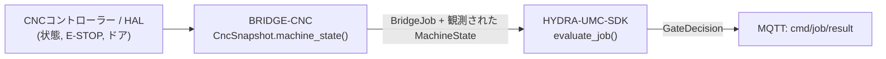

<!-- =============================================================================
HYDRA-UMC-BRIDGE-CNC - CNC cell coordination bridge
Copyright (C) JuanenRac (Electro Hobby 3D) <electrohobby3d@gmail.com>
GPL-3.0-or-later - see LICENSE
============================================================================= -->

<p align="center">
  
</p>

# 🔧 HYDRA-UMC-BRIDGE-CNC

<p align="center"><a href="README.md">🇺🇸 English</a> | <a href="README_spa.md">🇪🇸 Español</a> | <a href="README_fra.md">🇫🇷 Français</a> | <a href="README_ita.md">🇮🇹 Italiano</a> | <a href="README_deu.md">🇩🇪 Deutsch</a> | <a href="README_zho.md">🇨🇳 简体中文</a> | 🇯🇵 <b>日本語</b> | <a href="README_por.md">🇵🇹 Português</a></p>

### 🛑 CNCセル向けフェイルセーフ連携ブリッジ

<p align="center">
  
  
  
  
  
  
</p>

---

> **誠実性チェック - 今日実際に動くもの:** フェイルセーフなセルスナップショットと安全ゲート（`cell.py` の `CncSnapshot`/`CncCellBridge`。すべてのジョブは `HYDRA-UMC-SDK` 自身の本物の `evaluate_job()` を通過する）、読み取り専用の GRBL/MTConnect エビデンス正規化（`observation.py`）、本物の GRBL シリアルトランスポート（`serial_transport.py` の `GrblSerialProbe`/`GrblRealtimeControl`）、および MQTT コマンド/状態トランスポート（`mqtt_transport.py`）は本物であり、206件の通過する `unittest` ケースで検証されている（`python tools/build_test.py`）。これにはプロトコルに忠実な手書きの GRBL v1.1 エミュレータに対してこのブリッジを動かす `tests/test_grbl_emulator.py` も含まれる。これらはいずれも本物のシリアルポート、本物の MQTT ブローカー、実際の CNC コントローラには一切触れていない - `test_serial_transport.py` 独自の `FakeSerial` が物理接続を置き換えており、`test_mqtt_transport.py` も同様に模擬ブローカークライアントを使用している。LinuxCNC と CNCjs の接続および MTConnect ビューはシミュレーションにしか触れておらず、実際のコントローラがまだ一度も駆動されていないため、LinuxCNC HAL アダプターも実機向けの `run` コマンドもまだ存在しない - 詳細は下記の「ロードマップと既知の制限」に既に明記されており、これまでに実際に出荷された内容は `CHANGELOG.md` を参照。

> **安全性とセキュリティの現状:** このエコシステムは認証された安全システムではありません。ハードウェアの E-STOP 経路、ファームウェアが強制する制限やインターロック、検証済みの動作コマンドはまだありません。ファームウェアイメージは CRC32 と共有鍵の HMAC-SHA256 で検査しており、非対称署名ではありません。TLS と相互 TLS は任意で、既定では無効です。独自基板はまだ実装も試験もされていません。ここに書かれた内容を人の安全のために頼る前に、[セキュリティベースライン](https://github.com/JuanenRac/HYDRA-UMC-DOCS/blob/main/docs/SECURITY_BASELINE.md)と[脅威モデル](https://github.com/JuanenRac/HYDRA-UMC-DOCS/blob/main/docs/THREAT_MODEL.md)をお読みください。

---

## 📋 ひと目で

| | |
|---|---|
| バージョン | `0.2.0` |
| 成熟度 | 機能する |
| テスト | 206 (`python tools/build_test.py`) |
| 技術 | Python / LinuxCNC / G-code / GRBL status evidence / GRBL serial transport |
| 対象 | HYDRA-UMC セルの Raspberry Pi CM5 |
| 実機での確認 | シミュレーションのみ：エミュレーター、模擬部品、シミュレーターで試験済み。このバージョンについて実機での動作記録はありません |

**移動：** [概要](#-概要) · [アーキテクチャ](#-アーキテクチャ) · [機能](#-機能) · [セキュリティと安全](#-セキュリティと安全) · [インターフェース](#-インターフェース) · [設定](#-設定) · [クイックスタート](#-クイックスタート) · [テスト](#-テスト) · [トラブルシューティング](#-トラブルシューティング) · [リポジトリの構成](#-リポジトリの構成) · [関連プロジェクト](#-関連プロジェクト)

## 🚦 プロジェクトの状況

各行はこのリポジトリの一部分で、信号は今日どこまで進んでいるかを示します。計画ではなく、リポジトリが示せるもの（テスト、ビルド、実行）に基づいて書かれています。

🟢 完了・検証済み · 🟡 動作する（既知の制限あり） · 🟠 一部のみ、または未検証 · 🔴 未実装または動作しない

| 領域 | 状態 | ここでの意味 |
|---|---|---|
| ソフトウェア | 🟡 | 主な目的では動作します。足りない点は上の正直さの確認に書かれています |
| テスト | 🟢 | 自動テスト 206 件。変更のたびに実行されます |
| 実機 | 🟠 | シミュレーションのみ：エミュレーター、模擬部品、シミュレーターで試験済み。このバージョンについて実機での動作記録はありません |
| ドキュメント | 🟢 | 8 言語の README。変更のたびにマニフェストと照合されます |

## 🎯 概要

**HYDRA-UMC-BRIDGE-CNC** は、CNCセルとHYDRA-UMCロボット補助装置とを結ぶ高レベルブリッジであり、搬入・搬出・部品ハンドリング、監視下にある補助タスクを扱う。実時間軌道コントローラーになることは決してない —— CNCコントローラー(GRBL、LinuxCNC、または CNCjs の背後にあるもの)が常に軌道・主軸・機械限界の権限を保持する。

本リポジトリは **External Automation Bridges** ファミリーに属する。CNC・LASER・OPENPNP・PRINTER3D・ROS2という兄弟リポジトリ群が、すべて `HYDRA-UMC-SDK` の同じ安全契約を共有しており、いずれのブリッジも独自の「作業に安全」という定義を勝手に作ることはできない。

## 🧩 HYDRA-UMC での役割

**HYDRA-UMC-BRIDGE-CNC** は、CNC コントローラー（GRBL、LinuxCNC、または CNCjs の背後のもの）と、それに対して着脱を行うロボットセルの間に位置します。軌跡・スピンドル・制限の権限は常にコントローラーにあり、ブリッジはコントローラーの報告を伝え、補助作業の前に共通ゲートへ問い合わせるだけです。

すべてのブリッジは `HYDRA-UMC-SDK` の共通の安全契約に従います。ジョブは共通の `evaluate_job()` ゲートが許可したときだけ受け付けられ、ゲートは安全側（閉）に倒れます。親プロジェクトは `HYDRA-UMC-SERVER` で、このブリッジはそれを呼び出さず、`HYDRA-UMC-MQTT-BROKER` 経由の MQTT でセルを指令する側に応答します。

| 連携先 | 方法 | 目的 |
|---|---|---|
| `HYDRA-UMC-SDK` | Python のインポート | ジョブゲート `evaluate_job()`、ジョブと判定のワイヤ形式、シリアル接続、MQTT クライアント |
| `HYDRA-UMC-MQTT-BROKER` | MQTT, `hydra/bridges/cnc/` | コマンド入力（`cmd/`）、状態と結果の出力 |
| GRBL | シリアルポート | 状態照会 `?` とリアルタイムバイト（フィードホールド、サイクル再開、ソフトリセット）。G コードのプログラムは送りません |
| LinuxCNC | Python モジュール `linuxcnc` | `linuxcnc.stat` を読み、一時停止・中止・再開だけを送ります |
| CNCjs | socket.io | `controller:state` を購読し、`feedhold`・`reset`・`cyclestart` だけを送ります |

## 🏛️ アーキテクチャ

<p align="center">
  
</p>

<details>
<summary>図のテキスト版（Mermaid）</summary>



</details>

**この作りにした理由**

* **なぜE-STOPとドア状態をコントローラー自身の報告状態より先に確認するのか。** `CncSnapshot.machine_state()` は、`estop` が真であるか、あるいはドアが閉じていない場合、真っ先に `SAFE_STOP` へ短絡する —— ドアが開いたままなのに `IDLE` と報告し続けるコントローラーを、額面通りに信用してはならない。
* **なぜコントローラー状態のマッピングを意図的に保守的にしているのか。** 文字列 `IDLE` のみが `MachineState.IDLE` にマッピングされる。認識されない値はすべて `OFFLINE` にフォールバックし、補助作業を許可してしまうような状態には決してならない —— 未知のコントローラー状態は「わからない」として扱われ、「おそらく大丈夫」とは扱われない。
* **なぜブリッジは新しい `BridgeJob` を組み立て、独自の受理/拒否ロジックを書く代わりに共有の `evaluate_job()` に委譲するのか。** 5つのExternal Automation Bridges(CNC、LASER、OPENPNP、PRINTER3D、ROS2)はすべて `HYDRA-UMC-SDK` の全く同じ `bridge_contract` を再利用しており、「何をもってジョブ開始が安全とみなすか」がそれぞれの間で静かに食い違うことがない。
* **なぜ LinuxCNC と CNCjs の接続は読み取り・一時停止・再開だけなのか。** 軌道・主軸・限界の権限はコントローラーが持ち、プログラムはそれを実行する側（CNCjs、LinuxCNC 自身）のものです。ブリッジは機械を停止状態にし、一時停止中の機械を続行させることしかできません。実際のHALピンの配線は、実物のコントローラーに対して検証すべきハードウェア統合ステップのままです。
* **エコシステムの他部分とどう関係するか。** BRIDGE-CNCはCNCコントローラーと `HYDRA-UMC-SDK` → `HYDRA-UMC-MQTT-BROKER` → MCU/セル安全との間に位置する。CNCの周辺で補助ロボット作業を調整するものであり、コントローラー自身の安全権限を置き換えたり上書きしたりすることはない。

観測ヘルパーはエビデンスの正規化を行うものであり、コントローラーアダプターではない——HAL、シリアル、ネットワークのいずれの接続も開かない。[Controller Evidence Boundary](docs/CONTROLLER_EVIDENCE_BOUNDARY.md) は、実際のコントローラー統合の前に必要な検証を定義している。

## ✨ 機能

* ✅ **実在するフェイルセーフなセルスナップショット:** `cell.py` の `CncSnapshot.machine_state()` は、コントローラーが報告する内容を見る*前に*E-STOPとドア状態を確認する —— E-STOPが作動しているか、ドアが閉じていない場合、`controller_state` の内容に関わらず常に `SAFE_STOP` へ解決される。*(実装済み、`tests/test_cell.py` でテスト済み)*
* ✅ **実在する共有安全ゲート:** 観測されたすべてのジョブは `HYDRA-UMC-SDK` の `bridge_contract` にある `evaluate_job()` を通じて再評価される。これは他のすべての兄弟ブリッジが使うのと同じゲートである。*(実装済み)*
* ✅ **保守的な状態マッピング:** `IDLE` のみがアイドルとして扱われる。`RUN`/`RUNNING`/`JOG`/`HOME` は `RUNNING` に、`FAULT`/`ERROR`/`OFF`/`ALARM` は `FAULT` にマッピングされ、認識されない値はすべて `OFFLINE` にフォールバックする —— 生産的な作業を許可してしまうような状態には決してフォールバックしない。(`HOLD` → `HOLDING`; `DOOR` → `SAFE_STOP`) *(実装済み)*
* ✅ **読み取り専用のコントローラー証跡:** `observation.py` はローカルのマッピング証跡と供給された GRBL ステータス行を厳密に正規化する。E-STOP/ドア信号が欠落しているか、ブール値でない場合は安全側に倒れて失敗する。*(実装済み、`tests/test_observation.py` でテスト済み)*
* ✅ **実際の GRBL シリアル転送:** `serial_transport.py` の `GrblSerialProbe` は実際のシリアル接続を開き、GRBL のリアルタイムステータスバイト（`?`）を問い合わせる。`GrblRealtimeControl` は GRBL 自身のリアルタイム制御バイト（送り保持、サイクル再開、ソフトリセット）のみを送信する —— `cycle_start_resume()` はマシンが本当に `HOLDING` 状態のときのみゲートされ、他は `ABORT` のように常に許可される。G-code プログラムをストリーミングすることは決してない。*(実装済み、`tests/test_serial_transport.py` でテスト済み)*
* ✅ **非破壊的なビルド/テスト:** `build-test.bat`/`.sh` はソースをコンパイルし、バージョンファイルやCHANGELOGに一切触れずに安全ゲートのテストスイートを実行する。*(実装済み、下記「ビルドとリリース」を参照)*
* ✅ **コントローラー接続:** ブリッジは `ControllerLink`（`controller.py`）を通じてコントローラーと通信します。ブリッジ自身が開いたシリアルポート上の GRBL（`GrblController`）、LinuxCNC のインストール（`linuxcnc_link.py`：`linuxcnc.stat` を読み、`linuxcnc.command` で一時停止中のプログラムの一時停止・中断・再開だけを送り、プログラムは決して実行しない）、そしてポートを所有する CNCjs サーバー（`cncjs_link.py`：配信される `controller:state` を読み、`feedhold`・`reset`・`cyclestart` だけを送るため、ブリッジはプログラムを実行する送信側と並んで動作する）です。再開には常に READY のセルと実際に保持中の機械が必要で、古い読み取りや欠けた読み取りが待機中の機械になることはありません。どちらの接続もシミュレーション（`SimulatedLinuxcnc`、`SimulatedCncjs`）に対してテスト済みで、本物の LinuxCNC や CNCjs には触れていません。*(実装済み、シミュレーションのみ)*
* ✅ **主軸ゲート:** コントローラーがアイドルでも、主軸が回転中または送りが動作中（`FS:`）と報告している間は、搬入・搬出を拒否します。`HYDRA_UMC_CNC_SPINDLE_GATE` は `off`、`when_known`（既定：報告されたものを拒否）、`required`（コントローラーが報告しないものも拒否）のいずれかです。スナップショットにはレポートの位置・ワークオフセット・オーバーライドも含まれます。*(実装済み)*
* ✅ **MTConnect ビュー:** `mtconnect_publish.py` はスナップショットを MTConnect の観測値（`avail`、`execution`、`estop`、`door`、`spindle_speed`、`path_feedrate`、`system`）に変換し、`ShdrAdapter` が TCP 上の SHDR として提供します（読み取り専用。受け付ける行は `* PING` のみ）。`HYDRA_UMC_CNC_MTCONNECT=1` のときは `hydra/bridges/cnc/mtconnect` にリテイン付きで発行します。報告しないコントローラーは `UNAVAILABLE` であり、`READY` にはなりません。模擬エージェントに対してテスト済み。*(実装済み、実エージェントでは未検証)*
* 🔜 **LinuxCNC HALピン** —— 保留中。実際のCNCコントローラー、HALピン、ロボットはまだ一度も駆動されていない。*(計画中)*
* ✅ **重複した冪等キー:** `CncMqttBridge` は `IdempotencyStore` を受け取り、重複したジョブキーには再評価せず初回の応答を返す。*（実装済み、`tests/test_idempotency.py` でテスト済み）*
* ✅ **噛み合うステータス応答、フェイルクローズドなシリアル、堅牢化したMQTTループ:** ステータス問い合わせは、すでに待っているものを捨て、`?` を送り、本物のステータスレポート(`<...>`)が届くまで読む。GRBLが頼まれなくても送るバナーや `ok`、`[MSG:...]`、`ALARM:n` によって、以後の問い合わせが毎回1応答ずつ遅れることはなくなった。USBデバイスの不在(またはリンク上のあらゆる障害)はブリッジを終了させず、フェイルクローズドで失敗し、ポートはDTRをアサートせずに開かれる。`cmd/feed_hold` はその後にコントローラーが報告した内容(`controller_state_after`、`confirmed`)を返し、`cmd/feed_hold` と `cmd/soft_reset` は専用レーンで動くため、ステータス問い合わせが遅らせることはない。大きすぎる(16 KiB超)・読めない・深くネストされたペイロードや想定外の障害には、結果トピックで拒否を返し、ループは決して終了しない。`cmd/job` の応答には `"mode": "gate-only"` が付き、そこを通したABORTは何も停止していないことを明示する。状態には `observed_at` が含まれ、ブリッジはLast Will付きの `availability` トピックで自らを告知する。GRBLのシリアルポートは1つだけである。このブリッジが保持している間は、どのG-codeセンダーもそれを使えない(`docs/BRIDGE_GUIDE.md` を参照)。*(実装済み、`tests/test_hardening.py` でテスト済み)*

## 🔒 セキュリティと安全

| 脅威 | 防御 | 場所 |
|---|---|---|
| 安全でない状態のセルへのジョブ | すべてのジョブは、安全側に倒れる共通の `evaluate_job()` ゲートを通ります。ブリッジ自身に受理・拒否のロジックはありません。非常停止とドアはコントローラーの報告より先に読まれ、ドア開または非常停止は常に `SAFE_STOP` です | `cell.py`, SDK `bridge_contract` |
| 過大なジョブデータ | パラメーターは最大 32 個、キーは 64 文字、値は 1024 文字、識別子は 128 文字まで。16 KiB を超える MQTT ペイロードは結果トピックで拒否されます | SDK `bridge_contract`, `mqtt_transport.py` |
| 繰り返された、または再送された命令 | `IdempotencyStore` は各キーを 24 時間、最大 10 000 件まで記憶し、再送には再評価せず最初の応答を返します。保持された `cmd/` メッセージは再接続時に無視されます | SDK `job_intake.py`, `mqtt_transport.py` |
| アームが着脱している間のスピンドル回転 | コントローラーがアイドルでもスピンドル回転や送りが報告されている間は `LOAD` と `UNLOAD` を拒否します。`HYDRA_UMC_CNC_SPINDLE_GATE` は `off`、`when_known`（既定。未知の値でも同じ）、`required` のいずれかです | `cell.py` |
| リモート命令による機械の停止や移動 | CNCjs には `feedhold`・`reset`・`cyclestart` だけ、LinuxCNC には一時停止・中止・再開だけ、シリアルポートには GRBL のリアルタイムバイトだけが届きます。再開には READY のセルと実際に停止中の機械が必要です。`cmd/feed_hold` と `cmd/soft_reset` は専用レーンで動きます | `cncjs_link.py`, `linuxcnc_link.py`, `serial_transport.py`, `mqtt_transport.py` |
| 古い読み取りを「アイドル」と取り違える | 3 秒より古い CNCjs の読み取りは信用せず、状態がない・古い場合はアイドルとみなさずドアは開とみなします。LinuxCNC のコマンドは 2 秒でタイムアウトし、シリアル照会の失敗は安全側に倒れます | `cncjs_link.py`, `linuxcnc_link.py`, `serial_transport.py` |
| アダプターに過剰接続する MTConnect クライアント | SHDR アダプターは読み取り専用で、クライアントは最大 16、1 行は 1024 バイトまで、受け付ける行は `* PING` だけです | `mtconnect_publish.py` |

**絶対にしないこと：** G コードのプログラムをストリーミングしない、LinuxCNC でプログラムを実行しない、CNCjs からシリアルポートを奪わない、証拠に含まれない非常停止やドアの状態を推測しない。`docs/CONTROLLER_EVIDENCE_BOUNDARY.md` を参照してください。

## 🔌 インターフェース

`hydra/bridges/cnc/`（プレフィックス `TOPIC_PREFIX`）以下のトピック。ブリッジは `cmd/#` を購読します。

| トピックまたはルート | 内容 |
|---|---|
| `cmd/status` | セルの状態を要求。応答は `cmd/status/result` |
| `cmd/job` | SDK の `job_to_dict()` 形式の `BridgeJob`。応答は `"mode": "gate-only"` が付いた `GateDecision` で、何も実行しません（これ経由の `ABORT` は何も止めていないと答えます） |
| `cmd/feed_hold`, `cmd/soft_reset` | 停止コマンド。専用レーンで処理され、応答に `controller_state_after` と `confirmed` を含みます |
| `cmd/cycle_start_resume`, `cmd/start`, `cmd/resume` | 停止中の機械を再開します。セルが READY で機械が実際に停止中でない限り拒否されます（ドアの事象の後は不可） |
| `<verb>/result` | コマンドごとに 1 つの JSON 応答。拒否時は `{"allowed", "executed", "reason"}` |
| `state`, `availability` | セルの状態（保持。`observed_at` はエポックミリ秒）と `online`/`offline`（Last Will） |
| `mtconnect` | MTConnect の観測値（保持）。`HYDRA_UMC_CNC_MTCONNECT=1` のときだけ |

ライブラリ：`CncCellBridge`、`CncSnapshot`、`CncMqttBridge`、`spindle_gate_from_environment()`、3 つの連携（`GrblController`、`LinuxcncController`、`CncjsController`）。

## ⚙️ 設定

| 変数 | 既定値 | 設定する内容 |
|---|---|---|
| `HYDRA_UMC_CNC_SPINDLE_GATE` | `when_known` | `off`・`when_known`・`required` のいずれか。未設定や未知の値は `when_known` と同じです |
| `HYDRA_UMC_CNC_MTCONNECT` | オフ | `1` で MTConnect の観測値を `hydra/bridges/cnc/mtconnect` に公開します |
| `HYDRA_MQTT_USERNAME` | なし | MQTT のユーザー名。ブローカーはクライアント ID のプレフィックスに結び付けます |
| `HYDRA_MQTT_PASSWORD` | なし | パスワード。ユーザー名と一緒にのみ有効です |
| `HYDRA_MQTT_PASSWORD_FILE` | なし | ファイルから読むパスワード（Docker や systemd のシークレット）。`HYDRA_MQTT_PASSWORD` があれば無視されます |
| `HYDRA_MQTT_TLS_CA` | なし | ブローカーの証明書に署名した CA のファイル。接続は TLS になり、証明書が検証されます |
| `HYDRA_MQTT_TLS` | オフ | `1` で TLS を有効にし、システムの信頼する CA で検証します |
| `HYDRA_MQTT_TLS_CERT` / `HYDRA_MQTT_TLS_KEY` | なし | 相互 TLS を求めるブローカー用のクライアント証明書とその鍵。両方が必要です |

コントローラー連携はコードで選びます。LinuxCNC や CNCjs には `CncMqttBridge` に `controller=` を渡し、それ以外ではブリッジが GRBL のシリアル接続を保持します。保持している間、G コード送信ソフトはそのポートを使えません（`docs/BRIDGE_GUIDE.md` の「One serial port」を参照）。

## 🚀 クイックスタート

Python 3.11 以上が必要です。テストとビルドスクリプトは、このリポジトリの隣にある `HYDRA-UMC-SDK`（`../HYDRA-UMC-SDK`）、または `HYDRA_UMC_SDK_ROOT` で指定した場所を前提にします。

ハードウェアなしで試す（エミュレーターと模擬部品でブリッジ全体を確認します）：

```bash
py -3 tools/build_test.py          # Windows
python3 tools/build_test.py         # Linux, macOS
build-test.bat  /  bash build-test.sh   # the same, through the scripts
```

サービスを起動する（コンソールスクリプトはありません。サービスは MQTT トランスポートの `run_forever()` で、自分の起動コードから呼び出します）：

```python
from hydra_umc_bridge_cnc.mqtt_transport import CncMqttBridge, run_forever
# `connection` is an open GRBL serial connection (open_serial_port()), or pass controller=...
bridge = CncMqttBridge(connection)
run_forever(bridge, host="192.168.0.180")   # connects to the broker and serves cmd/# forever
```

ユーザー名、パスワード、TLS ファイルは `HYDRA_MQTT_*` 変数から読まれます（設定を参照）。上のコード自体に認証情報は不要です。

## 🧪 テスト

`python tools/build_test.py` で自動 `unittest` 206 件を実行します（各モジュールのコンパイルも行います）。テストにハードウェア、ネットワーク、オプションのパッケージは不要で、`paho-mqtt`・`pyserial`・ベンダーのライブラリが必要なものは代用品を使うか、パッケージがなければスキップされます。

| テストファイル | テスト数 | 対象 |
|---|---|---|
| `test_cell.py` | 10 | 安全なアイドルでの受理、ドア開時の拒否、中止の転送 |
| `test_controllers.py` | 63 | スピンドルゲート、LinuxCNC と CNCjs の連携（シミュレーション相手）、MTConnect ビュー |
| `test_serial_transport.py` | 29 | 偽のポートに対するシリアルトランスポート（安全側に倒れる経路を含む） |
| `test_mqtt_transport.py`, `test_mqtt_environment.py` | 28 + 4 | 偽のブローカークライアントに対するコマンドと状態の形式。環境の認証情報と TLS がクライアントに届く |
| `test_grbl_emulator.py`, `grbl_emulator.py` | 17 | 手書きでプロトコルに忠実な GRBL v1.1 エミュレーターに対するブリッジ |
| `test_hardening.py`, `test_edge_cases.py`, `test_idempotency.py`, `test_observation.py` | 25 + 20 + 3 + 7 | 揃った状態応答、断線、フィードホールドの確認、悪意あるペイロード、繰り返しキー、欠けた証拠 |

CI は `HYDRA_UMC_CI=1 python tools/ci_validate.py` を実行し、マニフェスト、文書、8 つの README、図を検査し、SDK のチェックアウトを使ってテストを実行します。

## 🏗️ ビルドとリリース

Python 3.11以上が必要。`tools/build_test.py` は `HYDRA-UMC-SDK` が兄弟ディレクトリ(`../HYDRA-UMC-SDK`)としてチェックアウトされているか、環境変数 `HYDRA_UMC_SDK_ROOT` で指定されていることを期待する。

```bash
# Windows
build-test.bat      # 検証のみ —— バージョン/CHANGELOGの変更なし
build.bat            # 検証後、成功時にバージョン + CHANGELOG を更新

# Linux/macOS
bash build-test.sh
bash build.sh
```

`build-test` は `src/` 配下の各モジュールを `py_compile` でコンパイルし、`tests/` 配下で検出される `unittest` の全スイート(`test_cell.py`、`test_observation.py`、`test_serial_transport.py`、`test_mqtt_transport.py`、`test_grbl_emulator.py`、`test_hardening.py`、`test_idempotency.py`、`test_mqtt_environment.py` - 206件のテスト)を実行して、安全アイドル許可、ドア開放時の拒否、中止転送などを実証する —— リポジトリを一切変更しない。`build` はまず同じ検証を実行し、成功した場合のみ `tools/bump_version.py` を呼び出して `pyproject.toml`、`hydra-umc.project.json`、`CHANGELOG.md` の間でバージョンを同期する。実際のCNC向け `run` コマンドはまだ存在しない —— それには検証済みのコントローラー統合が必要である。

## 🩺 トラブルシューティング

| 表示 | 原因 | 対処 |
|---|---|---|
| `ModuleNotFoundError: hydra_umc_sdk` | SDK がインストールされておらず、このリポジトリの隣にもありません | `HYDRA-UMC-SDK` をこのリポジトリの隣に置くか、`HYDRA_UMC_SDK_ROOT` を設定します |
| `paho-mqtt is not installed` | MQTT クライアントはオプションの追加パッケージです | `pip install ".[mqtt]"`（`paho-mqtt` 2.1 以上 3 未満が必要） |
| `password was given without a username` | MQTT の認証情報にはユーザー名とパスワードの両方が必要です | パスワードに加えて `HYDRA_MQTT_USERNAME` も設定します |
| `spindle_gate must be one of ...` | `HYDRA_UMC_CNC_SPINDLE_GATE` にコードが知らない値が設定されています | `off`・`when_known`・`required` を使います（コードで渡すと例外になり、環境変数では未知の値は `when_known` に戻ります） |
| `a serial connection or a controller link is required` | `CncMqttBridge` がどちらも指定されずに作られました | 開いたシリアル接続か `controller=` を渡します |
| `"allowed": false` + `reason` | 共通ゲートまたはガードが命令を拒否しました | `reason` を読みます（ドア開、非常停止、機械がアイドルでない、スピンドル回転、古い読み取り）。原因を直し、やみくもに再試行しないでください |

## 📂 リポジトリの構成

<p align="center">
  
</p>

<details>
<summary>ツリーのテキスト版</summary>

```text
HYDRA-UMC-BRIDGE-CNC/
├── src/hydra_umc_bridge_cnc/
│   ├── cell.py                    セル状態、安全ゲート、スピンドルゲート
│   ├── observation.py             読み取り専用の証拠、GRBL ステータス行
│   ├── serial_transport.py        GRBL シリアル接続：状態照会とリアルタイムバイト
│   ├── controller.py              ControllerLink と GRBL コントローラー
│   ├── linuxcnc_link.py           LinuxCNC 連携（読み取り・一時停止・再開）とそのシミュレーション
│   ├── cncjs_link.py              CNCjs 連携（feedhold・reset・cyclestart）とそのシミュレーション
│   ├── mtconnect_publish.py       MTConnect の観測値と読み取り専用 SHDR アダプター
│   └── mqtt_transport.py          MQTT のコマンド・状態トランスポート
├── tests/                         206 件（手書きの GRBL エミュレーター付き）
├── docs/                          ブリッジガイド、証拠の境界
├── tools/                         ビルド・テスト実行、バージョン引き上げ、CI 検証、README と図の生成・検査
├── images/                        バナーと README の図
├── .github/                       CI ワークフローと Issue テンプレート
├── pyproject.toml                 パッケージのメタデータと依存関係
├── hydra-umc.project.json         マニフェスト：バージョン・成熟度・ファミリー
├── CHANGELOG.md                   各バージョンの変更点
├── build.sh build.bat             ビルドスクリプト（バージョンは変えません）
├── build-test.sh build-test.bat   ビルドスクリプト（バージョンは変えません）
├── test.sh test.bat               テストを実行
└── SECURITY.md SUPPORT.md CONTRIBUTING.md CODE_OF_CONDUCT.md LICENSE LICENSE.md
```

</details>

## 🗺️ ロードマップと既知の制限

**現時点の既知の制限**

**現時点で実在するもの:** バージョン `0.2.0`。ローカルでテスト済みのフェイルセーフなセル調整器(`CncSnapshot` + `CncCellBridge`)が `HYDRA-UMC-SDK` の共有ジョブゲートの上に構築されており、GRBL v1.1 の実際のステータス語彙全体(実際の `Hold:N`/`Door:N` サブステートを含む `Idle`/`Run`/`Jog`/`Home`/`Hold`/`Alarm`/`Door`)に加えて MTConnect の実行状態もカバーする厳密な読み取り専用コントローラー証拠の正規化、実際の接続経由でステータスを問い合わせ GRBL 自身のリアルタイム制御バイトを送信できる実際のシリアル転送(`GrblSerialProbe`/`GrblRealtimeControl`)——ドア/E-STOP のライブ読み取りは、その問い合わせ自身のブロッキングな往復が完了した直後に行われるようになり、決してその前ではない。実際の短い、またはゼロバイトの書き込みは、偽の成功としてではなく未実行として報告される——決定論的な206件の `unittest` スイートと、SDKチェックアウトを伴いCIに組み込まれた非破壊的なbuild-testスクリプトを備える。

**統合境界:** CNCコントローラー(GRBL、LinuxCNC、または CNCjs の背後にあるもの)は常に軌道・主軸・機械限界の権限を保持する。このブリッジが調整するのはあくまで*補助的な*ロボット作業のみであり、コントローラー自身の動作には一切関与しない。

**今後の課題:** 実際のCNCコントローラー、LinuxCNC HALピン、ロボットはまだ一度も駆動されていない —— 具体的なHALアダプターの選定と検証は、実機とその文書化されたインターフェースが揃った後に行うハードウェア/ソフトウェア統合ステップである。

## 🌍 言語

この README とリポジトリの文書は、英語・スペイン語・ドイツ語・フランス語・イタリア語・日本語・中国語・ポルトガル語（ポルトガル）の 8 言語で提供されています。8 つのファイルは同時に書かれ、同じ節と同じリンクを持つことを CI が確認します。 このリポジトリには独自の画面もメッセージカタログもないため、翻訳すべきインターフェース文字列はありません。

## 🔗 関連プロジェクト

本プロジェクトは、同じ作者(JuanenRac / Electro Hobby 3D)による HYDRA-UMC ロボティクスエコシステムの一部です。リクエストが実はこの中のどれかについてのものである可能性があるため、知っておく価値があります。

**親プロジェクト**
- **[HYDRA-UMC-SERVER](https://github.com/JuanenRac/HYDRA-UMC-SERVER)** — すべての制御クライアントが実際に通信する、本物のヘッドレスバックエンド(REST/WebSocket)。このブリッジはこれを呼び出さず、HYDRA-UMC-MQTT-BROKER を介したMQTTで、セルを指揮する側に応答する。

**兄弟プロジェクト** —— それぞれ独自のクライアントとして、同じく HYDRA-UMC-SERVER 自身の API と通信する
- **[HYDRA-UMC-STUDIO](https://github.com/JuanenRac/HYDRA-UMC-STUDIO)** — リアルタイムのマルチロボット 3D 可視化を備えたウェブ制御ダッシュボード。
- **[HYDRA-UMC-SUITE](https://github.com/JuanenRac/HYDRA-UMC-SUITE)** — 複数のサーバーを同時に扱えるデスクトップ(PySide6)スウォームコマンドセンター、スタンドアロン実行ファイルとしてパッケージ化。
- **[HYDRA-UMC-ANDROID-CONTROL](https://github.com/JuanenRac/HYDRA-UMC-ANDROID-CONTROL)** — 生体認証ログインとペアリングされた Wear OS コンパニオンを備えたネイティブ Android 制御アプリ。
- **[HYDRA-UMC-IOS-CONTROL](https://github.com/JuanenRac/HYDRA-UMC-IOS-CONTROL)** — リアルタイム WebSocket 同期を備えた iOS/iPadOS 制御アプリ(Flutter)。
- **[HYDRA-UMC-DSI](https://github.com/JuanenRac/HYDRA-UMC-DSI)** — 本体搭載の 7 インチ DSI タッチスクリーン向けネイティブタッチ UI、CM5 自体に組み込み。
- **[HYDRA-UMC-BRIDGE-AMR](https://github.com/JuanenRac/HYDRA-UMC-BRIDGE-AMR)** — VDA 5050 MQTT パブリッシャーによる AGV/AMR フリートの調整境界(エミュレートしたフリートに対してのみテスト済み)。
- **[HYDRA-UMC-BRIDGE-DROIDS](https://github.com/JuanenRac/HYDRA-UMC-BRIDGE-DROIDS)** — Boston Dynamics Spot コマンド送信機能を持つ、脚型/ヒューマノイドドロイドの調整境界(エミュレーターに対してのみテスト済み)。
- **[HYDRA-UMC-BRIDGE-LASER](https://github.com/JuanenRac/HYDRA-UMC-BRIDGE-LASER)** — キー/筐体/インターロックの GPIO 信号 3 系統を読み取るレーザーセルのコーディネーター(模擬チップに対してのみテスト済み。レーザーの武装や発射はできない)。
- **[HYDRA-UMC-BRIDGE-OPENPNP](https://github.com/JuanenRac/HYDRA-UMC-BRIDGE-OPENPNP)** — OpenPnP ピックアンドプレースの基板フローを安全に統括する高レベルコーディネーター。
- **[HYDRA-UMC-BRIDGE-PRINTER3D](https://github.com/JuanenRac/HYDRA-UMC-BRIDGE-PRINTER3D)** — 実際にゲート制御されたジョブコマンドを持つ、Moonraker/Klipper 3D プリンター向けの安全な調整境界。
- **[HYDRA-UMC-BRIDGE-ROS2](https://github.com/JuanenRac/HYDRA-UMC-BRIDGE-ROS2)** — 遅延インポートの rclpy ROS 2 トランスポートを持つコーディネーター(ROS 2 環境ではまだ実行していない)。
- **[HYDRA-UMC-BRIDGE-UAV](https://github.com/JuanenRac/HYDRA-UMC-BRIDGE-UAV)** — MAVLink コマンド送信機能を持つ、カメラ搭載 UAV の調整境界(エミュレーターに対してのみテスト済み)。

**直接関連**
- **[HYDRA-UMC-SDK](https://github.com/JuanenRac/HYDRA-UMC-SDK)** — すべてのブリッジが自身のコマンドを検証する共有 JSON-Schema 契約とソフトウェアのジョブゲート境界(認証済みの安全機能ではない)。
- **[HYDRA-UMC-CONNECTOR-HUB](https://github.com/JuanenRac/HYDRA-UMC-CONNECTOR-HUB)** — 外部マシン用コネクタのための宣言的アダプターマニフェストのレジストリとバリデーター。SDK 自身の契約という発想を外部マシンにまで拡張し、産業用ゲートウェイ系のプロジェクトを置き換えることはありません。
- **[HYDRA-UMC-MQTT-BROKER](https://github.com/JuanenRac/HYDRA-UMC-MQTT-BROKER)** — このブリッジ自身の `hydra/bridges/cnc/...` トピック向けの `mqtt_transport.py` の実際のトランスポート——ステータスに加え jog/reset/resume の制御バイト、および共有ジョブゲート。詳細はそのリポジトリ自身の `docs/BRIDGE_TOPICS.md` を参照。
- **[HYDRA-UMC-HIL-BRIDGE](https://github.com/JuanenRac/HYDRA-UMC-HIL-BRIDGE)** — 実際のコントローラー統合に向けた将来のハードウェア・イン・ザ・ループ実証経路。

**エコシステムの他のプロジェクト**

*コアハードウェア&プラットフォーム*
- **[HYDRA-UMC](https://github.com/JuanenRac/HYDRA-UMC)** — ロボットアームのマザーボードの設計——CM5 ホスト + デュアルコア STM32H745、CAN-OTA/SPI-OTA 経由で最大 8 本のツールアームを統括することを目指す(ファームウェアは初期段階で、実装済みの基板はまだない)。
- **[HYDRA-UMC-OS](https://github.com/JuanenRac/HYDRA-UMC-OS)** — CM5 向けの再現可能な Raspberry Pi OS プロダクト層——読み取り専用エージェント、検証済み設定/プロファイル、WiFi 初回接続プロビジョニング。

*コアバックエンド&クライアント*
- **[HYDRA-UMC-EDITOR-URDF](https://github.com/JuanenRac/HYDRA-UMC-EDITOR-URDF)** — 完成したモデルを STUDIO 自身のカタログへ送信するデスクトップ用グラフィカル URDF 作成/編集ツール。
- **[HYDRA-UMC-EDITOR-STL](https://github.com/JuanenRac/HYDRA-UMC-EDITOR-STL)** — HYDRA-UMC-EDITOR-URDF も編集する同じモデルカタログ内で、実在するパーツを変換/置換/削除/追加するデスクトップ STL モデルエディタ。

*URTC ツールプラットフォーム*
- **[URTC](https://github.com/JuanenRac/URTC)** — 物理的な Universal Robot Tool Controller 基板向けファームウェア、CAN バス経由の 25 以上のツールプロファイル。
- **[URTC-FLASHER](https://github.com/JuanenRac/URTC-FLASHER)** — URTC 基板用のデスクトップ GUI 書き込みツール、CAN-OTA およびフルチップ SWD/JTAG。
- **[URTC-TESTER](https://github.com/JuanenRac/URTC-TESTER)** — URTC 基板向けのデスクトップ CAN バスライブ診断ツール、ツールプロファイルごとに 1 パネル。
- **[URTC-WEB-STUDIO](https://github.com/JuanenRac/URTC-WEB-STUDIO)** — Web Serial API を使ったブラウザベースの URTC-TESTER の代替、ローカルインストール不要。
- **[URTC-GATEWAY](https://github.com/JuanenRac/URTC-GATEWAY)** — URTC の CAN バスの前に置くゲートウェイ：許可する識別子のリスト、レート制限、セッション鍵。コンピューター上でテスト済みで、実際のバスではまだ試していません。

*ビジョン AI ノード(Hailo-8)*
- **[HYDRA-UMC-VISION-NODE](https://github.com/JuanenRac/HYDRA-UMC-VISION-NODE)** — Hailo-8 ビジョンパイプラインの統合ハブ、段階ごとの実際のハードウェア準備状況チェック付き。
- **[HYDRA-UMC-DETECTION-HEF](https://github.com/JuanenRac/HYDRA-UMC-DETECTION-HEF)** — Hailo アーキテクチャ/チェックサムによる安全読み込み検証を備えた、実際のコンパイル済みモデルレジストリ。
- **[HYDRA-UMC-VISION-STREAMER](https://github.com/JuanenRac/HYDRA-UMC-VISION-STREAMER)** — 実際の HailoRT 統合境界を持つ、実際の GStreamer パイプライン + MediaMTX 設定生成器。
- **[HYDRA-UMC-VISUAL-SERVOING-API](https://github.com/JuanenRac/HYDRA-UMC-VISUAL-SERVOING-API)** — ゾーン状態を条件に承認する Position-Based Visual Servoing 補正則。カメラによる姿勢推定はまだない。
- **[HYDRA-UMC-SAFETY-ZONES](https://github.com/JuanenRac/HYDRA-UMC-SAFETY-ZONES)** — ファイルから物体位置を受け取る、ゾーン侵入・キャリブレーション鮮度・E-STOP 要求の v0 ロジック。検出器は接続されておらず、物理 E-STOP もまだ配線されていない。

*コグニティブ AI ノード(Hailo-10)*
- **[HYDRA-UMC-COGNITIVE-NODE](https://github.com/JuanenRac/HYDRA-UMC-COGNITIVE-NODE)** — Hailo-10 コグニティブパイプライン(LLM/VLA/音声オーケストレーション)の統合ハブ。
- **[HYDRA-UMC-VLA-ENGINE](https://github.com/JuanenRac/HYDRA-UMC-VLA-ENGINE)** — Vision-Language-Action モデル向けの、実際のアクショントークンのエンコード/デコードと軌道生成。
- **[HYDRA-UMC-VOICE-UI](https://github.com/JuanenRac/HYDRA-UMC-VOICE-UI)** — 確認ゲート付きの限定的な Watch リレーを備えた、実際の音声フロントエンド(VAD + 意図解析)。
- **[HYDRA-UMC-SEMANTIC-PLANNER](https://github.com/JuanenRac/HYDRA-UMC-SEMANTIC-PLANNER)** — MCU エラーコードに対する、実際のルールベースのタスク分解と意味的エラー復旧。
- **[HYDRA-UMC-DOCS-QA](https://github.com/JuanenRac/HYDRA-UMC-DOCS-QA)** — このエコシステム自身の Markdown ドキュメントに対する、標準ライブラリのみの実際の TF-IDF 文書検索。
- **[HYDRA-UMC-LOCAL-TECHNICIAN](https://github.com/JuanenRac/HYDRA-UMC-LOCAL-TECHNICIAN)** — エコシステム自身のための、ローカルでポリシーゲート付きのAIメンテナンス技術者 — 観察、診断し、修正を提案する;最上位の2つのリスクレベルは意図的にまだ実装されていない。

*オーケストレーション&スウォーム*
- **[HYDRA-UMC-ORCHESTRATOR](https://github.com/JuanenRac/HYDRA-UMC-ORCHESTRATOR)** — 実際の gRPC/Protobuf ヘルスレポート契約とミッションステートマシンを持つ統合ハブ。
- **[HYDRA-UMC-JOB-DISPATCHER](https://github.com/JuanenRac/HYDRA-UMC-JOB-DISPATCHER)** — 実際の HTTP API 上に構築された、優先度ベースの実際のジョブキュー(重複排除付き)。
- **[HYDRA-UMC-NODE-HEALING](https://github.com/JuanenRac/HYDRA-UMC-NODE-HEALING)** — リトライ/バックオフとアイデンティティ不一致検出を備えた、実際の gRPC ベースのフリートヘルスウォッチドッグ。
- **[HYDRA-UMC-PATH-PLANNER-3D](https://github.com/JuanenRac/HYDRA-UMC-PATH-PLANNER-3D)** — 実際の障害物/ワークスペース衝突検証を備えた、実際の RRT ベースの 3D 経路プランナー。
- **[HYDRA-UMC-SWARM-SYNC](https://github.com/JuanenRac/HYDRA-UMC-SWARM-SYNC)** — 複数セルの収束についてプロパティテストされた、実際の CRDT LWW-Element-Map 状態同期。

*デジタルツイン&シミュレーション*
- **[HYDRA-UMC-TWIN](https://github.com/JuanenRac/HYDRA-UMC-TWIN)** — 実際のバージョン互換性同期契約を持つ、デジタルツインエンジンの統合ハブ。
- **[HYDRA-UMC-PHYSICS-REPLICA](https://github.com/JuanenRac/HYDRA-UMC-PHYSICS-REPLICA)** — 実際の URDF サブセットに対する、実際の順運動学と関節限界検証。
- **[HYDRA-UMC-SYNTHETIC-DATA-GEN](https://github.com/JuanenRac/HYDRA-UMC-SYNTHETIC-DATA-GEN)** — YOLO/COCO アノテーションのエクスポート機能を持つ、実際のプロシージャル 2D シーンジェネレーター。

*データ&分析*
- **[HYDRA-UMC-DATALAKE](https://github.com/JuanenRac/HYDRA-UMC-DATALAKE)** — 実際の取り込み/クエリ HTTP API を備えた、実際の sqlite3 ベースの時系列ストア。
- **[HYDRA-UMC-ANOMALY-DETECTOR](https://github.com/JuanenRac/HYDRA-UMC-ANOMALY-DETECTOR)** — ドリフト監視を備えた、実際の FFT + 統計ベースラインによる異常検知器。
- **[HYDRA-UMC-PRODUCTION-REPORTS](https://github.com/JuanenRac/HYDRA-UMC-PRODUCTION-REPORTS)** — DATALAKE の履歴に対する実際の OEE/稼働率計算、再現可能な CSV エクスポート付き。
- **[HYDRA-UMC-TELEMETRY-COLLECTOR](https://github.com/JuanenRac/HYDRA-UMC-TELEMETRY-COLLECTOR)** — シーケンス重複排除機能を備えた、DATALAKE への実際の CAN/WebSocket 取り込みパイプライン。

*産業用ゲートウェイ*
- **[HYDRA-UMC-GATEWAY-INDUSTRIAL](https://github.com/JuanenRac/HYDRA-UMC-GATEWAY-INDUSTRIAL)** — 実際のコマンド許可リスト/バックプレッシャー層を持つ、産業用プロトコルへ中継する統合ハブ。
- **[HYDRA-UMC-OPCUA-SERVER](https://github.com/JuanenRac/HYDRA-UMC-OPCUA-SERVER)** — 実際のバイナリプロトコルクライアントセッションで検証された、実際の OPC-UA アドレス空間。
- **[HYDRA-UMC-MTCONNECT-ADAPTER](https://github.com/JuanenRac/HYDRA-UMC-MTCONNECT-ADAPTER)** — 縮退モード出力を備えた、実際の MTConnect `/probe` および `/current` XML エンドポイント。

*補完ツール&エコシステム運用*
- **[HYDRA-UMC-DASHBOARD-AI](https://github.com/JuanenRac/HYDRA-UMC-DASHBOARD-AI)** — 誠実な統計フォールバックを備えた、DATALAKE/ANOMALY-DETECTOR 上のスマートサマリーと異常ハイライトパネル。
- **[HYDRA-UMC-TOOL-CLI](https://github.com/JuanenRac/HYDRA-UMC-TOOL-CLI)** — 実際の安定した終了コード契約を持つフリート CLI、HYDRA-UMC-SERVER 自身の API の本物のライブクライアント。
- **[HYDRA-UMC-WATCH](https://github.com/JuanenRac/HYDRA-UMC-WATCH)** — 触覚アラートのパターンとペアリング済みスマートフォンへの音声リレーを備えた WearOS コンパニオンアプリ(物理的なウォッチではまだ実行していない)。
- **[URTC-SMART-RACK](https://github.com/JuanenRac/URTC-SMART-RACK)** — 実際の工具 ID デコードと Smart Idle 予熱ロジックを備えた、基板搭載ラック用ファームウェア。
- **[URTC-VISION-TOOL](https://github.com/JuanenRac/URTC-VISION-TOOL)** — サーマル/RGB 検査ツールヘッド向けの、ファームウェアと実際の Python ビジョンコンパニオン。
- **[HYDRA-UMC-UPDATER](https://github.com/JuanenRac/HYDRA-UMC-UPDATER)** — このエコシステム内のすべてのリポジトリを検出・クローン・更新する、管理用デスクトップツール。
- **[HYDRA-UMC-OS-REBUILDER](https://github.com/JuanenRac/HYDRA-UMC-OS-REBUILDER)** — エコシステムの最新バージョンをプリロードした、書き込み可能なCM5イメージを構築するWindows/Linuxデスクトップツール。Raspberry Pi Imager方式の初回起動Wi-Fi/ユーザー/SSH設定を備える。
- **[HYDRA-UMC-OPS-AGENT](https://github.com/JuanenRac/HYDRA-UMC-OPS-AGENT)** — 保守インシデントコーディネーター: 低権限のエッジ役割がサニタイズされたインベントリ/ヘルスのスナップショットを収集し、コントロールプレーン役割がそれを読み取り専用でレンダリングして AI プロバイダーに診断の提案を依頼します - パッチを適用することも、何かをデプロイすることも決してありません。
- **[HYDRA-UMC-DEV-SERVER](https://github.com/JuanenRac/HYDRA-UMC-DEV-SERVER)** — 再現可能な開発ホスト（Raspberry Pi 5 / CM5）。エコシステムのソースコードを保管し、永続キューのもとで境界の明確なビルド/テストタスクを実行する。運用中の CM5 とは明確に異なる、開発専用の役割。

## 📚 ドキュメント

さらに読むには：

* [docs/BRIDGE_GUIDE.md](docs/BRIDGE_GUIDE.md) - 範囲、コントローラー連携、スピンドルゲート、MTConnect ビュー、唯一のシリアルポート、スクリプト
* [docs/CONTROLLER_EVIDENCE_BOUNDARY.md](docs/CONTROLLER_EVIDENCE_BOUNDARY.md) - 実際の安全の証拠とみなされるものと、ブリッジが推測しないもの
* [エコシステムのセキュリティ基準](https://github.com/JuanenRac/HYDRA-UMC-DOCS/blob/main/docs/SECURITY_BASELINE.md)
* [エコシステムの脅威モデル](https://github.com/JuanenRac/HYDRA-UMC-DOCS/blob/main/docs/THREAT_MODEL.md)
* [このリポジトリの変更履歴](CHANGELOG.md)
* [このリポジトリのライセンス](LICENSE.md)

## 🤝 コントリビュートとコミュニティ

* プルリクエストの前に `HYDRA_UMC_CI=1 py -3 tools/ci_validate.py`（または `HYDRA_UMC_CI=1 python3 tools/ci_validate.py`）を実行してください。`CI_VALIDATION=PASS` と表示される必要があります。この確認に `build.sh` や `build.bat` は使わないでください。ビルドは検査ではありません。
* 8 つの README は HYDRA-UMC-DOCS の 1 つのソースから書かれます。手で編集しないでください。ソースを変更し、`tools/make_readmes.py` で書き直します。
* 実行していないことを README に書かないでください。事実であれば「シミュレーションのみ」「実機では未確認」と書きます。
* [CONTRIBUTING.md](CONTRIBUTING.md)、[行動規範](CODE_OF_CONDUCT.md)、[SECURITY.md](SECURITY.md)、[SUPPORT.md](SUPPORT.md) を参照してください。

## 👤 作者

**JuanenRac (Electro Hobby 3D)** · electrohobby3d@gmail.com

## 📜 ライセンス

GPL-3.0-or-later - [LICENSE](LICENSE).
