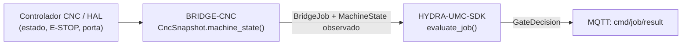

<!-- =============================================================================
HYDRA-UMC-BRIDGE-CNC - CNC cell coordination bridge
Copyright (C) JuanenRac (Electro Hobby 3D) <electrohobby3d@gmail.com>
GPL-3.0-or-later - see LICENSE
============================================================================= -->

<p align="center">
  
</p>

# 🔧 HYDRA-UMC-BRIDGE-CNC

<p align="center"><a href="README.md">🇺🇸 English</a> | <a href="README_spa.md">🇪🇸 Español</a> | <a href="README_fra.md">🇫🇷 Français</a> | <a href="README_ita.md">🇮🇹 Italiano</a> | <a href="README_deu.md">🇩🇪 Deutsch</a> | <a href="README_zho.md">🇨🇳 简体中文</a> | <a href="README_jpn.md">🇯🇵 日本語</a> | 🇵🇹 <b>Português</b></p>

### 🛑 Bridge de coordenação de falha segura para células CNC

<p align="center">
  
  
  
  
  
  
</p>

---

> **Verificação de honestidade - o que realmente corre hoje:** o instantâneo de célula com falha segura e a porta de segurança (o `CncSnapshot`/`CncCellBridge` de `cell.py`, que encaminha cada trabalho pelo `evaluate_job()` do próprio `HYDRA-UMC-SDK`), o normalizador só de leitura de evidência GRBL/MTConnect (`observation.py`), o transporte série GRBL real (o `GrblSerialProbe`/`GrblRealtimeControl` de `serial_transport.py`) e o transporte MQTT de comandos/estado (`mqtt_transport.py`) são reais e estão cobertos por 261 casos `unittest` que passam (`python tools/build_test.py`), incluindo `tests/test_grbl_emulator.py`, que executa este bridge contra um emulador GRBL v1.1 escrito à mão e fiel ao protocolo. Nada disto tocou numa porta série real, num broker MQTT real nem num controlador CNC verdadeiro: o `FakeSerial` de `test_serial_transport.py` substitui uma ligação física, e `test_mqtt_transport.py` usa um cliente de broker falso do mesmo modo. As ligações ao LinuxCNC e ao CNCjs e a vista MTConnect só conheceram simulações, não há adaptador HAL do LinuxCNC nem comando `run` vivo, porque nenhum controlador real foi acionado; ver «Roteiro e limites conhecidos» abaixo, que já o diz com clareza, e `CHANGELOG.md` para saber exatamente o que foi entregue até agora. O transporte MQTT também foi executado contra um HYDRA-UMC-MQTT-BROKER real numa máquina de desenvolvimento (`tests/test_broker_integration.py`, ignorado se não houver nenhum broker instalado): publicação e subscrição com QoS 0, 1 e 2, a disponibilidade retida e o seu último testamento, e o regresso depois de o broker ter parado e arrancado de novo.

> **Estado de segurança (safety e security):** este ecossistema não é um sistema de segurança certificado. Ainda não existe um caminho de E-STOP por hardware, nem limites ou interlocks impostos pelo firmware, nem um comando de movimento verificado; as imagens de firmware são verificadas com CRC-32 e uma assinatura Ed25519, e uma compilação de versão recusa as chaves de desenvolvimento publicadas (as cabeças de ferramenta e as placas de expansão atrás do relé ainda usam os bootloaders do URTC, que aceitam um HMAC-SHA256 de chave partilhada em vez de uma assinatura); TLS e TLS mútuo são opcionais e estão desativados por defeito; nenhuma placa própria foi ainda montada ou testada. Leia a [base de segurança](https://github.com/JuanenRac/HYDRA-UMC-DOCS/blob/main/docs/SECURITY_BASELINE.md) e o [modelo de ameaças](https://github.com/JuanenRac/HYDRA-UMC-DOCS/blob/main/docs/THREAT_MODEL.md) antes de confiar em qualquer afirmação aqui para a segurança de uma pessoa.

---

## 📋 Num relance

| | |
|---|---|
| Versão | `0.2.1` |
| Maturidade | Funcional |
| Testes | 261 (`python tools/build_test.py`) |
| Tecnologia | Python / LinuxCNC / G-code / GRBL status evidence / GRBL serial transport |
| Destino | O Raspberry Pi CM5 de uma célula HYDRA-UMC |
| Em hardware real | Só simulado: testado com emuladores, dublês de teste ou simuladores; não há registo de execução em hardware real para esta versão |

**Ir para:** [Visão geral](#-visão-geral) · [Arquitetura](#-arquitetura) · [Funcionalidades](#-funcionalidades) · [Segurança e proteção](#-segurança-e-proteção) · [Interfaces](#-interfaces) · [Configuração](#-configuração) · [Início rápido](#-início-rápido) · [Testes](#-testes) · [Resolução de problemas](#-resolução-de-problemas) · [Estrutura do repositório](#-estrutura-do-repositório) · [Projetos relacionados](#-projetos-relacionados)

## 🚦 Estado do projeto

Cada linha é uma parte deste repositório e a luz diz até onde chega hoje. É escrita com o que o repositório consegue demonstrar (testes, compilações, execuções), não com o que está previsto.

🟢 Feito e verificado · 🟡 Funciona, com limites conhecidos · 🟠 Feito a meio ou ainda por verificar · 🔴 Por fazer ou a não funcionar

| Área | Estado | O que significa aqui |
|---|---|---|
| Software | 🟡 | Funciona para o seu propósito principal; a verificação de honestidade acima lista o que ainda falta |
| Testes | 🟢 | 261 testes automáticos, executados a cada alteração |
| Hardware real | 🟠 | Só simulado: testado com emuladores, dublês de teste ou simuladores; não há registo de execução em hardware real para esta versão |
| Documentação | 🟢 | README em oito idiomas, verificado contra o manifesto a cada alteração |

## 🎯 Visão geral

O **HYDRA-UMC-BRIDGE-CNC** é o bridge de alto nível entre as células CNC e os auxiliares robóticos do HYDRA-UMC: carga, descarga, manuseamento de peças e tarefas auxiliares supervisionadas. Nunca se torna um controlador de trajetórias em tempo real: o controlador CNC (GRBL, LinuxCNC ou o que está por trás do CNCjs) mantém em todo o momento a autoridade sobre a trajetória, o fuso e os limites da máquina.

Pertence à família de **Bridges de automação externa**: um conjunto de repositórios irmãos (CNC, LASER, OPENPNP, PRINTER3D, ROS2) que falam todos o mesmo contrato de segurança partilhado do `HYDRA-UMC-SDK`, de modo que nenhum bridge possa inventar a sua própria definição de «seguro para trabalhar».

## 🧩 Papel no HYDRA-UMC

O **HYDRA-UMC-BRIDGE-CNC** fica entre um controlador CNC (GRBL, LinuxCNC ou o que está por trás do CNCjs) e a célula de robôs que o carrega e descarrega. O controlador mantém sempre a autoridade sobre a trajetória, o fuso e os limites; o bridge só relata o que o controlador diz e consulta a porta partilhada antes de qualquer trabalho auxiliar.

Todos os bridges falam o contrato de segurança partilhado do `HYDRA-UMC-SDK`: um trabalho só é aceite quando a porta partilhada `evaluate_job()` o permite, e essa porta falha fechada. O projeto pai é o `HYDRA-UMC-SERVER`; este bridge não o chama, responde por MQTT, através do `HYDRA-UMC-MQTT-BROKER`, a quem comanda a célula.

| Fala com | Como | Para quê |
|---|---|---|
| `HYDRA-UMC-SDK` | importação Python | a porta de trabalhos `evaluate_job()`, a forma de trabalhos e decisões, a ligação série e o cliente MQTT |
| `HYDRA-UMC-MQTT-BROKER` | MQTT, `hydra/bridges/cnc/` | comandos de entrada (`cmd/`), estado e resultados de saída |
| GRBL | porta série | consulta de estado `?` e os bytes em tempo real (retenção de avanço, retoma do ciclo, reinício suave); nunca um programa G-code |
| LinuxCNC | módulo Python `linuxcnc` | lê `linuxcnc.stat`; envia apenas pausa, aborto e retoma |
| CNCjs | socket.io | escuta `controller:state`; envia apenas `feedhold`, `reset`, `cyclestart` |

## 🏛️ Arquitetura

<p align="center">
  
</p>

<details>
<summary>Versão em texto do diagrama (Mermaid)</summary>



</details>

**Porque é construído assim**

* **Porque a paragem de emergência e o estado da porta se verificam antes do estado que o próprio controlador comunica.** `CncSnapshot.machine_state()` passa diretamente a `SAFE_STOP` perante `estop` ou uma porta não fechada antes de mais nada: um controlador que ainda indica `IDLE` com a porta aberta nunca deve ser levado a sério à primeira.
* **Porque o mapeamento do estado do controlador é conservador de propósito.** Só a cadeia literal `IDLE` corresponde a `MachineState.IDLE`. Todo o valor não reconhecido volta a `OFFLINE`, nunca a algo que permitisse trabalho auxiliar: um estado de controlador desconhecido trata-se como «não sei», não como «provavelmente está bem».
* **Porque o bridge constrói um novo `BridgeJob` e delega no `evaluate_job()` partilhado em vez de escrever a sua própria lógica de aceitar/rejeitar.** Os cinco Bridges de automação externa (CNC, LASER, OPENPNP, PRINTER3D, ROS2) reutilizam exatamente o mesmo `bridge_contract` do `HYDRA-UMC-SDK`, de modo que o que conta como «seguro para iniciar um trabalho» não pode divergir em silêncio entre eles.
* **Porque as ligações ao LinuxCNC e ao CNCjs apenas leem, pausam e retomam.** O controlador mantém a autoridade sobre a trajetória, o fuso e os limites, e o programa pertence a quem o executa (o CNCjs, o próprio LinuxCNC): o bridge pode levar a máquina ao repouso e deixar prosseguir uma máquina em pausa, nada mais. Ligar pinos HAL reais continua a ser um passo de integração de hardware que tem de se validar contra um controlador verdadeiro.
* **Como se encaixa no resto do ecossistema.** O BRIDGE-CNC fica entre o controlador CNC e o `HYDRA-UMC-SDK` → `HYDRA-UMC-MQTT-BROKER` → segurança do MCU/célula: coordena o trabalho auxiliar do robô em redor da CNC e não substitui nem anula a autoridade de segurança do próprio controlador.

Os auxiliares de observação são normalizadores de evidência, não adaptadores de controlador: não abrem ligações HAL, série nem de rede. O [Limite de evidência do controlador](docs/CONTROLLER_EVIDENCE_BOUNDARY.md) define a validação exigida antes de uma integração real com um controlador.

**Execução como serviço.** `python -m hydra_umc_bridge_cnc --config /etc/hydra-umc/bridge-cnc.toml` arranca o bridge a partir de um único ficheiro TOML: o controlador (uma placa GRBL numa porta série, CNCjs ou LinuxCNC), as origens da paragem de emergência e da porta (uma linha GPIO com o seu nível inseguro declarado, ou um ficheiro pequeno), a partilha da porta série com um emissor de G-code, a comporta do fuso, MTConnect, o broker MQTT e a origem do estado da célula. Uma chave desconhecida é recusada, uma origem de sinal tem de declarar a sua cablagem e tudo falha fechado: um sinal sem origem é paragem de emergência premida ou porta aberta, e um sinal ou ficheiro de estado da célula em falta, desconhecido ou caducado dá a resposta insegura. `--check` valida o ficheiro; `deploy/` tem a unidade systemd (`Restart=on-failure`) e um ficheiro de exemplo. Correu contra o emulador GRBL e sinais simulados, não numa máquina real.

## ✨ Funcionalidades

* ✅ **Instantâneo real de célula com falha segura:** o `CncSnapshot.machine_state()` de `cell.py` verifica a paragem de emergência e o estado da porta *antes* de olhar para qualquer coisa que o controlador comunique: uma paragem de emergência ativada ou uma porta aberta resolvem-se sempre em `SAFE_STOP`, diga o que disser `controller_state`. *(implementado, testado em `tests/test_cell.py`)*
* ✅ **Porta de segurança partilhada real:** cada trabalho observado é reavaliado pelo `evaluate_job()` do `bridge_contract` do `HYDRA-UMC-SDK`, a mesma porta que usam todos os bridges irmãos. *(implementado)*
* ✅ **Porta série partilhada:** uma placa GRBL tem uma só porta série. O `multiplexer.py` pode ficar com ela e oferecer uma frente TCP (apenas o loopback por defeito) à qual se liga um emissor de G-code de cada vez, enquanto a ponte mantém as suas consultas de estado e os seus três bytes em tempo real; a ponte nunca pode escrever mais nada e um segundo emissor é recusado. Vem desligado (`HYDRA_UMC_CNC_PORT_SHARING=multiplexer` liga-o; `HYDRA_UMC_CNC_PORT_SHARING_LISTEN` e `HYDRA_UMC_CNC_PORT_SHARING_ALLOW_REMOTE` definem o endereço). Testado com o emulador GRBL; nunca correu numa placa GRBL real. *(implementado, só simulado)*
* ✅ **Mapeamento de estados conservador:** só `IDLE` se trata como inativo; `RUN`/`RUNNING`/`JOG`/`HOME` correspondem a `RUNNING`, `FAULT`/`ERROR`/`OFF`/`ALARM` correspondem a `FAULT` e tudo o que não se reconhece volta a `OFFLINE`, nunca a um estado que permitiria trabalho produtivo. (`HOLD` → `HOLDING`; `DOOR` → `SAFE_STOP`) *(implementado)*
* ✅ **Evidência só de leitura do controlador:** `observation.py` normaliza de forma estrita a evidência de mapeamento local e as linhas de estado GRBL fornecidas; sinais de paragem de emergência/porta omitidos ou não booleanos falham de forma segura. *(implementado, testado em `tests/test_observation.py`)*
* ✅ **Transporte série GRBL real:** o `GrblSerialProbe` de `serial_transport.py` abre uma ligação série real e consulta o byte de estado em tempo real do GRBL (`?`); o `GrblRealtimeControl` envia apenas os bytes de controlo em tempo real próprios do GRBL (retenção de avanço, retoma de ciclo, reinício suave): `cycle_start_resume()` só se permite com uma máquina genuinamente em `HOLDING` e os outros permitem-se sempre, como `ABORT`. Nunca transmite um programa de G-code. *(implementado, testado em `tests/test_serial_transport.py`)*
* ✅ **Compilação/teste que não altera nada:** `build-test.bat`/`.sh` compilam o código-fonte e executam a suíte determinista da porta de segurança sem tocar nos ficheiros de versão nem no CHANGELOG. *(implementado, ver Compilação e publicação abaixo)*
* ✅ **Ligações a controladores:** o bridge fala com um controlador através de `ControllerLink` (`controller.py`): GRBL numa porta série que o bridge mantém aberta (`GrblController`), uma instalação LinuxCNC (`linuxcnc_link.py`: lê `linuxcnc.stat`, envia apenas pausa, aborto e retoma de um programa em pausa através de `linuxcnc.command`, nunca executa um programa) e um servidor CNCjs que possui a porta (`cncjs_link.py`: lê o `controller:state` que ele difunde e envia apenas `feedhold`, `reset` e `cyclestart`, pelo que o bridge trabalha ao lado do emissor que executa os programas). Retomar exige sempre uma célula READY e uma máquina realmente em retenção; uma leitura antiga ou em falta nunca é uma máquina em repouso. Ambas as ligações são testadas contra simulações (`SimulatedLinuxcnc`, `SimulatedCncjs`); nenhuma tocou num LinuxCNC ou CNCjs reais. *(implementado, apenas simulado)*
* ✅ **Porta do fuso:** recusa-se uma carga ou uma descarga quando o controlador está em repouso mas ainda indica um fuso a rodar ou um avanço em movimento (`FS:`). `HYDRA_UMC_CNC_SPINDLE_GATE` vale `off`, `when_known` (por omissão: recusa o que é indicado) ou `required` (recusa também o que o controlador não indica). O instantâneo traz ainda as posições, o desvio de trabalho e os overrides do relatório. *(implementado)*
* ✅ **Vista MTConnect:** `mtconnect_publish.py` converte o instantâneo em observações MTConnect (`avail`, `execution`, `estop`, `door`, `spindle_speed`, `path_feedrate`, `system`), servidas como SHDR por TCP pelo `ShdrAdapter` (só de leitura; a única linha que aceita é `* PING`) e, com `HYDRA_UMC_CNC_MTCONNECT=1`, publicadas retidas em `hydra/bridges/cnc/mtconnect`. Um controlador que não responde é `UNAVAILABLE`, nunca `READY`. Testado contra um agente simulado. *(implementado, ainda não experimentado com um agente real)*
* 🔜 **Pinos HAL do LinuxCNC:** adiado; ainda não se acionou nenhum controlador CNC, pino HAL ou robô reais. *(planeado)*
* ✅ **Chaves de idempotência repetidas:** `CncMqttBridge` aceita um `IdempotencyStore`: uma chave de trabalho repetida recebe a resposta dada da primeira vez em vez de ser avaliada de novo. *(implementado, testado em `tests/test_idempotency.py`)*
* ✅ **Respostas de estado alinhadas, série com falha segura, ciclo MQTT blindado:** a consulta de estado descarta o que já esperava, envia `?` e lê até chegar um relatório de estado real (`<...>`): o banner, `ok`, `[MSG:...]` e `ALARM:n` que o GRBL envia sem que lhos peçam deixam de atrasar cada consulta seguinte uma resposta; um dispositivo USB em falta (ou qualquer falha da ligação) falha de forma segura em vez de terminar o bridge, e a porta é aberta sem ativar o DTR; `cmd/feed_hold` indica o que o controlador disse depois (`controller_state_after`, `confirmed`), e `cmd/feed_hold` e `cmd/soft_reset` correm numa faixa própria, pelo que uma consulta de estado nunca os atrasa; uma carga demasiado grande (mais de 16 KiB), ilegível ou com JSON profundamente aninhado, e qualquer falha inesperada, recebem uma recusa no tópico de resultado e nunca terminam o ciclo; as respostas de `cmd/job` indicam `"mode": "gate-only"` e um ABORT por aí diz que nada foi parado; o estado inclui `observed_at` e o bridge anuncia-se num tópico `availability` com Last Will. O GRBL tem UMA só porta série: enquanto este bridge a mantiver aberta, nenhum emissor de G-code a pode usar (ver `docs/BRIDGE_GUIDE.md`). *(implementado, testado em `tests/test_hardening.py`)*
* ✅ **Trabalhos pela admissão partilhada:** a verificação de um trabalho mal formado e de uma `idempotency_key` repetida é o `JobIntake` do SDK em vez de código desta ponte (as chaves deixaram de ter o prefixo `job:`).
* ✅ **Respostas que correspondem ao pedido:** uma carga de comando que é um objeto JSON pode levar um `request_id` (um token simples de até 64 caracteres: letras, dígitos, `.`, `_`, `:`, `-`), e cada resultado que a ponte publica para essa mensagem o devolve, também o guardado para uma chave de idempotência repetida. Os tópicos de estado não mudam.

## 🔒 Segurança e proteção

| Ameaça | Defesa | Onde |
|---|---|---|
| Um trabalho para uma célula que não está em estado seguro | Todo o trabalho passa pela porta partilhada `evaluate_job()`, que falha fechada; o bridge não tem lógica própria de aceitar ou recusar. A paragem de emergência e a porta são lidas antes do que o controlador comunica, e porta aberta ou paragem de emergência é sempre `SAFE_STOP` | `cell.py`, SDK `bridge_contract` |
| Dados de trabalho desmesurados | No máximo 32 parâmetros, chaves até 64 carateres, valores até 1024, identificadores até 128; uma carga MQTT acima de 16 KiB é recusada no tópico de resultado | SDK `bridge_contract`, `mqtt_transport.py` |
| Uma ordem repetida ou reenviada | Um `IdempotencyStore` lembra cada chave durante 24 horas e no máximo 10 000 entradas; uma repetição recebe a primeira resposta em vez de ser avaliada de novo. Uma mensagem `cmd/` retida é ignorada ao reconectar | SDK `job_intake.py`, `mqtt_transport.py` |
| Um fuso a rodar enquanto um braço carrega ou descarrega | `LOAD` e `UNLOAD` são recusados quando o controlador está em repouso mas comunica um fuso a rodar ou um avanço em movimento; `HYDRA_UMC_CNC_SPINDLE_GATE` é `off`, `when_known` (predefinição, também para um valor desconhecido) ou `required` | `cell.py` |
| Parar ou mover a máquina por ordem remota | Ao CNCjs chegam apenas `feedhold`, `reset` e `cyclestart`, ao LinuxCNC apenas pausa, aborto e retoma, e a uma porta série apenas os bytes em tempo real do GRBL; uma retoma exige uma célula READY e uma máquina realmente parada. `cmd/feed_hold` e `cmd/soft_reset` correm numa via própria | `cncjs_link.py`, `linuxcnc_link.py`, `serial_transport.py`, `mqtt_transport.py` |
| Uma leitura antiga tomada por máquina em repouso | Uma leitura do CNCjs com mais de 3 segundos não é considerada, um estado em falta ou antigo nunca é repouso e a porta conta como aberta; um comando ao LinuxCNC expira aos 2 segundos; uma consulta série falhada falha fechada | `cncjs_link.py`, `linuxcnc_link.py`, `serial_transport.py` |
| Um cliente MTConnect que inunda o adaptador | O adaptador SHDR é só de leitura: no máximo 16 clientes, linhas até 1024 bytes, e a única linha que aceita é `* PING` | `mtconnect_publish.py` |

**O que nunca faz:** nunca envia um programa G-code em fluxo, nunca executa um programa no LinuxCNC, nunca tira ao CNCjs a sua porta série e nunca deduz um estado de paragem de emergência ou de porta que a evidência não trazia. Consulte `docs/CONTROLLER_EVIDENCE_BOUNDARY.md`.

## 🔌 Interfaces

Tópicos sob `hydra/bridges/cnc/` (prefixo `TOPIC_PREFIX`); o bridge subscreve `cmd/#`.

| Tópico ou rota | O que leva |
|---|---|
| `cmd/status` | pede o estado da célula; resposta em `cmd/status/result` |
| `cmd/job` | um `BridgeJob` na forma `job_to_dict()` do SDK; a resposta é uma `GateDecision` marcada `"mode": "gate-only"` (nunca atua, por isso um `ABORT` por aqui diz que nada foi parado) |
| `cmd/feed_hold`, `cmd/soft_reset` | os comandos de paragem, numa via própria; a resposta traz `controller_state_after` e `confirmed` |
| `cmd/cycle_start_resume`, `cmd/start`, `cmd/resume` | retomam uma máquina parada; recusado a menos que a célula esteja READY e a máquina realmente parada (nunca após um evento de porta) |
| `<verb>/result` | uma resposta JSON por comando, `{"allowed", "executed", "reason"}` numa recusa |
| `state`, `availability` | o estado da célula (retido, com `observed_at` em milissegundos de época) e `online`/`offline` (o Last Will) |
| `mtconnect` | observações MTConnect, retidas; só com `HYDRA_UMC_CNC_MTCONNECT=1` |

A biblioteca: `CncCellBridge`, `CncSnapshot`, `CncMqttBridge`, `spindle_gate_from_environment()` e as três ligações (`GrblController`, `LinuxcncController`, `CncjsController`).

## ⚙️ Configuração

| Variável | Predefinição | O que define |
|---|---|---|
| `HYDRA_UMC_CNC_SPINDLE_GATE` | `when_known` | `off`, `when_known` ou `required`; por definir ou desconhecido equivale a `when_known` |
| `HYDRA_UMC_CNC_MTCONNECT` | desativado | `1` publica as observações MTConnect em `hydra/bridges/cnc/mtconnect` |
| `HYDRA_MQTT_USERNAME` | nenhum | O nome de utilizador MQTT; o broker liga-o a um prefixo de ID de cliente |
| `HYDRA_MQTT_PASSWORD` | nenhum | A palavra-passe; só vale em conjunto com o nome de utilizador |
| `HYDRA_MQTT_PASSWORD_FILE` | nenhum | A palavra-passe lida de um ficheiro (segredo do Docker ou do systemd); ignorada se `HYDRA_MQTT_PASSWORD` estiver definida |
| `HYDRA_MQTT_TLS_CA` | nenhum | O ficheiro da CA que assinou o certificado do broker: a ligação é TLS e o certificado é verificado |
| `HYDRA_MQTT_TLS` | desativado | `1` ativa o TLS, verificado com as CA de confiança do sistema |
| `HYDRA_MQTT_TLS_CERT` / `HYDRA_MQTT_TLS_KEY` | nenhum | O certificado de cliente e a sua chave para um broker que exige TLS mútuo; são precisos os dois |

A ligação ao controlador escolhe-se no código: passe `controller=` ao `CncMqttBridge` para LinuxCNC ou CNCjs; caso contrário o bridge mantém uma ligação série GRBL. Enquanto a mantém, nenhum emissor de G-code pode usar essa porta (consulte `docs/BRIDGE_GUIDE.md`, «One serial port»).

## 🚀 Início rápido

Requer Python 3.11 ou superior. Os testes e os scripts de compilação esperam o `HYDRA-UMC-SDK` clonado ao lado deste repositório (`../HYDRA-UMC-SDK`) ou indicado com `HYDRA_UMC_SDK_ROOT`.

Experimente sem hardware (isto verifica todo o bridge com os seus emuladores e dublês de teste):

```bash
py -3 tools/build_test.py          # Windows
python3 tools/build_test.py         # Linux, macOS
build-test.bat  /  bash build-test.sh   # the same, through the scripts
```

Arrancar o serviço (não há um script de consola: o serviço é o `run_forever()` do transporte MQTT, que chama a partir do seu próprio código de arranque):

```python
from hydra_umc_bridge_cnc.mqtt_transport import CncMqttBridge, run_forever
# `connection` is an open GRBL serial connection (open_serial_port()), or pass controller=...
bridge = CncMqttBridge(connection)
run_forever(bridge, host="192.168.0.180")   # connects to the broker and serves cmd/# forever
```

O nome de utilizador, a palavra-passe e os ficheiros TLS vêm das variáveis `HYDRA_MQTT_*` (ver Configuração); o código acima não precisa de credenciais próprias.

## 🧪 Testes

261 casos `unittest` automáticos correm com `python tools/build_test.py` (que também compila cada módulo). Os testes não precisam de hardware, rede nem pacotes opcionais: os que precisariam de `paho-mqtt`, `pyserial` ou de uma biblioteca do fabricante usam um substituto ou são saltados se o pacote faltar.

| Ficheiro de testes | Testes | O que cobre |
|---|---|---|
| `test_cell.py` | 10 | admissão em repouso seguro, recusa com porta aberta, reencaminhamento do aborto |
| `test_controllers.py` | 63 | porta do fuso, ligações LinuxCNC e CNCjs contra as suas simulações, vista MTConnect |
| `test_serial_transport.py` | 29 | o transporte série contra uma porta simulada, incluindo os caminhos que falham fechados |
| `test_mqtt_transport.py`, `test_mqtt_environment.py` | 28 + 4 | formas de comandos e estado contra um cliente de broker simulado; as credenciais e o TLS do ambiente chegam ao cliente |
| `test_grbl_emulator.py`, `grbl_emulator.py` | 17 | o bridge contra um emulador GRBL v1.1 escrito à mão e fiel ao protocolo |
| `test_hardening.py`, `test_edge_cases.py`, `test_idempotency.py`, `test_observation.py` | 25 + 20 + 3 + 7 | respostas de estado alinhadas, um cabo morto, confirmação da retenção de avanço, cargas hostis, chaves repetidas, evidência em falta |

A CI executa `HYDRA_UMC_CI=1 python tools/ci_validate.py`, que verifica o manifesto, os documentos, os oito README e as imagens, e corre os testes com uma cópia do SDK.

## 🏗️ Compilação e publicação

Requer Python 3.11+. `tools/build_test.py` espera o `HYDRA-UMC-SDK` extraído como diretoria irmã (`../HYDRA-UMC-SDK`) ou indicado pela variável de ambiente `HYDRA_UMC_SDK_ROOT`.

```bash
# Windows
build-test.bat      # só valida - sem alteração de versão/CHANGELOG
build.bat            # Valida e compila (compilar nunca altera a versão)

# Linux/macOS
bash build-test.sh
bash build.sh
```

`build-test` compila com `py_compile` cada módulo em `src/` e executa a suíte `unittest` completa descoberta em `tests/` (`test_cell.py`, `test_observation.py`, `test_serial_transport.py`, `test_mqtt_transport.py`, `test_grbl_emulator.py`, `test_hardening.py`, `test_idempotency.py`, `test_mqtt_environment.py` - 261 testes), que prova, entre tudo o resto que cobre, a admissão com inatividade segura, a rejeição por porta aberta e o encaminhamento de aborto; nunca modifica o repositório. `build` executa primeiro essa mesma validação e, só se correr bem, chama `tools/bump_version.py` para sincronizar a versão em `pyproject.toml`, `hydra-umc.project.json` e `CHANGELOG.md`. Ainda não há comando `run` de CNC viva: exige uma integração validada com um controlador.

## 🩺 Resolução de problemas

| Vê | Porque | Faça |
|---|---|---|
| `ModuleNotFoundError: hydra_umc_sdk` | O SDK não está instalado nem ao lado deste repositório | Clone o `HYDRA-UMC-SDK` ao lado deste repositório ou defina `HYDRA_UMC_SDK_ROOT` |
| `paho-mqtt is not installed` | O cliente MQTT é um extra opcional | `pip install ".[mqtt]"` (precisa de `paho-mqtt` 2.1 ou superior, inferior a 3) |
| `password was given without a username` | As credenciais MQTT precisam das duas partes | Defina também `HYDRA_MQTT_USERNAME`, não só a palavra-passe |
| `spindle_gate must be one of ...` | `HYDRA_UMC_CNC_SPINDLE_GATE` tem um valor que o código não conhece | Use `off`, `when_known` ou `required` (passado no código lança uma exceção; vindo do ambiente um valor desconhecido volta a `when_known`) |
| `a serial connection or a controller link is required` | o `CncMqttBridge` foi criado sem nenhuma das duas | Passe uma ligação série aberta ou `controller=` |
| `"allowed": false` + `reason` | A porta partilhada ou uma guarda recusou a ordem | Leia `reason`: porta aberta, paragem de emergência, máquina não em repouso, fuso a rodar ou leitura antiga; corrija a causa, não repita às cegas |

## 📂 Estrutura do repositório

<p align="center">
  
</p>

<details>
<summary>Versão em texto da árvore</summary>

```text
HYDRA-UMC-BRIDGE-CNC/
├── src/hydra_umc_bridge_cnc/
│   ├── cell.py                    instantâneo da célula, porta de segurança, porta do fuso
│   ├── observation.py             evidência só de leitura, linhas de estado GRBL
│   ├── serial_transport.py        ligação série GRBL: consulta de estado e bytes em tempo real
│   ├── controller.py              ControllerLink e o controlador GRBL
│   ├── linuxcnc_link.py           ligação LinuxCNC (lê, pausa, retoma) e a sua simulação
│   ├── cncjs_link.py              ligação CNCjs (feedhold, reset, cyclestart) e a sua simulação
│   ├── multiplexer.py             multiplexador da porta série: a ponte e um emissor de G-code partilham uma porta GRBL
│   ├── mtconnect_publish.py       observações MTConnect e o adaptador SHDR só de leitura
│   └── mqtt_transport.py          transporte MQTT de comandos e estado
├── tests/                         238 testes, com um emulador GRBL escrito à mão
├── deploy/                        unidade systemd e configuração de exemplo
├── docs/                          guia do bridge, limite da evidência
├── tools/                         executor de compilação e testes, subida de versão, validador de CI, geradores e verificações de README e imagens
├── images/                        faixa e imagens do README
├── .github/                       fluxo de CI e modelos de questões
├── pyproject.toml                 metadados do pacote e dependências
├── hydra-umc.project.json         manifesto: versão, maturidade, família
├── CHANGELOG.md                   o que mudou em cada versão
├── build.sh build.bat             scripts de compilação (nunca mudam a versão)
├── build-test.sh build-test.bat   scripts de compilação (nunca mudam a versão)
├── test.sh test.bat               executam os testes
└── SECURITY.md SUPPORT.md CONTRIBUTING.md CODE_OF_CONDUCT.md LICENSE LICENSE.md
```

</details>

## 🗺️ Roteiro e limites conhecidos

**Limites conhecidos hoje**

**Real hoje:** versão `0.2.1`, um coordenador de célula com falha segura testado localmente (`CncSnapshot` + `CncCellBridge`) apoiado pela porta de trabalhos partilhada do `HYDRA-UMC-SDK`, uma normalização estrita e só de leitura da evidência do controlador que cobre todo o vocabulário de estados real do GRBL v1.1, incluindo os subestados reais `Hold:N`/`Door:N` (`Idle`/`Run`/`Jog`/`Home`/`Hold`/`Alarm`/`Door`), mais os estados de execução do MTConnect, um transporte série real (`GrblSerialProbe`/`GrblRealtimeControl`) que pode consultar o estado e enviar os bytes de controlo em tempo real próprios do GRBL por uma ligação verdadeira (a leitura viva da porta/paragem de emergência faz-se agora logo a seguir à ida e volta bloqueante dessa consulta, nunca antes dela, e uma escrita real curta ou de zero bytes comunica-se como não executada e não como falso êxito), uma suíte `unittest` determinista de 261 testes e scripts build-test que não alteram nada ligados ao CI com um checkout do SDK.

**Fronteira de integração:** o controlador CNC (GRBL, LinuxCNC ou o que está por trás do CNCjs) mantém em todo o momento a autoridade sobre a trajetória, o fuso e os limites da máquina; este bridge apenas regula o trabalho robótico *auxiliar*, nunca o movimento do controlador.

**Ainda por fazer:** nenhum controlador CNC, pino HAL do LinuxCNC ou robô reais foi acionado: escolher e validar um adaptador HAL concreto é um passo de integração de hardware/software que vem depois de a máquina e a sua interface documentada estarem disponíveis.

## 🌍 Idiomas

Este README e os documentos do repositório existem em oito idiomas: inglês, espanhol, alemão, francês, italiano, japonês, chinês e português (Portugal). São escritos em conjunto e a CI verifica que os oito ficheiros têm as mesmas secções e as mesmas ligações. Este repositório não tem ecrã nem catálogo de mensagens próprios, por isso não há textos de interface para traduzir.

## 🔗 Projetos relacionados

Este projeto faz parte do ecossistema de robótica HYDRA-UMC do mesmo autor (JuanenRac / Electro Hobby 3D). Vale a pena conhecê-los, porque um pedido pode ser, na verdade, sobre um destes e não sobre este repositório.

**Projeto-mãe**
- **[HYDRA-UMC-SERVER](https://github.com/JuanenRac/HYDRA-UMC-SERVER)** — o verdadeiro backend sem interface (REST/WebSocket) com que falam todos os clientes de controlo; este bridge não o chama: responde por MQTT, através do HYDRA-UMC-MQTT-BROKER, a quem comanda a célula.

**Projetos irmãos** — também falam com a API do próprio HYDRA-UMC-SERVER, cada um como cliente próprio
- **[HYDRA-UMC-STUDIO](https://github.com/JuanenRac/HYDRA-UMC-STUDIO)** — painel web de controlo com visualização 3D em tempo real de vários robôs.
- **[HYDRA-UMC-SUITE](https://github.com/JuanenRac/HYDRA-UMC-SUITE)** — centro de comando de enxame para desktop (PySide6) para vários servidores ao mesmo tempo, empacotado como executável independente.
- **[HYDRA-UMC-ANDROID-CONTROL](https://github.com/JuanenRac/HYDRA-UMC-ANDROID-CONTROL)** — aplicação Android nativa de controlo, com início de sessão biométrico e um companheiro Wear OS emparelhado.
- **[HYDRA-UMC-IOS-CONTROL](https://github.com/JuanenRac/HYDRA-UMC-IOS-CONTROL)** — aplicação de controlo para iOS/iPadOS (Flutter) com sincronização WebSocket em tempo real.
- **[HYDRA-UMC-DSI](https://github.com/JuanenRac/HYDRA-UMC-DSI)** — interface tátil nativa para o ecrã tátil DSI de 7" integrado, executada no próprio CM5.
- **[HYDRA-UMC-BRIDGE-AMR](https://github.com/JuanenRac/HYDRA-UMC-BRIDGE-AMR)** — fronteira de coordenação para frotas AGV/AMR através de um publicador MQTT VDA 5050 (testado apenas contra uma frota emulada).
- **[HYDRA-UMC-BRIDGE-DROIDS](https://github.com/JuanenRac/HYDRA-UMC-BRIDGE-DROIDS)** — fronteira de coordenação para droides com patas/humanoides, com um emissor de comandos para o Boston Dynamics Spot (testado apenas contra um emulador).
- **[HYDRA-UMC-BRIDGE-LASER](https://github.com/JuanenRac/HYDRA-UMC-BRIDGE-LASER)** — coordenador de células laser que lê 3 sinais GPIO (chave, caixa e interlock) (testado apenas contra um chip simulado; não pode armar nem disparar um laser).
- **[HYDRA-UMC-BRIDGE-OPENPNP](https://github.com/JuanenRac/HYDRA-UMC-BRIDGE-OPENPNP)** — coordenador seguro de fluxo de placa de alto nível para pick-and-place com OpenPnP.
- **[HYDRA-UMC-BRIDGE-PRINTER3D](https://github.com/JuanenRac/HYDRA-UMC-BRIDGE-PRINTER3D)** — fronteira de coordenação segura para impressoras 3D Moonraker/Klipper, com comandos de trabalho reais protegidos por portas.
- **[HYDRA-UMC-BRIDGE-ROS2](https://github.com/JuanenRac/HYDRA-UMC-BRIDGE-ROS2)** — coordenador com um transporte ROS 2 baseado em rclpy importado sob demanda (ainda não executado contra uma instalação ROS 2).
- **[HYDRA-UMC-BRIDGE-UAV](https://github.com/JuanenRac/HYDRA-UMC-BRIDGE-UAV)** — fronteira de coordenação para UAV com câmara, com um emissor de comandos MAVLink (testado apenas contra um emulador).

**Diretamente relacionados**
- **[HYDRA-UMC-SDK](https://github.com/JuanenRac/HYDRA-UMC-SDK)** — o contrato JSON-Schema partilhado e a fronteira de software de controlo de trabalhos contra a qual cada bridge valida os seus comandos (não é uma função de segurança certificada).
- **[HYDRA-UMC-CONNECTOR-HUB](https://github.com/JuanenRac/HYDRA-UMC-CONNECTOR-HUB)** — registo declarativo de manifestos de adaptador e validador para conectores de máquinas externas; estende a ideia de contrato do SDK a máquinas externas sem substituir os projetos de gateway industrial.
- **[HYDRA-UMC-MQTT-BROKER](https://github.com/JuanenRac/HYDRA-UMC-MQTT-BROKER)** — o transporte real de `mqtt_transport.py` para os tópicos `hydra/bridges/cnc/...` deste bridge: estado mais bytes de controlo de jog/reinício/retoma, junto com a porta de trabalhos partilhada; ver o `docs/BRIDGE_TOPICS.md` desse repositório.
- **[HYDRA-UMC-HIL-BRIDGE](https://github.com/JuanenRac/HYDRA-UMC-HIL-BRIDGE)** — futuro caminho de evidência hardware-in-the-loop para a integração real com um controlador.

**Também fazem parte do ecossistema**

*Hardware e plataforma centrais*
- **[HYDRA-UMC](https://github.com/JuanenRac/HYDRA-UMC)** — o desenho da placa-mãe do braço robótico: anfitrião CM5 + STM32H745 de dois núcleos, pensado para orquestrar até 8 braços de ferramenta por CAN-OTA/SPI-OTA (firmware numa fase inicial; ainda sem placa montada).
- **[HYDRA-UMC-OS](https://github.com/JuanenRac/HYDRA-UMC-OS)** — camada de produto reproduzível do Raspberry Pi OS para o CM5: agente só de leitura, configuração/perfis validados, aprovisionamento Wi-Fi de primeiro contacto.

*Backend central e clientes*
- **[HYDRA-UMC-EDITOR-URDF](https://github.com/JuanenRac/HYDRA-UMC-EDITOR-URDF)** — criador/editor gráfico de URDF para desktop que envia os modelos concluídos para o catálogo do STUDIO.
- **[HYDRA-UMC-EDITOR-STL](https://github.com/JuanenRac/HYDRA-UMC-EDITOR-STL)** — editor de modelos STL para desktop que transforma/substitui/remove/adiciona peças reais no mesmo catálogo de modelos que o HYDRA-UMC-EDITOR-URDF também edita.

*Plataforma de ferramentas URTC*
- **[URTC](https://github.com/JuanenRac/URTC)** — firmware da placa física Universal Robot Tool Controller, mais de 25 perfis de ferramenta por barramento CAN.
- **[URTC-FLASHER](https://github.com/JuanenRac/URTC-FLASHER)** — ferramenta gráfica de gravação para desktop das placas URTC, por CAN-OTA e também SWD/JTAG de chip completo.
- **[URTC-TESTER](https://github.com/JuanenRac/URTC-TESTER)** — ferramenta de diagnóstico CAN em tempo real para desktop das placas URTC, com um painel por perfil de ferramenta.
- **[URTC-WEB-STUDIO](https://github.com/JuanenRac/URTC-WEB-STUDIO)** — alternativa no navegador ao URTC-TESTER através da Web Serial API, sem instalação local.
- **[URTC-GATEWAY](https://github.com/JuanenRac/URTC-GATEWAY)** — gateway à frente do barramento CAN do URTC: lista de identificadores permitidos, limite de taxa e chave de sessão; software testado num computador, ainda não num barramento real.

*Nó de IA de visão (Hailo-8)*
- **[HYDRA-UMC-VISION-NODE](https://github.com/JuanenRac/HYDRA-UMC-VISION-NODE)** — centro de integração do pipeline de visão Hailo-8, com uma verificação real de prontidão de hardware por fase.
- **[HYDRA-UMC-DETECTION-HEF](https://github.com/JuanenRac/HYDRA-UMC-DETECTION-HEF)** — registo real de modelos compilados com verificação segura de carga por arquitetura Hailo e soma de verificação.
- **[HYDRA-UMC-VISION-STREAMER](https://github.com/JuanenRac/HYDRA-UMC-VISION-STREAMER)** — pipeline GStreamer real e gerador de configuração MediaMTX com uma fronteira de integração HailoRT real.
- **[HYDRA-UMC-VISUAL-SERVOING-API](https://github.com/JuanenRac/HYDRA-UMC-VISUAL-SERVOING-API)** — lei de correção de servovisão baseada em posição com autorização condicionada ao estado da zona; ainda sem estimativa de pose por câmara.
- **[HYDRA-UMC-SAFETY-ZONES](https://github.com/JuanenRac/HYDRA-UMC-SAFETY-ZONES)** — lógica v0 de violação de zonas, atualidade da calibração e pedido de E-STOP que lê as posições dos objetos de um ficheiro; nenhum detetor a alimenta e ainda não há E-STOP físico ligado.

*Nó de IA cognitiva (Hailo-10)*
- **[HYDRA-UMC-COGNITIVE-NODE](https://github.com/JuanenRac/HYDRA-UMC-COGNITIVE-NODE)** — centro de integração do pipeline cognitivo do Hailo-10 (orquestração de LLM/VLA/voz).
- **[HYDRA-UMC-VLA-ENGINE](https://github.com/JuanenRac/HYDRA-UMC-VLA-ENGINE)** — codificação/descodificação real de tokens de ação e geração de trajetórias para um modelo Visão-Linguagem-Ação.
- **[HYDRA-UMC-VOICE-UI](https://github.com/JuanenRac/HYDRA-UMC-VOICE-UI)** — front-end de voz real (VAD + analisador de intenções) com um relé para o relógio limitado e protegido por confirmação.
- **[HYDRA-UMC-SEMANTIC-PLANNER](https://github.com/JuanenRac/HYDRA-UMC-SEMANTIC-PLANNER)** — decomposição real de tarefas baseada em regras e recuperação semântica de erros sobre os códigos de erro do MCU.
- **[HYDRA-UMC-DOCS-QA](https://github.com/JuanenRac/HYDRA-UMC-DOCS-QA)** — pesquisa real de documentos TF-IDF só com a biblioteca padrão sobre a documentação Markdown deste ecossistema.
- **[HYDRA-UMC-LOCAL-TECHNICIAN](https://github.com/JuanenRac/HYDRA-UMC-LOCAL-TECHNICIAN)** — técnico de manutenção de IA local, protegido por políticas, para o próprio ecossistema: observa, diagnostica e propõe correções; os dois níveis de maior risco não estão implementados de propósito.

*Orquestração e enxame*
- **[HYDRA-UMC-ORCHESTRATOR](https://github.com/JuanenRac/HYDRA-UMC-ORCHESTRATOR)** — centro de integração com um contrato real de relatório de saúde gRPC/Protobuf e uma máquina de estados de missões.
- **[HYDRA-UMC-JOB-DISPATCHER](https://github.com/JuanenRac/HYDRA-UMC-JOB-DISPATCHER)** — fila real de trabalhos por prioridade com deduplicação, sobre uma API HTTP real.
- **[HYDRA-UMC-NODE-HEALING](https://github.com/JuanenRac/HYDRA-UMC-NODE-HEALING)** — vigilante real de saúde da frota por gRPC com repetição/recuo e deteção de identidade incoerente.
- **[HYDRA-UMC-PATH-PLANNER-3D](https://github.com/JuanenRac/HYDRA-UMC-PATH-PLANNER-3D)** — planeador real de trajetórias 3D baseado em RRT com validação real de colisões com obstáculos e espaço de trabalho.
- **[HYDRA-UMC-SWARM-SYNC](https://github.com/JuanenRac/HYDRA-UMC-SWARM-SYNC)** — sincronização real de estado CRDT LWW-Element-Map, testada por propriedades para a convergência de várias células.

*Gémeo digital e simulação*
- **[HYDRA-UMC-TWIN](https://github.com/JuanenRac/HYDRA-UMC-TWIN)** — centro de integração do motor de gémeo digital, com um contrato real de sincronização de compatibilidade de versões.
- **[HYDRA-UMC-PHYSICS-REPLICA](https://github.com/JuanenRac/HYDRA-UMC-PHYSICS-REPLICA)** — cinemática direta real e validação de limites de juntas sobre um subconjunto real de URDF.
- **[HYDRA-UMC-SYNTHETIC-DATA-GEN](https://github.com/JuanenRac/HYDRA-UMC-SYNTHETIC-DATA-GEN)** — gerador procedural real de cenas 2D com exportação de anotações YOLO/COCO.

*Dados e análise*
- **[HYDRA-UMC-DATALAKE](https://github.com/JuanenRac/HYDRA-UMC-DATALAKE)** — armazém real de séries temporais sobre sqlite3 com uma API HTTP real de ingestão/consulta.
- **[HYDRA-UMC-ANOMALY-DETECTOR](https://github.com/JuanenRac/HYDRA-UMC-ANOMALY-DETECTOR)** — detetor real de anomalias por FFT e linha de base estatística, com monitorização de deriva.
- **[HYDRA-UMC-PRODUCTION-REPORTS](https://github.com/JuanenRac/HYDRA-UMC-PRODUCTION-REPORTS)** — cálculo real de OEE/disponibilidade sobre o histórico do DATALAKE, com exportação CSV reprodutível.
- **[HYDRA-UMC-TELEMETRY-COLLECTOR](https://github.com/JuanenRac/HYDRA-UMC-TELEMETRY-COLLECTOR)** — pipeline real de ingestão CAN/WebSocket para o DATALAKE, com deduplicação por sequência.

*Gateway industrial*
- **[HYDRA-UMC-GATEWAY-INDUSTRIAL](https://github.com/JuanenRac/HYDRA-UMC-GATEWAY-INDUSTRIAL)** — centro de integração que retransmite para protocolos industriais, com uma camada real de lista de comandos permitidos e contrapressão.
- **[HYDRA-UMC-OPCUA-SERVER](https://github.com/JuanenRac/HYDRA-UMC-OPCUA-SERVER)** — espaço de endereços OPC-UA real, verificado com uma sessão de cliente real do protocolo binário.
- **[HYDRA-UMC-MTCONNECT-ADAPTER](https://github.com/JuanenRac/HYDRA-UMC-MTCONNECT-ADAPTER)** — endpoints XML MTConnect `/probe` e `/current` reais com saída em modo degradado.

*Ferramentas complementares e operações do ecossistema*
- **[HYDRA-UMC-DASHBOARD-AI](https://github.com/JuanenRac/HYDRA-UMC-DASHBOARD-AI)** — painéis de Resumos Inteligentes e Realce de Anomalias sobre o DATALAKE/ANOMALY-DETECTOR, com um recurso estatístico honesto.
- **[HYDRA-UMC-TOOL-CLI](https://github.com/JuanenRac/HYDRA-UMC-TOOL-CLI)** — CLI da frota com um contrato de códigos de saída real e estável, um cliente vivo genuíno da API do HYDRA-UMC-SERVER.
- **[HYDRA-UMC-WATCH](https://github.com/JuanenRac/HYDRA-UMC-WATCH)** — aplicação companheira WearOS com padrões de alerta tátil e um relé de voz para o telemóvel emparelhado (ainda não executada num relógio físico).
- **[URTC-SMART-RACK](https://github.com/JuanenRac/URTC-SMART-RACK)** — firmware de um rack de montagem de placas com descodificação real do ID da ferramenta e lógica de pré-aquecimento Smart Idle.
- **[URTC-VISION-TOOL](https://github.com/JuanenRac/URTC-VISION-TOOL)** — firmware mais um companheiro de visão em Python real para uma cabeça de ferramenta de inspeção térmica/RGB.
- **[HYDRA-UMC-UPDATER](https://github.com/JuanenRac/HYDRA-UMC-UPDATER)** — ferramenta administrativa de desktop que descobre, clona e atualiza todos os repositórios deste ecossistema.
- **[HYDRA-UMC-OS-REBUILDER](https://github.com/JuanenRac/HYDRA-UMC-OS-REBUILDER)** — ferramenta de desktop para Windows/Linux que constrói uma imagem do CM5 pronta a gravar com as versões mais recentes do ecossistema, com configuração de primeiro arranque de Wi-Fi/utilizador/SSH ao estilo do Raspberry Pi Imager.
- **[HYDRA-UMC-OPS-AGENT](https://github.com/JuanenRac/HYDRA-UMC-OPS-AGENT)** — coordenador de incidentes de manutenção: um papel de borda de poucos privilégios recolhe um inventário/estado higienizado, um papel de plano de controlo mostra-o só de leitura e pede a um fornecedor de IA que sugira um diagnóstico; nunca aplica um patch nem implanta nada.
- **[HYDRA-UMC-DEV-SERVER](https://github.com/JuanenRac/HYDRA-UMC-DEV-SERVER)** — anfitrião de desenvolvimento reproduzível (Raspberry Pi 5 / CM5) que guarda o código-fonte do ecossistema e executa tarefas limitadas de compilação/teste numa fila durável; um papel de desenvolvimento dedicado, explicitamente não um CM5 operacional.

## 📚 Documentação

Onde ler mais:

* [docs/BRIDGE_GUIDE.md](docs/BRIDGE_GUIDE.md) - âmbito, ligações a controladores, porta do fuso, vista MTConnect, a única porta série, scripts
* [docs/CONTROLLER_EVIDENCE_BOUNDARY.md](docs/CONTROLLER_EVIDENCE_BOUNDARY.md) - o que conta como evidência real de segurança e o que o bridge se recusa a deduzir
* [Base de segurança do ecossistema](https://github.com/JuanenRac/HYDRA-UMC-DOCS/blob/main/docs/SECURITY_BASELINE.md)
* [Modelo de ameaças do ecossistema](https://github.com/JuanenRac/HYDRA-UMC-DOCS/blob/main/docs/THREAT_MODEL.md)
* [Registo de alterações deste repositório](CHANGELOG.md)
* [Licença deste repositório](LICENSE.md)

## 🤝 Contribuir e comunidade

* Antes de um pull request execute `HYDRA_UMC_CI=1 py -3 tools/ci_validate.py` (ou `HYDRA_UMC_CI=1 python3 tools/ci_validate.py`): tem de imprimir `CI_VALIDATION=PASS`. Não execute `build.sh` nem `build.bat` para esta verificação; compilar não é verificar.
* Os oito README são escritos a partir de uma única fonte em HYDRA-UMC-DOCS; não os edite à mão. Altere a fonte e escreva-os de novo com `tools/make_readmes.py`.
* Não afirme num README o que não foi executado: diga «simulado» ou «não testado em hardware» quando for a verdade.
* Consulte [CONTRIBUTING.md](CONTRIBUTING.md), o [código de conduta](CODE_OF_CONDUCT.md), [SECURITY.md](SECURITY.md) e [SUPPORT.md](SUPPORT.md).

## 👤 AUTOR

**JuanenRac (Electro Hobby 3D)** · electrohobby3d@gmail.com

## 📜 LICENÇA

GPL-3.0-or-later - [LICENSE](LICENSE).
