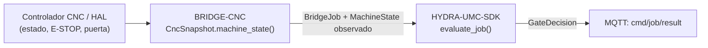

<!-- =============================================================================
HYDRA-UMC-BRIDGE-CNC - CNC cell coordination bridge
Copyright (C) JuanenRac (Electro Hobby 3D) <electrohobby3d@gmail.com>
GPL-3.0-or-later - see LICENSE
============================================================================= -->

<p align="center">
  
</p>

# 🔧 HYDRA-UMC-BRIDGE-CNC

<p align="center"><a href="README.md">🇺🇸 English</a> | 🇪🇸 <b>Español</b> | <a href="README_fra.md">🇫🇷 Français</a> | <a href="README_ita.md">🇮🇹 Italiano</a> | <a href="README_deu.md">🇩🇪 Deutsch</a> | <a href="README_zho.md">🇨🇳 简体中文</a> | <a href="README_jpn.md">🇯🇵 日本語</a> | <a href="README_por.md">🇵🇹 Português</a></p>

### 🛑 Puente de coordinación seguro por defecto para celdas CNC

<p align="center">
  
  
  
  
  
  
</p>

---

> **Comprobación de honestidad - qué funciona realmente hoy:** el snapshot de celda a prueba de fallos y la puerta de seguridad (`cell.py` con `CncSnapshot`/`CncCellBridge`, que hace pasar cada trabajo por el propio `evaluate_job()` de `HYDRA-UMC-SDK`), el normalizador de evidencia GRBL/MTConnect de solo lectura (`observation.py`), el transporte serie real de GRBL (`serial_transport.py` con `GrblSerialProbe`/`GrblRealtimeControl`), y el transporte de comandos/estado MQTT (`mqtt_transport.py`) son reales y están cubiertos por 261 casos `unittest` que pasan (`python tools/build_test.py`), incluyendo `tests/test_grbl_emulator.py`, que ejecuta este bridge contra un emulador GRBL v1.1 fiel al protocolo pero escrito a mano. Nada de esto ha tocado un puerto serie real, un broker MQTT real, ni un controlador CNC real - el propio `FakeSerial` de `test_serial_transport.py` sustituye a una conexión física, y `test_mqtt_transport.py` usa igualmente un cliente de broker falso. Los enlaces de LinuxCNC y CNCjs y la vista MTConnect solo han conocido simulaciones, no hay un adaptador HAL de LinuxCNC ni un comando `run` en vivo, porque no se ha manejado ningún controlador real - ver "Estado Actual y Próximos Pasos" más abajo, que ya lo dice con claridad, y `CHANGELOG.md` para lo que se ha entregado exactamente hasta ahora. El transporte MQTT también se ha ejecutado contra un HYDRA-UMC-MQTT-BROKER real en una máquina de desarrollo (`tests/test_broker_integration.py`, que se omite si no hay ningún broker instalado): publicar y suscribirse con QoS 0, 1 y 2, la disponibilidad retenida y su último testamento, y la vuelta tras caerse y levantarse el broker.

> **Estado de seguridad física y de ciberseguridad:** este ecosistema no es un sistema de seguridad certificado. Todavía no existe una ruta de E-STOP por hardware, ni límites ni enclavamientos aplicados por el firmware, ni un comando de movimiento verificado; las imágenes de firmware se comprueban con CRC-32 y una firma Ed25519, y una compilación de versión rechaza las claves de desarrollo publicadas (los cabezales de herramienta y las placas de expansión detrás del relé siguen con cargadores de URTC, que usan un HMAC-SHA256 de clave compartida en lugar de una firma); TLS y TLS mutuo son opcionales y están desactivados por defecto; aún no se ha poblado ni probado ninguna placa propia. Lee la [línea base de seguridad](https://github.com/JuanenRac/HYDRA-UMC-DOCS/blob/main/docs/SECURITY_BASELINE.md) y el [modelo de amenazas](https://github.com/JuanenRac/HYDRA-UMC-DOCS/blob/main/docs/THREAT_MODEL.md) antes de fiarte de cualquier afirmación de aquí para la seguridad de una persona.

---

## 📋 De un vistazo

| | |
|---|---|
| Versión | `0.2.2` |
| Madurez | Funcional |
| Tests | 261 (`python tools/build_test.py`) |
| Tecnología | Python / LinuxCNC / G-code / GRBL status evidence / GRBL serial transport |
| Destino | La Raspberry Pi CM5 de una celda HYDRA-UMC |
| En hardware real | Solo simulado: probado con emuladores, dobles de prueba o simuladores; no consta ninguna ejecución en hardware real para esta versión |

**Ir a:** [Resumen](#-resumen) · [Arquitectura](#-arquitectura) · [Funciones](#-funciones) · [Seguridad y protección](#-seguridad-y-protección) · [Interfaces](#-interfaces) · [Configuración](#-configuración) · [Inicio rápido](#-inicio-rápido) · [Pruebas](#-pruebas) · [Resolución de problemas](#-resolución-de-problemas) · [Estructura del repositorio](#-estructura-del-repositorio) · [Proyectos relacionados](#-proyectos-relacionados)

## 🚦 Estado del proyecto

Cada línea es una parte de este repositorio y la luz dice hasta dónde llega hoy. Se escribe con lo que el repositorio puede demostrar (pruebas, compilaciones, ejecuciones), no con lo previsto.

🟢 Hecho y verificado · 🟡 Funciona, con límites conocidos · 🟠 Hecho a medias o sin verificar · 🔴 Sin hacer o sin funcionar

| Área | Estado | Qué significa aquí |
|---|---|---|
| Software | 🟡 | Funciona para su propósito principal; la comprobación de honestidad de arriba lista lo que aún falta |
| Pruebas | 🟢 | 261 pruebas automáticas, ejecutadas en cada cambio |
| Hardware real | 🟠 | Solo simulado: probado con emuladores, dobles de prueba o simuladores; no consta ninguna ejecución en hardware real para esta versión |
| Documentación | 🟢 | README en ocho idiomas, comprobado contra el manifiesto en cada cambio |

## 🎯 Resumen

**HYDRA-UMC-BRIDGE-CNC** es el puente de alto nivel entre celdas CNC y auxiliares robóticos HYDRA-UMC: carga, descarga, manipulación de piezas y tareas auxiliares supervisadas. Nunca se convierte en un controlador de trayectorias en tiempo real: el controlador CNC (GRBL, LinuxCNC o el que hay detrás de CNCjs) conserva en todo momento la autoridad sobre trayectoria, husillo y límites de máquina.

Pertenece a la familia **External Automation Bridges**: un conjunto de repositorios hermanos (CNC, LASER, OPENPNP, PRINTER3D, ROS2) que hablan el mismo contrato de seguridad compartido de `HYDRA-UMC-SDK`, de modo que ningún puente puede inventar su propia definición de "seguro para trabajar".

## 🧩 Papel en HYDRA-UMC

**HYDRA-UMC-BRIDGE-CNC** está entre un controlador CNC (GRBL, LinuxCNC o el que hay detrás de CNCjs) y la celda de robots que lo carga y descarga. El controlador conserva siempre la autoridad sobre la trayectoria, el husillo y los límites; el bridge solo cuenta lo que dice el controlador y consulta la puerta compartida antes de cualquier trabajo auxiliar.

Todos los bridges hablan el contrato de seguridad compartido de `HYDRA-UMC-SDK`: un trabajo solo se acepta cuando la puerta compartida `evaluate_job()` lo permite, y esa puerta falla cerrada. El proyecto padre es `HYDRA-UMC-SERVER`; este bridge no lo llama, responde por MQTT, a través de `HYDRA-UMC-MQTT-BROKER`, a quien manda en la celda.

| Habla con | Cómo | Para qué |
|---|---|---|
| `HYDRA-UMC-SDK` | importación Python | la puerta de trabajos `evaluate_job()`, la forma de los trabajos y decisiones, el enlace serie y el cliente MQTT |
| `HYDRA-UMC-MQTT-BROKER` | MQTT, `hydra/bridges/cnc/` | órdenes de entrada (`cmd/`), estado y resultados de salida |
| GRBL | puerto serie | consulta de estado `?` y los bytes en tiempo real (retención, reanudar ciclo, reinicio suave); nunca un programa G-code |
| LinuxCNC | módulo Python `linuxcnc` | lee `linuxcnc.stat`; envía solo pausa, aborto y reanudación |
| CNCjs | socket.io | escucha `controller:state`; envía solo `feedhold`, `reset`, `cyclestart` |

## 🏛️ Arquitectura

<p align="center">
  
</p>

<details>
<summary>Versión en texto del diagrama (Mermaid)</summary>



</details>

**Por qué está hecho así**

* **Por qué se comprueban el E-STOP y el estado de puerta antes que el propio estado reportado por el controlador.** `CncSnapshot.machine_state()` cortocircuita a `SAFE_STOP` si hay `estop` o la puerta no está cerrada, antes que nada — un controlador que sigue reportando `IDLE` con la puerta abierta jamás debe tomarse al pie de la letra.
* **Por qué el mapeo del estado del controlador es deliberadamente conservador.** Solo la cadena literal `IDLE` se mapea a `MachineState.IDLE`. Cualquier valor no reconocido cae en `OFFLINE`, nunca en algo que permitiría trabajo auxiliar — un estado de controlador desconocido se trata como "no lo sé", no como "probablemente está bien".
* **Por qué el puente construye un nuevo `BridgeJob` y delega en el `evaluate_job()` compartido en lugar de escribir su propia lógica de aceptación/rechazo.** Los cinco External Automation Bridges (CNC, LASER, OPENPNP, PRINTER3D, ROS2) reutilizan exactamente el mismo `bridge_contract` de `HYDRA-UMC-SDK`, de modo que "qué cuenta como seguro para iniciar un trabajo" no puede divergir silenciosamente entre ellos.
* **Por qué los enlaces de LinuxCNC y CNCjs solo leen, pausan y reanudan.** El controlador conserva la autoridad sobre trayectoria, husillo y límites, y el programa pertenece a quien lo ejecuta (CNCjs, el propio LinuxCNC): el bridge puede llevar la máquina al reposo y dejar continuar a una en pausa, nada más. Cablear pines HAL reales sigue siendo un paso de integración de hardware que hay que validar contra un controlador real.
* **Cómo encaja en el resto del ecosistema.** BRIDGE-CNC se sitúa entre el controlador CNC y `HYDRA-UMC-SDK` → `HYDRA-UMC-MQTT-BROKER` → MCU/seguridad de celda: coordina trabajo robótico auxiliar alrededor del CNC, no reemplaza ni anula la propia autoridad de seguridad del controlador.

Los asistentes de observación son normalizadores de evidencia, no adaptadores de controlador: no abren enlaces HAL, serie ni de red. [Controller Evidence Boundary](docs/CONTROLLER_EVIDENCE_BOUNDARY.md) define la validación necesaria antes de una integración real con el controlador.

**Funcionamiento como servicio.** `python -m hydra_umc_bridge_cnc --config /etc/hydra-umc/bridge-cnc.toml` arranca el bridge desde un único fichero TOML: el controlador (una placa GRBL en un puerto serie, CNCjs o LinuxCNC), el origen del paro de emergencia y de la puerta (una línea GPIO con su nivel inseguro declarado, o un fichero pequeño), el reparto del puerto serie con un emisor de G-code, la compuerta del husillo, MTConnect, el broker MQTT y el origen del estado de la celda. Una clave que no conoce se rechaza, un origen de señal tiene que declarar su cableado y todo falla cerrado: una señal sin origen es paro de emergencia pulsado o puerta abierta, y una señal o fichero de estado de la celda ausente, desconocido o caducado da la respuesta insegura. `--check` valida el fichero; `deploy/` contiene la unidad systemd (`Restart=on-failure`) y un fichero de ejemplo. Se ha ejecutado contra el emulador GRBL y señales simuladas, no en una máquina real.

## ✨ Funciones

* ✅ **Instantánea de celda segura por defecto, real:** `cell.py` — `CncSnapshot.machine_state()` comprueba el E-STOP y el estado de la puerta *antes* de mirar nada que reporte el controlador; un E-STOP activo o una puerta abierta siempre resuelven en `SAFE_STOP`, sin importar lo que diga `controller_state`. *(implementado, probado en `tests/test_cell.py`)*
* ✅ **Puerta de seguridad compartida, real:** cada trabajo observado se reevalúa mediante `evaluate_job()` de `bridge_contract` en `HYDRA-UMC-SDK`, la misma puerta que usan todos los puentes hermanos. *(implementado)*
* ✅ **Puerto serie compartido:** una placa GRBL tiene un solo puerto serie. `multiplexer.py` puede poseerlo y ofrecer un frontal TCP (solo en el bucle local por defecto) al que se conecta un emisor de G-code a la vez, mientras el bridge conserva sus consultas de estado y sus tres bytes en tiempo real; el bridge nunca puede escribir otra cosa y se rechaza un segundo emisor. Viene desactivado (`HYDRA_UMC_CNC_PORT_SHARING=multiplexer` lo activa; `HYDRA_UMC_CNC_PORT_SHARING_LISTEN` y `HYDRA_UMC_CNC_PORT_SHARING_ALLOW_REMOTE` fijan la dirección). Probado con el emulador de GRBL; no ha funcionado con una placa GRBL real. *(implementado, solo simulado)*
* ✅ **Mapeo de estado conservador:** solo `IDLE` se trata como reposo; `RUN`/`RUNNING`/`JOG`/`HOME` se mapean a `RUNNING`, `FAULT`/`ERROR`/`OFF`/`ALARM` a `FAULT`, y cualquier valor no reconocido cae en `OFFLINE`, nunca en un estado que permitiría trabajo productivo. (`HOLD` → `HOLDING`; `DOOR` → `SAFE_STOP`) *(implementado)*
* ✅ **Evidencia del controlador de solo lectura:** `observation.py` normaliza estrictamente la evidencia de mapeo local y las líneas de estado GRBL recibidas; las señales de E-STOP/puerta omitidas o no booleanas fallan de forma segura. *(implementado, probado en `tests/test_observation.py`)*
* ✅ **Transporte serie GRBL real:** `GrblSerialProbe` de `serial_transport.py` abre una conexión serie real y consulta el byte de estado en tiempo real de GRBL (`?`); `GrblRealtimeControl` solo envía los bytes de control en tiempo real propios de GRBL (retención de avance, reanudación de ciclo, reinicio suave) — `cycle_start_resume()` está condicionado a que la máquina esté genuinamente en `HOLDING`, los demás siempre están permitidos como `ABORT`. Nunca transmite un programa G-code. *(implementado, probado en `tests/test_serial_transport.py`)*
* ✅ **Compilación/prueba no mutante:** `build-test.bat`/`.sh` compilan el código y ejecutan la batería de pruebas de la puerta de seguridad sin tocar archivos de versión ni el CHANGELOG. *(implementado, ver Compilación y publicación más abajo)*
* ✅ **Enlaces de controlador:** el bridge habla con un controlador mediante `ControllerLink` (`controller.py`): GRBL en un puerto serie que el bridge mantiene abierto (`GrblController`), una instalación de LinuxCNC (`linuxcnc_link.py`: lee `linuxcnc.stat`, envía solo pausa, aborto y reanudación de un programa en pausa mediante `linuxcnc.command`, nunca ejecuta un programa) y un servidor CNCjs que posee el puerto (`cncjs_link.py`: lee el `controller:state` que emite y envía solo `feedhold`, `reset` y `cyclestart`, de modo que el bridge trabaja junto al emisor que ejecuta los programas). Reanudar siempre exige una celda READY y una máquina que realmente esté en retención; una lectura antigua o ausente nunca es una máquina en reposo. Ambos enlaces se prueban contra simulaciones (`SimulatedLinuxcnc`, `SimulatedCncjs`); ninguno ha tocado un LinuxCNC ni un CNCjs reales. *(implementado, solo simulado)*
* ✅ **Puerta del husillo:** se rechaza una carga o una descarga cuando el controlador está en reposo pero informa de un husillo girando o de un avance en movimiento (`FS:`). `HYDRA_UMC_CNC_SPINDLE_GATE` vale `off`, `when_known` (por defecto: rechaza lo que se informa) o `required` (rechaza también lo que el controlador no informa). El snapshot lleva además las posiciones, el desplazamiento de trabajo y los overrides del informe. *(implementado)*
* ✅ **Vista MTConnect:** `mtconnect_publish.py` convierte el snapshot en observaciones MTConnect (`avail`, `execution`, `estop`, `door`, `spindle_speed`, `path_feedrate`, `system`), servidas como SHDR por TCP mediante `ShdrAdapter` (solo lectura; la única línea que acepta es `* PING`) y, con `HYDRA_UMC_CNC_MTCONNECT=1`, publicadas retenidas en `hydra/bridges/cnc/mtconnect`. Un controlador que no informa es `UNAVAILABLE`, nunca `READY`. Probado contra un agente simulado. *(implementado, aún no probado con un agente real)*
* 🔜 **Pines HAL de LinuxCNC** — aplazado; todavía no se ha accionado un controlador CNC, un pin HAL ni un robot real. *(planeado)*
* ✅ **Claves de idempotencia repetidas:** `CncMqttBridge` acepta un `IdempotencyStore`: una clave de trabajo repetida recibe la respuesta dada la primera vez en lugar de evaluarse de nuevo. *(implementado, probado en `tests/test_idempotency.py`)*
* ✅ **Respuestas de estado alineadas, serie que falla cerrado, bucle MQTT blindado:** la consulta de estado descarta lo que ya esperaba, envía `?` y lee hasta que llega un informe de estado real (`<...>`): el banner, `ok`, `[MSG:...]` y `ALARM:n` que GRBL envía sin que se lo pidan ya no dejan cada consulta posterior una respuesta atrasada; un dispositivo USB ausente (o cualquier fallo del enlace) falla cerrado en lugar de terminar el bridge, y el puerto se abre sin activar DTR; `cmd/feed_hold` informa de lo que dijo el controlador después (`controller_state_after`, `confirmed`), y `cmd/feed_hold` y `cmd/soft_reset` corren en un carril propio, de modo que una consulta de estado nunca los retrasa; una carga demasiado grande (más de 16 KiB), ilegible o con JSON profundamente anidado, y cualquier fallo inesperado, reciben una negativa en el topic de resultado y nunca terminan el bucle; las respuestas de `cmd/job` indican `"mode": "gate-only"` y un ABORT por ahí dice que no se detuvo nada; el estado lleva `observed_at` y el bridge se anuncia en un topic `availability` con Last Will. GRBL tiene UN solo puerto serie: mientras este bridge lo tiene abierto, ningún emisor de G-code puede usarlo (véase `docs/BRIDGE_GUIDE.md`). *(implementado, probado en `tests/test_hardening.py`)*
* ✅ **Trabajos por la admisión compartida:** la comprobación de un trabajo mal formado y de una `idempotency_key` repetida es el `JobIntake` del SDK en lugar de código de este puente (las claves ya no llevan el prefijo `job:`).
* ✅ **Respuestas que coinciden con su petición:** una carga de orden que es un objeto JSON puede llevar un `request_id` (un token sencillo de hasta 64 caracteres: letras, dígitos, `.`, `_`, `:`, `-`), y cada resultado que el puente publica para ese mensaje lo devuelve, también el guardado para una clave de idempotencia repetida. Los temas de estado no cambian.

## 🔒 Seguridad y protección

| Amenaza | Defensa | Dónde |
|---|---|---|
| Un trabajo para una celda que no está en estado seguro | Todo trabajo pasa por la puerta compartida `evaluate_job()`, que falla cerrada; el bridge no tiene lógica propia de aceptar o rechazar. El paro de emergencia y la puerta se leen antes que lo que informa el controlador, y puerta abierta o paro de emergencia es siempre `SAFE_STOP` | `cell.py`, SDK `bridge_contract` |
| Datos de trabajo desmesurados | Como máximo 32 parámetros, claves de hasta 64 caracteres, valores de hasta 1024, identificadores de hasta 128; una carga MQTT de más de 16 KiB se rechaza en el topic de resultado | SDK `bridge_contract`, `mqtt_transport.py` |
| Una orden repetida o reenviada | Un `IdempotencyStore` recuerda cada clave 24 horas y como máximo 10 000 entradas; una repetición recibe la primera respuesta en vez de evaluarse otra vez. Un mensaje `cmd/` retenido se ignora al reconectar | SDK `job_intake.py`, `mqtt_transport.py` |
| Un husillo girando mientras un brazo carga o descarga | `LOAD` y `UNLOAD` se rechazan si el controlador está inactivo pero informa de un husillo girando o un avance en movimiento; `HYDRA_UMC_CNC_SPINDLE_GATE` es `off`, `when_known` (por defecto, también para un valor desconocido) o `required` | `cell.py` |
| Parar o mover la máquina por orden remota | A CNCjs solo llegan `feedhold`, `reset` y `cyclestart`, a LinuxCNC solo pausa, aborto y reanudación, y a un puerto serie solo los bytes en tiempo real de GRBL; reanudar exige una celda READY y una máquina que esté detenida de verdad. `cmd/feed_hold` y `cmd/soft_reset` corren en un carril propio | `cncjs_link.py`, `linuxcnc_link.py`, `serial_transport.py`, `mqtt_transport.py` |
| Una lectura vieja tomada por una máquina inactiva | Una lectura de CNCjs de más de 3 segundos no se considera fiable, un estado ausente o viejo nunca es inactivo y entonces la puerta cuenta como abierta; una orden a LinuxCNC caduca a los 2 segundos; una consulta serie fallida falla cerrada | `cncjs_link.py`, `linuxcnc_link.py`, `serial_transport.py` |
| Un cliente MTConnect que desborda el adaptador | El adaptador SHDR es de solo lectura: como máximo 16 clientes, líneas de hasta 1024 bytes, y la única línea que atiende es `* PING` | `mtconnect_publish.py` |

**Lo que nunca hace:** nunca envía un programa G-code en flujo, nunca ejecuta un programa en LinuxCNC, nunca le quita a CNCjs su puerto serie y nunca deduce un estado de paro de emergencia o de puerta que la evidencia no traía. Mira `docs/CONTROLLER_EVIDENCE_BOUNDARY.md`.

## 🔌 Interfaces

Topics bajo `hydra/bridges/cnc/` (prefijo `TOPIC_PREFIX`); el bridge se suscribe a `cmd/#`.

| Topic o ruta | Qué lleva |
|---|---|
| `cmd/status` | pide el estado de la celda; se responde en `cmd/status/result` |
| `cmd/job` | un `BridgeJob` con la forma `job_to_dict()` del SDK; la respuesta es una `GateDecision` marcada `"mode": "gate-only"` (nunca actúa, así que un `ABORT` por aquí dice que no se detuvo nada) |
| `cmd/feed_hold`, `cmd/soft_reset` | las órdenes de parada, en su propio carril; la respuesta lleva `controller_state_after` y `confirmed` |
| `cmd/cycle_start_resume`, `cmd/start`, `cmd/resume` | reanudan una máquina detenida; se rechazan salvo que la celda esté READY y la máquina esté detenida de verdad (nunca tras un evento de puerta) |
| `<verb>/result` | una respuesta JSON por orden, `{"allowed", "executed", "reason"}` en un rechazo |
| `state`, `availability` | el estado de la celda (retenido, con `observed_at` en milisegundos de época) y `online`/`offline` (el Last Will) |
| `mtconnect` | observaciones MTConnect, retenidas; solo con `HYDRA_UMC_CNC_MTCONNECT=1` |

La biblioteca: `CncCellBridge`, `CncSnapshot`, `CncMqttBridge`, `spindle_gate_from_environment()` y los tres enlaces (`GrblController`, `LinuxcncController`, `CncjsController`).

## ⚙️ Configuración

| Variable | Por defecto | Qué fija |
|---|---|---|
| `HYDRA_UMC_CNC_SPINDLE_GATE` | `when_known` | `off`, `when_known` o `required`; sin definir o un valor desconocido equivale a `when_known` |
| `HYDRA_UMC_CNC_MTCONNECT` | desactivado | `1` publica las observaciones MTConnect en `hydra/bridges/cnc/mtconnect` |
| `HYDRA_MQTT_USERNAME` | ninguno | El usuario MQTT; el broker lo liga a un prefijo de ID de cliente |
| `HYDRA_MQTT_PASSWORD` | ninguno | La contraseña; solo vale junto con el usuario |
| `HYDRA_MQTT_PASSWORD_FILE` | ninguno | La contraseña leída de un fichero (secreto de Docker o systemd); se ignora si hay `HYDRA_MQTT_PASSWORD` |
| `HYDRA_MQTT_TLS_CA` | ninguno | El fichero de la CA que firmó el certificado del broker: la conexión es TLS y se verifica el certificado |
| `HYDRA_MQTT_TLS` | desactivado | `1` activa TLS, verificado con las CA de confianza del sistema |
| `HYDRA_MQTT_TLS_CERT` / `HYDRA_MQTT_TLS_KEY` | ninguno | El certificado de cliente y su clave para un broker que exige TLS mutuo; hacen falta los dos |

El enlace con el controlador se elige en el código: pasa `controller=` a `CncMqttBridge` para LinuxCNC o CNCjs; si no, el bridge mantiene una conexión serie GRBL. Mientras la mantiene, ningún emisor de G-code puede usar ese puerto (mira `docs/BRIDGE_GUIDE.md`, «One serial port»).

## 🚀 Inicio rápido

Requiere Python 3.11 o superior. Las pruebas y los scripts de compilación esperan `HYDRA-UMC-SDK` clonado junto a este repositorio (`../HYDRA-UMC-SDK`) o indicado con `HYDRA_UMC_SDK_ROOT`.

Pruébalo sin hardware (esto comprueba todo el bridge contra sus emuladores y dobles de prueba):

```bash
py -3 tools/build_test.py          # Windows
python3 tools/build_test.py         # Linux, macOS
build-test.bat  /  bash build-test.sh   # the same, through the scripts
```

Arranca el servicio (no hay un script de consola: el servicio es el `run_forever()` del transporte MQTT, que llamas desde tu propio código de arranque):

```python
from hydra_umc_bridge_cnc.mqtt_transport import CncMqttBridge, run_forever
# `connection` is an open GRBL serial connection (open_serial_port()), or pass controller=...
bridge = CncMqttBridge(connection)
run_forever(bridge, host="192.168.0.180")   # connects to the broker and serves cmd/# forever
```

El usuario, la contraseña y los ficheros TLS salen de las variables `HYDRA_MQTT_*` (ver Configuración); el código de arriba no necesita credenciales propias.

## 🧪 Pruebas

261 casos automáticos de `unittest` se ejecutan con `python tools/build_test.py` (que también compila cada módulo). Las pruebas no necesitan hardware, red ni paquetes opcionales: las que necesitarían `paho-mqtt`, `pyserial` o una biblioteca del fabricante usan un sustituto o se saltan si falta el paquete.

| Fichero de pruebas | Pruebas | Qué cubre |
|---|---|---|
| `test_cell.py` | 10 | admisión en reposo seguro, rechazo con puerta abierta, reenvío de aborto |
| `test_controllers.py` | 63 | puerta del husillo, enlaces LinuxCNC y CNCjs contra sus simulaciones, vista MTConnect |
| `test_serial_transport.py` | 29 | el transporte serie contra un puerto simulado, incluidos los caminos que fallan cerrados |
| `test_mqtt_transport.py`, `test_mqtt_environment.py` | 28 + 4 | formas de órdenes y estado contra un cliente de broker simulado; las credenciales y el TLS del entorno llegan al cliente |
| `test_grbl_emulator.py`, `grbl_emulator.py` | 17 | el bridge contra un emulador GRBL v1.1 escrito a mano y fiel al protocolo |
| `test_hardening.py`, `test_edge_cases.py`, `test_idempotency.py`, `test_observation.py` | 25 + 20 + 3 + 7 | respuestas de estado alineadas, un cable muerto, confirmación de retención, cargas hostiles, claves repetidas, evidencia ausente |

El CI ejecuta `HYDRA_UMC_CI=1 python tools/ci_validate.py`, que comprueba el manifiesto, los documentos, los ocho README y las imágenes, y ejecuta las pruebas con una copia del SDK.

## 🏗️ Compilación y publicación

Requiere Python 3.11+. `tools/build_test.py` espera que `HYDRA-UMC-SDK` esté clonado como directorio hermano (`../HYDRA-UMC-SDK`) o indicado mediante la variable de entorno `HYDRA_UMC_SDK_ROOT`.

```bash
# Windows
build-test.bat      # solo valida — sin cambio de versión/CHANGELOG
build.bat            # Valida y compila (compilar nunca cambia la versión)

# Linux/macOS
bash build-test.sh
bash build.sh
```

`build-test` compila cada módulo bajo `src/` con `py_compile` y ejecuta la batería completa de `unittest` descubierta en `tests/` (`test_cell.py`, `test_observation.py`, `test_serial_transport.py`, `test_mqtt_transport.py`, `test_grbl_emulator.py`, `test_hardening.py`, `test_idempotency.py`, `test_mqtt_environment.py` - 261 tests), demostrando la admisión en reposo seguro, el rechazo con puerta abierta y el reenvío de aborto entre todo lo demás cubierto — nunca modifica el repositorio. `build` ejecuta primero esa misma validación y, solo si tiene éxito, llama a `tools/bump_version.py` para sincronizar la versión en `pyproject.toml`, `hydra-umc.project.json` y `CHANGELOG.md`. Todavía no existe un comando `run` real de CNC — eso requiere una integración de controlador validada.

## 🩺 Resolución de problemas

| Ves | Porque | Haz |
|---|---|---|
| `ModuleNotFoundError: hydra_umc_sdk` | El SDK no está instalado ni junto a este repositorio | Clona `HYDRA-UMC-SDK` junto a este repositorio o define `HYDRA_UMC_SDK_ROOT` |
| `paho-mqtt is not installed` | El cliente MQTT es un extra opcional | `pip install ".[mqtt]"` (necesita `paho-mqtt` 2.1 o superior, menor que 3) |
| `password was given without a username` | Las credenciales MQTT necesitan las dos partes | Define `HYDRA_MQTT_USERNAME` además de la contraseña |
| `spindle_gate must be one of ...` | `HYDRA_UMC_CNC_SPINDLE_GATE` tiene un valor que el código no conoce | Usa `off`, `when_known` o `required` (pasado en código lanza una excepción; desde el entorno un valor desconocido vuelve a `when_known`) |
| `a serial connection or a controller link is required` | `CncMqttBridge` se creó sin ninguna de las dos | Pasa una conexión serie abierta o `controller=` |
| `"allowed": false` + `reason` | La puerta compartida o una guarda rechazó la orden | Lee `reason`: puerta abierta, paro de emergencia, máquina no inactiva, husillo girando o lectura vieja; arregla la causa, no reintentes a ciegas |

## 📂 Estructura del repositorio

<p align="center">
  
</p>

<details>
<summary>Versión en texto del árbol</summary>

```text
HYDRA-UMC-BRIDGE-CNC/
├── src/hydra_umc_bridge_cnc/
│   ├── cell.py                    instantánea de la celda, puerta de seguridad, puerta del husillo
│   ├── observation.py             evidencia de solo lectura, líneas de estado GRBL
│   ├── serial_transport.py        enlace serie GRBL: consulta de estado y bytes en tiempo real
│   ├── controller.py              ControllerLink y el controlador GRBL
│   ├── linuxcnc_link.py           enlace LinuxCNC (lee, pausa, reanuda) y su simulación
│   ├── cncjs_link.py              enlace CNCjs (feedhold, reset, cyclestart) y su simulación
│   ├── multiplexer.py             multiplexor del puerto serie: el puente y un emisor de G-code comparten un puerto GRBL
│   ├── mtconnect_publish.py       observaciones MTConnect y el adaptador SHDR de solo lectura
│   └── mqtt_transport.py          transporte MQTT de órdenes y estado
├── tests/                         238 pruebas, con un emulador GRBL escrito a mano
├── deploy/                        unidad systemd y configuración de ejemplo
├── docs/                          guía del bridge, límite de la evidencia
├── tools/                         ejecutor de compilación y pruebas, subida de versión, validador de CI, generadores y comprobaciones de README e imágenes
├── images/                        banner y las imágenes del README
├── .github/                       flujo de CI y plantillas de incidencias
├── pyproject.toml                 metadatos del paquete y dependencias
├── hydra-umc.project.json         manifiesto: versión, madurez, familia
├── CHANGELOG.md                   qué cambió en cada versión
├── build.sh build.bat             scripts de compilación (nunca cambian la versión)
├── build-test.sh build-test.bat   scripts de compilación (nunca cambian la versión)
├── test.sh test.bat               ejecutan las pruebas
└── SECURITY.md SUPPORT.md CONTRIBUTING.md CODE_OF_CONDUCT.md LICENSE LICENSE.md
```

</details>

## 🗺️ Hoja de ruta y límites conocidos

**Límites conocidos hoy**

**Real hoy:** versión `0.2.2`, un coordinador de celda seguro por defecto probado en local (`CncSnapshot` + `CncCellBridge`) apoyado en la puerta de trabajo compartida de `HYDRA-UMC-SDK`, normalización estricta y de solo lectura de evidencia de controlador que cubre el vocabulario de estado real completo de GRBL v1.1 incluyendo subestados reales `Hold:N`/`Door:N` (`Idle`/`Run`/`Jog`/`Home`/`Hold`/`Alarm`/`Door`) además de estados de ejecución MTConnect, un transporte serie real (`GrblSerialProbe`/`GrblRealtimeControl`) capaz de consultar el estado y enviar los bytes de control en tiempo real propios de GRBL sobre una conexión real - la lectura en vivo de puerta/E-STOP ahora ocurre justo después del propio viaje de ida y vuelta bloqueante de esa consulta, nunca antes, y una escritura real corta o de cero bytes se reporta como no ejecutada en vez de un falso éxito -, una batería `unittest` determinista de 261 pruebas, y scripts de build-test no mutantes conectados a CI con clonado del SDK.

**Frontera de integración:** el controlador CNC (GRBL, LinuxCNC o el que hay detrás de CNCjs) conserva en todo momento la autoridad sobre trayectoria, husillo y límites de máquina; este puente solo controla trabajo robótico *auxiliar*, nunca el movimiento del controlador.

**Todavía pendiente:** no se ha accionado ningún controlador CNC real, pin HAL de LinuxCNC ni robot — elegir y validar un adaptador HAL concreto es un paso de integración de hardware/software posterior a disponer de la máquina y su interfaz documentada.

## 🌍 Idiomas

Este README y los documentos del repositorio existen en ocho idiomas: inglés, español, alemán, francés, italiano, japonés, chino y portugués (Portugal). Se escriben a la vez y el CI comprueba que los ocho ficheros tengan las mismas secciones y los mismos enlaces. Este repositorio no tiene pantalla ni catálogo de mensajes propios, así que no hay cadenas de interfaz que traducir.

## 🔗 Proyectos relacionados

Este proyecto es parte del ecosistema de robótica HYDRA-UMC del mismo autor (JuanenRac / Electro Hobby 3D). Vale la pena conocerlo, ya que una petición podría en realidad ser sobre alguno de estos en vez de sobre este repositorio.

**Proyecto Padre**
- **[HYDRA-UMC-SERVER](https://github.com/JuanenRac/HYDRA-UMC-SERVER)** — el backend headless real (REST/WebSocket) con el que habla de verdad cada cliente de control; este bridge no lo llama: responde por MQTT, a través de HYDRA-UMC-MQTT-BROKER, a quien manda en la celda.

**Proyectos Hermanos** — también hablan con la propia API de HYDRA-UMC-SERVER, cada uno como su propio cliente
- **[HYDRA-UMC-STUDIO](https://github.com/JuanenRac/HYDRA-UMC-STUDIO)** — panel de control web con visualización 3D multi-robot en tiempo real.
- **[HYDRA-UMC-SUITE](https://github.com/JuanenRac/HYDRA-UMC-SUITE)** — centro de mando de enjambre de escritorio (PySide6) para varios servidores a la vez, empaquetado como ejecutable independiente.
- **[HYDRA-UMC-ANDROID-CONTROL](https://github.com/JuanenRac/HYDRA-UMC-ANDROID-CONTROL)** — app nativa de control para Android con inicio de sesión biométrico y un compañero Wear OS emparejado.
- **[HYDRA-UMC-IOS-CONTROL](https://github.com/JuanenRac/HYDRA-UMC-IOS-CONTROL)** — app de control para iOS/iPadOS (Flutter) con sincronización en tiempo real por WebSocket.
- **[HYDRA-UMC-DSI](https://github.com/JuanenRac/HYDRA-UMC-DSI)** — interfaz táctil nativa para la pantalla táctil DSI de 7" a bordo, embebida en el propio CM5.
- **[HYDRA-UMC-BRIDGE-AMR](https://github.com/JuanenRac/HYDRA-UMC-BRIDGE-AMR)** — barrera de coordinación para flotas AGV/AMR mediante un publicador MQTT VDA 5050 (probado solo contra una flota emulada).
- **[HYDRA-UMC-BRIDGE-DROIDS](https://github.com/JuanenRac/HYDRA-UMC-BRIDGE-DROIDS)** — barrera de coordinación para droides con patas/humanoides, con un emisor de comandos para Boston Dynamics Spot (probado solo contra un emulador).
- **[HYDRA-UMC-BRIDGE-LASER](https://github.com/JuanenRac/HYDRA-UMC-BRIDGE-LASER)** — coordinador de celdas láser que lee 3 señales GPIO de llave/carcasa/enclavamiento (probado solo contra un chip simulado; no puede armar ni disparar un láser).
- **[HYDRA-UMC-BRIDGE-OPENPNP](https://github.com/JuanenRac/HYDRA-UMC-BRIDGE-OPENPNP)** — coordinador de alto nivel seguro para el flujo de placas de pick-and-place OpenPnP.
- **[HYDRA-UMC-BRIDGE-PRINTER3D](https://github.com/JuanenRac/HYDRA-UMC-BRIDGE-PRINTER3D)** — barrera de coordinación segura para impresoras 3D Moonraker/Klipper, con comandos de trabajo reales y controlados.
- **[HYDRA-UMC-BRIDGE-ROS2](https://github.com/JuanenRac/HYDRA-UMC-BRIDGE-ROS2)** — coordinador con un transporte ROS 2 rclpy importado de forma perezosa (todavía no ejecutado contra una instalación de ROS 2).
- **[HYDRA-UMC-BRIDGE-UAV](https://github.com/JuanenRac/HYDRA-UMC-BRIDGE-UAV)** — barrera de coordinación para UAV equipados con cámara, con un emisor de comandos MAVLink (probado solo contra un emulador).

**Directamente Relacionados**
- **[HYDRA-UMC-SDK](https://github.com/JuanenRac/HYDRA-UMC-SDK)** — el contrato JSON-Schema compartido y la barrera de software de puerta de trabajos contra la que cada bridge valida sus comandos (no es una función de seguridad certificada).
- **[HYDRA-UMC-CONNECTOR-HUB](https://github.com/JuanenRac/HYDRA-UMC-CONNECTOR-HUB)** — registro declarativo y validador de manifiestos de adaptador para conectores de máquinas externas; extiende la propia idea de contrato del SDK a máquinas externas sin sustituir a los proyectos de pasarela industrial.
- **[HYDRA-UMC-MQTT-BROKER](https://github.com/JuanenRac/HYDRA-UMC-MQTT-BROKER)** — el transporte real de `mqtt_transport.py` para los propios tópicos `hydra/bridges/cnc/...` de este bridge — estado más los bytes de control de jog/reset/resume, junto con la barrera de trabajos compartida; ver el propio `docs/BRIDGE_TOPICS.md` de ese repositorio.
- **[HYDRA-UMC-HIL-BRIDGE](https://github.com/JuanenRac/HYDRA-UMC-HIL-BRIDGE)** — futuro camino de evidencia hardware-in-the-loop para la integración real del controlador.

**También Forma Parte del Ecosistema**

*Hardware y Plataforma Base*
- **[HYDRA-UMC](https://github.com/JuanenRac/HYDRA-UMC)** — el diseño de la placa madre del brazo robótico: host CM5 + coprocesador STM32H745 de doble núcleo, pensado para coordinar hasta 8 brazos herramienta por CAN-OTA/SPI-OTA (firmware en fase temprana; todavía no hay ninguna placa poblada).
- **[HYDRA-UMC-OS](https://github.com/JuanenRac/HYDRA-UMC-OS)** — capa de producto reproducible sobre Raspberry Pi OS para el CM5: agente de solo lectura, config/perfiles validados, aprovisionamiento WiFi de primer contacto.

*Backend Central y Clientes*
- **[HYDRA-UMC-EDITOR-URDF](https://github.com/JuanenRac/HYDRA-UMC-EDITOR-URDF)** — creador/editor gráfico de URDF de escritorio que envía los modelos terminados al propio catálogo de STUDIO.
- **[HYDRA-UMC-EDITOR-STL](https://github.com/JuanenRac/HYDRA-UMC-EDITOR-STL)** — editor de escritorio de modelos STL, que transforma/reemplaza/quita/añade piezas reales en el mismo catálogo de modelos que también edita HYDRA-UMC-EDITOR-URDF.

*Plataforma de Herramientas URTC*
- **[URTC](https://github.com/JuanenRac/URTC)** — firmware para la placa física del Universal Robot Tool Controller, más de 25 perfiles de herramienta por bus CAN.
- **[URTC-FLASHER](https://github.com/JuanenRac/URTC-FLASHER)** — herramienta de escritorio con GUI para flashear placas URTC, CAN-OTA más SWD/JTAG de chip completo.
- **[URTC-TESTER](https://github.com/JuanenRac/URTC-TESTER)** — herramienta de escritorio de diagnóstico CAN-bus en vivo para placas URTC, un panel por perfil de herramienta.
- **[URTC-WEB-STUDIO](https://github.com/JuanenRac/URTC-WEB-STUDIO)** — alternativa basada en navegador a URTC-TESTER mediante la Web Serial API, sin instalación local.
- **[URTC-GATEWAY](https://github.com/JuanenRac/URTC-GATEWAY)** — pasarela delante del bus CAN de URTC: lista de identificadores permitidos, límite de tasa y clave de sesión; software probado en ordenador, aún no en un bus real.

*Nodo IA de Visión (Hailo-8)*
- **[HYDRA-UMC-VISION-NODE](https://github.com/JuanenRac/HYDRA-UMC-VISION-NODE)** — nodo de integración para el pipeline de visión Hailo-8, con una comprobación real de disponibilidad de hardware por etapa.
- **[HYDRA-UMC-DETECTION-HEF](https://github.com/JuanenRac/HYDRA-UMC-DETECTION-HEF)** — registro real de modelos compilados con verificación de carga segura por arquitectura Hailo/checksum.
- **[HYDRA-UMC-VISION-STREAMER](https://github.com/JuanenRac/HYDRA-UMC-VISION-STREAMER)** — generador real de pipeline GStreamer + config MediaMTX, con una frontera de integración HailoRT real.
- **[HYDRA-UMC-VISUAL-SERVOING-API](https://github.com/JuanenRac/HYDRA-UMC-VISUAL-SERVOING-API)** — ley de corrección Position-Based Visual Servoing con autorización condicionada al estado de zona; todavía sin estimación de pose por cámara.
- **[HYDRA-UMC-SAFETY-ZONES](https://github.com/JuanenRac/HYDRA-UMC-SAFETY-ZONES)** — lógica v0 de invasión de zona, vigencia de calibración y solicitud de E-STOP que toma las posiciones de los objetos de un fichero; ningún detector la alimenta y todavía no hay un E-STOP físico conectado.

*Nodo IA Cognitivo (Hailo-10)*
- **[HYDRA-UMC-COGNITIVE-NODE](https://github.com/JuanenRac/HYDRA-UMC-COGNITIVE-NODE)** — nodo de integración para el pipeline cognitivo Hailo-10 (orquestación de LLM/VLA/voz).
- **[HYDRA-UMC-VLA-ENGINE](https://github.com/JuanenRac/HYDRA-UMC-VLA-ENGINE)** — codificación/decodificación real de tokens de acción y generación de trayectoria para un modelo Vision-Language-Action.
- **[HYDRA-UMC-VOICE-UI](https://github.com/JuanenRac/HYDRA-UMC-VOICE-UI)** — front-end de voz real (VAD + analizador de intención) con un relé a Watch acotado y con confirmación.
- **[HYDRA-UMC-SEMANTIC-PLANNER](https://github.com/JuanenRac/HYDRA-UMC-SEMANTIC-PLANNER)** — descomposición real de tareas basada en reglas y recuperación semántica de errores sobre códigos de error del MCU.
- **[HYDRA-UMC-DOCS-QA](https://github.com/JuanenRac/HYDRA-UMC-DOCS-QA)** — búsqueda real de documentos TF-IDF (solo librería estándar) sobre los propios documentos Markdown de este ecosistema.
- **[HYDRA-UMC-LOCAL-TECHNICIAN](https://github.com/JuanenRac/HYDRA-UMC-LOCAL-TECHNICIAN)** — técnico de mantenimiento con IA local y con puertas de política para el propio ecosistema - observa, diagnostica y propone arreglos; los dos niveles de riesgo más altos están deliberadamente sin implementar todavía.

*Orquestación y Enjambre*
- **[HYDRA-UMC-ORCHESTRATOR](https://github.com/JuanenRac/HYDRA-UMC-ORCHESTRATOR)** — nodo de integración con un contrato real de informe de salud gRPC/Protobuf y una máquina de estados de misión.
- **[HYDRA-UMC-JOB-DISPATCHER](https://github.com/JuanenRac/HYDRA-UMC-JOB-DISPATCHER)** — cola de trabajos real basada en prioridad con deduplicación, sobre una API HTTP real.
- **[HYDRA-UMC-NODE-HEALING](https://github.com/JuanenRac/HYDRA-UMC-NODE-HEALING)** — watchdog de salud de flota real basado en gRPC, con reintento/backoff y detección de discrepancia de identidad.
- **[HYDRA-UMC-PATH-PLANNER-3D](https://github.com/JuanenRac/HYDRA-UMC-PATH-PLANNER-3D)** — planificador de rutas 3D real basado en RRT, con validación real de colisión de obstáculos/espacio de trabajo.
- **[HYDRA-UMC-SWARM-SYNC](https://github.com/JuanenRac/HYDRA-UMC-SWARM-SYNC)** — sincronización de estado real mediante CRDT LWW-Element-Map, con pruebas de propiedades para convergencia multi-celda.

*Gemelo Digital y Simulación*
- **[HYDRA-UMC-TWIN](https://github.com/JuanenRac/HYDRA-UMC-TWIN)** — nodo de integración para el motor de gemelo digital, con un contrato real de sincronización por compatibilidad de versión.
- **[HYDRA-UMC-PHYSICS-REPLICA](https://github.com/JuanenRac/HYDRA-UMC-PHYSICS-REPLICA)** — cinemática directa real y validación de límites articulares sobre un subconjunto real de URDF.
- **[HYDRA-UMC-SYNTHETIC-DATA-GEN](https://github.com/JuanenRac/HYDRA-UMC-SYNTHETIC-DATA-GEN)** — generador real de escenas 2D procedurales con exportación de anotaciones YOLO/COCO.

*Datos y Analítica*
- **[HYDRA-UMC-DATALAKE](https://github.com/JuanenRac/HYDRA-UMC-DATALAKE)** — almacén de series temporales real respaldado por sqlite3, con una API HTTP real de ingesta/consulta.
- **[HYDRA-UMC-ANOMALY-DETECTOR](https://github.com/JuanenRac/HYDRA-UMC-ANOMALY-DETECTOR)** — detector de anomalías real basado en FFT + línea base estadística, con monitorización de deriva.
- **[HYDRA-UMC-PRODUCTION-REPORTS](https://github.com/JuanenRac/HYDRA-UMC-PRODUCTION-REPORTS)** — cálculo real de OEE/disponibilidad sobre el histórico de DATALAKE, con exportación CSV reproducible.
- **[HYDRA-UMC-TELEMETRY-COLLECTOR](https://github.com/JuanenRac/HYDRA-UMC-TELEMETRY-COLLECTOR)** — pipeline real de ingesta CAN/WebSocket hacia DATALAKE, con deduplicación por secuencia.

*Pasarela Industrial*
- **[HYDRA-UMC-GATEWAY-INDUSTRIAL](https://github.com/JuanenRac/HYDRA-UMC-GATEWAY-INDUSTRIAL)** — nodo de integración que retransmite a protocolos industriales, con una capa real de lista blanca de comandos/contrapresión.
- **[HYDRA-UMC-OPCUA-SERVER](https://github.com/JuanenRac/HYDRA-UMC-OPCUA-SERVER)** — espacio de direcciones OPC-UA real, verificado con una sesión de cliente real del protocolo binario.
- **[HYDRA-UMC-MTCONNECT-ADAPTER](https://github.com/JuanenRac/HYDRA-UMC-MTCONNECT-ADAPTER)** — endpoints XML reales `/probe` y `/current` de MTConnect, con salida en modo degradado.

*Herramientas Complementarias y Operaciones del Ecosistema*
- **[HYDRA-UMC-DASHBOARD-AI](https://github.com/JuanenRac/HYDRA-UMC-DASHBOARD-AI)** — paneles de Resúmenes Inteligentes y Resaltado de Anomalías sobre DATALAKE/ANOMALY-DETECTOR, con un respaldo estadístico honesto.
- **[HYDRA-UMC-TOOL-CLI](https://github.com/JuanenRac/HYDRA-UMC-TOOL-CLI)** — CLI de flota con un contrato real y estable de códigos de salida, cliente real y en vivo de la propia API de HYDRA-UMC-SERVER.
- **[HYDRA-UMC-WATCH](https://github.com/JuanenRac/HYDRA-UMC-WATCH)** — app compañera de WearOS con patrones de alerta háptica y un relé de voz al teléfono emparejado (todavía no ejecutada en un reloj físico).
- **[URTC-SMART-RACK](https://github.com/JuanenRac/URTC-SMART-RACK)** — firmware para un rack de montaje de placas con decodificación real de ID de herramienta y lógica de precalentamiento Smart Idle.
- **[URTC-VISION-TOOL](https://github.com/JuanenRac/URTC-VISION-TOOL)** — firmware más un compañero de visión real en Python para un cabezal de inspección térmica/RGB.
- **[HYDRA-UMC-UPDATER](https://github.com/JuanenRac/HYDRA-UMC-UPDATER)** — herramienta administrativa de escritorio que descubre, clona y actualiza cada repositorio de este ecosistema.
- **[HYDRA-UMC-OS-REBUILDER](https://github.com/JuanenRac/HYDRA-UMC-OS-REBUILDER)** — herramienta de escritorio Windows/Linux que construye una imagen de la CM5 lista para grabar, precargada con las versiones más actuales del ecosistema, con configuración de primer arranque de Wi-Fi/usuario/SSH al estilo de Raspberry Pi Imager.
- **[HYDRA-UMC-OPS-AGENT](https://github.com/JuanenRac/HYDRA-UMC-OPS-AGENT)** — coordinador de incidencias de mantenimiento: un rol edge de bajo privilegio recopila un snapshot de inventario/salud saneado, un rol control-plane lo renderiza de solo lectura y pide a un proveedor de IA que sugiera un diagnóstico - nunca aplica un parche ni despliega nada.
- **[HYDRA-UMC-DEV-SERVER](https://github.com/JuanenRac/HYDRA-UMC-DEV-SERVER)** — host de desarrollo reproducible (Raspberry Pi 5 / CM5) que almacena el código del ecosistema y ejecuta tareas acotadas de compilación/pruebas bajo una cola duradera; un rol de desarrollo dedicado, explícitamente distinto de un CM5 operativo.

## 📚 Documentación

Dónde leer más:

* [docs/BRIDGE_GUIDE.md](docs/BRIDGE_GUIDE.md) - alcance, enlaces con controladores, puerta del husillo, vista MTConnect, el único puerto serie, scripts
* [docs/CONTROLLER_EVIDENCE_BOUNDARY.md](docs/CONTROLLER_EVIDENCE_BOUNDARY.md) - qué cuenta como evidencia real de seguridad y qué se niega a deducir el bridge
* [Base de seguridad del ecosistema](https://github.com/JuanenRac/HYDRA-UMC-DOCS/blob/main/docs/SECURITY_BASELINE.md)
* [Modelo de amenazas del ecosistema](https://github.com/JuanenRac/HYDRA-UMC-DOCS/blob/main/docs/THREAT_MODEL.md)
* [Historial de cambios de este repositorio](CHANGELOG.md)
* [Licencia de este repositorio](LICENSE.md)

## 🤝 Contribuir y comunidad

* Antes de un pull request ejecuta `HYDRA_UMC_CI=1 py -3 tools/ci_validate.py` (o `HYDRA_UMC_CI=1 python3 tools/ci_validate.py`): debe imprimir `CI_VALIDATION=PASS`. No ejecutes `build.sh` ni `build.bat` para esta comprobación; compilar no es comprobar.
* Los ocho README se escriben desde una sola fuente en HYDRA-UMC-DOCS; no los edites a mano. Cambia la fuente y vuelve a escribirlos con `tools/make_readmes.py`.
* No afirmes en un README lo que no se ha ejecutado: di «simulado» o «sin probar en hardware» cuando esa sea la verdad.
* Mira [CONTRIBUTING.md](CONTRIBUTING.md), el [código de conducta](CODE_OF_CONDUCT.md), [SECURITY.md](SECURITY.md) y [SUPPORT.md](SUPPORT.md).

## 👤 AUTOR

**JuanenRac (Electro Hobby 3D)** · electrohobby3d@gmail.com

## 📜 LICENCIA

GPL-3.0-or-later - [LICENSE](LICENSE).
