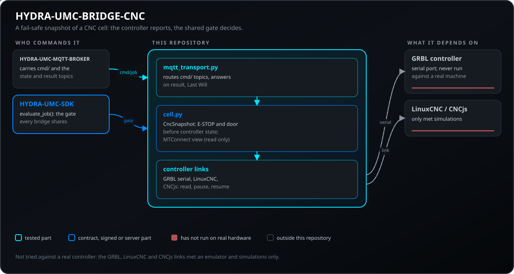
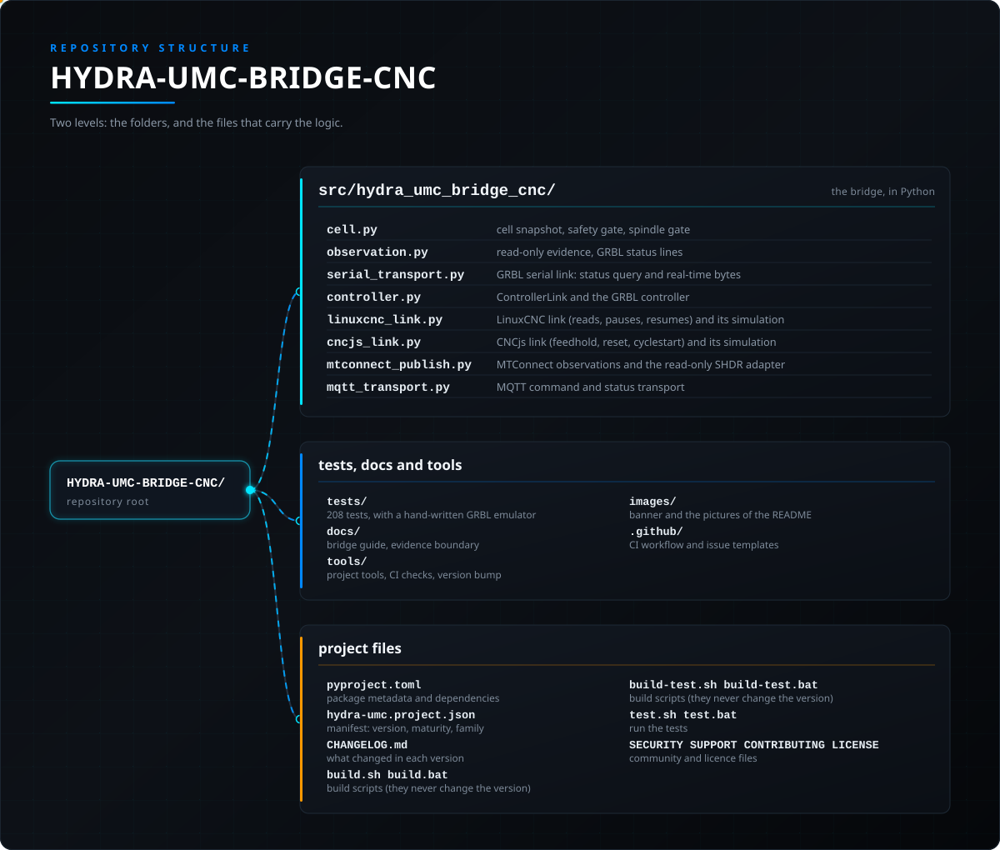

<!-- =============================================================================
HYDRA-UMC-BRIDGE-CNC - CNC cell coordination bridge
Copyright (C) JuanenRac (Electro Hobby 3D) <electrohobby3d@gmail.com>
GPL-3.0-or-later - see LICENSE
============================================================================= -->

<p align="center">
  
</p>

# 🔧 HYDRA-UMC-BRIDGE-CNC

<p align="center"><a href="README.md">🇺🇸 English</a> | <a href="README_spa.md">🇪🇸 Español</a> | <a href="README_fra.md">🇫🇷 Français</a> | <a href="README_ita.md">🇮🇹 Italiano</a> | <a href="README_deu.md">🇩🇪 Deutsch</a> | 🇨🇳 <b>简体中文</b> | <a href="README_jpn.md">🇯🇵 日本語</a> | <a href="README_por.md">🇵🇹 Português</a></p>

### 🛑 面向 CNC 单元的故障安全协调桥接

<p align="center">
  
  
  
  
  
  
</p>

---

> **诚实检查——今天真正可运行的部分：** 故障安全的单元快照与安全门控（`cell.py` 中的 `CncSnapshot`/`CncCellBridge`，每个任务都会经过 `HYDRA-UMC-SDK` 自身真正的 `evaluate_job()`）、只读的 GRBL/MTConnect 证据归一化器（`observation.py`）、真正的 GRBL 串口传输（`serial_transport.py` 中的 `GrblSerialProbe`/`GrblRealtimeControl`），以及 MQTT 命令/状态传输（`mqtt_transport.py`）都是真实的，并由 287 个通过的 `unittest` 用例覆盖（`python tools/build_test.py`），其中包括让该桥接对抗一个协议忠实但纯手写的 GRBL v1.1 模拟器的 `tests/test_grbl_emulator.py`。以上这些都从未接触过真实的串口、真实的 MQTT broker 或真实的 CNC 控制器——`test_serial_transport.py` 自带的 `FakeSerial` 替代了物理连接，`test_mqtt_transport.py` 同样使用了一个伪造的 broker 客户端。LinuxCNC 与 CNCjs 连接以及 MTConnect 视图目前只接触过模拟器，既没有 LinuxCNC HAL 适配器，也没有实时的 `run` 命令，因为还没有驱动过任何真实的控制器——详见下文的"当前状态与后续步骤"（已经如实说明了这一点），以及 `CHANGELOG.md` 中目前具体已交付的内容。 MQTT 传输层也已在开发机器上针对真实的 HYDRA-UMC-MQTT-BROKER 运行过(`tests/test_broker_integration.py`,未安装 broker 时会跳过):QoS 0、1、2 的发布与订阅、保留的可用性及其遗嘱消息,以及 broker 停止后重新启动时的恢复。

> **安全与安防现状:**本生态系统不是经认证的安全系统。目前尚无硬件 E-STOP 通路,没有由固件强制执行的限位或联锁,也没有经过验证的运动指令;固件映像使用 CRC-32 和 Ed25519 签名校验,发布构建会拒绝已公开的开发密钥(中继之后的工具头和扩展板仍运行 URTC 的引导程序,它们使用共享密钥的 HMAC-SHA256 而不是签名);TLS 与双向 TLS 均为可选项,默认关闭;自制电路板尚未组装或测试。在依赖此处任何说法来保障人身安全之前,请先阅读[安全基线](https://github.com/JuanenRac/HYDRA-UMC-DOCS/blob/main/docs/SECURITY_BASELINE.md)和[威胁模型](https://github.com/JuanenRac/HYDRA-UMC-DOCS/blob/main/docs/THREAT_MODEL.md)。

---

## 📋 速览

| | |
|---|---|
| 版本 | `0.2.2` |
| 成熟度 | 可用 |
| 测试 | 287 (`python tools/build_test.py`) |
| 技术栈 | Python / LinuxCNC / G-code / GRBL status evidence / GRBL serial transport |
| 目标 | HYDRA-UMC 工作单元的 Raspberry Pi CM5 |
| 真实硬件 | 仅模拟：使用模拟器、替身或仿真测试；此版本没有在真实硬件上运行的记录 |

**跳转：** [概述](#-概述) · [架构](#-架构) · [功能](#-功能) · [安全与防护](#-安全与防护) · [接口](#-接口) · [配置](#-配置) · [快速开始](#-快速开始) · [测试](#-测试) · [故障排除](#-故障排除) · [仓库结构](#-仓库结构) · [相关项目](#-相关项目)

## 🚦 项目状态

每一行是本仓库的一个部分，灯号表示它今天做到了哪一步。内容依据仓库能够展示的证据（测试、构建、运行），而不是计划。

🟢 已完成并验证 · 🟡 可用，有已知限制 · 🟠 部分完成或尚未验证 · 🔴 未完成或不可用

| 领域 | 状态 | 在这里的含义 |
|---|---|---|
| 软件 | 🟡 | 主要用途可用；上面的诚实性检查列出了仍然缺少的内容 |
| 测试 | 🟢 | 287 项自动测试，每次变更都会运行 |
| 真实硬件 | 🟠 | 仅模拟：使用模拟器、替身或仿真测试；此版本没有在真实硬件上运行的记录 |
| 文档 | 🟢 | 八种语言的 README，每次变更都会与清单核对 |

## 🎯 概述

**HYDRA-UMC-BRIDGE-CNC** 是 CNC 单元与 HYDRA-UMC 机器人辅助设备之间的高层桥接:上料、下料、工件搬运以及受监督的辅助任务。它绝不会成为实时轨迹控制器 —— CNC 控制器(GRBL、LinuxCNC 或 CNCjs 背后的控制器)始终保留对轨迹、主轴和机床限位的控制权。

它属于 **External Automation Bridges** 家族:一组共享 `HYDRA-UMC-SDK` 相同安全契约的兄弟仓库(CNC、LASER、OPENPNP、PRINTER3D、ROS2),因此任何一个桥接都不能自行发明"可以安全工作"的定义。

## 🧩 在 HYDRA-UMC 中的角色

**HYDRA-UMC-BRIDGE-CNC** 位于 CNC 控制器（GRBL、LinuxCNC 或 CNCjs 背后的控制器）与负责上下料的机器人单元之间。轨迹、主轴和限位的决定权始终在控制器；桥接只转述控制器所说的内容，并在任何辅助作业前询问共用关口。

所有桥接都遵循 `HYDRA-UMC-SDK` 的共同安全契约：只有共用的 `evaluate_job()` 关口放行，任务才会被接受，而该关口在失败时保持关闭。父项目是 `HYDRA-UMC-SERVER`；本桥接不调用它，而是通过 `HYDRA-UMC-MQTT-BROKER` 以 MQTT 回应指挥该单元的一方。

| 对话对象 | 方式 | 用途 |
|---|---|---|
| `HYDRA-UMC-SDK` | Python 导入 | 任务关口 `evaluate_job()`、任务与决定的传输格式、串口链路和 MQTT 客户端 |
| `HYDRA-UMC-MQTT-BROKER` | MQTT, `hydra/bridges/cnc/` | 命令输入（`cmd/`），状态与结果输出 |
| GRBL | 串口 | 状态查询 `?` 和实时字节（进给保持、循环恢复、软复位）；绝不发送 G 代码程序 |
| LinuxCNC | Python 模块 `linuxcnc` | 读取 `linuxcnc.stat`；只发送暂停、中止和恢复 |
| CNCjs | socket.io | 监听 `controller:state`；只发送 `feedhold`、`reset`、`cyclestart` |

## 🏛️ 架构

<p align="center">
  
</p>

<details>
<summary>图表的文本版本（Mermaid）</summary>


</details>

**为什么这样构建**

* **为什么先检查急停和门状态,而不是先看控制器自身上报的状态。** `CncSnapshot.machine_state()` 会在检测到 `estop` 或门未关闭时,第一时间短路为 `SAFE_STOP` —— 一个门开着却仍上报 `IDLE` 的控制器,绝不能被照单全收。
* **为什么控制器状态的映射被刻意设计得保守。** 只有字面字符串 `IDLE` 会被映射为 `MachineState.IDLE`。任何无法识别的值都会回落到 `OFFLINE`,绝不会回落到允许辅助工作的状态 —— 未知的控制器状态被当作"不知道"处理,而不是"大概没问题"。
* **为什么桥接会构造一个新的 `BridgeJob` 并委托给共享的 `evaluate_job()`,而不是自己编写接受/拒绝逻辑。** 全部五个 External Automation Bridges(CNC、LASER、OPENPNP、PRINTER3D、ROS2)都复用 `HYDRA-UMC-SDK` 中完全相同的 `bridge_contract`,因此"什么才算安全到可以启动任务"不会在它们之间悄悄产生分歧。
* **为什么 LinuxCNC 和 CNCjs 连接只读取、暂停和恢复。** 控制器始终保留对轨迹、主轴和限位的控制权,程序属于运行它的一方(CNCjs、LinuxCNC 本身):桥接只能让机器停下来,并让已暂停的机器继续,仅此而已。接线真实的 HAL 引脚仍是必须针对真实控制器验证的硬件集成步骤。
* **它如何融入整个生态系统。** BRIDGE-CNC 位于 CNC 控制器与 `HYDRA-UMC-SDK` → `HYDRA-UMC-MQTT-BROKER` → MCU/单元安全之间:它协调围绕 CNC 的辅助机器人工作,而不会取代或凌驾于控制器自身的安全权限之上。

这些观测辅助函数是证据规范化器,而不是控制器适配器:它们不会打开任何 HAL、串口或网络连接。[Controller Evidence Boundary](docs/CONTROLLER_EVIDENCE_BOUNDARY.md) 定义了进行真实控制器集成之前所需的验证。

**作为服务运行。** `python -m hydra_umc_bridge_cnc --config /etc/hydra-umc/bridge-cnc.toml` 从一个 TOML 文件启动桥接：控制器（串口上的 GRBL 板、CNCjs 或 LinuxCNC）、急停和门的信号来源（带有已声明不安全电平的 GPIO 线路，或一个小文件）、与 G 代码发送器共享串口、主轴闸门、MTConnect、MQTT 代理以及单元状态的来源。未知的键会被拒绝，信号来源必须声明其接线，所有情况都失败即关闭：没有来源的信号视为急停被按下或门已打开，信号或单元状态文件缺失、未知或过期时给出不安全的答复。`--check` 校验该文件；`deploy/` 中有 systemd 单元（`Restart=on-failure`）和示例文件。它已针对 GRBL 模拟器和模拟信号运行，尚未在真实机器上运行。

## ✨ 功能

* ✅ **真实的故障安全单元快照:** `cell.py` 中的 `CncSnapshot.machine_state()` 会先检查急停(E-STOP)和门状态,*然后*才查看控制器上报的任何内容 —— 只要急停被触发或门未关闭,状态始终解析为 `SAFE_STOP`,与 `controller_state` 报告的内容无关。*(已实现,并在 `tests/test_cell.py` 中测试)*
* ✅ **真实的共享安全门控:** 每个被观察到的任务都会通过 `HYDRA-UMC-SDK` 的 `bridge_contract` 中的 `evaluate_job()` 重新评估,这与所有兄弟桥接使用的是同一个门控。*(已实现)*
* ✅ **共享串口：** GRBL 板只有一个串口。`multiplexer.py` 可以拥有它并提供一个 TCP 前端（默认仅限回环地址），一次只有一个 G 代码发送端可以连接，而桥接仍保留其状态查询和三个实时字节；桥接绝不会写入其他内容，第二个发送端会被拒绝。默认关闭（`HYDRA_UMC_CNC_PORT_SHARING=multiplexer` 开启；`HYDRA_UMC_CNC_PORT_SHARING_LISTEN` 和 `HYDRA_UMC_CNC_PORT_SHARING_ALLOW_REMOTE` 设置地址）。已用 GRBL 模拟器测试，尚未在真实 GRBL 板上运行。*（已实现，仅模拟）*
* ✅ **保守的状态映射:** 只有 `IDLE` 被视为空闲;`RUN`/`RUNNING`/`JOG`/`HOME` 映射为 `RUNNING`,`FAULT`/`ERROR`/`OFF`/`ALARM` 映射为 `FAULT`,任何无法识别的值都会回落到 `OFFLINE`——绝不会回落到允许生产性工作的状态。(`HOLD` → `HOLDING`; `DOOR` → `SAFE_STOP`) *(已实现)*
* ✅ **只读控制器证据:** `observation.py` 严格规范化本地映射证据和提供的 GRBL 状态行;缺失或非布尔的 E-STOP/门信号会安全失效关闭。*(已实现,在 `tests/test_observation.py` 中测试)*
* ✅ **真实的 GRBL 串行传输:** `serial_transport.py` 的 `GrblSerialProbe` 打开真实的串行连接并查询 GRBL 的实时状态字节(`?`);`GrblRealtimeControl` 只发送 GRBL 自身的实时控制字节(进给保持、循环恢复、软复位)——`cycle_start_resume()` 仅在机器真正处于 `HOLDING` 状态时才被允许,其他命令则始终允许,如 `ABORT`。它从不流式传输 G-code 程序。*(已实现,在 `tests/test_serial_transport.py` 中测试)*
* ✅ **非变更式构建/测试:** `build-test.bat`/`.sh` 编译源码并运行安全门控测试套件,不会触碰版本文件或 CHANGELOG。*(已实现,见下方"构建与发布")*
* ✅ **控制器连接:** 桥接通过 `ControllerLink`(`controller.py`)与控制器通信:桥接自己持有串口的 GRBL(`GrblController`)、LinuxCNC 安装(`linuxcnc_link.py`:读取 `linuxcnc.stat`,仅通过 `linuxcnc.command` 发送暂停、中止和恢复已暂停的程序,绝不运行程序)以及拥有该串口的 CNCjs 服务器(`cncjs_link.py`:读取它广播的 `controller:state`,仅发送 `feedhold`、`reset` 和 `cyclestart`,使桥接与运行程序的发送端并行工作)。恢复始终要求单元为 READY 且机器确实处于暂停状态;过期或缺失的读数绝不等同于空闲的机器。两种连接都针对模拟器测试(`SimulatedLinuxcnc`、`SimulatedCncjs`);都没有接触过真实的 LinuxCNC 或 CNCjs。*(已实现,仅模拟)*
* ✅ **主轴门控:** 当控制器空闲但仍报告主轴在转或进给在动(`FS:`)时,拒绝上料或下料。`HYDRA_UMC_CNC_SPINDLE_GATE` 取值 `off`、`when_known`(默认:拒绝已报告的情况)或 `required`(也拒绝控制器未报告的情况)。快照还携带报告中的位置、工件偏置和倍率。*(已实现)*
* ✅ **MTConnect 视图:** `mtconnect_publish.py` 将快照转换为 MTConnect 观测值(`avail`、`execution`、`estop`、`door`、`spindle_speed`、`path_feedrate`、`system`),由 `ShdrAdapter` 以 SHDR 经 TCP 提供(只读;唯一接受的行是 `* PING`),并在设置 `HYDRA_UMC_CNC_MTCONNECT=1` 时以保留消息发布到 `hydra/bridges/cnc/mtconnect`。不上报的控制器是 `UNAVAILABLE`,绝不是 `READY`。已针对模拟代理测试。*(已实现,尚未用真实代理试过)*
* 🔜 **LinuxCNC HAL 引脚** —— 尚未实现;目前还没有驱动过真实的 CNC 控制器、HAL 引脚或机器人。*(计划中)*
* ✅ **重复的幂等键：** `CncMqttBridge` 接受 `IdempotencyStore`：重复的作业键会得到第一次给出的答复，而不是被重新评估。*（已实现，已在 `tests/test_idempotency.py` 中测试）*
* ✅ **对齐的状态回复、故障安全的串口、加固的 MQTT 循环:** 状态查询会丢弃已在等待的内容,发送 `?`,并一直读取到真正的状态报告(`<...>`)到达:GRBL 未经询问发出的启动横幅、`ok`、`[MSG:...]` 和 `ALARM:n` 不再让之后的每次查询都落后一条回复;缺少 USB 设备(或链路上的任何故障)会以故障安全方式失败,而不是让桥接结束,并且打开端口时不会拉高 DTR;`cmd/feed_hold` 会报告控制器随后的反馈(`controller_state_after`、`confirmed`),`cmd/feed_hold` 和 `cmd/soft_reset` 在独立通道上运行,因此状态查询绝不会拖延它们;过大(超过 16 KiB)、无法读取或深度嵌套的负载以及任何意外故障,都会在结果主题上得到拒绝回复,绝不会终止循环;`cmd/job` 的回复带有 `"mode": "gate-only"`,通过它发出的 ABORT 会说明没有停止任何东西;状态带有 `observed_at`,桥接在带遗嘱(Last Will)的 `availability` 主题上宣告自己。GRBL 只有一个串口:本桥接占用它期间,任何 G-code 发送器都无法使用它(参见 `docs/BRIDGE_GUIDE.md`)。*(已实现,在 `tests/test_hardening.py` 中测试)*
* ✅ **作业经由共享的受理环节:** 对格式错误的作业和重复的 `idempotency_key` 的检查，由 SDK 的 `JobIntake` 完成，而不是此桥接自己的代码(键不再带 `job:` 前缀)。
* ✅ **与请求对应的响应:** 作为 JSON 对象的命令负载可以带一个 `request_id`(最长 64 个字符的普通令牌:字母、数字、`.`、`_`、`:`、`-`)，桥接为该消息发布的每个结果都会带回它，包括为重复幂等键保存的结果。状态主题不变。
* ✅ **跟随全局停止（默认关闭）:** 设置 `HYDRA_UMC_CNC_GLOBAL_STOP=1` 后，桥接读取服务器在 `hydra/swarm/safety/estop` 上的保留通知；通知为 `SAFE_STOP` 或无法读取时，它会带原因拒绝：恢复和任务（中止放行）。停止命令和只读请求照常工作，只有 `READY` 才能解除拒绝。*（已实现，已对真实代理测试；从未与真实服务器一起运行）*

## 🔒 安全与防护

| 威胁 | 防御 | 位置 |
|---|---|---|
| 对处于不安全状态的单元下达任务 | 每个任务都经过共用的 `evaluate_job()` 关口，该关口失败时保持关闭；桥接本身没有接受/拒绝逻辑。急停和门状态先于控制器的报告被读取，门打开或急停始终是 `SAFE_STOP` | `cell.py`, SDK `bridge_contract` |
| 过大的任务数据 | 最多 32 个参数，键最长 64 个字符，值最长 1024，标识符最长 128；超过 16 KiB 的 MQTT 负载会在结果主题上被拒绝 | SDK `bridge_contract`, `mqtt_transport.py` |
| 重复或重放的命令 | `IdempotencyStore` 将每个键记住 24 小时、最多 10 000 条；重复请求得到第一次的答复而不是重新评估。保留的 `cmd/` 消息在重连时被忽略 | SDK `job_intake.py`, `mqtt_transport.py` |
| 机械臂上下料时主轴仍在旋转 | 控制器空闲但报告主轴在转或进给在动时，拒绝 `LOAD` 和 `UNLOAD`；`HYDRA_UMC_CNC_SPINDLE_GATE` 取 `off`、`when_known`（默认，未知值同样处理）或 `required` | `cell.py` |
| 通过远程命令停止或移动机器 | CNCjs 只收到 `feedhold`、`reset`、`cyclestart`，LinuxCNC 只收到暂停、中止和恢复，串口只收到 GRBL 实时字节；恢复需要 READY 的单元和确实处于保持状态的机器。`cmd/feed_hold` 和 `cmd/soft_reset` 在独立通道上运行 | `cncjs_link.py`, `linuxcnc_link.py`, `serial_transport.py`, `mqtt_transport.py` |
| 把过期读数当成机器空闲 | 超过 3 秒的 CNCjs 读数不可信，缺失或过期的状态绝不算空闲，此时门按打开处理；LinuxCNC 命令 2 秒后超时；串口查询失败时保持关闭 | `cncjs_link.py`, `linuxcnc_link.py`, `serial_transport.py` |
| 淹没适配器的 MTConnect 客户端 | SHDR 适配器只读：最多 16 个客户端，每行最长 1024 字节，唯一处理的行是 `* PING` | `mtconnect_publish.py` |

**它绝不做的事：** 绝不流式发送 G 代码程序，绝不在 LinuxCNC 中运行程序，绝不夺走 CNCjs 的串口，也绝不推断证据中没有携带的急停或门状态。参见 `docs/CONTROLLER_EVIDENCE_BOUNDARY.md`。

## 🔌 接口

位于 `hydra/bridges/cnc/` 下的主题（前缀 `TOPIC_PREFIX`）；桥接订阅 `cmd/#`。

| 主题或路由 | 内容 |
|---|---|
| `cmd/status` | 请求单元状态；答复在 `cmd/status/result` |
| `cmd/job` | SDK `job_to_dict()` 形式的 `BridgeJob`；答复是标有 `"mode": "gate-only"` 的 `GateDecision`（它从不动作，因此经此发出的 `ABORT` 会说明什么也没停） |
| `cmd/feed_hold`, `cmd/soft_reset` | 停止命令，在独立通道上处理；答复包含 `controller_state_after` 和 `confirmed` |
| `cmd/cycle_start_resume`, `cmd/start`, `cmd/resume` | 恢复处于保持的机器；除非单元为 READY 且机器确实处于保持，否则拒绝（门事件之后绝不允许） |
| `<verb>/result` | 每个命令一个 JSON 答复，拒绝时为 `{"allowed", "executed", "reason"}` |
| `state`, `availability` | 单元状态（保留，`observed_at` 为纪元毫秒）和 `online`/`offline`（遗嘱消息） |
| `mtconnect` | MTConnect 观测值，保留；仅在 `HYDRA_UMC_CNC_MTCONNECT=1` 时 |

库：`CncCellBridge`、`CncSnapshot`、`CncMqttBridge`、`spindle_gate_from_environment()` 以及三种链路（`GrblController`、`LinuxcncController`、`CncjsController`）。

## ⚙️ 配置

| 变量 | 默认值 | 设置内容 |
|---|---|---|
| `HYDRA_UMC_CNC_SPINDLE_GATE` | `when_known` | `off`、`when_known` 或 `required`；未设置或未知值等同于 `when_known` |
| `HYDRA_UMC_CNC_MTCONNECT` | 关闭 | `1` 会把 MTConnect 观测值发布到 `hydra/bridges/cnc/mtconnect` |
| `HYDRA_UMC_CNC_GLOBAL_STOP` | 关闭 | `1` 跟随服务器的全局停止：只要保留主题 `hydra/swarm/safety/estop` 上最新的通知是 `SAFE_STOP`（或无法读取），桥接就会带原因拒绝：恢复和任务（中止放行）；只有 `READY` 才能解除。`HYDRA_UMC_CNC_GLOBAL_STOP_TOPIC` 可更改主题，`HYDRA_UMC_CNC_GLOBAL_STOP_STRICT=1` 会在收到第一条通知之前也拒绝 |
| `HYDRA_MQTT_USERNAME` | 无 | MQTT 用户名；代理将其绑定到客户端 ID 前缀 |
| `HYDRA_MQTT_PASSWORD` | 无 | 密码；只能与用户名一起使用 |
| `HYDRA_MQTT_PASSWORD_FILE` | 无 | 从文件读取的密码（Docker 或 systemd 机密）；设置了 `HYDRA_MQTT_PASSWORD` 时忽略 |
| `HYDRA_MQTT_TLS_CA` | 无 | 签署代理证书的 CA 文件：连接使用 TLS 并验证证书 |
| `HYDRA_MQTT_TLS` | 关闭 | `1` 启用 TLS，并用系统信任的 CA 验证 |
| `HYDRA_MQTT_TLS_CERT` / `HYDRA_MQTT_TLS_KEY` | 无 | 用于要求双向 TLS 的代理的客户端证书及其密钥；两者都需要 |

控制器链路在代码中选择：对 LinuxCNC 或 CNCjs 向 `CncMqttBridge` 传入 `controller=`，否则桥接持有一个 GRBL 串口连接。持有期间没有 G 代码发送程序能使用该端口（见 `docs/BRIDGE_GUIDE.md` 的 “One serial port”）。

## 🚀 快速开始

需要 Python 3.11 或更高版本。测试和构建脚本期望 `HYDRA-UMC-SDK` 位于本仓库旁边（`../HYDRA-UMC-SDK`），或由 `HYDRA_UMC_SDK_ROOT` 指定。

无需硬件即可试用（用模拟器和替身检查整个桥接）：

```bash
py -3 tools/build_test.py          # Windows
python3 tools/build_test.py         # Linux, macOS
build-test.bat  /  bash build-test.sh   # the same, through the scripts
```

启动服务（没有控制台脚本：服务就是 MQTT 传输的 `run_forever()`，由你自己的启动代码调用）：

```python
from hydra_umc_bridge_cnc.mqtt_transport import CncMqttBridge, run_forever
# `connection` is an open GRBL serial connection (open_serial_port()), or pass controller=...
bridge = CncMqttBridge(connection)
run_forever(bridge, host="192.168.0.180")   # connects to the broker and serves cmd/# forever
```

用户名、密码和 TLS 文件来自 `HYDRA_MQTT_*` 变量（见“配置”）；上面的代码本身不需要凭据。

## 🧪 测试

运行 `python tools/build_test.py` 会执行 287 个自动 `unittest` 用例（同时编译每个模块）。测试不需要硬件、网络或可选软件包：需要 `paho-mqtt`、`pyserial` 或厂商库的用例使用替身，缺少软件包时则跳过。

| 测试文件 | 测试数 | 覆盖内容 |
|---|---|---|
| `test_cell.py` | 10 | 安全空闲时接受、门开时拒绝、转发中止 |
| `test_controllers.py` | 63 | 主轴门、针对模拟的 LinuxCNC 和 CNCjs 链路、MTConnect 视图 |
| `test_serial_transport.py` | 29 | 针对假端口的串口传输，包括失败即关闭的路径 |
| `test_mqtt_transport.py`, `test_mqtt_environment.py` | 28 + 4 | 针对假代理客户端的命令与状态形态；环境中的凭据和 TLS 会传到客户端 |
| `test_grbl_emulator.py`, `grbl_emulator.py` | 17 | 针对手写、忠实于协议的 GRBL v1.1 模拟器的桥接 |
| `test_hardening.py`, `test_edge_cases.py`, `test_idempotency.py`, `test_observation.py` | 25 + 20 + 3 + 7 | 对齐的状态答复、断线、进给保持确认、恶意负载、重复键、缺失证据 |
| `test_global_stop.py`, `test_global_stop_broker.py` | 17 + 5 | 全局停止的守卫及其附带原因的拒绝，以及在空闲本地端口上对真实代理的同样测试（QoS 0、1、2 的通告，连接时遵从保留的停止，无法读取的通告按故障关闭处理） |
| `test_broker_integration.py`, `broker_harness.py` | 7 | 在空闲本地端口上对真实 HYDRA-UMC-MQTT-BROKER 的 MQTT 客户端测试：通过客户端下发的指令、保留状态与遗嘱，以及代理掉线再恢复后的回路；缺少 Node.js、`paho-mqtt` 或已安装的代理（`HYDRA_UMC_TEST_BROKER_DIR`，默认是相邻文件夹）时会自动跳过 |
| `test_result_qos.py` | 4 | 对命令的每个应答都以 QoS 1 发布（`cmd/<verb>/result`），也在真实代理上测试 |

CI 运行 `HYDRA_UMC_CI=1 python tools/ci_validate.py`，检查清单、文档、八个 README 和图片，并使用 SDK 副本运行测试。

## 🏗️ 构建与发布

需要 Python 3.11+。`tools/build_test.py` 期望 `HYDRA-UMC-SDK` 作为兄弟目录被检出(`../HYDRA-UMC-SDK`),或通过环境变量 `HYDRA_UMC_SDK_ROOT` 指定。

```bash
# Windows
build-test.bat      # 仅验证 —— 不改变版本/CHANGELOG
build.bat            # 先验证,成功后更新版本 + CHANGELOG

# Linux/macOS
bash build-test.sh
bash build.sh
```

`build-test` 使用 `py_compile` 编译 `src/` 下的每个模块,并运行在 `tests/` 下发现的完整 `unittest` 套件(`test_cell.py`、`test_observation.py`、`test_serial_transport.py`、`test_mqtt_transport.py`、`test_grbl_emulator.py`、`test_hardening.py`、`test_idempotency.py`、`test_mqtt_environment.py`——共 287 个测试),证明安全空闲准入、开门拒绝和中止转发等均按预期工作 —— 它绝不会修改仓库。`build` 会先运行同样的验证,只有成功后才调用 `tools/bump_version.py`,在 `pyproject.toml`、`hydra-umc.project.json` 和 `CHANGELOG.md` 之间同步版本号。目前尚无真正的 CNC `run` 命令 —— 这需要经过验证的控制器集成。

## 🩺 故障排除

| 你看到 | 原因 | 处理 |
|---|---|---|
| `ModuleNotFoundError: hydra_umc_sdk` | 未安装 SDK，且不在本仓库旁边 | 把 `HYDRA-UMC-SDK` 克隆到本仓库旁边，或设置 `HYDRA_UMC_SDK_ROOT` |
| `paho-mqtt is not installed` | MQTT 客户端是可选附加包 | `pip install ".[mqtt]"`（需要 `paho-mqtt` 2.1 或更高，低于 3） |
| `password was given without a username` | MQTT 凭据需要两部分 | 除密码外还要设置 `HYDRA_MQTT_USERNAME` |
| `spindle_gate must be one of ...` | `HYDRA_UMC_CNC_SPINDLE_GATE` 的值代码不认识 | 使用 `off`、`when_known` 或 `required`（在代码中传入会抛出异常；来自环境变量的未知值会回退到 `when_known`） |
| `a serial connection or a controller link is required` | 创建 `CncMqttBridge` 时两者都没有给 | 传入已打开的串口连接或 `controller=` |
| `"allowed": false` + `reason` | 共用关口或某项保护拒绝了命令 | 阅读 `reason`：门开、急停、机器非空闲、主轴在转或读数过期；先排除原因，不要盲目重试 |

## 📂 仓库结构

<p align="center">
  
</p>

<details>
<summary>目录树的文本版本</summary>

```text
HYDRA-UMC-BRIDGE-CNC/
├── src/hydra_umc_bridge_cnc/
│   ├── cell.py                    单元快照、安全门、主轴门
│   ├── observation.py             只读证据、GRBL 状态行
│   ├── serial_transport.py        GRBL 串口链路：状态查询与实时字节
│   ├── controller.py              ControllerLink 与 GRBL 控制器
│   ├── linuxcnc_link.py           LinuxCNC 链路（读取、暂停、恢复）及其模拟
│   ├── cncjs_link.py              CNCjs 链路（feedhold、reset、cyclestart）及其模拟
│   ├── multiplexer.py             串口多路复用器：桥接与 G 代码发送端共用一个 GRBL 串口
│   ├── mtconnect_publish.py       MTConnect 观测值与只读 SHDR 适配器
│   └── mqtt_transport.py          MQTT 命令与状态传输
├── tests/                         238 项测试（含手写 GRBL 模拟器）
├── deploy/                        systemd 单元和示例配置
├── docs/                          桥接指南、证据边界
├── tools/                         构建与测试运行器、版本提升、CI 校验、README 与图片的生成和检查
├── images/                        横幅图与 README 的图片
├── .github/                       CI 工作流和 Issue 模板
├── pyproject.toml                 包元数据与依赖
├── hydra-umc.project.json         清单：版本、成熟度、系列
├── CHANGELOG.md                   每个版本的变化
├── build.sh build.bat             构建脚本（从不改变版本）
├── build-test.sh build-test.bat   构建脚本（从不改变版本）
├── test.sh test.bat               运行测试
└── SECURITY.md SUPPORT.md CONTRIBUTING.md CODE_OF_CONDUCT.md LICENSE LICENSE.md
```

</details>

## 🗺️ 路线图与已知限制

**当前已知限制**

**目前真实的部分:** 版本 `0.2.2`,一个已在本地测试过的故障安全单元协调器(`CncSnapshot` + `CncCellBridge`),依托 `HYDRA-UMC-SDK` 的共享任务门控,包含严格的只读控制器证据标准化,覆盖 GRBL v1.1 完整的真实状态词汇表,包括真实的 `Hold:N`/`Door:N` 子状态(`Idle`/`Run`/`Jog`/`Home`/`Hold`/`Alarm`/`Door`)以及 MTConnect 执行状态,一个真实的串行传输层(`GrblSerialProbe`/`GrblRealtimeControl`),可通过真实连接查询状态并发送 GRBL 自身的实时控制字节——门锁/急停的实时读取现在发生在该查询自身的阻塞式往返完成之后,而不是之前;真实的短写入或零字节写入会被报告为未执行,而不是虚假的成功——配有确定性的287项 `unittest` 测试套件,以及已接入 CI 并带 SDK 检出的非变更式 build-test 脚本。

**集成边界:** CNC 控制器(GRBL、LinuxCNC 或 CNCjs 背后的控制器)始终保留对轨迹、主轴和机床限位的控制权;本桥接只负责门控*辅助*机器人工作,绝不涉及控制器自身的运动。

**仍待完成:** 目前还没有驱动过真实的 CNC 控制器、LinuxCNC HAL 引脚或机器人 —— 选择并验证具体的 HAL 适配器,是一个只有在拿到机器及其文档化接口之后才会进行的软硬件集成步骤。

## 🌍 语言

本 README 和仓库文档提供八种语言：英语、西班牙语、德语、法语、意大利语、日语、中文和葡萄牙语（葡萄牙）。它们同时编写，并由 CI 检查八个文件拥有相同的章节和相同的链接。 本仓库没有自己的界面或消息目录，因此没有需要翻译的界面文字。

## 🔗 相关项目

本项目是同一作者(JuanenRac / Electro Hobby 3D)打造的 HYDRA-UMC 机器人生态系统的一部分。值得了解,因为某个请求实际上可能是关于这些项目之一,而非本仓库本身。

**父项目**
- **[HYDRA-UMC-SERVER](https://github.com/JuanenRac/HYDRA-UMC-SERVER)** — 每个控制客户端真正通信的真实无头后端(REST/WebSocket);本桥接不会调用它,而是通过 HYDRA-UMC-MQTT-BROKER 以 MQTT 回应指挥单元的一方。

**兄弟项目** —— 同样与 HYDRA-UMC-SERVER 自身 API 通信,各自作为独立客户端
- **[HYDRA-UMC-STUDIO](https://github.com/JuanenRac/HYDRA-UMC-STUDIO)** — 具有实时多机器人 3D 可视化的网页控制面板。
- **[HYDRA-UMC-SUITE](https://github.com/JuanenRac/HYDRA-UMC-SUITE)** — 面向多台服务器的桌面(PySide6)集群指挥中心，打包为独立可执行文件。
- **[HYDRA-UMC-ANDROID-CONTROL](https://github.com/JuanenRac/HYDRA-UMC-ANDROID-CONTROL)** — 具有生物识别登录和配对 Wear OS 伴侣应用的原生 Android 控制应用。
- **[HYDRA-UMC-IOS-CONTROL](https://github.com/JuanenRac/HYDRA-UMC-IOS-CONTROL)** — 具有实时 WebSocket 同步的 iOS/iPadOS 控制应用(Flutter)。
- **[HYDRA-UMC-DSI](https://github.com/JuanenRac/HYDRA-UMC-DSI)** — 面向机载 7 英寸 DSI 触摸屏的原生触控界面，直接嵌入 CM5 本体。
- **[HYDRA-UMC-BRIDGE-AMR](https://github.com/JuanenRac/HYDRA-UMC-BRIDGE-AMR)** — 通过 VDA 5050 MQTT 发布者为 AGV/AMR 车队提供的协调边界(仅针对仿真车队测试)。
- **[HYDRA-UMC-BRIDGE-DROIDS](https://github.com/JuanenRac/HYDRA-UMC-BRIDGE-DROIDS)** — 面向足式/人形机器人的协调边界,带有 Boston Dynamics Spot 指令发送器(仅针对模拟器测试)。
- **[HYDRA-UMC-BRIDGE-LASER](https://github.com/JuanenRac/HYDRA-UMC-BRIDGE-LASER)** — 读取 3 路钥匙/外壳/联锁 GPIO 信号的激光单元协调器(仅针对模拟芯片测试;无法使激光器上膛或发射)。
- **[HYDRA-UMC-BRIDGE-OPENPNP](https://github.com/JuanenRac/HYDRA-UMC-BRIDGE-OPENPNP)** — 面向 OpenPnP 贴片机板级流程的安全高层协调器。
- **[HYDRA-UMC-BRIDGE-PRINTER3D](https://github.com/JuanenRac/HYDRA-UMC-BRIDGE-PRINTER3D)** — 面向 Moonraker/Klipper 3D 打印机的安全协调边界，具备真实的受控作业指令。
- **[HYDRA-UMC-BRIDGE-ROS2](https://github.com/JuanenRac/HYDRA-UMC-BRIDGE-ROS2)** — 带有惰性导入 rclpy ROS 2 传输层的协调器(尚未在 ROS 2 环境中运行)。
- **[HYDRA-UMC-BRIDGE-UAV](https://github.com/JuanenRac/HYDRA-UMC-BRIDGE-UAV)** — 面向搭载摄像头的无人机的协调边界,带有 MAVLink 指令发送器(仅针对模拟器测试)。

**直接相关**
- **[HYDRA-UMC-SDK](https://github.com/JuanenRac/HYDRA-UMC-SDK)** — 每个桥接都据此校验自身指令的共享 JSON-Schema 契约与软件作业门限边界(并非经认证的安全功能)。
- **[HYDRA-UMC-CONNECTOR-HUB](https://github.com/JuanenRac/HYDRA-UMC-CONNECTOR-HUB)** — 面向外部机器连接器的声明式适配器清单注册与校验工具；把 SDK 自身的契约理念扩展到外部机器，而不取代工业网关类项目。
- **[HYDRA-UMC-MQTT-BROKER](https://github.com/JuanenRac/HYDRA-UMC-MQTT-BROKER)** — `mqtt_transport.py` 为本桥接自身 `hydra/bridges/cnc/...` 主题提供的真实传输——状态加上 jog/reset/resume 控制字节,以及共享的作业门限;详见该仓库自身的 `docs/BRIDGE_TOPICS.md`。
- **[HYDRA-UMC-HIL-BRIDGE](https://github.com/JuanenRac/HYDRA-UMC-HIL-BRIDGE)** — 面向真实控制器集成的未来硬件在环验证路径。

**生态系统中的其他项目**

*核心硬件与平台*
- **[HYDRA-UMC](https://github.com/JuanenRac/HYDRA-UMC)** — 机器人手臂主板设计——CM5 主机 + 双核 STM32H745,目标是通过 CAN-OTA/SPI-OTA 协调最多 8 条工具臂(固件处于早期阶段,尚无已组装的电路板)。
- **[HYDRA-UMC-OS](https://github.com/JuanenRac/HYDRA-UMC-OS)** — 面向 CM5 的可复现 Raspberry Pi OS 产品层——只读代理、经过验证的配置/配置文件、WiFi 首次配网。

*核心后端与客户端*
- **[HYDRA-UMC-EDITOR-URDF](https://github.com/JuanenRac/HYDRA-UMC-EDITOR-URDF)** — 将完成的模型推送到 STUDIO 自身目录的桌面版图形化 URDF 创建/编辑工具。
- **[HYDRA-UMC-EDITOR-STL](https://github.com/JuanenRac/HYDRA-UMC-EDITOR-STL)** — 桌面 STL 模型编辑器，在 HYDRA-UMC-EDITOR-URDF 编辑的同一模型目录中变换/替换/移除/添加真实部件。

*URTC 工具平台*
- **[URTC](https://github.com/JuanenRac/URTC)** — 面向实体 Universal Robot Tool Controller 板卡的固件，通过 CAN 总线支持 25 种以上工具配置。
- **[URTC-FLASHER](https://github.com/JuanenRac/URTC-FLASHER)** — 面向 URTC 板卡的桌面图形烧录工具，支持 CAN-OTA 以及全芯片 SWD/JTAG。
- **[URTC-TESTER](https://github.com/JuanenRac/URTC-TESTER)** — 面向 URTC 板卡的桌面实时 CAN 总线诊断工具，每种工具配置对应一个面板。
- **[URTC-WEB-STUDIO](https://github.com/JuanenRac/URTC-WEB-STUDIO)** — 通过 Web Serial API 实现的浏览器版 URTC-TESTER 替代方案，无需本地安装。
- **[URTC-GATEWAY](https://github.com/JuanenRac/URTC-GATEWAY)** — URTC CAN 总线前的网关：允许的标识符列表、速率限制和会话密钥；软件已在计算机上测试，尚未在真实总线上测试。

*视觉 AI 节点(Hailo-8)*
- **[HYDRA-UMC-VISION-NODE](https://github.com/JuanenRac/HYDRA-UMC-VISION-NODE)** — 面向 Hailo-8 视觉流水线的集成中枢，具备逐阶段的真实硬件就绪检测。
- **[HYDRA-UMC-DETECTION-HEF](https://github.com/JuanenRac/HYDRA-UMC-DETECTION-HEF)** — 具备 Hailo 架构/校验和安全加载验证的真实编译模型注册表。
- **[HYDRA-UMC-VISION-STREAMER](https://github.com/JuanenRac/HYDRA-UMC-VISION-STREAMER)** — 具备真实 HailoRT 集成边界的真实 GStreamer 流水线 + MediaMTX 配置生成器。
- **[HYDRA-UMC-VISUAL-SERVOING-API](https://github.com/JuanenRac/HYDRA-UMC-VISUAL-SERVOING-API)** — 以区域状态为授权条件的 Position-Based Visual Servoing 修正律;尚无摄像头位姿估计。
- **[HYDRA-UMC-SAFETY-ZONES](https://github.com/JuanenRac/HYDRA-UMC-SAFETY-ZONES)** — 从文件读取物体位置的 v0 区域入侵、校准新鲜度与 E-STOP 请求逻辑;没有检测器为其供数,也尚未连接任何物理 E-STOP。

*认知 AI 节点(Hailo-10)*
- **[HYDRA-UMC-COGNITIVE-NODE](https://github.com/JuanenRac/HYDRA-UMC-COGNITIVE-NODE)** — 面向 Hailo-10 认知流水线(LLM/VLA/语音编排)的集成中枢。
- **[HYDRA-UMC-VLA-ENGINE](https://github.com/JuanenRac/HYDRA-UMC-VLA-ENGINE)** — 面向 Vision-Language-Action 模型的真实动作 token 编解码与轨迹生成。
- **[HYDRA-UMC-VOICE-UI](https://github.com/JuanenRac/HYDRA-UMC-VOICE-UI)** — 具备受限、需确认的 Watch 中继的真实语音前端(VAD + 意图解析)。
- **[HYDRA-UMC-SEMANTIC-PLANNER](https://github.com/JuanenRac/HYDRA-UMC-SEMANTIC-PLANNER)** — 基于真实规则的任务分解，以及针对 MCU 错误码的语义化错误恢复。
- **[HYDRA-UMC-DOCS-QA](https://github.com/JuanenRac/HYDRA-UMC-DOCS-QA)** — 面向本生态系统自身 Markdown 文档的真实纯标准库 TF-IDF 文档检索。
- **[HYDRA-UMC-LOCAL-TECHNICIAN](https://github.com/JuanenRac/HYDRA-UMC-LOCAL-TECHNICIAN)** — 面向生态系统自身的本地、按策略门控的 AI 维护技师——观察、诊断并提出修复建议;两个最高风险等级目前特意尚未实现。

*编排与集群*
- **[HYDRA-UMC-ORCHESTRATOR](https://github.com/JuanenRac/HYDRA-UMC-ORCHESTRATOR)** — 具备真实 gRPC/Protobuf 健康报告契约与任务状态机的集成中枢。
- **[HYDRA-UMC-JOB-DISPATCHER](https://github.com/JuanenRac/HYDRA-UMC-JOB-DISPATCHER)** — 基于真实 HTTP API 的真实优先级任务队列，支持去重。
- **[HYDRA-UMC-NODE-HEALING](https://github.com/JuanenRac/HYDRA-UMC-NODE-HEALING)** — 具备重试/退避与身份不匹配检测的真实基于 gRPC 的车队健康看门狗。
- **[HYDRA-UMC-PATH-PLANNER-3D](https://github.com/JuanenRac/HYDRA-UMC-PATH-PLANNER-3D)** — 具备真实障碍物/工作空间碰撞校验的真实基于 RRT 的三维路径规划器。
- **[HYDRA-UMC-SWARM-SYNC](https://github.com/JuanenRac/HYDRA-UMC-SWARM-SYNC)** — 经过多单元收敛属性测试的真实 CRDT LWW-Element-Map 状态同步。

*数字孪生与仿真*
- **[HYDRA-UMC-TWIN](https://github.com/JuanenRac/HYDRA-UMC-TWIN)** — 面向数字孪生引擎的集成中枢，具备真实的版本兼容性同步契约。
- **[HYDRA-UMC-PHYSICS-REPLICA](https://github.com/JuanenRac/HYDRA-UMC-PHYSICS-REPLICA)** — 面向真实 URDF 子集的真实正向运动学与关节限位校验。
- **[HYDRA-UMC-SYNTHETIC-DATA-GEN](https://github.com/JuanenRac/HYDRA-UMC-SYNTHETIC-DATA-GEN)** — 具备 YOLO/COCO 标注导出功能的真实程序化 2D 场景生成器。

*数据与分析*
- **[HYDRA-UMC-DATALAKE](https://github.com/JuanenRac/HYDRA-UMC-DATALAKE)** — 具备真实数据摄入/查询 HTTP API 的真实 sqlite3 时序数据存储。
- **[HYDRA-UMC-ANOMALY-DETECTOR](https://github.com/JuanenRac/HYDRA-UMC-ANOMALY-DETECTOR)** — 具备漂移监测能力的真实 FFT + 统计基线异常检测器。
- **[HYDRA-UMC-PRODUCTION-REPORTS](https://github.com/JuanenRac/HYDRA-UMC-PRODUCTION-REPORTS)** — 基于 DATALAKE 历史数据的真实 OEE/可用率计算，支持可复现的 CSV 导出。
- **[HYDRA-UMC-TELEMETRY-COLLECTOR](https://github.com/JuanenRac/HYDRA-UMC-TELEMETRY-COLLECTOR)** — 面向 DATALAKE 的真实 CAN/WebSocket 数据摄入管道，支持序列去重。

*工业网关*
- **[HYDRA-UMC-GATEWAY-INDUSTRIAL](https://github.com/JuanenRac/HYDRA-UMC-GATEWAY-INDUSTRIAL)** — 中继至工业协议的集成中枢，具备真实的指令白名单/背压控制层。
- **[HYDRA-UMC-OPCUA-SERVER](https://github.com/JuanenRac/HYDRA-UMC-OPCUA-SERVER)** — 经真实二进制协议客户端会话验证的真实 OPC-UA 地址空间。
- **[HYDRA-UMC-MTCONNECT-ADAPTER](https://github.com/JuanenRac/HYDRA-UMC-MTCONNECT-ADAPTER)** — 具备降级模式输出的真实 MTConnect `/probe` 与 `/current` XML 端点。

*辅助工具与生态系统运维*
- **[HYDRA-UMC-DASHBOARD-AI](https://github.com/JuanenRac/HYDRA-UMC-DASHBOARD-AI)** — 基于 DATALAKE/ANOMALY-DETECTOR 的智能摘要与异常高亮面板，具备诚实的统计回退机制。
- **[HYDRA-UMC-TOOL-CLI](https://github.com/JuanenRac/HYDRA-UMC-TOOL-CLI)** — 具备真实、稳定退出码契约的车队 CLI，是 HYDRA-UMC-SERVER 自身 API 的真实在线客户端。
- **[HYDRA-UMC-WATCH](https://github.com/JuanenRac/HYDRA-UMC-WATCH)** — 带有触觉提醒模式与配对手机语音中继的 WearOS 伴侣应用(尚未在实体手表上运行)。
- **[URTC-SMART-RACK](https://github.com/JuanenRac/URTC-SMART-RACK)** — 面向板卡安装机架的固件，具备真实的工具 ID 解码与 Smart Idle 预热逻辑。
- **[URTC-VISION-TOOL](https://github.com/JuanenRac/URTC-VISION-TOOL)** — 面向热成像/RGB 检测工具头的固件及真实 Python 视觉伴侣程序。
- **[HYDRA-UMC-UPDATER](https://github.com/JuanenRac/HYDRA-UMC-UPDATER)** — 发现、克隆并更新本生态系统中每个仓库的管理类桌面工具。
- **[HYDRA-UMC-OS-REBUILDER](https://github.com/JuanenRac/HYDRA-UMC-OS-REBUILDER)** —— 构建即刻可烧录、预装生态系统最新版本的 CM5 镜像的 Windows/Linux 桌面工具,具备类似 Raspberry Pi Imager 风格的首次启动 Wi-Fi/用户/SSH 配置。
- **[HYDRA-UMC-OPS-AGENT](https://github.com/JuanenRac/HYDRA-UMC-OPS-AGENT)** — 维护事件协调器：一个低权限的边缘角色采集经过脱敏的库存/健康快照，一个控制面角色以只读方式渲染它，并请求某个 AI 提供方给出诊断建议——从不应用补丁，也从不部署任何内容。
- **[HYDRA-UMC-DEV-SERVER](https://github.com/JuanenRac/HYDRA-UMC-DEV-SERVER)** — 可复现的开发主机（Raspberry Pi 5 / CM5），保存整个生态系统的源代码，并在持久队列下运行有界的构建/测试任务；这是专用的开发角色，明确区别于运行中的 CM5。

## 📚 文档

更多阅读：

* [docs/BRIDGE_GUIDE.md](docs/BRIDGE_GUIDE.md) - 范围、控制器链路、主轴门、MTConnect 视图、唯一的串口、脚本
* [docs/CONTROLLER_EVIDENCE_BOUNDARY.md](docs/CONTROLLER_EVIDENCE_BOUNDARY.md) - 什么算真实的安全证据，以及桥接拒绝推断的内容
* [生态系统的安全基线](https://github.com/JuanenRac/HYDRA-UMC-DOCS/blob/main/docs/SECURITY_BASELINE.md)
* [生态系统的威胁模型](https://github.com/JuanenRac/HYDRA-UMC-DOCS/blob/main/docs/THREAT_MODEL.md)
* [本仓库的更新日志](CHANGELOG.md)
* [本仓库的许可证](LICENSE.md)

## 🤝 参与贡献与社区

* 提交 pull request 之前，请运行 `HYDRA_UMC_CI=1 py -3 tools/ci_validate.py`（或 `HYDRA_UMC_CI=1 python3 tools/ci_validate.py`）：它必须输出 `CI_VALIDATION=PASS`。此检查不要运行 `build.sh` 或 `build.bat`；构建不是检查。
* 八个 README 由 HYDRA-UMC-DOCS 中的同一个源生成；请勿手工编辑。修改源文件，再用 `tools/make_readmes.py` 重新生成。
* 不要在 README 中声称尚未运行过的内容：属实时请写“仅模拟”或“尚未在硬件上试过”。
* 请参阅 [CONTRIBUTING.md](CONTRIBUTING.md)、[行为准则](CODE_OF_CONDUCT.md)、[SECURITY.md](SECURITY.md) 和 [SUPPORT.md](SUPPORT.md)。

## 👤 作者

**JuanenRac (Electro Hobby 3D)** · electrohobby3d@gmail.com

## 📜 许可证

GPL-3.0-or-later - [LICENSE](LICENSE).
